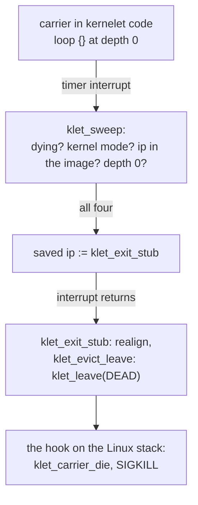

# Stopping a kernelet

However a kernelet ends, every carrier stops, everything the kernelet held goes back, and Linux is left exactly as it was. A kernelet ends in one of three ways: its kernel asks to, by powering off; its kernel fails, with a panic nothing catches; or the host decides, because the operator killed it. The hard case is a carrier that is running kernelet code and will not come out.

## The shape of a death

1. The kernelet is **marked** stopped or dying, which is a single store.
2. Every carrier is **stopped**, at a point where it holds nothing of Linux's.
3. When no carrier is left, the sandbox has **exited**: what the kernelet held goes back and the holder can read the exit record from the sandbox descriptor.

A kernelet's state is abandoned, not tidied: nothing is unwound and no destructor runs, because tidying would mean running the tenant's kernel on the host's behalf at the moment it is least trusted. Once a carrier has left the image for good, no code from it runs on that carrier again, and the endovisor never runs kernelet code on the host's behalf. What the endovisor gave the kernelet it takes back as a whole, without looking inside: the address spaces, every heap block the kernelet still held, which the endovisor tracks in a table of its own, and the pool of kernelet stacks.

## Stopping from inside

Both the kernel proper's `poweroff` and a panic in the kernelet end in the service `stop`, which marks the instance dying and kills every carrier, its caller included. On the endovisor's side it records the exit code for the holder to read from the sandbox descriptor, marks the instance as dying, sends `SIGKILL` to every carrier, the caller included, and arms the eviction sweep of the end of this chapter; then the calling carrier leaves its kernelet stack for the last time.

*Simplified from `prototype/linux/endovisor/carrier.c`: `klet_stop_instance`, `klet_svc_stop`, `klet_carrier_die`.*

```c
void klet_stop_instance(struct klet_inst *inst, u64 code)
{
	inst->stopped = true;
	pr_info("kernelet: stopped, exit code %llu\n", code);
	klet_end(inst, KLET_END_EXITED, code, 0);    /* every end of a sandbox goes through klet_end: the next section shows it */
}

static void klet_svc_stop(u64 code)              /* the service, called by the kernelet */
{
	klet_svc_enter(KLET_SVC_STOP, code, 0, 0);   /* klet_stop_instance, on the Linux stack */
	for (;;)
		klet_leave(c, KLET_DEAD);                /* abandon this kernelet stack for good */
}

static void klet_carrier_die(struct klet_carrier *c)
{
	klet_detach(c);                              /* current->carrier_hooks = NULL; free the stack and the records */
	if (!fatal_signal_pending(current))
		force_sig(SIGKILL);                      /* a user task can only end by Linux's own exit path */
}
```

A carrier that leaves for good dies as any process does, by a fatal signal Linux acts on. `klet_leave` with the state `DEAD` switches to the Linux stack and lands, as always, inside whichever hook entered the kernelet. That hook sees the state and calls `klet_carrier_die`, which clears the task's hooks pointer and lets Linux kill it. Linux offers a module no direct way to end a task that is not a kernel thread, so a carrier ends as any process does, by a fatal signal acted on in the exit loop; clearing it first keeps the hooks from running on a task that no longer carries anything.

Where each carrier is at the moment of the mark decides what stops it:

| the carrier is | what stops it |
|---|---|
| in user mode | Linux's signal handling: the carrier enters the exit loop, the resume hook sees the mark and dies |
| asleep in a service (`vcpu_idle`, or `vm_wait`, where a memory service waits for a lock) | the sleep is *killable*, so `SIGKILL` wakes it; on the way back, the service body finds the signal pending and **dooms** the carrier, and the stub leaves for good instead of returning into kernelet code |
| running a service | the same: the service completes, and the stub leaves for good |
| **running kernelet code** | nothing in Linux's exit path can reach it: **eviction**, below |

## Stopping from outside

A carrier killed from outside is noticed through its lifeline, which Linux closes when the carrier's process exits. The operator kills a carrier, or the out-of-memory killer does, or the holder does it (`make probe`, at the end of this chapter): `kill(pid, SIGKILL)` on a carrier's process id. The carrier dies in Linux's exit path if the signal finds it in user mode, and Linux closes its descriptors, among them its lifeline; where Linux's exit path cannot reach it, the endovisor looks for the signal itself, as the end of this section shows. The lifeline's release is the endovisor's notice:

*Simplified from `prototype/linux/endovisor/carrier.c`: `klet_carrier_lifeline_closed`.*

```c
void klet_carrier_lifeline_closed(struct klet_carrier *c)
{
	/* release what a carrier killed in user mode never detached: its stack, its empty address space */
	list_del_init(&c->link);
	live = !inst->dying;                         /* the sandbox was running when this carrier died */
	last = atomic_dec_and_test(&inst->nr_carriers);
	if (!live)
		klet_check_exited_locked(inst, &claim);  /* the last carrier of a dying sandbox: its exit is this caller's to run */
	if (live)
		klet_end(inst, KLET_END_KILLED, 0, KLET_KILLED_CARRIER_LOST);   /* a carrier's death is the sandbox's death */
	else if (claim)
		klet_sandbox_exited(inst);               // Release the address spaces, heap blocks and stack pool; wake exit-record readers.
	if (c->task == current) {                    /* undo its attachment, which only its own task may do */
		current->carrier_hooks = NULL;
		klet_sched_detach(c);
	}
	if (!c->pnotifier_on && c->task->carrier_hooks != &c->hooks)
		klet_carrier_put(c);                     /* the carrier's own reference; the lifeline file holds the other */
	else
		pr_warn("kernelet: carrier record released away from its task; kept\n");
}
```

*Simplified from `prototype/linux/endovisor/sandbox.c`: `klet_end`.*

```c
void klet_end(struct klet_inst *inst, u32 how, s32 code, u32 reason)
{
	if (!inst->exit.how) {                       // The first end records the final exit reason.
		inst->exit.how = how;
		inst->exit.code = code;
		inst->exit.reason = reason;
	}
	first_mark = !inst->dying;                   /* a test-and-set under the lock */
	inst->dying = true;
	klet_check_exited_locked(inst, &claim);      /* no carrier left? then the sandbox has exited already */
	if (first_mark) {
		klet_kill_carriers(inst);                /* SIGKILL to every carrier, and every sleep of theirs ended */
		klet_evict_arm(inst);                    /* for whoever is inside kernelet code */
	}
	if (claim)
		klet_sandbox_exited(inst);
}
```

Any carrier's death while the sandbox is running ends it: a sandbox that had lost a virtual CPU would otherwise run on, with the others spinning on whatever locks the lost one held.

Every end of a sandbox goes through `klet_end`, which records why, marks it dying, kills every carrier and arms the eviction sweep. The sweep is armed even for the kernelet's own stop, for a reason the next section makes clear: a virtual CPU that the stop left spinning in kernel mode never passes through a hook again to die, and only eviction gets it out.

The last carrier's death is the sandbox's exit. It releases what the kernelet held, makes the sandbox descriptor readable, and wakes the holder waiting for its exit record.

A carrier killed in user mode before any mark never detaches, so its lifeline's release is where its records are freed and the sandbox is told to die. Such a carrier passes through the resume hook once more, since the signal counts as pending work, but the hook, finding no mark and (usually) no virtual interrupt pending, steps aside; Linux kills the task, and `klet_detach` never runs for it. (With a tick pending, the hook enters the kernelet, a service dooms the carrier, and it dies by the route of the next paragraph instead.) The lifeline's release frees what the detach would have: this is why the death notice, not the detach, is the place where a carrier's records are finally released, and, since the sandbox was running, where the rest of the sandbox is told to die.

A carrier's record is freed only when nothing can still reach it through its task. The record holds two references, the carrier's own, dropped here, and the lifeline file's, dropped when the file is released, and goes when both are gone. The carrier's own is dropped only if its task no longer points at the record: a lifeline released by some other task, through a copy of the descriptor, would leave the dying task's hooks pointer and preemption notifier aimed at freed memory, so such a record is kept instead, with a warning; the endovisor counts records made and freed at unload, and every test checks that none is left.

Killed anywhere else, the carrier is out of Linux's reach, since Linux acts on `SIGKILL` only on the way to user mode, and the endovisor has to notice the signal itself. Every service body, on its way back to the kernelet stack, tests for a pending fatal signal. If it finds one, it marks the sandbox dying, which kills the others, and marks the carrier **doomed**, and the stub then leaves the kernelet for good, through `klet_leave`, instead of returning into it. That covers a carrier asleep in `vcpu_idle` or `vm_wait`, whose sleeps are killable and so end at once, and one in the middle of any other service. A carrier running kernelet code and calling no service is caught by the watch timer of chapter 10: its callback, finding a fatal signal pending on a carrier, points the interrupted instruction at the eviction sweep's exit stub (below), exactly as the sweep does, and the carrier's death then ends the sandbox through its lifeline. With the watch timer turned off, such a carrier stays out of reach until it next calls a service.

## Eviction

<div class="background">

**Linux: signals and kernel mode.** Linux acts on a signal, even `SIGKILL`, only when the task is about to return to user mode. A task that stays in kernel mode is never killed by a signal, however long it stays. Linux's own kernel code is written to come out: it sleeps in killable waits and passes voluntary preemption points. Code that Linux did not write does neither.

</div>

A carrier looping in kernelet code can be stopped only by force. Say it loops in a `loop {}` reached through a logic bug a tenant found: it never returns to user mode, Linux by itself would never kill it, and the sandbox could never be destroyed. The endovisor has the means from chapter 10: a timer interrupt on the carrier's processor, and the right to change the interrupted instruction pointer.

The **eviction sweep** is one `hrtimer` per processor, pinned and hard like the watch timer, armed on every processor when a kernelet is marked dying, and re-armed every millisecond until no dying sandbox has a carrier left. Its callback checks four things about what it interrupted: that the task is a carrier of a dying kernelet, that the interrupted context is kernel mode, that the interrupted instruction lies inside the kernelet image's text, and that the carrier's service-call depth is zero. If all four hold, it overwrites the saved instruction pointer with the address of an **exit stub**, and nothing else.

*Simplified from `prototype/linux/endovisor/evict.c`: `klet_sweep`.*

```c
static enum hrtimer_restart klet_sweep(struct hrtimer *timer)
{
	struct pt_regs *regs = get_irq_regs();

	if (atomic_read(&klet_sweeping) == 0)           /* no dying sandbox has a carrier left */
		return HRTIMER_NORESTART;
	if (!regs || user_mode(regs) || !klet_in_image_text(regs->ip) || !current->carrier_hooks)
		goto again;
	c = klet_current_carrier();
	if (!inst->dying || c->depth != 0 || c->evicted || c->state != KLET_RUNNING)
		goto again;

	c->evicted = true;
	regs->ip = (unsigned long)klet_exit_stub;    /* the only register the endovisor touches */
again:
	hrtimer_forward_now(timer, ns_to_ktime(KLET_SWEEP_INTERVAL_NS));
	return HRTIMER_RESTART;
}
```

The interrupt then returns to the stub instead of the loop. The stub realigns the stack pointer, because an interrupt can land between any two instructions, and leaves through the ordinary stack switch, never to come back:

*Simplified from `prototype/linux/endovisor/switch.S` and `prototype/linux/endovisor/carrier.c`: `klet_exit_stub`, `klet_evict_leave`.*

```asm
klet_exit_stub:
	andq	$-16, %rsp
	call	klet_evict_leave
	ud2                        /* never reached */
```

```c
void klet_evict_leave(void)
{
	struct klet_carrier *c = klet_current_carrier();
	c->evicted = true;
	for (;;)
		klet_leave(c, KLET_DEAD);   /* to the Linux stack; the hook there calls klet_carrier_die */
}
```



Why this is safe to do at an arbitrary instruction: at depth 0, in kernelet text, a carrier holds nothing of Linux's. It cannot hold a Linux lock, because kernelet code cannot call Linux; the only thing it may hold is the one increment of Linux's preemption count from chapter 11, and `klet_leave` with the state `DEAD` runs `klet_mirror_out` with `forever` set, which measures and removes it. The kernelet's own half-finished state, its locks and its data, does not matter: the kernelet is dying, and no kernelet code runs afterwards. Kernelet code never masks hardware interrupts: the kernel proper is safe Rust, and vOSTD, the only code beneath it, has no interface that would; so there is no state in which the timer cannot land.

The sweep is needed only for a carrier that was in kernelet code; every other carrier is caught on another path. A carrier that is not on a processor at that instant is interrupted by nothing; it is caught by the sweep when it next runs, since the sweep is on every processor. A carrier inside a service call is left alone by the depth test, and finishes the service; by then the `SIGKILL` the mark sent is pending on it, so the service body dooms it and the stub leaves for good, as the previous section said.

## The test

`make probe` boots one probe kernel three times and ends its sandbox a different way each time. The kernel, in `prototype/kernels/probe/src/lib.rs`, has a handler for system call number 1000 that is `loop {}`. In the first boot the holder waits a second and then sends `SIGKILL` to the carrier of virtual CPU 0, which is spinning in kernelet code; the log shows the watch timer finding the signal on it and killing it there, its lifeline closing and ending the sandbox, and the module unloading with its reference count at zero. In the second boot the tenant runs under a seccomp filter that kills on its endless system call, and the sandbox ends by that signal. In the third the holder asks the endovisor instead, with `KLET_KILL`: the log then shows the sweep being armed and the spinning carrier evicted by an early sweep, at an address the endovisor places a few kilobytes into the kernelet image's text. The build checks those lines and that Linux printed no warning, a check that means something only because the Linux the tests boot is built with `CONFIG_BUG` on, which the minimal configuration it starts from turns off.

The same test exercises the other mechanisms of chapter 8 that the hundred-line kernel never reaches: a demand-paging fault, which the next chapter builds, an illegal instruction (`ud2`, twice, so that the drain's re-ignoring of chapter 8 is exercised), a breakpoint (`int3`) and a privileged instruction (`hlt`), the last two being exceptions Linux reports with `SI_KERNEL`; the kernel proper steps past the three instructions, and the test reads the carrier's signal dispositions back and checks that everything but `SIGKILL` and `SIGSTOP` is ignored. The tenant also asks for a 4 MiB write, which the kernel proper refuses for want of memory rather than letting the host warn.

One of the memory tests, `make mem-kill`, kills a virtual CPU's carrier while its sibling is taking page faults in the same address space, and checks that the whole sandbox ends cleanly, with the module's reference count at zero.

The same test checks that the signals chapter 8 discards never reach the carrier. On the way it sends that carrier `SIGTERM` and `SIGUSR1`, and then two thousand rounds of `SIGQUIT`, `SIGABRT`, `SIGTSTP`, `SIGTTIN` and `SIGTTOU`, which chapter 8 said are discarded, and checks that it lives and that none of them reached its queue.

Two more boots of the same test kill the carrier where Linux by itself would never act on the signal: once while it is idle in `vcpu_idle` with nothing to run, and once while it runs a kernel task that loops and calls no service. The log must show the sandbox ending within a bounded time after the kill, the endovisor's counter saying which path caught it, no stall report from Linux, and a clean unload.

<div class="recap">

**Recap.** A kernelet ends by the `stop` service or by the death of any of its carriers; either marks the instance and sends `SIGKILL` to every carrier. A carrier in user mode dies by Linux's own exit path, after a hook sees the mark and detaches it; one asleep in a killable service is woken and leaves for good on its way back, as does one that was running a service. A carrier running kernelet code is evicted: a timer on its processor finds the interrupted instruction in the image's text at depth 0 and points it at an exit stub, which leaves through the stack switch for good. The last lifeline's release is the sandbox's end, and returns everything the kernelet held.

</div>
