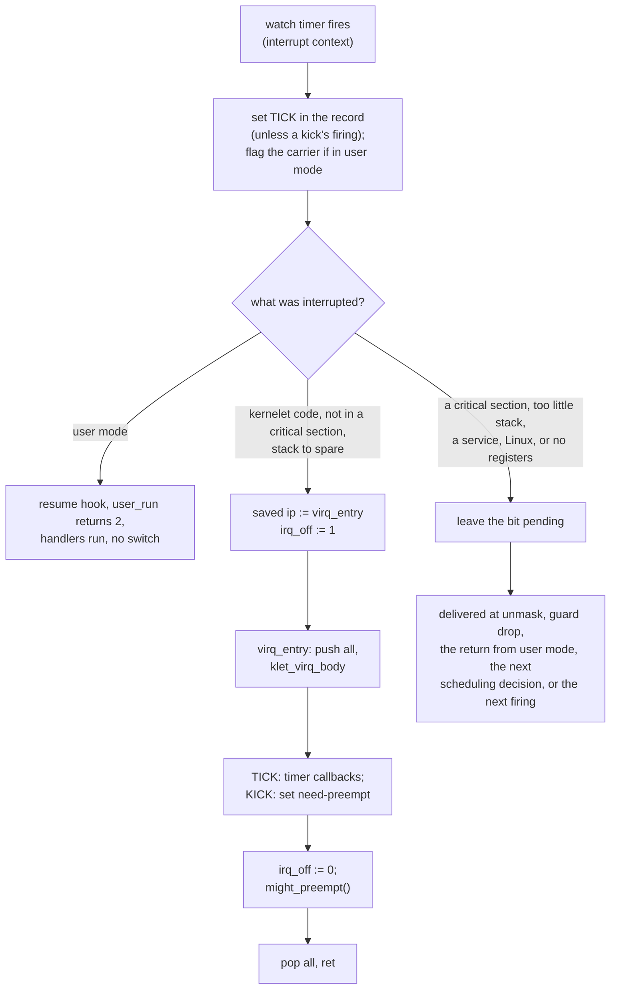

# Virtual interrupts

The kernelet's scheduler needs interrupts, and Linux leaves it none; this chapter gives it virtual ones. A time slice ends because a timer interrupt fires, and a wake-up on another processor is noticed because an interrupt arrives there. But Linux owns the interrupt controller, the vector table and every physical line, and nothing in vOSTD can register a handler for any of them.

## Bits in a record

A virtual interrupt is a bit in the `pending` word of a virtual CPU's record (chapter 9). The endovisor sets it from interrupt context or from another processor. The kernelet's handler for it runs as kernelet code on that virtual CPU's carrier, never in Linux's interrupt context, soon after. Two bits are raised in this prototype; a third, LINES, is reserved for devices:

| bit | meaning | set by |
|---|---|---|
| TICK | this processor's watch period (the watch timer's one-millisecond period, below) expired while this carrier was current; also raised whenever the virtual CPU wakes from `vcpu_idle` | the watch timer, below; `vcpu_idle` on waking |
| KICK | another virtual CPU wants this one to look at its run queue | the `vcpu_kick` service |

Each bit stands in for a hardware interrupt the kernel proper already handles. The kernel proper's *timer callbacks*, functions it registers with OSTD to run on every timer interrupt, run from TICK as they would from a hardware timer interrupt. One of them, registered by OSTD when the kernel proper calls `enable_preemption_on_cpu`, calls the injected run queue's `update_current(Tick)` and sets *need-preempt*, a bit in OSTD's preemption word meaning *switch tasks at the next chance*, if the run queue asks for it. KICK does what a reschedule interrupt does on a machine: it makes the virtual CPU ask its scheduler whether something more urgent has become runnable.

vOSTD computes the kernelet's *jiffies*, its count of ticks since boot, from the cycle counter rather than by counting ticks, because a virtual CPU that Linux has not scheduled gets none.

When the handler runs depends on what the virtual CPU is doing when the bit is set, and above all on whether it is in a critical section. A virtual CPU is in a **critical section** when the kernelet task on it holds at least one preemption guard or spin lock, or has its virtual interrupts masked. The chapter's closing section lists the paths by which a bit reaches its handler; each path has a section of its own first.

## The watch timer

<div class="background">

**Linux: high-resolution timers and preemption notifiers.** An [`hrtimer`](https://elixir.bootlin.com/linux/v6.12/source/kernel/time/hrtimer.c) is a timer whose callback runs in interrupt context, normally on the processor that armed it. A *pinned* timer is guaranteed to stay there. A *hard* one runs in the interrupt itself even on a real-time kernel, a kernel built to run most interrupt work in threads. A callback returns `HRTIMER_RESTART` to run again, after moving its expiry forward by whole periods past now with `hrtimer_forward_now()`, or `HRTIMER_NORESTART` to stop. `hrtimer_active()` says whether a timer is queued or its callback is running, `hrtimer_cb_get_time()` gives the time a callback runs at, and `hrtimer_set_expires()` sets the next expiry directly.

A timer callback can make the interrupted code resume somewhere else. The timer interrupt publishes the registers of whatever it interrupted, and a callback reads them with [`get_irq_regs()`](https://elixir.bootlin.com/linux/v6.12/source/include/asm-generic/irq_regs.h), which is how Linux's profiler samples programs; a callback that changes the saved instruction pointer makes the interrupt return somewhere else.

A **preemption notifier** ([`preempt_notifier_register()`](https://elixir.bootlin.com/linux/v6.12/source/kernel/sched/core.c#L4866)) is a pair of callbacks Linux runs for one task every time it switches that task out of a processor and in to one; KVM, Linux's own hypervisor, uses it to load a virtual CPU's state onto the processor it is switched in on and to save it when it is switched out. Notifiers are compiled in only if another configuration option requires them (`CONFIG_PREEMPT_NOTIFIERS` cannot be turned on by itself); the patch's `CONFIG_KERNELET` requires it.

</div>

The **watch timer**, a pinned, hard, one-millisecond `hrtimer` on each processor, is armed while the task running there is the carrier of a virtual CPU, and for at most one more period after it leaves. Each carrier registers a preemption notifier when it starts. The notifier's switch-in callback arms the timer of whatever processor the carrier has just landed on, and so does every entry into kernelet code and every return from a service, which no switch-in need precede. The timer's own callback re-arms itself if it interrupted the carrier of a virtual CPU of a live sandbox, and stops otherwise. So a carrier that Linux migrates is watched wherever it lands, and a processor that has no carrier is soon unwatched.

*Simplified from `prototype/linux/endovisor/watch.c` and `prototype/linux/endovisor/sched.c`: `klet_watch_arm`, `klet_sched_in`.*

```c
static void klet_sched_in(struct preempt_notifier *pn, int cpu)   /* Linux just put this carrier on a processor */
{
	struct klet_carrier *c = container_of(pn, struct klet_carrier, pnotifier);
	klet_watch_arm(c);
}

void klet_watch_arm(struct klet_carrier *c)
{
	struct hrtimer *timer = this_cpu_ptr(&klet_watch_timer);
	if (!hrtimer_active(timer))
		hrtimer_start(timer, ns_to_ktime(KLET_WATCH_INTERVAL_NS), HRTIMER_MODE_REL_PINNED_HARD);
}
```

Every time a period expires, the callback raises TICK and then decides how to deliver whatever is pending:

*Simplified from `prototype/linux/endovisor/watch.c`: `klet_watch_fn`.*

```c
static enum hrtimer_restart klet_watch_fn(struct hrtimer *timer)
{
	struct pt_regs *regs = get_irq_regs();      /* the interrupted registers; NULL if whatever ran this callback did not publish them */
	struct klet_carrier *c;
	bool tick = true;

	if (this_cpu_read(klet_watch_requested)) {  /* a kick asked for this firing (below): it counts as a tick only if the period it cut short has run out */
		this_cpu_write(klet_watch_requested, false);
		tick = !ktime_before(hrtimer_cb_get_time(timer), this_cpu_read(klet_watch_period_end));
	}

	if (!current->carrier_hooks)                     /* not a carrier any more: stop */
		return HRTIMER_NORESTART;
	c = klet_current_carrier();

	if (tick)
		klet_virq_raise(c, KLET_VIRQ_TICK);     /* 1. the tick */

	if (!regs || user_mode(regs) || !klet_in_image_text(regs->ip) || !klet_in_kernelet(c)) {
		/* no registers, user mode (klet_virq_raise flagged the carrier), a service, or Linux: leave it pending */
	} else if (!klet_critical(c)) {
		klet_virq_redirect(c, regs);            /* 2. in kernelet code, not in a critical section: deliver now */
	} else {
		/* in a critical section: the kernelet delivers it itself when the section ends */
	}
	/* 3. the bound on critical sections: the next chapter */

	if (!tick) {                                /* a requested firing goes back to its period's own expiry */
		hrtimer_set_expires(timer, this_cpu_read(klet_watch_period_end));
		return HRTIMER_RESTART;
	}
	hrtimer_forward_now(timer, ns_to_ktime(KLET_WATCH_INTERVAL_NS));
	return HRTIMER_RESTART;
}
```

The callback's two tests keep it from redirecting anything but kernelet code. `klet_in_image_text` asks whether the interrupted instruction lies in the kernelet image's code; Linux's code and the endovisor's never do. `klet_in_kernelet` asks whether the carrier is running kernelet code and not a service: state `RUNNING`, depth 0, not asleep in `vcpu_idle`, and not *evicted*, that is, not already being forced out of kernelet code by the endovisor, as happens when the sandbox is being stopped. A carrier inside a service call is never redirected, because it may hold Linux's locks.

`klet_virq_raise` sets the bit and does the two cheap things that get it noticed. It wakes the carrier if it is asleep in `vcpu_idle`. It flags the carrier (chapter 6) if it is in user mode, so that it comes back through the resume hook and `user_run` returns 2.

When the carrier is in kernelet code outside a critical section, the endovisor delivers at once, as a machine would, by changing one saved register:

*Simplified from `prototype/linux/endovisor/watch.c`: `klet_virq_redirect`.*

```c
bool klet_virq_redirect(struct klet_carrier *c, struct pt_regs *regs)
{
	if (user_mode(regs) || !klet_in_image_text(regs->ip) || !klet_in_kernelet(c))
		return false;
	if (klet_irq_off(c))                         /* interrupts masked: wait */
		return false;
	limit = READ_ONCE(c->vrec.stack_limit);
	if (!limit || regs->sp < limit || regs->sp - limit < KLET_UPCALL_HEADROOM)
		return false;                            /* no limit published, or not enough stack for the handler */

	WRITE_ONCE(c->vrec.virq_ip, regs->ip);       /* where we interrupted the kernelet */
	WRITE_ONCE(c->vrec.irq_off, 1);              /* mask, as hardware clears IF when it takes an interrupt */
	regs->ip = (unsigned long)kernelet_entry_table.virq_entry;   /* return there instead */
	return true;
}
```

The redirect is refused when interrupts are masked or when the task's kernelet stack has too little room. vOSTD publishes each task's stack limit at every task switch. The endovisor requires 32 KiB below the interrupted stack pointer (`KLET_UPCALL_HEADROOM`): 16 KiB for the upcall and the callbacks it runs, and 16 KiB reserved for Linux, which runs on whatever stack it interrupts until it switches to its interrupt stack, runs its scheduler there when it preempts the carrier on the way out of an interrupt, and runs the whole handler of a kernel-mode exception there.

## The upcall

When the timer interrupt returns, it lands not on the interrupted instruction but in the kernelet's **upcall** stub: the kernelet's own interrupt handler, which only a redirected interrupt enters.

The stub, in vOSTD's assembly, saves everything on the *current task's* kernelet stack, calls a Rust function, and returns to the interrupted instruction. It is assembly because it is entered between two arbitrary instructions and must put every general register and the flags back exactly.

Two build settings keep the stub short. The kernelet is built without vector instructions, so there is no vector state to save. The kernelet, like Linux, is compiled without a red zone, the 128 bytes below the stack pointer that user-mode code may use without moving it, so the stub may push below the interrupted `rsp`.

The excerpt is in Intel syntax, destination first, as Rust's `global_asm!` has it; chapter 7's switch was in AT&T syntax, the GNU assembler's default, source first.

*Simplified from `prototype/vostd/src/vcpu.rs`: `klet_virq_entry`, `klet_virq_body`.*

```asm
klet_virq_entry:
    lea rsp, [rsp - 8]       ; a slot for the interrupted instruction pointer (lea, not sub: sub would change the flags)
    pushfq                   ; the flags, exactly as the interrupted code left them
    push rax ... push r15    ; every general register but rsp
    mov rbp, rsp
    and rsp, -16             ; align for the call
    call klet_virq_body      ; returns the instruction pointer to resume at
    mov rsp, rbp
    mov [rsp + 128], rax     ; into the slot: 15 registers and the flags (128 bytes) above rsp
    pop r15 ... pop rax
    popfq
    ret                      ; to the interrupted instruction
```

```rust
extern "C" fn klet_virq_body() -> u64 {
    let rec = vrec();
    let ip = unsafe { read_volatile(rec.virq_ip.get()) } as usize;   // copied to this frame first: the record's field may be reused
    assert!(IMAGE_TEXT_LO <= ip && ip < IMAGE_TEXT_HI);   // never resume at an address the host made up

    let owns_mirror = get_guard_count() == 0;            // this upcall begins a critical section of its own
    if owns_mirror { host_preempt_inc(); }               // the mirror of the next chapter: tell Linux so

    run_handlers(rec);                                   // TICK: the timer callbacks; KICK: a look at the run queue

    let host_wants_cpu = if owns_mirror { host_preempt_dec_and_test() } else { false };
    unsafe { write_volatile(rec.irq_off.get(), 0) };     // unmask: what a machine's interrupt return would do
    if host_wants_cpu { host_yield(); }                  // Linux was waiting for this processor
    if get_guard_count() == 0 {                          // kernel-mode preemption: switch if the scheduler wants to
        crate::task::scheduler::might_preempt();
    }
    ip as u64
}

fn run_handlers(rec: &VcpuRec) {
    loop {
        let pending = rec.pending.swap(0, Ordering::AcqRel);
        if pending == 0 { break; }
        if pending & VIRQ_TICK != 0 { crate::timer::call_timer_callback_functions(); }
        if pending & VIRQ_KICK != 0 { cpu_local::set_need_preempt(); }
    }
}
```

The check against the image's text range catches a bug in the endovisor's bookkeeping, so that a wrong address stops the kernelet instead of being jumped to. The host is trusted, so this is not a defense against it.

Four lines raise Linux's preemption count while the handlers run, so that Linux does not take the processor in the middle; the next chapter explains them. `owns_mirror` is always true, since the endovisor redirects only when no guard is held (below); the test keeps the function correct if that ever changes.

The `might_preempt` at the end adds **kernel-mode preemption**, which OSTD on a machine lacks: the handler may switch to another task before returning. That is how a tick ends a time slice in the middle of a kernel task's computation, as it does on a machine with a preemptible kernel.

A switch inside the upcall is safe for the interrupted address because the body's first act copies `virq_ip` into a local variable, so the address lives in this frame, on the task's own stack. The record's field is free for the next upcall on this virtual CPU. The stub copies the local into the slot only once the body has returned, perhaps much later. The interrupted task resumes from the same frame.

vOSTD assumes that a preempted task resumes on the virtual CPU that preempted it. On a machine a per-CPU word is one `gs:` instruction, so it cannot straddle a switch; vOSTD finds the slot first and touches it second, so a task preempted between the two and resumed on another virtual CPU would write the first virtual CPU's slot. The schedulers of this book's kernels, like Asterinas's, never move a task they preempted, but OSTD allows a scheduler that balances load, and nothing in vOSTD enforces the assumption: it is a requirement vOSTD places on the kernel proper's scheduler.

Kernel-mode preemption has a hazard of its own with floating-point state. From a thread's `FpuContext::load` until `user_run`, and from `execute`'s return until `save`, the thread's floating-point and vector registers are live on the processor, and a switch there, by an upcall or by a guard drop that delivers a bit, would let the next task's restore of its own registers overwrite them. A kernel proper must therefore save them in its pre-schedule handler, as Asterinas does; this book's kernels do not, so those windows are open in the prototype, and no test shows them closed.

## Preemption inside a scheduling decision

An upcall must not preempt inside `reschedule`, between its decision and its switch. `reschedule` holds no preemption guard, since on a machine nothing preempts OSTD's kernel code, so an upcall can land between the two. By then the run queue's bookkeeping already names the chosen task current and has put the still-running task back among the waiting. A second decision could pick the running task. Before switching to a task, OSTD waits until the processor that last ran it has finished saving it, so a task that waits for itself waits forever and the processor hangs.

So vOSTD flags that window and defers any preemption to its end. `open_resched_window`, the first thing `reschedule` does, runs whatever virtual interrupts are already pending, without switching, so that whatever they ask for is answered by the decision about to be made; then it clears need-preempt and sets a flag in the virtual CPU's local storage. While the flag is set, `might_preempt` only records a note, because need-preempt alone would wait for the next upcall, the bit that asked for it having been consumed. Whoever closes the window (the completed switch, the decision to do nothing, or the retry that decides again) acts on the note at once, by preempting or, for the retry, by deciding again instead of sleeping. A preemption is deferred by the window and never by more.

The window costs one reschedule each time a kick is taken inside it. When virtual CPU A puts a task on B's run queue and kicks B while B is already deciding, B often picks the task before the kick is taken; the kick is then taken inside the window, by the guard drop that releases the run queue or by an upcall, and leaves a note. If B was idle, the note costs one reschedule that finds nothing to do; if B was switching away from a running task, it costs a switch back.


## Interrupts off, and guards

Two separate fields in the record stand for the two ways a kernel defers work. On a machine, masking interrupts holds off the handler, and a preemption guard holds off only the task switch; in vOSTD both hold off the upcall, because the upcall cannot know in advance whether it will switch. The fields stay separate because OSTD's interface has two guards.

- `irq_off` is the virtual interrupt flag, inverted. vOSTD sets it where OSTD's interrupts-off guard, `irq::disable_local()`, would clear the processor's flag, and clears it when the guard drops; the endovisor sets it when it redirects into the upcall, and the upcall clears it at the end. While it is set, nothing is delivered.
- The **guard count**, the low bits of `preempt_info`, is how many preemption guards are held, counting spin locks that disable preemption; a lock that disables interrupts sets `irq_off` instead. What a guard *means* is that no task switch happens on this virtual CPU while it is held; how that is *enforced* is that the watch timer never redirects a task that holds one, so the upcall, the one place a switch could happen underneath kernelet code, is never entered under a guard.

`irq_off` has two writers, but plain stores are enough. The endovisor writes a 1 only when it finds a 0, only from an interrupt on the carrier's own processor, so the two writers never run at once, and the upcall it diverts into always clears that 1 again before the interrupted code resumes.

The guard word is updated only by its own virtual CPU, with single read-modify-write instructions (`add`, `sub`, `and`, `or`), because the guard count shares its word with the need-preempt bit, which the upcall's handlers set. If a guard's increment compiled to a load, an add and a store, an upcall could land between the load and the store, because the count was still zero, and the store would erase the need-preempt bit the upcall had just set; a single `add` to memory cannot be split by an interrupt.

## Delivery at the end of a critical section

When a critical section ends, vOSTD delivers whatever was left pending in it, whenever it arrived. Two places check: the interrupts-off guard when it unmasks, and the drop of the last preemption guard, for a bit that arrived under the guard, in kernelet code or in a service. Only the upcall checks the stack's headroom; these paths run the same handlers as a function call on whatever stack the task is on. The unmask:

*Simplified from `prototype/vostd/src/task/preempt/cpu_local.rs` and `prototype/vostd/src/vcpu.rs`: `irq_unmask`, `deliver_if_pending`, `handle_virq`.*

```rust
pub(crate) fn irq_unmask() {
    let leaving = get_guard_count() == 0;       // the end of a critical section?
    /* ... the next chapter's mirror ... */
    set_irq_off(false);
    if leaving {
        vcpu::deliver_if_pending();             // a few loads and a branch
    }
}

pub(crate) fn deliver_if_pending() {
    if has_pending() { handle_virq(); }
}

pub(crate) fn handle_virq() {                   // the same handlers, called as a function
    if IN_VIRQ.load() { return; }               // already inside (one flag per virtual CPU): the guard's own drop below calls back here; the outer loop takes any bit raised before its last swap
    IN_VIRQ.store(true);
    {
        let _guard = crate::irq::disable_local();
        run_handlers(vrec());
    }
    IN_VIRQ.store(false);                       // cleared before the switch below, which may not come back here
    crate::task::scheduler::might_preempt();
}
```

## Delivery on the return from user mode

A carrier in user mode takes its virtual interrupts on the way back, without a task switch. `execute`'s loop runs the handlers before it re-enters user mode, through `deliver_no_switch`: the same `handle_virq` as above without the final `might_preempt`, the call that switches tasks if need-preempt is set and no guard is held.

vOSTD does not switch at that point, unlike OSTD, because the tenant thread's floating-point and vector registers are still live on the processor, and this book's kernels save them only after `execute` returns and not at a switch, so another task's restore of its own would overwrite them.

So under vOSTD a tenant thread that stays in user mode is never preempted. Its slice ends and need-preempt is set, but nothing acts on it until the thread enters the kernel and its kernel code reaches a call to `might_preempt`: an upcall, a guard drop or unmask that finds a bit pending, a spawn, or the kernel proper's next yield or sleep. OSTD on a machine does preempt such a thread, by calling `might_preempt` before every entry to user mode, and Asterinas's kernel proper relies on that; its `has_kernel_event` hook reports only signals. This is a difference from OSTD's documented behavior, which the prototype has not closed.

Neither the flag nor the bit can be lost in a race. A flag set while the hook is already running is not lost, as chapter 5 arranged. `user_run` publishes `KLET_USER` and then reads `pending`, while `klet_virq_raise` sets the bit and then reads the state; as with idling, one of the two always sees the other, so a bit raised just as the carrier leaves is never stranded.

## The kick's interrupt

A kick to kernelet code on another processor makes that processor's watch timer fire at once, through an inter-processor interrupt, instead of waiting up to a millisecond for its next tick. The endovisor sends it with [`smp_call_function_single()`](https://elixir.bootlin.com/linux/v6.12/source/kernel/smp.c), which runs a function on a named processor, in interrupt context there, through an inter-processor interrupt; the last argument, 0, means the caller does not wait. The function it runs there cannot redirect anything itself, because that kind of interrupt does not publish the interrupted registers; what it can do is restart the watch timer with zero delay (`klet_watch_fire_now`), so that the timer interrupt, whose callback does see the registers, arrives as soon as the cross-processor call returns, and delivers the kick:

*Simplified from `prototype/linux/endovisor/sched.c`: `klet_kick_remote`, `klet_kick_ipi`.*

```c
void klet_kick_remote(struct klet_carrier *c)
{
	if (c->state != KLET_RUNNING || c->depth != 0 || !klet_task_on_cpu(c->task))
		return;                                 /* not in kernelet code on a processor: the bit will be found */
	smp_call_function_single(task_cpu(c->task), klet_kick_ipi, c, 0);
}

static void klet_kick_ipi(void *arg)            /* runs in interrupt context on that processor */
{
	struct klet_carrier *c = arg;
	if (current->carrier_hooks == &c->hooks)          /* still the same carrier there? */
		klet_watch_fire_now();                  /* then make the watch timer fire, and it will redirect */
}
```

A requested firing is not a tick, unless the period it cut short has already run out: the callback raises no TICK for it, does not count toward the next chapter's bound on critical sections, and puts the timer back on the expiry of the period it cut short, so a kick neither raises an extra tick nor delays the next one.

A kick whose bit is already set does nothing at all, so a thousand kicks before the bit is taken cost one delivery.

## When a bit is delivered

A virtual interrupt reaches its handler by whichever of four paths comes first: the upcall, at a watch firing that finds the kernelet in kernelet code outside a critical section with stack to spare; the end of a critical section, at the unmask or the drop of the last guard; the return from user mode; or the start of the next scheduling decision. A bit left pending for any reason, because the carrier was in a service that held no guard, had too little stack, or was off its processor, is delivered by the first of those that comes, usually the next guard drop, or by a later watch firing that can redirect.

The firing comes within one period if the carrier is on its processor when that period expires; there is no bound while Linux keeps the carrier off a processor, or takes it off before each period ends.



<div class="recap">

**Recap.** Virtual interrupts are bits in the virtual CPU's record: TICK from the watch timer, KICK from `vcpu_kick`. The watch timer is a pinned, hard, one-millisecond `hrtimer` per processor, armed by each carrier's preemption notifier whenever Linux puts the carrier on that processor. When it finds the carrier in kernelet code outside a critical section, with room on the task's stack, it points the interrupted frame at the image's upcall stub, which saves everything on the task's stack, runs the handlers, and may switch tasks before returning: kernel-mode preemption, held off by a guard and, inside a scheduling decision, by the window. A carrier in user mode is flagged and runs the handlers on its way back without switching; one in a critical section delivers the bit itself when the section ends; the next scheduling decision runs whatever is pending; a kick to another processor makes its timer fire at once; anything else waits for the next firing that can deliver it.

</div>
