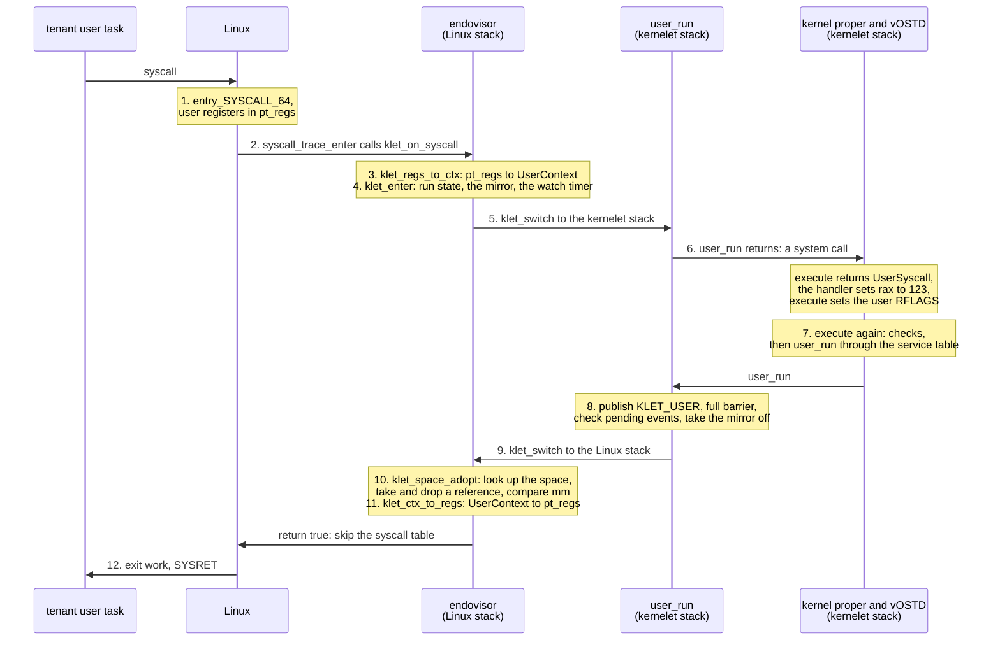
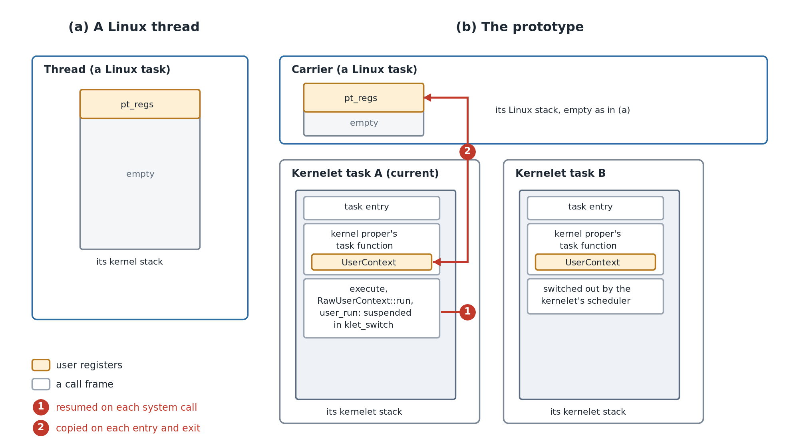
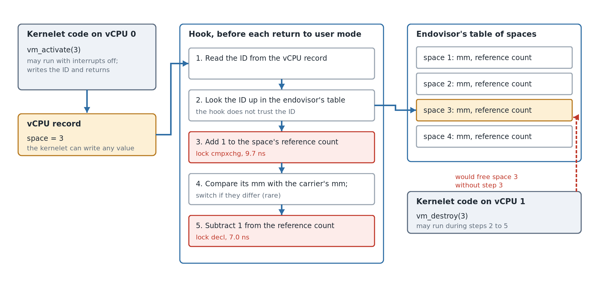
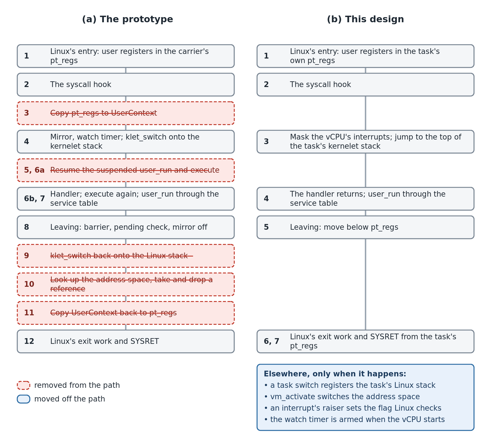
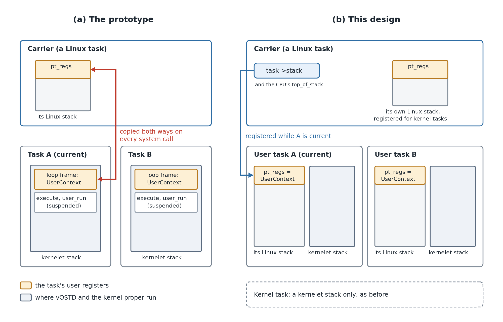

# 2026-10-31 Reduce syscall overhead

- Status: Draft
- Author(s): Plucky923
- Discussion: Not yet available.
- Affected chapters: [Carrier hooks and patch overview](../accepted-design/carrier-hooks.md), [The first kernel we will run](../accepted-design/the-first-kernel-we-will-run.md), [Two stacks](../accepted-design/two-stacks.md), [Into user mode and back](../accepted-design/into-user-mode-and-back.md), [The kernelet ABI](../accepted-design/the-kernelet-abi.md), [Tasks and virtual CPUs](../accepted-design/tasks-and-virtual-cpus.md), [Tenant memory on Linux's page tables](../accepted-design/tenant-memory-on-linux-page-tables.md), [Virtual interrupts](../accepted-design/virtual-interrupts.md), [Sharing a processor politely](../accepted-design/sharing-a-processor-politely.md), [What it costs](../accepted-design/what-it-costs.md), and [Why a kernel of your own](../accepted-design/why-a-kernel-of-your-own.md).
- Implementation or experiments: `prototype/` has the new build profile. The rest of the design is implemented and measured in a separate worktree and is not merged; [Validation and evidence](#validation-and-evidence) gives the results.

## Summary

A system call on a kernelet takes 125.1 ns, against 56.4 ns for native `getpid`. The extra time is the handoff between Linux and the kernelet. This proposal makes vOSTD follow Linux's protocol at that handoff: events go to a handler that returns, each user task keeps its registers in its own Linux stack, and checks on every return move to where their cause happens. A system call then takes 66.2 ns, 9.3 ns more than native `getpid`.

## Problem and motivation

On the prototype, a system call that the kernelet serves takes 125.1 ns, and native `getpid` takes 56.4 ns. The kernelet's handler only returns a constant, so the extra 68.7 ns is the cost of getting to the handler and back. 

### Background: one system call today

The figure below follows one system call through the prototype. Its step numbers match the rows of the table in the next section. [Appendix: the prototype's mechanisms](#appendix-the-prototypes-mechanisms) explains each mechanism in it.



### Where the cost is

We traced the prototype from the host with Intel PT: one 10 ms window in each of five boots, about 450,000 system calls in all. The table gives the median time of each step.

<div class="background">

**x86: Intel Processor Trace.** The processor records which way each branch goes, and the cycle count at some of these branches. A decoder replays this record against the binaries and recovers each instruction that ran. It can time the path only at the branches that carry a cycle count. Tracing adds no instructions to the traced code, but it slows the code a little: the traced repetitions took 1.2% to 1.6% longer, and steps with locked instructions are sometimes much slower, so the table gives medians.

</div>

| Step | What runs | Instructions | Cycles | Time (ns) |
|---|---|---:|---:|---:|
| 1 | Linux's entry, up to the check of the syscall work bits | 64 | 42 | 12.7 |
| 2 | The work bit, the call of the hook, and the hook's first checks | 18 | 9 | 2.7 |
| 3 | The hook's last checks, and the copy from `pt_regs` to `UserContext` | 43 | 15 | 4.5 |
| 4 | `klet_enter`: the run state, the mirror, the watch timer, and `klet_switch` saving and loading registers | 65 | 24 | 7.3 |
| 5 | From `klet_switch`'s return to `user_run`'s return on the kernelet stack | 3 | 16 | 4.9 |
| 6a | The kernel proper tells what the run returned | 10 | 16 | 4.8 |
| 6b | The handler stores 123, `execute` sets the user flags and calls `RawUserContext::run` | 5 | 25 | 7.4 |
| 7a | `RawUserContext::run`'s checks: the current task, overflow checks, held spin locks | 26 | 6 | 1.7 |
| 7b | Two dependent loads of the service table, and the jump to `user_run` | 3 | 24 | 7.3 |
| 8 | `user_run`: publishing `KLET_USER`, the barrier `lock addl`, the pending check, and taking the mirror off | 24 | 28 | 8.4 |
| 9 | `klet_switch` back onto the Linux stack, and `klet_enter`'s return | 23 | 7 | 2.1 |
| 10a | The hook calls `klet_space_adopt`, which calls `klet_space_get` | 26 | 16 | 5.0 |
| 10b | `lock cmpxchg` on the space's reference count | 5 | 32 | 9.7 |
| 10c | The liveness check, the `mm` comparison, the call of `klet_space_put` | 15 | 2 | 0.6 |
| 10d | `lock decl` on the same count | 1 | 23 | 7.0 |
| 10e | The returns to the hook | 6 | 2 | 0.6 |
| 11 | The hook's check after the run, and the copy from `UserContext` back to `pt_regs` | 52 | 15 | 4.5 |
| 12a | Linux's exit work | 63 | 19 | 5.8 |
| 12b | Restoring the user registers, and SYSRET | 23 | 52 | 15.8 |
| — | User mode, from SYSRET to the next `syscall` | | | 13.3 |
| | Total | 475 | 373 | 126.1 |

Tracing has little effect: the medians add up to 126.1 ns, and the same boots took 125.9 to 128.4 ns per call without tracing.

Linux's own part of the call, steps 1 and 12 and the time in user mode, takes 47.6 ns; this design keeps it. The kernelet's handoff, steps 2 to 11, takes the other 78.5 ns, and this proposal reduces it. Native `getpid` takes 8.8 ns more than Linux's part here, so a kernelet as fast as `getpid` needs a handoff of about 8.8 ns. The target is approximate, because native `getpid` takes Linux's faster entry and exit path and a carrier does not.

The handoff's 78.5 ns has three causes.

#### Two kernels' models meet at the handoff

Linux assumes that each task has its own kernel stack, and that this stack is empty whenever the task is in user mode. The prototype breaks both assumptions. A carrier runs many kernelet tasks on one Linux stack. The kernel proper's call to `execute` returns only at the program's next system call, so the frames of this call stay on a stack while the program runs. The prototype translates between the two models on each system call, in the five ways listed below the figure; the figure shows the first two.



*A Linux thread (a) and the prototype's carrier (b), both while the program runs in user mode. The red numbers mark the first two items of the list below.*

1. **Resuming the suspended call: steps 5 and 6a, 9.7 ns.** Each system call returns into the `user_run` and `execute` that wait on the kernelet stack ([Appendix](#appendix-the-prototypes-mechanisms), `execute` and Two stacks). These 13 instructions take 9.7 ns. The stack switch itself costs little.
2. **Copying the registers: steps 3 and 11, about 9 ns.** The hook copies 18 registers from `pt_regs` to `UserContext` on entry, and back on exit. The cost is plain work: 95 instructions in about 30 cycles.
3. **Checking the address space: step 10, 22.9 ns.** The kernel proper may call `vm_activate` with the vCPU's interrupts off; Asterinas calls it right after a task switch ([Tenant memory on Linux's page tables](../accepted-design/tenant-memory-on-linux-page-tables.md)). Switching the carrier to another address space can sleep in Linux: if the carrier drops the last reference to the old space, `mmput()` frees it, and `mmput()` may sleep (Linux v6.12 `kernel/fork.c`). A sleeping carrier stops its whole vCPU, so no kernelet task runs there until Linux wakes it. With interrupts off, vOSTD forbids that sleep, so that other tasks do not wait on it: a request from another vCPU, such as the wake-up of a task that runs here, would wait until the carrier wakes and the kernel proper unmasks its interrupts ([What vOSTD adds on top](../accepted-design/what-vostd-adds-on-top.md), rule 2). The prototype's `vm_activate` therefore only writes the space's ID into the vCPU record, and the hook switches before each return to user mode, where the carrier may sleep.

   The hook cannot tell whether `vm_activate` has run since the carrier last returned to user mode, because `vm_activate` only writes an ID. Before each return to user mode, the hook therefore checks the address space in the five steps of the figure. Steps 2, 3 and 5 protect the hook from the kernelet: the kernelet can write any ID into the record, and another vCPU of the same kernelet can destroy the address space with `vm_destroy` during the check. The two updates of the reference count are atomic instructions on memory that the vCPUs share, and take 16.7 ns of the 22.9 ns (steps 10b and 10d).

   

   *The prototype's address-space check before each return to user mode. The red steps are the two atomic instructions.*

   The address space changes only when the kernelet switches to a task of another process, so almost every check finds the carrier already in the right address space. The hook pays the 22.9 ns on each system call all the same.
4. **Ordering the event check: part of step 8.** Before the carrier leaves for user mode, `user_run` executes a full memory barrier, `lock addl`, on each system call. The barrier keeps a virtual interrupt raised at that moment from going unnoticed by both the carrier and the raiser ([Appendix](#appendix-the-prototypes-mechanisms), Virtual interrupts). Without the barrier, such an interrupt would still be handled at the watch timer's next tick, within 1 ms: the tick raises an interrupt of its own, and its raiser then asks Linux to hand the carrier to the kernelet. The barrier is paid on every system call to shorten a rare delay.
5. **Calling through the service table: step 7b, 7.3 ns.** The endovisor accepts only self-contained images: their relocations are relative and they import no symbol. It can then check an image when the image is registered, and share the image's code pages between sandboxes ([The endovisor UAPI](../accepted-design/the-endovisor-uapi.md)). The kernelet therefore cannot call `user_run` by name, and calls it through the service table that it receives when it starts. The call loads the table's address, then the address of `user_run`, and jumps there: two dependent loads before the jump.

#### Two schedulers share the processor

Linux schedules the carriers, and the kernelet schedules its own tasks on them. Linux cannot see inside kernelet code, so two mechanisms tell it what it needs ([Appendix](#appendix-the-prototypes-mechanisms)): the mirror tells Linux when kernelet code holds a lock, and the watch timer gives the processor back to Linux when Linux wants it. The prototype maintains both on each crossing between user mode and the kernelet.

- **The mirror.** On each entry into kernelet code, `klet_enter` reads Linux's preemption count and adds back the kernelet's share. On each exit, `user_run` removes the share. This work is part of steps 4 and 8.
- **The watch timer.** On each entry, `klet_enter` calls `hrtimer_active` to check that the timer runs. This takes about 2 ns of step 4.

#### The build

Two costs come from how the image was built, not from the design. In step 6b, `execute` calls `RawUserContext::run`, which is in another crate. The image was compiled as shared-library code (`relocation-model = pic`), so this call goes through the global offset table ([The endovisor UAPI](../accepted-design/the-endovisor-uapi.md)), although the image is one executable that could call it directly. In step 7a, the build's integer-overflow checks add a test to each arithmetic operation.

#### The rest

The remaining steps cost about 6.5 ns in all: the call of the hook in step 2, the checks in step 7a, and the switch back to the Linux stack in step 9. They are small and hard to remove.

## Proposed change

### Design overview



*One system call through the prototype (a) and through this design (b). Steps on the same row do the same job. Red steps are gone from the path; the blue box lists work that now happens only when its cause does.*

### The kernelet user task



*What a task holds in the prototype (a) and in this design (b).*

To remove the copy of item 2, each kernelet user task gets a Linux stack of its own, 16 KiB in Linux's format. Its `pt_regs` is the task's `UserContext`. The task needs a whole stack, not only a register area, because Linux runs its entry and exit code on the stack where it saves the registers. Below `pt_regs`, the stack holds only the hook, the services the task calls and Linux's exit work.

Linux saves the registers into the stack that it takes to be the carrier's own. When the kernelet makes a user task current on a carrier, it registers the task's Linux stack as the carrier's (Task switch); a kernel task runs with the carrier's own Linux stack. Both stacks of a user task come from the sandbox's stack pool, within its limit on tasks, and are charged to the sandbox's memory cgroup.

Linux returns to user mode from these registers, so they must always hold safe values. The kernel proper writes them only through `UserContext`, and only during the task's own handler call; `UserContext` keeps the segment fields and the privileged flag bits fixed, so no write can make them unsafe.

### The vOSTD interface

In the prototype, the kernel proper enters user mode itself, through `execute`. Its call stays on the kernelet stack while the program runs, and each system call must resume it. This design separates the two jobs. The kernel proper only handles events: it implements one handler, which handles one system call, exception or event and returns. vOSTD runs user mode: it calls the handler for each event of a kernelet user task, and enters user mode after the handler returns. No kernel context then waits on a stack while the program runs, so nothing is saved or resumed across user mode. vOSTD also owns the whole path between user mode and the handler, so it can optimize that path without changes to the kernel proper:

*Proposed: vOSTD's interface for user events.*

```rust
pub trait UserEventHandler: Sync {
    /// Handles one event of the current task; returns when done.
    fn handle(&self, event: UserEvent, user: &mut UserMode);
    /// Asked before every return to user mode: whether the task ends.
    fn should_exit(&self, user: &UserMode) -> bool;
    /// Asked after a virtual interrupt: whether the handler has work.
    fn has_kernel_event(&self, user: &UserMode) -> bool { false }
    /// Called with interrupts masked just before user mode, to load
    /// the task's floating-point and segment state.
    fn pre_user_run(&self, user: &UserMode, guard: &DisabledLocalIrqGuard) {}
}

pub enum UserEvent { Syscall, Exception, KernelEvent }
```

A kernel proper declares its handler once, as it declares its `main`, and vOSTD calls it directly:

*Proposed: the hundred-line kernel's handler.*

```rust
struct Hello;

impl UserEventHandler for Hello {
    fn handle(&self, event: UserEvent, user: &mut UserMode) {
        if event == UserEvent::Syscall {
            let (context, task) = user.split();
            let vm_space = task.data().downcast_ref::<Arc<VmSpace>>().unwrap();
            handle_syscall(context, vm_space);
        }
    }
    fn should_exit(&self, _: &UserMode) -> bool { false }
}

#[ostd::user_event_handler]
static HELLO: Hello = Hello;
```

`TaskOptions::new_user(context)` sets up a kernelet user task whose user registers start as `context`; `spawn` creates it. `init(f)` adds a function that vOSTD calls once on the new task, with the task's `UserMode`, before the task first enters user mode. `UserMode` gives access to the current task, its user registers and the exception that ended a run. Only vOSTD can create a `UserMode`, and it passes the handler a reference that lasts one call. `UserMode` is neither `Send` nor `Sync`, so no other task can reach a task's registers.

#### Porting a kernel proper

The loop's body becomes the handler, the loop's condition becomes `should_exit`, and the code before the loop becomes the `init` function.

*Simplified from Asterinas's `create_new_user_task`: a user thread written against `execute`.*

```rust
TaskOptions::new(move || {
    write_child_tid(&ctx);                              // once, before user mode
    let mut user_mode = UserMode::new(user_ctx);
    while !thread.is_exited() {
        match user_mode.execute(&ctx) {
            UserSyscall => handle_syscall(&ctx, user_mode.context_mut()),
            UserException => handle_exception(&ctx, user_mode.context_mut()),
            KernelEvent => {}
        }
        handle_pending_signal(user_mode.context_mut(), &ctx);
    }
})
```

*Proposed: the same thread written against the handler.*

```rust
impl UserEventHandler for Kernel {
    fn handle(&self, event: UserEvent, user: &mut UserMode) {
        let exception = user.take_exception();
        let (user_ctx, task) = user.split();
        let ctx = Context::of(task);                        // state lives in the task
        match event {
            UserEvent::Syscall => handle_syscall(&ctx, user_ctx),
            UserEvent::Exception => handle_exception(&ctx, user_ctx, exception.unwrap()),
            UserEvent::KernelEvent => {}
        }
        handle_pending_signal(user_ctx, &ctx);
    }
    fn should_exit(&self, user: &UserMode) -> bool {
        user.task().as_thread().is_exited()                 // was the loop's condition
    }
}

TaskOptions::new_user(user_ctx)
    .init(|user| write_child_tid(&Context::of(user.task())))   // was before the loop
    .data(thread)
    .spawn();
```

### The handoff protocol

The handler leaves nothing waiting on the kernelet stack, but the prototype also leaves a call waiting on the Linux stack: the hook's call, which Linux returns through to run its exit work. Linux does not need that call. To finish a system call, it needs only the task's `pt_regs` and its exit work, and the exit work can run on a fresh frame just below `pt_regs`. So the hook abandons its call when it hands the event to the kernelet, and the kernelet later starts Linux's exit work from just below `pt_regs`. **While kernelet code runs, the Linux stack holds nothing below `pt_regs`.**

#### In: from the hook to the handler

The syscall hook enters the kernelet by a jump, not a call. It masks the vCPU's virtual interrupts, moves to the top of the current task's kernelet stack, and starts vOSTD's entry there with the kind of event. The hook's own frames stay on the Linux stack and are never resumed. The resume hook enters the same way for exceptions and virtual interrupts. vOSTD's entry finds the current task, unmasks the interrupts, and calls the kernel proper's handler. The interrupts stay masked until then, so that no virtual interrupt switches tasks before vOSTD has found the current one.

#### Out: from the handler to user mode

*Proposed, simplified: vOSTD's entry for a user event.*

```rust
extern "C" fn user_event_entry(event: UserEvent) -> ! {
    let mut user = UserMode::for_current_task();
    HANDLER.handle(event, &mut user);          // the kernel proper's handler returns
    if HANDLER.should_exit(&user) {
        exit_current_task();
    }
    assert_no_guard_held();                    // a guard kept alive with mem::forget
    preempt_if_wanted();                       // the scheduler's chance before user mode
    let guard = mask_virtual_interrupts();
    HANDLER.pre_user_run(&user, &guard);
    user_run()                                 // never returns
}
```

After the handler returns, vOSTD leaves for user mode through a new Linux entry. The entry runs Linux's exit work on a fresh frame just below the task's `pt_regs`, and returns to user mode as Linux returns from any system call or interrupt. No frame of the event remains on either stack.

### Task switch

Linux saves a carrier's user registers on the stack that it takes for the carrier's own. For example, the kernelet switches the carrier from task A to task B. Linux does not see the switch and still takes A's Linux stack for the carrier's. B's next system call then saves B's registers in A's `pt_regs`.

At each task switch, the kernelet therefore registers the next task's Linux stack with Linux as the carrier's stack. Linux does the same at each switch of its own threads. A switch to a kernel task registers the carrier's own Linux stack. The endovisor accepts only a stack that belongs to the instance and that no other carrier uses. The old stack holds nothing below `pt_regs` while kernelet code runs, so the switch leaves no Linux call behind.

### Switching the address space

The kernel proper calls `vm_activate` to name the address space of the next task. A full kernel proper calls it during a task switch, with interrupts off, so `vm_activate` must not sleep. A switch can sleep in one case: the carrier drops the last reference to the old space, and Linux frees the space. The prototype's `vm_activate` therefore only records the space. The hook then finds the space and compares it before each return to user mode (step 10). Processes switch rarely, but this check runs on each system call.

Only that last drop can sleep, and Linux can give it to a background worker with `mmput_async`. `vm_activate` therefore switches the address space at once and gives the old space to the worker. The return to user mode checks nothing.

### Interrupts raised while leaving

In the prototype, the raiser of a virtual interrupt sets the flag only if the carrier is in user mode. The raiser must therefore read the carrier's state, and the carrier must publish its state before it checks the pending bits. This exchange needs the barrier on each return to user mode. In this design, the raiser always sets the flag, whatever the carrier is doing. The carrier then publishes no state, checks no pending bits, and executes no barrier on its way out.

Linux checks the flag before each return to user mode. If the raiser set the flag before that check, Linux hands the carrier to the kernelet at once. If it set the flag after the check, the interrupt waits for the carrier's next entry into the kernel, at the latest the watch timer's next tick; an interrupt raised in user mode waits in the same way in the prototype. The cost is small: an interrupt that the kernelet has already handled can leave its flag set, and the next return to user mode then passes once through the resume hook for nothing.

### Bookkeeping at each crossing

The mirror adds one to Linux's preemption count while kernelet code holds a lock ([Appendix](#appendix-the-prototypes-mechanisms)). The prototype adjusts the count on each entry into kernelet code and on each exit. A task holds no lock at the two user-mode crossings: it enters from user mode with none, and its handler releases its locks before it returns. The kernelet's share of the count is therefore zero at these crossings, and they skip the adjustment. The return to user mode keeps one check that Linux's count is zero. Critical sections, services and yields inside the kernelet keep the mirror.

The prototype also checks on each entry that the watch timer runs. Linux's notification of a carrier's scheduling already re-arms the timer each time the carrier gets a processor. The timer is therefore armed once, when the vCPU starts. Neither change alters what the mirror and the watch timer protect against.

### Building the image

The image is compiled as a position-independent executable, the form in which it is linked, so its calls between crates are direct and no longer go through the global offset table (step 6b). It uses Asterinas's benchmark profile, `release-lto`: link-time optimization, one code-generation unit, and no overflow checks (step 7a). The kernelet's memory safety does not depend on overflow checks, because vOSTD bounds user ranges with `checked_add` and `saturating_add`.

### What stays

- **The hook's place.** Linux still calls the hook after seccomp, so the sandbox's filter still bounds what a carrier can ask of Linux.
- **The service table.** The kernelet still calls `user_run` through it.

## Alternatives and tradeoffs

- **One Linux task per kernelet task.** Each task would have its own Linux stack, with no registration. Each task switch of the kernelet's own scheduler would then become a Linux sleep, a wake-up and a Linux context switch, against fewer than 2,000 cycles for that switch today ([What it costs](../accepted-design/what-it-costs.md)), and a sandbox would put one Linux task on the host for each tenant thread.
- **Shorten Linux's own part.** Linux's entry and exit take about 38 ns of a system call. Two designs could shorten them. The kernelet could point `IA32_LSTAR` at its own entry while a carrier runs; seccomp would then no longer bound the carrier. Or a small switcher in the host, as in PVM (Huang et al., SOSP 2023), could take a carrier's system call, save the user registers in the task's `pt_regs`, and enter the kernelet directly. The switcher would return to user mode the same way, and fall back to Linux's full entry and exit only when Linux has work for the carrier, such as a signal or a reschedule. Both designs change Linux's entry code.

## Implementation and integration

Linux gets two more patches. The first adds the exit entry, and moves the SYSRET conditions of `do_syscall_64` into a function that both share. The second adds the stack registration; Linux puts a carrier's own stack back before it frees it, however the carrier ends, and keeps accounting the carrier's own stack.

In the endovisor, two stack primitives replace `klet_switch`: one jumps to a stack without returning, and the other calls a function on another stack and returns. The carrier's state flags become one state. The sandbox frees its tasks' Linux stacks only after no carrier refers to them.

In vOSTD, `UserContext` takes the layout of `pt_regs`, with private fields.

Each kernel proper that runs user code is ported to the handler. `kernels/mem`, which tests tenant memory, ran user code as a function call, and now waits for the program's report through a mailbox. `kernels/sched`, which has its own scheduler, saves floating-point state when it switches tasks, and loads it in `pre_user_run`.

The Accepted Design chapters listed under Affected chapters change with the prototype.

## Validation and evidence

We implemented the design in a separate worktree of the prototype. All experiments run on a host with two Intel Xeon Platinum 8259CL processors (48 cores, one thread per core) and Linux 6.12. The guest runs Linux 6.12 with our patches, in QEMU 10.0 with KVM, with two vCPUs pinned to dedicated host cores and 512 MiB of memory. We compare the design with native `getpid` and with the prototype. We measure the design with and without the mirror, and with a handler that either returns a constant or also takes and drops one spin lock. We boot each configuration five times, in a shuffled order within each round, and report the mean.

### The time of one system call

The prototype's row comes from another run. The range is between boots.

| Setting | Mirror | Handler | Time (ns) | Range (ns) | Ratio to native |
|---|---|---|---:|---:|---:|
| Native `getpid` | | | 56.9 | 56.8–57.1 | 1.00 |
| The prototype | kept | returns a constant | 125.1 | 123.9–125.9 | 2.22 |
| This design | kept | returns a constant | 66.2 | 66.0–66.3 | 1.16 |
| This design | kept | takes one lock | 91.5 | 91.3–91.6 | 1.61 |
| This design | removed | returns a constant | 63.1 | 62.6–64.1 | 1.11 |
| This design | removed | takes one lock | 71.7 | 71.4–72.1 | 1.26 |

This design removes most of the handoff: a system call takes 66.2 ns, 9.2 ns more than native `getpid`, where the prototype took 68.7 ns more. What remains depends on the handler. With no lock, the mirror adds 3.1 ns. Each outermost critical section adds about 17 ns more with the mirror than without it, more than the whole remaining gap to native, so for a handler that takes locks, the mirror becomes the largest cost that the kernelet adds ([Open questions](#open-questions)).

### Where the time goes now

We traced this design, with a handler that returns a constant, the same way as the prototype: five boots, 183,000 to 212,000 round trips each. 

| Steps | What runs | Instructions | Cycles | Time (ns) | Prototype (ns) |
|---|---|---:|---:|---:|---:|
| 1 | Linux's entry, up to the check of the syscall work bits | 64 | 42 | 12.7 | 12.7 |
| 2, 3 | The work bit, the hook, and the jump to the task's kernelet stack | 42 | 20 | 6.1 | 19.4 |
| 4 | vOSTD's entry, the handler, the checks before user mode, and the call of `user_run` | 58 | 45 | 13.6 | 21.2 |
| 5, 6 | `user_run`, the move below `pt_regs`, and Linux's exit work | 74 | 21 | 6.4 | 43.7 |
| 7 | Restoring the user registers, and SYSRET | 23 | 51 | 15.5 | 15.8 |
| — | User mode, from SYSRET to the next `syscall` | | | 13.3 | 13.3 |
| | Total | 261 | 179 | 67.5 | 126.1 |

The kernelet's part, steps 2 to 6, falls from 84.3 ns to 26.1 ns, and the kernel runs 261 instructions instead of 475. Steps 1 and 7 and the time in user mode do not change, so all of the gain is in the handoff. The return path, steps 5 and 6, gains the most: 37.3 ns. Step 4 is now the longest step, at 13.6 ns. Its guards still maintain the mirror, which adds 5.6 ns to it; without the mirror, step 4 takes 8.0 ns.

## Open questions

- **Shortening Linux's entry and exit.** Which of the two designs in [Alternatives and tradeoffs](#alternatives-and-tradeoffs), an own `IA32_LSTAR` entry or a PVM-style switcher, saves more, and at what cost to Linux's entry code, to seccomp and to the host's safety argument.
- **The mirror.** The mirror adds about 17 ns to each outermost critical section of the kernelet, while Linux pays one instruction for the same preemption count around its own locks. Removing the mirror would let Linux deschedule a vCPU that holds a kernelet spin lock, a cost that has not been measured. Making the mirror as cheap as Linux's own count may be enough.

## Decision and follow-up

Pending review.

## Appendix: the prototype's mechanisms

A system call of a tenant program passes through these mechanisms of the prototype.

- **Kernelet.** The tenant's kernel, linked into one image: the **kernel proper**, written in safe Rust, and **vOSTD**, the framework under it that provides OSTD's interface on Linux.
- **Carrier.** A Linux task that runs one virtual CPU of the kernelet. The tenant program runs on it in user mode ([Carriers](../accepted-design/carriers.md)).
- **Endovisor.** The Linux module that serves kernelets. The syscall hook and every `klet_*` function in the figure belong to it.
- **Syscall hook.** Our Linux patch adds this hook to the system-call entry. Linux calls it for each system call of a carrier, after seccomp. The hook gives the call to the kernelet, and Linux skips its own system-call table ([Carrier hooks and patch overview](../accepted-design/carrier-hooks.md)).
- **`execute`.** OSTD's interface for running user code. The kernel proper calls it in a loop. `execute` enters user mode and returns when the program makes a system call or raises an exception, or when an event for the kernel proper arrives. The kernel proper handles the event and calls `execute` again ([Into user mode and back](../accepted-design/into-user-mode-and-back.md)). The loop of the hundred-line kernel:

  *Simplified from `prototype/kernels/hello/src/lib.rs`: `create_user_task`.*

  ```rust
  let mut user_mode = UserMode::new(create_user_context());
  loop {
      let return_reason = user_mode.execute(&DummyUserHooks);
      let user_context = user_mode.context_mut();
      if ReturnReason::UserSyscall == return_reason {
          handle_syscall(user_context, &vm_space);
      }
  }
  ```

- **Two stacks.** A task's Linux kernel stack is empty each time the task returns to user mode. `execute` returns only at the program's next system call, so its frames must stay on a stack while the program runs. Each kernelet task therefore runs on a kernelet stack of its own. `klet_switch` switches between two kernel-mode contexts: the hook's, on the carrier's Linux stack, and the current kernelet task's, on that task's kernelet stack. While the kernelet runs, the hook's context waits. While the program runs, the task's context waits inside `execute` ([Two stacks](../accepted-design/two-stacks.md)).
- **`UserContext`.** The kernelet's copy of a task's user registers. On each entry into the kernel, Linux saves the user registers in `pt_regs`, at the top of the carrier's Linux stack. The hook copies them from `pt_regs` into the task's `UserContext`, and copies them back before the carrier returns to user mode ([Into user mode and back](../accepted-design/into-user-mode-and-back.md)).
- **Service table.** The kernelet image imports no host symbols. It calls the endovisor only through a table of function pointers that it receives when it starts. One entry is `user_run`, the service that enters user mode ([The kernelet ABI](../accepted-design/the-kernelet-abi.md)).
- **Virtual CPU record.** Memory that the carrier and the kernelet share, one for each virtual CPU. It holds the pending virtual interrupts and the address space that the kernelet last activated with `vm_activate`. Each tenant process has its own address space, a Linux `mm`. The carrier switches to the activated address space on its way to user mode ([Tasks and virtual CPUs](../accepted-design/tasks-and-virtual-cpus.md), [Tenant memory on Linux's page tables](../accepted-design/tenant-memory-on-linux-page-tables.md)).
- **Virtual interrupts.** The kernelet's own interrupts: a timer tick, or a request from another virtual CPU. To raise one, the endovisor sets a pending bit in the virtual CPU record. Kernelet code checks this bit before the carrier returns to user mode. If the carrier is already in user mode, the endovisor also tells Linux to give the carrier to the kernelet at its next entry into the kernel. Linux does this through the endovisor's **resume hook**. These two paths leave a gap. Kernelet code has already checked the bit, but the carrier is not yet in user mode, so the endovisor does not tell Linux. An interrupt raised in this gap would wait until the watch timer's next tick, up to 1 ms. The prototype closes the gap with a memory barrier (step 8) ([Virtual interrupts](../accepted-design/virtual-interrupts.md)).
- **The mirror.** Linux does not preempt a task whose preemption count is above zero. While kernelet code is in a critical section, for example holding a spin lock, vOSTD adds one to the carrier's count. Linux then does not preempt the carrier, and other virtual CPUs do not spin on a lock whose holder is off its processor. Linux code that runs for the carrier must see only Linux's own count. The endovisor therefore removes the kernelet's share each time the carrier leaves kernelet code, and adds it back each time the carrier returns ([Sharing a processor politely](../accepted-design/sharing-a-processor-politely.md)).
- **Watch timer.** A per-processor timer of the endovisor that takes the processor back from kernelet code when Linux wants it. Under Linux's `none` and `voluntary` preemption models, Linux does not preempt a task in kernel code. Linux's own code gives up the processor where it calls `cond_resched()`. Kernelet code cannot call that function, so without the timer a carrier in kernelet code would keep its processor. The timer also delivers the kernelet's timer tick. On each entry into kernelet code, the carrier checks that the timer runs ([Sharing a processor politely](../accepted-design/sharing-a-processor-politely.md), which also explains the preemption models).
