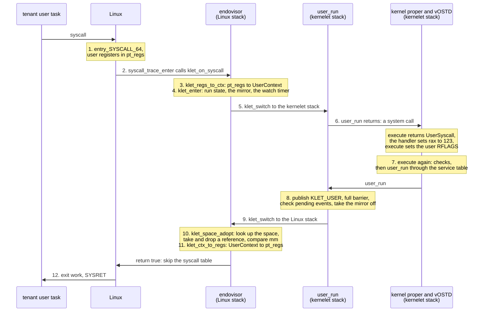
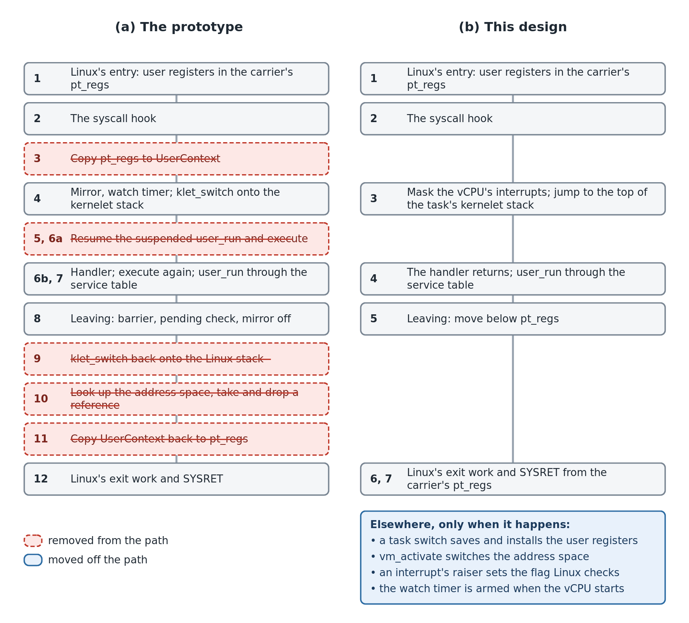
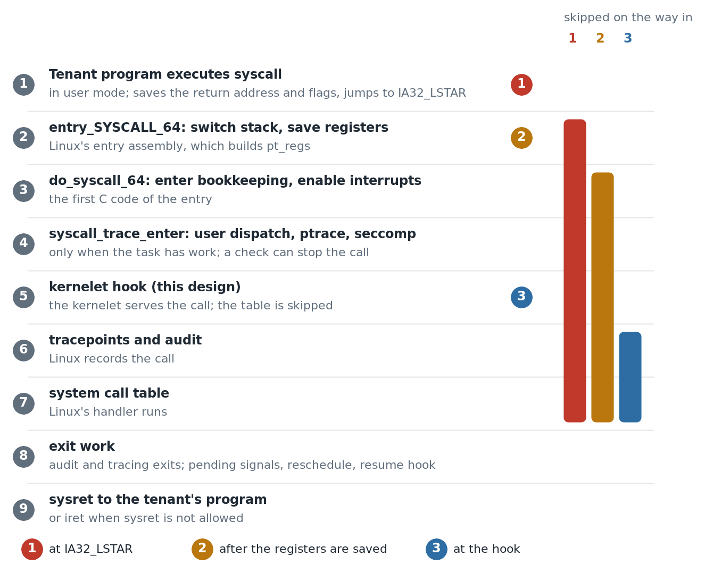

# 2026-10-31 Reduce syscall overhead

- Status: Draft
- Author(s): Plucky923
- Discussion: Not yet available.
- Affected chapters: [Carrier hooks and patch overview](../accepted-design/carrier-hooks.md), [The first kernel we will run](../accepted-design/the-first-kernel-we-will-run.md), [Two stacks](../accepted-design/two-stacks.md), [Into user mode and back](../accepted-design/into-user-mode-and-back.md), [The kernelet ABI](../accepted-design/the-kernelet-abi.md), [Tasks and virtual CPUs](../accepted-design/tasks-and-virtual-cpus.md), [Tenant memory on Linux's page tables](../accepted-design/tenant-memory-on-linux-page-tables.md), [Virtual interrupts](../accepted-design/virtual-interrupts.md), [What it costs](../accepted-design/what-it-costs.md), and [Why a kernel of your own](../accepted-design/why-a-kernel-of-your-own.md).
- Implementation or experiments: [Validation and evidence](#validation-and-evidence).

## Summary

A prototype system call whose handler only returns a constant takes 125.1 ns, compared with 56.4 ns for native `getpid`. This proposal aligns vOSTD's execution model with Linux's to reduce handoff overhead. Event handlers return before user execution resumes. User registers stay in the carrier's `pt_regs` until another user task needs it. **In a later experiment, the measured implementation takes 63.7 ns per call, compared with 57.4 ns for native `getpid` on the same Linux build.** Linux's task stacks stay unchanged.

## Problem and motivation

A prototype system call whose handler only returns a constant takes 125.1 ns, compared with 56.4 ns for native `getpid`. The difference is 68.7 ns.

### Background: one system call today

The figure traces one prototype system call, with step numbers from the timing table. The [appendix](#appendix-the-prototypes-mechanisms) explains the mechanisms.



### Where the cost is

We collected one 10 ms trace per boot across five boots, using Intel PT from the host. The traces cover about 450,000 system calls. The table reports each step's median time.

<div class="background">

**x86: Intel Processor Trace.** The processor records branch outcomes and, at selected branches, cycle counts. A decoder combines these records with the binaries to reconstruct the executed instructions. Only branches with cycle counts provide timing. Tracing inserts no instructions, but traced runs took 1.2% to 1.6% longer than untraced runs. The table reports medians to limit the effect of occasional slow samples.

</div>

| Step | What runs | Instructions | Cycles | Time (ns) |
|---|---|---:|---:|---:|
| 1 | Linux's entry, up to the check of the syscall work bits | 64 | 42 | 12.7 |
| 2 | The work bit, the call of the hook, and the hook's first checks | 18 | 9 | 2.7 |
| 3 | The hook's last checks, and the copy from `pt_regs` to `UserContext` | 43 | 15 | 4.5 |
| 4 | `klet_enter`: the run state, the mirror, the watch timer, and `klet_switch` saving and loading registers | 65 | 24 | 7.3 |
| 5 | From `klet_switch`'s return to `user_run`'s return on the kernelet stack | 3 | 16 | 4.9 |
| 6a | The kernel proper tells what the run returned | 10 | 16 | 4.8 |
| 6b | The handler stores 123, `execute` sets the user flags and calls `RawUserContext::run` | 5 | 25 | 7.4 |
| 7a | `RawUserContext::run`'s checks: the current task, overflow checks, held spin locks | 26 | 6 | 1.7 |
| 7b | Two dependent loads of the service table, and the jump to `user_run` | 3 | 24 | 7.3 |
| 8 | `user_run`: publishing `KLET_USER`, the barrier `lock addl`, the pending check, and taking the mirror off | 24 | 28 | 8.4 |
| 9 | `klet_switch` back onto the Linux stack, and `klet_enter`'s return | 23 | 7 | 2.1 |
| 10a | The hook calls `klet_space_adopt`, which calls `klet_space_get` | 26 | 16 | 5.0 |
| 10b | `lock cmpxchg` on the space's reference count | 5 | 32 | 9.7 |
| 10c | The liveness check, the `mm` comparison, the call of `klet_space_put` | 15 | 2 | 0.6 |
| 10d | `lock decl` on the same count | 1 | 23 | 7.0 |
| 10e | The returns to the hook | 6 | 2 | 0.6 |
| 11 | The hook's check after the run, and the copy from `UserContext` back to `pt_regs` | 52 | 15 | 4.5 |
| 12a | Linux's exit work | 63 | 19 | 5.8 |
| 12b | Restoring the user registers, and SYSRET | 23 | 52 | 15.8 |
| — | User mode, from SYSRET to the next `syscall` | | | 13.3 |
| | Total | 475 | 373 | 126.1 |

The step medians sum to 126.1 ns. Without tracing, we measured 125.9–128.4 ns per call in the same boots.

The Linux–kernelet handoff costs **78.5 ns** (steps 2–11). **This proposal addresses the handoff overhead caused by differences between Linux's and the kernelet's execution models.**

#### Two kernels' models meet at the handoff

Linux gives each task a kernel stack and saves user registers there in `pt_regs`. No kernel call remains suspended while the task runs in user mode. **In the prototype, kernelet tasks share a carrier's Linux stack. Each task keeps `execute` suspended on its own kernelet stack and stores user registers in a separate `UserContext`.** Each syscall copies registers between these representations and resumes the suspended call chain to reach the kernel proper.

**The resumption steps take 9.7 ns; register copying and adjacent hook checks take about 9 ns.** These two groups of steps total about **18.7 ns**. They do not isolate the full cost of adapting the two execution models.


*A Linux thread (a) and the prototype's carrier (b) during user execution. **Red numbers mark the two costs below: resuming calls (1) and copying registers (2).***

1. **Resuming the suspended call: steps 5 and 6a, 9.7 ns.** Each system call resumes `user_run` on the kernelet stack. Control returns through `execute` to the kernel proper, which checks the return reason ([Appendix](#appendix-the-prototypes-mechanisms), `execute` and Two stacks). These steps execute 13 instructions. The stack switch itself costs little.
2. **Copying the registers: steps 3 and 11, about 9 ns.** The hook copies 18 registers from Linux's `pt_regs` to the kernelet's `UserContext`, then copies them back before returning to user mode. These copies and the hook's checks execute 95 instructions in about 30 cycles.

#### Other costs and engineering optimizations

- **Address-space checks (step 10, 22.9 ns).** On each return, the prototype looks up the requested address space, takes and drops a reference, and compares it with the current space. The benchmark has one task, so its address space does not change. This design moves the switch to `vm_activate` and defers cleanup that can sleep, removing this work from the return path.
- **Event ordering (part of step 8).** `user_run` publishes `KLET_USER`, then checks for pending virtual interrupts. A full memory barrier (`lock addl`) orders these steps. This design sets Linux's notification flag for each virtual interrupt in any carrier state, removing the check and barrier from `user_run`.
- **Build settings (steps 6b and 7a).** The prototype builds the image as a shared library. Calls between crates then go through the global offset table, and integer-overflow checks stay on. The `release-lto` profile makes a position-independent executable with direct calls and no overflow checks.
- **Service-table call (step 7b, 7.3 ns).** The image permits only relative relocations and no imported symbols ([The endovisor UAPI](../accepted-design/the-endovisor-uapi.md)). The kernelet therefore calls `user_run` through a service table, with two dependent loads and an indirect jump. This design keeps this call.
- **The mirror and watch timer.** This design keeps both; their optimization is outside its scope.

## Proposed change

### Design overview



*One system call through the prototype (a) and this design (b). Steps on the same row do the same job. **This design removes the red steps from the system-call path.** The blue box lists work that runs only on a task switch, an address-space change, a virtual interrupt, or vCPU startup.*

### The kernelet user task


***Stacks and saved user registers** in the prototype (a) and this design (b). The blue arrows show a later switch from A to B.*

**A carrier keeps its own Linux stack, and each task has its own kernelet stack.** On entry from user mode, Linux saves the current user task's registers in `pt_regs` at the top of the carrier's Linux stack. The kernelet runs each task's code on that task's kernelet stack.

**While a user task stays current on the carrier, its registers stay in `pt_regs`.** The handler accesses them through a handle borrowed from vOSTD. For a system call, exception or kernel event without a task switch, **vOSTD copies no registers at the handoff**. This removes the two copies in item 2.

**When another user task needs `pt_regs`**, vOSTD saves the previous task's registers at the top of that task's kernelet stack. It then copies the incoming task's registers from its save area into `pt_regs` before that task's code continues. A kernel task has no user registers, so vOSTD saves or installs nothing for it.

### The vOSTD interface

In the prototype, the kernel proper calls `execute`, which stays suspended on the kernelet stack while user code runs. In this design, **vOSTD controls user execution and calls the kernel proper's event callbacks.** The handler returns before the task re-enters user mode. vOSTD can change the path between user mode and the handler without changing the handler.

**Each user task holds its handler in its data.** The kernel proper implements `UserEventHandler` for its thread type, such as Asterinas's `Thread`. Each user task stores an `Arc` of that type as its data. Callbacks borrow the current task's handler; for Asterinas, `self` is `&Thread`. vOSTD also passes `&CurrentTask`, the only way to access the task's local data.

*Proposed: vOSTD's interface for user events.*

```rust
/// The type of the user tasks' data: each user task's data is an `Arc` of
/// this type. vOSTD calls these methods on the current task's data.
pub trait UserEventHandler: Send + Sync + 'static {
    /// Called once on the new task, before its first entry into user mode.
    fn init(&self, task: &CurrentTask, user: &mut UserMode) {}
    /// Handles one event of the current task; returns when done. It may sleep
    /// or be preempted.
    fn handle(&self, event: UserEvent, task: &CurrentTask, user: &mut UserMode);
    /// Asked before every return to user mode: whether the task ends.
    fn should_exit(&self, task: &CurrentTask, user: &UserMode) -> bool;
    /// Returns true if a virtual interrupt received in user mode left work
    /// for the kernel proper. Otherwise, vOSTD skips `handle`.
    fn has_kernel_event(&self, task: &CurrentTask, user: &UserMode) -> bool { false }
    /// Called with virtual interrupts masked just before user mode, to load
    /// the task's floating-point and segment state.
    fn pre_user_run(&self, task: &CurrentTask, user: &UserMode, guard: &DisabledLocalIrqGuard) {}
}

#[derive(Clone, Copy, PartialEq, Eq)]
pub enum UserEvent { Syscall, Exception, KernelEvent }
```

The kernel proper marks its handler implementation with `#[ostd::user_event_handler]`, which **exports six symbols for vOSTD to use**.

<div class="background">

**Rust: `TypeId`.** A `TypeId` identifies a concrete Rust type. vOSTD stores task data as a `Box<dyn Any + Send + Sync>` and queries the value's type ID through `Any`. It compares this ID with the handler's exported ID without knowing the handler type. `data.as_ref().type_id()` identifies the stored value; `data.type_id()` identifies the box itself. See the [Rust documentation on smart pointers and `Any`](https://doc.rust-lang.org/std/any/index.html#smart-pointers-and-dyn-any).

</div>

| Generated symbol | Purpose |
|---|---|
| `__ostd_user_data_type_id` | Return the `TypeId` of `Arc<Thread>` for the `Thread` implementation. |
| `__ostd_user_init` | Call `init` once on the new task, before its first entry into user mode. |
| `__ostd_user_handle` | Call `handle` for a system call, an exception or a kernel event. |
| `__ostd_user_should_exit` | Call `should_exit` before a return to user mode. |
| `__ostd_user_has_kernel_event` | Check whether a kernel event needs `handle`. |
| `__ostd_user_pre_user_run` | Call `pre_user_run` with virtual interrupts masked before user mode. |

`TaskOptions::new_user(context)` takes initial user register values from `context`; `.data(value)` supplies the handler state. **Before a user task can run, `build` compares the final data value's `TypeId` with the ID returned by `__ostd_user_data_type_id`.** For `Thread`, the value must be an `Arc<Thread>`; missing or mismatched data causes `build` to return `Error::InvalidArgs`. `spawn` calls `build` and propagates this error. `build` writes the initial registers to the save area at the top of the new task's kernelet stack. On the first switch, vOSTD installs these registers in the carrier's `pt_regs` and calls `init` on the new task before entering user mode. Objects needed across events remain in task data or local data.

**Each callback borrows the current task and a `UserMode` handle from vOSTD.** vOSTD creates the handle and lends it for the callback's duration. The handle provides access to the task's registers in the carrier's `pt_regs` and its exception state. `UserMode` is neither `Send` nor `Sync`. Through `UserContext`, the kernel proper can update user registers while the segment fields and privileged flag bits remain fixed.

A callback may sleep while another user task runs on the same carrier and reuses its `pt_regs`. A `&mut` reference held across sleep would conflict with accesses by the switch path and the other task. Restoring the values before resumption would not remove this conflict. **The callback therefore borrows a `UserContext` on its own kernelet stack, without borrowing `pt_regs`.** Its methods read and write fields through raw pointers to the frame, without creating references to it. The kernel proper calls the same methods as before.

**A switched-out task does not execute its callback or access registers through its handle.** The task resumes on the same vCPU, and the handle keeps the same `pt_regs` address. If another user task took ownership of `pt_regs`, vOSTD restores the suspended task's registers from its stack save area before resuming the callback. The callback then accesses its own task's registers through the same handle.

#### Porting a kernel proper

**The kernel proper replaces its `execute` loop with callbacks.** Event handling moves to `handle`, the exit check to `should_exit`, and one-time setup on the new task to `init`. Objects that the loop created once and reused, such as the process reference, become task data. Each thread holds a strong process reference that callbacks borrow, avoiding reference-count updates on each event. **This creates a reference cycle, because the process also holds its tasks.** The reaper breaks the cycle by removing the main thread from the process's task set. References that keep the thread alive can delay process destruction, so cleanup must run earlier. Process exit cancels the timers, and the reaper sends the pidfd's hang-up event.

*Proposed: Asterinas's user thread from `create_new_user_task`, written against the handler. The wait while the process is stopped and the panic catching are omitted.*

```rust
/// Borrows the state that the thread and its task hold.
fn context<'a>(thread: &'a Thread, task: &'a CurrentTask) -> Context<'a> {
    let posix_thread = thread.as_posix_thread().unwrap();
    Context {
        process: posix_thread.process_ref(),                // held by the thread, as in Linux
        thread_local: task.as_thread_local().unwrap(),
        posix_thread,
        thread,
        task,
    }
}

#[ostd::user_event_handler]
impl UserEventHandler for Thread {
    fn init(&self, task: &CurrentTask, _: &mut UserMode) {  // was before the loop
        let ctx = context(self, task);
        let child_tid_ptr = ctx.thread_local.set_child_tid().get();
        if is_userspace_vaddr(child_tid_ptr) {
            let _ = current_userspace!().write_val(child_tid_ptr, &ctx.posix_thread.tid());
        }
        if ctx.posix_thread.tid() == FIRST_POSIX_TID {
            crate::init::on_first_process_startup(&ctx);
        }
    }
    fn handle(&self, event: UserEvent, task: &CurrentTask, user: &mut UserMode) {
        let ctx = context(self, task);
        let exception = user.take_exception();
        let user_ctx = user.context_mut();
        match event {
            UserEvent::Exception => {
                ctx.thread_local.set_orig_syscall_ret(None);
                handle_exception(&ctx, user_ctx, exception.unwrap())
            }
            UserEvent::Syscall => {
                ctx.thread_local.set_orig_syscall_ret(Some(user_ctx.syscall_ret()));
                let res = ctx.posix_thread.ptrace_may_stop_on_syscall(&ctx, user_ctx);
                if !matches!(res, PtraceStopResult::Interrupted) {
                    handle_syscall(&ctx, user_ctx);
                    ctx.posix_thread.ptrace_may_stop_on_syscall(&ctx, user_ctx);
                }
            }
            UserEvent::KernelEvent => {
                ctx.thread_local.set_orig_syscall_ret(None);
            }
        }
        if ctx.thread.is_exited() {
            return;                                         // the loop's check before signals
        }
        handle_pending_signal(user_ctx, &ctx);
    }
    fn should_exit(&self, _: &CurrentTask, _: &UserMode) -> bool {
        self.is_exited()                                    // the loop's exit check
    }
    fn has_kernel_event(&self, task: &CurrentTask, _: &UserMode) -> bool {
        context(self, task).has_pending()                   // was a hook of `execute`
    }
    fn pre_user_run(&self, task: &CurrentTask, _: &UserMode, guard: &DisabledLocalIrqGuard) {
        let thread_local = task.as_thread_local().unwrap();
        thread_local.supp_user_context().before_user_exec(guard);   // was a hook of `execute`
    }
}

TaskOptions::new_user(user_ctx)
    .data(thread)                                           // an `Arc<Thread>`
    .local_data(thread_local)
    .spawn()
    .unwrap();
```

### The handoff protocol

**An event enters the kernelet through a Linux hook and leaves through a new Linux entry point.** The kernelet never returns to the hook.

#### In: from the hook to the handler

The syscall hook masks virtual interrupts, switches to the current task's kernelet stack, and enters vOSTD with the event type. vOSTD reads the current task and event state from the vCPU record. **Virtual interrupts stay masked until these reads finish**, preventing another task's events from overwriting the record before vOSTD reads it. vOSTD then unmasks virtual interrupts and calls the kernel proper's handler. For a kernel event, vOSTD calls the handler only if `has_kernel_event` returns true. The resume hook uses the same path for exceptions and virtual interrupts.

#### Out: from the handler to user mode

*Proposed, simplified: vOSTD's entry for a user event.*

```rust
extern "C" fn user_event_entry(raw_event: u64) -> ! {
    let event = UserEvent::from_raw(raw_event);
    // The hook entered with virtual interrupts masked:
    // no task switch can happen before these reads.
    let task = current_task();
    let data = task.data().as_ref()
        as *const (dyn core::any::Any + Send + Sync) as *const ();
    let mut user = UserMode::for_current_carrier(); // also takes the exception, if any
    unmask_virtual_interrupts();
    // SAFETY: `build` checked this user task's data type. The data cannot
    // be replaced, and the current task keeps it alive during these calls.
    let should_exit = unsafe {
        if event != UserEvent::KernelEvent || __ostd_user_has_kernel_event(data, &task, &user) {
            __ostd_user_handle(data, event, &task, &mut user);
        }
        __ostd_user_should_exit(data, &task, &user)
    };
    if should_exit {
        exit_current_task();
    }
    assert_no_guard_held();                     // a guard kept alive with mem::forget
    preempt_if_wanted();                        // the scheduler's chance before user mode
    let guard = mask_virtual_interrupts();
    // SAFETY: The same task and checked data remain alive after rescheduling.
    unsafe { __ostd_user_pre_user_run(data, &task, &user, &guard) };
    user_run()                                  // never returns
}
```

After the handler returns, vOSTD completes the checks and callbacks above, then calls `user_run`. Virtual interrupts remain masked after `pre_user_run`. The endovisor unmasks them before invoking Linux's return-to-user path. **`user_run` leaves through `kernelet_return_to_user`, which starts a call chain on the carrier's Linux stack below the saved `pt_regs`.** Linux runs its exit work on this chain and returns to user mode.

### Task switch

**Each vCPU records which user task owns its carrier's `pt_regs`.** vOSTD copies registers only when switching to a user task other than the owner. It saves the owner's registers in that task's save area, installs the incoming task's registers, and records the new owner. Switches to kernel tasks or back to the owner copy nothing.

vOSTD copies registers in `after_switching_to`, on the incoming task's stack with virtual interrupts masked. The copies finish **before the task's own code continues**, so the task finds its registers in `pt_regs`.

- **First run.** `build` allocates the task's kernelet stack and writes the initial registers to its save area. The first switch installs these registers in the carrier's `pt_regs` before `init` runs. A vCPU without an owner has nothing to save.
- **Owner exit.** The exiting owner's registers are no longer needed. With virtual interrupts masked, `exit_current` clears the owner record and removes the task from the run queue. The task cannot run again, preventing the owner record from referring to its freed stack.

**A task stays on the vCPU where it first runs.** Asterinas's scheduler has no load balancing. Its `select_cpu` chooses a CPU by load for a new thread and otherwise returns the thread's last CPU. This design therefore keeps tasks on their vCPUs.

Three parts of this design rely on the rule:

- **Lazy saving.** A switched-out task's registers may still be in its vCPU's `pt_regs`.
- **Sleeping callbacks.** A callback may keep its `UserContext` borrow while sleeping. The stored address still identifies the same carrier's `pt_regs`.
- **vCPU lookups.** vOSTD assumes that a task stays on the same vCPU between finding its record and using it.

Every scheduler used with vOSTD must keep each task on the vCPU where it first runs. Load balancing would require saving a task's registers from its old carrier's `pt_regs` and making vCPU lookups safe across migration.

### Invariants

- **Handler data.** Each user task keeps an `Arc` of the registered handler type alive throughout its callbacks. `build` checks the type; safe APIs cannot replace the data afterwards.
- **Register owner.** While a user task runs, in the kernel or in user mode, it owns its vCPU's `pt_regs` ([Task switch](#task-switch)).
- **No reference to `pt_regs`.** Neither the kernel proper nor vOSTD creates a Rust reference to the carrier's `pt_regs` ([The vOSTD interface](#the-vostd-interface)).
- **vCPU binding.** Every scheduler must keep each task on the vCPU where it first runs.
- **Return state.** vOSTD's register writes keep segment fields and privileged flag bits fixed. The endovisor sets `orig_ax` to -1 before Linux's exit work ([Implementation and integration](#implementation-and-integration)).
- **Handler return.** The handler returns before its task enters user mode.
- **Masked entry.** vOSTD reads the current task and the event state with virtual interrupts masked ([In](#in-from-the-hook-to-the-handler)).
- **Services.** vOSTD does not switch tasks while a service runs.

## Alternatives and tradeoffs

### One Linux task per kernelet task

Each kernelet task has a separate Linux task, Linux stack and `pt_regs`.

- Gain: **No register copy at a task switch, and no shared Linux stack.**
- Cost: **A kernelet task switch becomes a Linux sleep and wakeup.** Linux's scheduler decides when the woken task runs. Each sandbox needs one Linux task per tenant thread.

### Per-task Linux stacks

Each user task has its own Linux stack, where Linux saves user registers in `pt_regs` and `UserContext` accesses them in place. On a switch to a user task, the endovisor installs that task's Linux stack as the carrier's by replacing `task_struct.stack` and the stack top.

- Gain: **A system call copies no registers and takes 63.5 ns**, 5.8 ns more than native `getpid` ([Validation and evidence](#validation-and-evidence)). Task switches also copy no registers, and tasks may move between vCPUs.
- Cost: **It breaks Linux's stack-lifetime invariant, requires invasive changes, and uses more memory.** Linux requires a fixed kernel stack throughout each task's life to locate `pt_regs`, check stack bounds and walk the stack. Each Linux stack takes 16 KiB.

### Switcher at `IA32_LSTAR`

[PVM](https://ranger.uta.edu/~jrao/papers/sosp23.pdf) (Huang et al., SOSP 2023) runs secure-container guests in hardware ring 3 inside a leased cloud VM. **It points `IA32_LSTAR` at a short assembly switcher in the host kernel. A guest `syscall` then reaches the guest kernel without the hypervisor's exit handler.** PVM calls this a *direct switch*.

<div class="background">

**x86: `IA32_LSTAR`.** This model-specific register stores the entry address for 64-bit system calls. **When user code executes `syscall`, the processor enters ring 0 at this address.** The kernel sets the register with the privileged `wrmsr` instruction, normally once at boot.

</div>

For kernelets, `IA32_LSTAR` could point to a switcher while a carrier runs, letting its `syscall` skip Linux's system-call entry.


*One system call under PVM's direct switch and under this design. Numbers mark each change between ring 3 and ring 0.*

- Gain: **Linux's system-call entry code stays unchanged, and ordinary tasks continue to use it.**
- Cost: **The switcher must redo the required work of Linux's entry and exit code.** It skips seccomp, ptrace, audit and syscall tracing for carrier calls. Each switch to or from a carrier writes `IA32_LSTAR`. If Linux runs in a VM whose hypervisor traps this write, it causes a VM exit.

### Switcher in Linux's entry code

After `entry_SYSCALL_64` saves the registers, new assembly code checks the current task's syscall work bits before Linux's C entry code runs. **If only the kernelet's bit is set, the code jumps to the switcher.** Otherwise Linux takes its C path, where enabled checks such as seccomp and ptrace run before the kernelet hook.

- Gain: **A carrier with only the kernelet's work bit set skips Linux's C entry code.** Switches to and from carriers do not write `IA32_LSTAR`, avoiding the VM exits caused by that write.
- Cost: **Every task runs two extra loads, a comparison and a branch on each system call.** The switcher must redo the required work of Linux's C entry and exit code.



*One system call, step by step. Positions 1 and 2 are the two switchers above; position 3 is this design's hook. Each bar shows the Linux steps that a position skips on the way in.*

**This design keeps the hook in `syscall_trace_enter`, after user dispatch, ptrace and seccomp.** Linux runs its enabled checks before the hook, its entry assembly stays unchanged, and no switch writes `IA32_LSTAR`. Keeping Linux's C entry code and exit work means this position skips the least Linux code of the three. Both switchers must reproduce required work, such as enabling interrupts and checking pending work, across Linux versions and configurations. An earlier trace without the mirror measured about 20 ns across Linux's entry, hook call and exit work. The switcher in Linux's entry code would retain part of this work; **its net saving is not measured**.

## Implementation and integration

### Linux

- **Add `kernelet_return_to_user`.** It completes the exit work from the carrier's last entry, then uses the same checks as `do_syscall_64` to choose SYSRET or IRET. After a task switch, this work can belong to another task's system call. The checks select IRET if the installed registers do not permit SYSRET.

### Endovisor

- **Event entry.** The hook masks virtual interrupts, switches to the current task's kernelet stack below its save area, and never returns. This replaces `klet_switch`. On syscall entry, the hook sets `regs->ax = regs->orig_ax` so the kernel proper can read the syscall number through `UserContext::rax()`.
- **Services.** A service runs on the carrier's Linux stack and returns to its call site on the kernelet stack. The endovisor delivers no upcall during a service, so vOSTD does not switch tasks.
- **Address of `pt_regs`.** The endovisor publishes the address of the carrier's `pt_regs` in the vCPU record.
- **Reset of `orig_ax`.** Before each return to user mode, the endovisor sets `orig_ax` to -1. Otherwise, a value of `rax` from `rt_sigreturn` or another task could look like a restart code.

<div class="background">

**Linux: `orig_ax` and system-call restart.** Linux stores the syscall number in the `orig_ax` field of `pt_regs`, or -1 for an interrupt or exception. Linux may restart a call if a signal is pending, `orig_ax` differs from -1, and `rax` holds a restart code such as `-ERESTARTSYS`. Before returning to user mode, it puts the call number back in `rax` and moves `rip` back over the `syscall` instruction.

</div>

### vOSTD

- **Handler entry points.** The macro emits the [six functions](#the-vostd-interface) in the kernel proper with `#[unsafe(no_mangle)]` and the Rust ABI. The five callback entries take the task's data address as `*const ()`, then the trait arguments except `self`. For `Thread`, each borrows `&Arc<Thread>` and calls the method with `thread.as_ref()`, without cloning the `Arc` or creating `&mut Thread`. Each image must define one registration.
- **`UserContext` with two forms.** `Owned` holds independent register values from `UserContext::default()` for initialization or `clone()` for a snapshot. `build` stores the initial values as `RawUserRegs` in the task's stack save area. `Frame` is the handle that `context_mut` lends to a callback. On first run or event entry, `UserMode` gets the carrier's `pt_regs` address from the vCPU record. **Task switching copies registers between the save area and `pt_regs`; the handle's form and address stay unchanged.** `Frame` methods read and write through raw pointers and return values, without creating references to `pt_regs`. `general_regs` and `general_regs_mut` return objects containing copies; references into these objects point to the copies. The mutable object borrows its parent `UserContext` until it writes the copy back on drop.
- **No `Send` or `Sync`.** `UserContext` implements neither trait. Asterinas creates and uses each context within one task, so it does not need `Send`. Task `data`, `local_data` and entry closures require `Send`, which prevents them from storing or transferring a `UserContext`.
- **Replaced context.** If `init` or `handle` replaces the borrowed `UserContext` with an owned one, vOSTD installs those registers in the current task's `pt_regs` after the callback returns. The same field restrictions apply as for other context writes.
- **Save area and owner.** Each user task reserves a `pt_regs`-sized save area at the top of its kernelet stack. The first entry and every event entry start below it. Each vCPU records its `pt_regs` owner. `after_switching_to` copies registers when the owner changes; with virtual interrupts masked, `exit_current` clears an exiting owner's record and removes the task from the run queue.
- **Default scheduler.** vOSTD's FIFO scheduler records the vCPU where a task first runs and wakes the task there.
- **Fixed fields.** vOSTD keeps segment fields and privileged flag bits fixed on every user-register write, in both `UserContext` forms and when installing a task's registers. This includes `general_regs_mut` writeback and replacement with an owned context. `set_rflags` keeps only `RFLAGS_USER` bits: those Linux lets a debugger set, plus `ID`. It always sets `IF` and bit 1.

<div class="background">

**x86: user-mode return state.** `CS` selects the code segment, `SS` selects the stack segment, and `RFLAGS` contains status and control bits. This design fixes the following values for return to 64-bit user mode:

| Field | Fixed value | Purpose |
|---|---:|---|
| `CS` | `0x33` | Select the 64-bit user code segment. |
| `SS` | `0x2b` | Select the user stack segment; `RSP` supplies the stack address. |
| `RFLAGS.IF` | `1` | Allow maskable hardware interrupts in user mode. |
| `RFLAGS.IOPL` | `0` | Prevent the kernel proper from raising user I/O privileges. |

The segment values and flag definitions come from Linux v6.12's [segment header](https://github.com/torvalds/linux/blob/v6.12/arch/x86/include/asm/segment.h) and [flags header](https://github.com/torvalds/linux/blob/v6.12/arch/x86/include/uapi/asm/processor-flags.h).

</div>

*Proposed: `UserContext::set_rflags` for owned registers and the carrier frame.*

```rust
/// Sets rflags: only the bits a user program may hold are taken, and the
/// interrupt flag and bit 1 are always set.
#[inline(always)]
pub fn set_rflags(&mut self, rflags: usize) {
    let value = (rflags & RFLAGS_USER) | RFLAGS_FIXED;
    match &mut self.storage {
        ContextStorage::Owned(regs) => regs.rflags = value,
        // SAFETY: The current task owns this live carrier frame.
        // This write does not create a reference to the frame.
        ContextStorage::Frame(frame) => unsafe {
            core::ptr::addr_of_mut!((**frame).rflags).write(value)
        },
    }
}
```

For example, `set_rflags(0)` stores `0x202`, with `IF` and bit 1 set. `set_rflags(3 << 12)` also stores `0x202`: the requested `IOPL = 3` is cleared.

**Update the Accepted Design chapters listed under Affected chapters together with the corresponding prototype changes.**

## Validation and evidence

**We measured this design and [per-task Linux stacks](#per-task-linux-stacks) in one run, with the same Linux configuration.** Both share the handler and the return path. A QEMU/KVM guest runs patched Linux 6.12 with two vCPUs pinned to separate host cores. The kernelet uses one vCPU and one user task, and its handler returns a constant. Each configuration boots five times in shuffled order.

### The time of one system call

**The table reports the mean of the five per-boot averages; range gives the smallest and largest.** Each ratio uses the native time on that design's Linux build. The prototype's row comes from another run.

| Setting | Time (ns) | Range (ns) | Ratio to native |
|---|---:|---:|---:|
| Native `getpid` | 57.5 | 57.3–57.8 | 1.00 |
| The prototype | 125.1 | 123.9–125.9 | 2.22 |
| Per-task Linux stacks | 63.5 | 63.1–63.8 | 1.10 |
| This design | 63.7 | 62.7–65.6 | 1.11 |

**This design and per-task Linux stacks take the same time; their ranges overlap.** The times include Linux's own entry and exit work, which this proposal does not change.

### Functional checks

**On the final implementation of this design, system calls and task scheduling work correctly.**

- **System calls.** Handlers received the expected arguments; user tasks received the expected results and retained their other general registers, including after a handler slept.
- **Scheduling.** Several user tasks shared a vCPU, blocked, woke and switched through kernel tasks without losing their saved registers. Each resumed on its original vCPU.

## Open questions

- **Floating-point and segment-base state across task switches.** `pt_regs` holds only general registers. Linux keeps FPU registers and FS and GS bases in the CPU. It saves them only on carrier switches or, for the FPU, when kernel code uses it. During kernelet execution, a task's FPU state can therefore be in the CPU or the carrier's `thread.fpu`. Task switches must coordinate with Linux to save and load this state. Linux marks saved FPU state with `TIF_NEED_FPU_LOAD` and reloads it before user mode.

## Decision and follow-up

Pending review.

## Appendix: the prototype's mechanisms

A tenant system call uses these prototype mechanisms.

- **Kernelet.** The tenant's kernel, linked into one image: the **kernel proper**, written in safe Rust, and **vOSTD**, which provides OSTD's interface on Linux.
- **Carrier.** A Linux task that runs one virtual CPU of the kernelet. The tenant program runs on it in user mode ([Carriers](../accepted-design/carriers.md)).
- **Endovisor.** The Linux module that serves kernelets. The syscall hook and every `klet_*` function in the figure belong to it.
- **Syscall hook.** Our Linux patch adds this hook after seccomp in the system-call entry. Linux calls it for each carrier syscall. The hook passes the call to the kernelet, and Linux skips its own system-call table ([Carrier hooks and patch overview](../accepted-design/carrier-hooks.md)).
- **`execute`.** OSTD's interface for running user code, called in a loop by the kernel proper. `execute` enters user mode and returns on a system call, exception, or event for the kernel proper. The kernel proper handles the event and calls `execute` again ([Into user mode and back](../accepted-design/into-user-mode-and-back.md)). The hundred-line kernel uses this loop:

  *Simplified from `prototype/kernels/hello/src/lib.rs`: `create_user_task`.*

  ```rust
  let mut user_mode = UserMode::new(create_user_context());
  loop {
      let return_reason = user_mode.execute(&DummyUserHooks);
      let user_context = user_mode.context_mut();
      if ReturnReason::UserSyscall == return_reason {
          handle_syscall(user_context, &vm_space);
      }
  }
  ```

- **Two stacks.** A task's Linux kernel stack is empty on return to user mode. `execute` returns on a system call, exception or kernel event; its frames remain on the task's kernelet stack while the program runs. `klet_switch` switches between the hook's kernel-mode context on the carrier's Linux stack and the current task's context on its kernelet stack. The hook waits while the kernelet runs; the task waits inside `execute` while the user program runs ([Two stacks](../accepted-design/two-stacks.md)).
- **`UserContext`.** The kernelet's copy of a task's user registers. On kernel entry, Linux saves them in `pt_regs` at the top of the carrier's Linux stack. The hook copies them into the task's `UserContext` and back before returning to user mode ([Into user mode and back](../accepted-design/into-user-mode-and-back.md)).
- **Service table.** The kernelet image imports no host symbols. It calls the endovisor only through a function-pointer table received at startup. The `user_run` entry enters user mode ([The kernelet ABI](../accepted-design/the-kernelet-abi.md)).
- **Virtual CPU record.** One shared record per virtual CPU, holding pending virtual interrupts and the address space last activated with `vm_activate`. Each tenant process has its own address space, a Linux `mm`. The carrier switches to the activated space before returning to user mode ([Tasks and virtual CPUs](../accepted-design/tasks-and-virtual-cpus.md), [Tenant memory on Linux's page tables](../accepted-design/tenant-memory-on-linux-page-tables.md)).
- **Virtual interrupts.** A kernelet timer tick or request from another virtual CPU. The endovisor sets a pending bit, then checks whether the carrier is in or entering user mode and notifies Linux if so. Before checking pending events, `user_run` publishes `KLET_USER`. Memory barriers order both sequences, so an interrupt raised during this handoff is either seen by `user_run` or causes a Linux notification. Linux clears the notification flag before calling the resume hook, preserving notifications raised during the hook ([Virtual interrupts](../accepted-design/virtual-interrupts.md)).
- **The mirror and watch timer.** The prototype uses these mechanisms to coordinate with Linux's scheduler; the timer also delivers virtual timer ticks. Their implementation is described in [Sharing a processor politely](../accepted-design/sharing-a-processor-politely.md).
