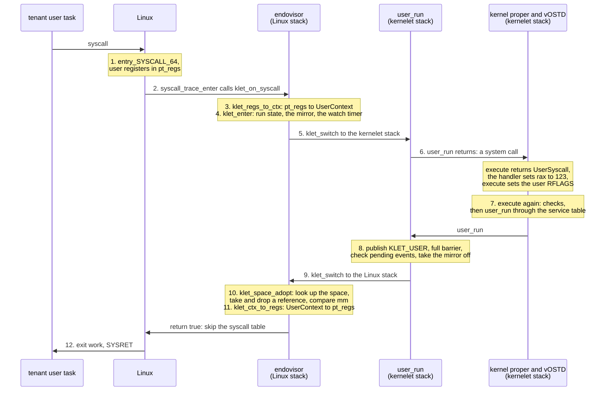
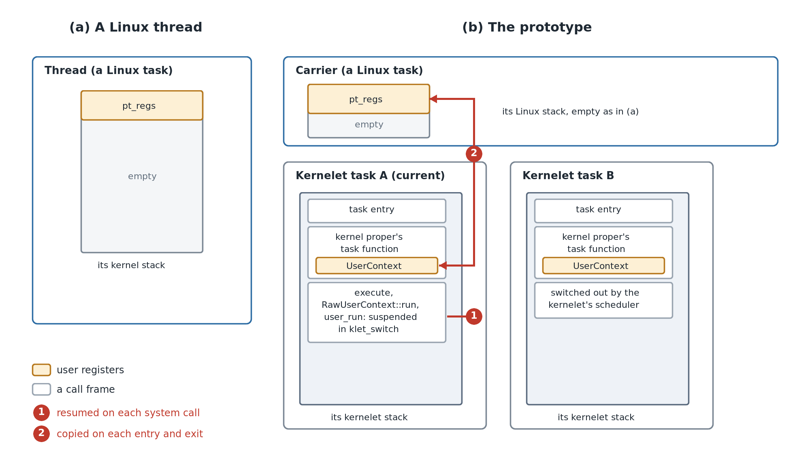
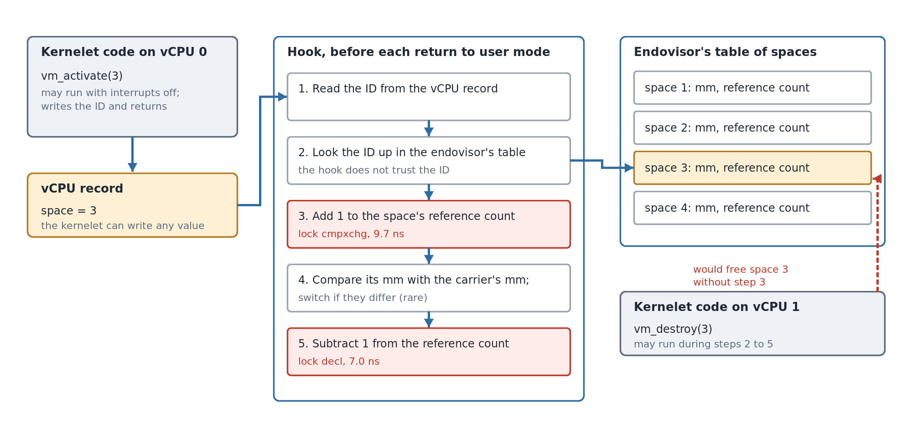
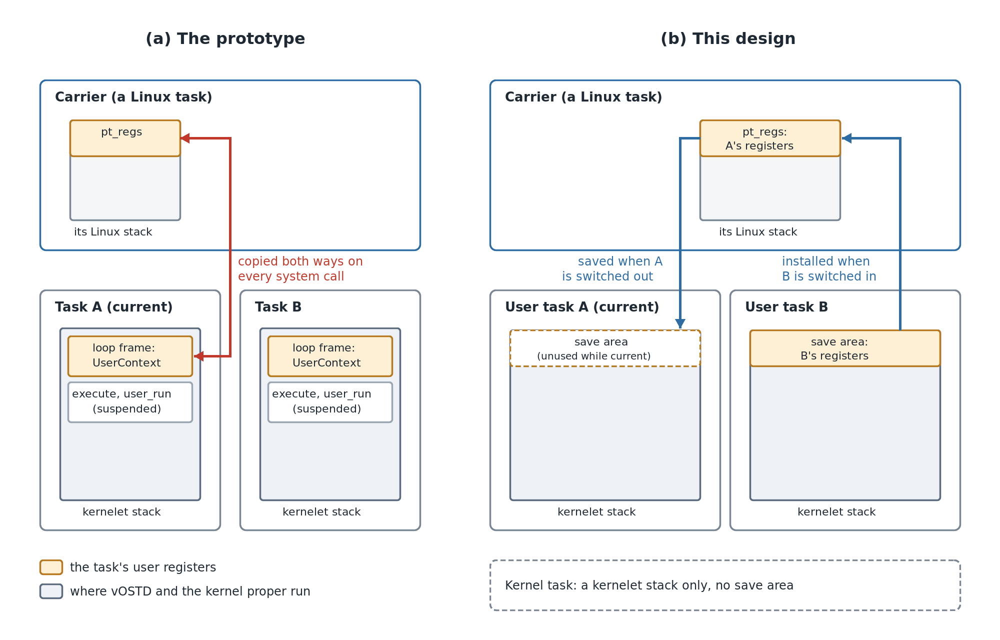
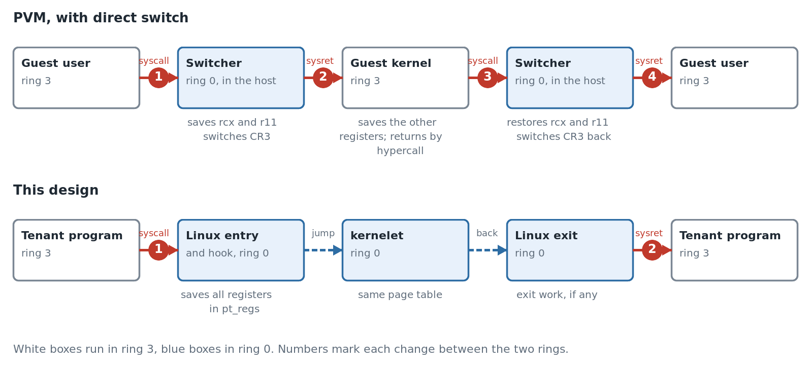

# 2026-10-31 Reduce syscall overhead

- Status: Draft
- Author(s): Plucky923
- Discussion: Not yet available.
- Affected chapters: [Carrier hooks and patch overview](../accepted-design/carrier-hooks.md), [The first kernel we will run](../accepted-design/the-first-kernel-we-will-run.md), [Two stacks](../accepted-design/two-stacks.md), [Into user mode and back](../accepted-design/into-user-mode-and-back.md), [The kernelet ABI](../accepted-design/the-kernelet-abi.md), [Tasks and virtual CPUs](../accepted-design/tasks-and-virtual-cpus.md), [Tenant memory on Linux's page tables](../accepted-design/tenant-memory-on-linux-page-tables.md), [Virtual interrupts](../accepted-design/virtual-interrupts.md), [Sharing a processor politely](../accepted-design/sharing-a-processor-politely.md), [What it costs](../accepted-design/what-it-costs.md), and [Why a kernel of your own](../accepted-design/why-a-kernel-of-your-own.md).
- Implementation or experiments: `prototype/` has the new build profile. The system call path is implemented and measured in a separate worktree and is not merged; [Validation and evidence](#validation-and-evidence) gives the results. Smaller Linux stacks, the additional scheduler-state interface, host-aware task placement, static checks and alternative preemption policy are not yet implemented or measured.

## Summary

A system call on a kernelet takes 125.1 ns, against 56.4 ns for native `getpid`. The extra time is the handoff between Linux and the kernelet. This proposal makes vOSTD follow Linux's protocol at that handoff: events go to a handler that returns, each user task keeps its registers in its own Linux stack, and checks on every return move to where their cause happens. A system call then takes 66.2 ns, 9.3 ns more than native `getpid`.

We propose a mechanism to coordinate the Linux and kernelet schedulers. It retains the mirror and watch timer. Static proofs would replace the corresponding runtime boundary checks, and direct access to host CPU state would guide task placement.

## Problem and motivation

### System call overhead

On the prototype, a system call whose handler only returns a constant takes 125.1 ns, compared with 56.4 ns for native `getpid`. The difference is 68.7 ns.

#### Background: one system call today

The figure shows one system call through the prototype. Step numbers match those in the timing table below. The [appendix](#appendix-the-prototypes-mechanisms) explains the mechanisms.



#### Where the cost is

We collected one 10 ms trace per boot across five boots, using Intel PT from the host. The traces cover about 450,000 system calls. The table reports each step's median time.

<div class="background">

**x86: Intel Processor Trace.** The processor records branch outcomes, with cycle counts at selected branches. A decoder uses this record and the binaries to reconstruct the executed instructions. Timing is available only at branches with cycle counts. Tracing adds no instructions to the code, but traced runs took 1.2% to 1.6% longer than untraced runs. Some steps occasionally took much longer than usual. The table uses medians to reduce the effect of these slow samples.

</div>

| Step | What runs | Instructions | Cycles | Time (ns) |
|---|---|---:|---:|---:|
| 1 | Linux's entry, up to the check of the syscall work bits | 64 | 42 | 12.7 |
| 2 | The work bit, the call of the hook, and the hook's first checks | 18 | 9 | 2.7 |
| 3 | The hook's last checks, and the copy from `pt_regs` to `UserContext` | 43 | 15 | 4.5 |
| 4 | `klet_enter`: the run state, the mirror, the watch timer, and `klet_switch` saving and loading registers | 65 | 24 | 7.3 |
| 5 | From `klet_switch`'s return to `user_run`'s return on the kernelet stack | 3 | 16 | 4.9 |
| 6a | The kernel proper tells what the run returned | 10 | 16 | 4.8 |
| 6b | The handler stores 123, `execute` sets the user flags and calls `RawUserContext::run` | 5 | 25 | 7.4 |
| 7a | `RawUserContext::run`'s checks: the current task, overflow checks, held spin locks | 26 | 6 | 1.7 |
| 7b | Two dependent loads of the service table, and the jump to `user_run` | 3 | 24 | 7.3 |
| 8 | `user_run`: publishing `KLET_USER`, the barrier `lock addl`, the pending check, and taking the mirror off | 24 | 28 | 8.4 |
| 9 | `klet_switch` back onto the Linux stack, and `klet_enter`'s return | 23 | 7 | 2.1 |
| 10a | The hook calls `klet_space_adopt`, which calls `klet_space_get` | 26 | 16 | 5.0 |
| 10b | `lock cmpxchg` on the space's reference count | 5 | 32 | 9.7 |
| 10c | The liveness check, the `mm` comparison, the call of `klet_space_put` | 15 | 2 | 0.6 |
| 10d | `lock decl` on the same count | 1 | 23 | 7.0 |
| 10e | The returns to the hook | 6 | 2 | 0.6 |
| 11 | The hook's check after the run, and the copy from `UserContext` back to `pt_regs` | 52 | 15 | 4.5 |
| 12a | Linux's exit work | 63 | 19 | 5.8 |
| 12b | Restoring the user registers, and SYSRET | 23 | 52 | 15.8 |
| — | User mode, from SYSRET to the next `syscall` | | | 13.3 |
| | Total | 475 | 373 | 126.1 |

The step medians sum to 126.1 ns. Without tracing, we measured 125.9–128.4 ns per call in the same boots.

Linux entry and exit (steps 1 and 12), plus the user-mode interval, take 47.6 ns. **This proposal retains that work and reduces the 78.5 ns kernelet handoff (steps 2–11).** To match native `getpid` at 56.4 ns, the handoff would need to take about 8.8 ns. This target is approximate: native `getpid` uses a faster Linux entry and exit path than carriers.

**The handoff includes work to bridge the two kernel models and [coordinate their schedulers](#two-level-scheduling).**

##### Two kernels' models meet at the handoff

Linux gives each task its own kernel stack, with no active call frames while the task runs in user mode. **In the prototype, kernelet tasks share a carrier's Linux stack but keep suspended `execute` calls on their own kernelet stacks.** On a system call, `execute` resumes and returns to the kernel proper. The prototype translates between these models on each system call. The list below describes five sources of handoff work; the figure shows the first two.



*A Linux thread (a) and the prototype's carrier (b) during user execution. **Red numbers mark the first two costs below: resuming calls (1) and copying registers (2).***

1. **Resuming the suspended call: steps 5 and 6a, 9.7 ns.** Each system call resumes `user_run` on the kernelet stack. Control returns through `execute` to the kernel proper, which checks the return reason ([Appendix](#appendix-the-prototypes-mechanisms), `execute` and Two stacks). These steps execute 13 instructions. The stack switch itself costs little.
2. **Copying the registers: steps 3 and 11, about 9 ns.** The hook copies 18 registers from Linux's `pt_regs` to the kernelet's `UserContext`, then copies them back before returning to user mode. These copies and the hook's checks execute 95 instructions in about 30 cycles.
3. **Checking the address space: step 10, 22.9 ns.** The kernel proper may call `vm_activate` with virtual interrupts masked; Asterinas calls it after a task switch ([Tenant memory on Linux's page tables](../accepted-design/tenant-memory-on-linux-page-tables.md)). Switching address spaces can drop the old space's last reference; `mmput()` then frees it and may sleep (Linux v6.12 `kernel/fork.c`). While the carrier sleeps, no kernelet task can run on its vCPU. With virtual interrupts masked, other vCPUs' requests, including wakeups, wait until the carrier resumes and the kernel proper unmasks interrupts ([What vOSTD adds on top](../accepted-design/what-vostd-adds-on-top.md), rule 2). vOSTD forbids sleep with virtual interrupts masked. **`vm_activate` therefore records only the space ID in the vCPU record; the hook switches before returning to user mode, where sleep is allowed.**

   `vm_activate` records only the space ID, so the hook cannot tell whether it ran since the last return to user mode. **The hook therefore repeats the five-step check before every return to user mode.** The kernelet can write any ID, and another vCPU of the same kernelet can call `vm_destroy` during the check. Figure steps 2, 3 and 5 validate the ID and hold a reference while the hook uses the space. The hook makes two atomic updates to the reference count shared by the vCPUs. These updates take **16.7 ns of the 22.9 ns total** (table steps 10b and 10d).

   

   *The prototype's address-space check before each return to user mode. **Red steps 3 and 5 update the reference count atomically.***

   The address space changes only when the kernelet switches to a task of another process, so almost every check finds no change. **The hook still spends 22.9 ns on this check for every system call.**
4. **Ordering the event check: part of step 8.** To return to user mode, the kernelet calls `user_run`. It sets `c->state` to `KLET_USER`, checks for pending virtual interrupts, and hands control to Linux if none are pending. An interrupt raiser that sees `KLET_USER` sets a notification flag for Linux. Before returning to user mode, Linux checks this flag and calls `on_resume` if it is set. The hook re-enters the kernelet if virtual interrupts are pending. **Ordering the state write before the pending check requires a full memory barrier (`lock addl`) on every system call** ([Appendix](#appendix-the-prototypes-mechanisms), Virtual interrupts).
5. **Calling through the service table: step 7b, 7.3 ns.** The endovisor requires images with only relative relocations and no imported symbols. This lets it validate images at registration and share code pages across sandboxes ([The endovisor UAPI](../accepted-design/the-endovisor-uapi.md)). The kernelet therefore calls `user_run` through the service table supplied at startup. **The call performs two dependent loads before the jump: the table address, then `user_run`'s address from that table.**

### Two-level scheduling

#### Background: two levels of scheduling

Linux schedules carriers on physical CPUs. The kernelet schedules tasks on the virtual CPUs that these carriers run. **Without coordination, Linux does not account for dependencies between kernelet tasks. The kernelet places tasks without considering how much processor time each carrier gets.** Virtual machines have the same scheduling structure. The guest kernel schedules tasks on virtual CPUs; the hypervisor schedules virtual CPUs on physical CPUs.

#### Scheduling problems

1. **Preemption during a guarded critical section.** A virtual preemption guard or virtual interrupt mask prevents the kernelet from preempting the current task. It does not by itself prevent Linux from descheduling the carrier. **If Linux deschedules a spin lock holder's carrier, waiters on other virtual CPUs can spin until the holder resumes and releases the lock.**
2. **Delays in sleeping and waking.** A task waiting on a mutex or event needs the holder or waking task to run. Linux can delay the wakeup by descheduling the holder's or waking task's carrier. **Even when runnable, the waiter may still wait for Linux to schedule its own carrier.**
3. **Task placement without host-load information.** Linux assigns carriers to physical CPUs; the kernelet assigns tasks to virtual CPUs. Competing Linux tasks on the same CPU may reduce a carrier's processor time. **If the kernelet ignores this difference, it may place new tasks on virtual CPUs whose carriers get little processor time.** The prototype does not use host processor-time information for task placement.

#### What the prototype does

<div class="background">

**Linux: kernel preemption models.** **A preemption model controls when Linux can switch away from a task executing kernel code.** Linux 6.12 has three non-real-time models:

- **`none`.** **Linux can switch away from a task executing kernel code only when it blocks or reaches an explicit scheduling point.** Examples include yields and rescheduling checks.
- **`voluntary`.** **Compared with `none`, Linux adds rescheduling checks at selected points in its kernel code.**
- **`full`.** **Linux can also preempt kernel code on interrupt return if rescheduling is requested and the preemption count is zero.**

**All three models allow preemption of user code and scheduling before return to user mode.** With `CONFIG_PREEMPT_DYNAMIC` enabled, `preempt=` selects the model at boot. See Linux v6.12's [model definitions](https://github.com/torvalds/linux/blob/v6.12/kernel/Kconfig.preempt), [model selection](https://github.com/torvalds/linux/blob/v6.12/kernel/sched/core.c), and [interrupt and user-mode exit paths](https://github.com/torvalds/linux/blob/v6.12/kernel/entry/common.c).

</div>

<div class="background">

**x86: per-CPU data.** Linux keeps a separate copy of some kernel variables for each CPU. **In the x86-64 Linux kernel, `%gs:[offset]` selects a field in the current CPU's copy.** A VM guest uses its own address space and `%gs` base, so this access selects guest data. The guest needs a host interface to read host scheduling state.

</div>

**The prototype coordinates the two schedulers through three parts** ([mechanism details](../accepted-design/sharing-a-processor-politely.md)):

1. **Direct updates through `%gs:[offset]`.** The endovisor supplies the offset of Linux's preemption count. **vOSTD uses `inc` and `dec` through `%gs` to update this count on the current host CPU.** After decrementing, vOSTD yields if the count is zero and Linux requests rescheduling.
2. **Mirror state.** Each vCPU has a `mirrored` flag. On entry to the outermost virtual critical section, vOSTD increments Linux's preemption count, then sets the flag. On exit, it clears the flag, then decrements the count. **The flag prevents repeated count updates when guards or virtual interrupt masks nest.**
3. **Watch timer.** When Linux requests rescheduling, the watch arranges a yield outside a virtual critical section and defers it inside. It records the first tick that finds both a critical section and a rescheduling request. **A later tick can force the carrier to yield if both conditions still hold and at least 1 ms has elapsed.**

**Before a service call or forced yield, the endovisor saves and removes any mirror increment from Linux's preemption count.** It restores the increment before returning to kernelet code. The vCPU's `mirrored` flag remains unchanged.

**The prototype uses all three parts under `none`, `voluntary`, and `full`, but their scheduling roles differ:**

- **`full`.** **The mirrored count defers Linux's automatic preemption while the carrier runs kernelet code in a virtual critical section.** The watch provides the forced-yield fallback.
- **`none` and `voluntary`.** Linux does not automatically preempt kernel code on interrupt return. **The watch provides a path for the carrier to yield when Linux requests rescheduling.** The prototype still maintains the mirror.

**As a backstop, a task spinning on a lock can request a yield to another runnable carrier in the same sandbox.**

#### Limitations and overhead

- **Sleeping and waking.** **These mechanisms do not address delays to sleeping-lock holders or tasks responsible for wakeups when Linux deschedules their carriers.** A woken task may still wait for Linux to run its own carrier.
- **Task placement.** The kernelet still assigns tasks to virtual CPUs **without using host processor-time information**.
- **Overhead.** The mirror updates Linux's preemption count on entry to and exit from **each outermost virtual critical section**, including under `none` and `voluntary`. **Each system call** also pays for mirror bookkeeping on entry and exit (steps 4 and 8). Checking whether the watch timer is active adds **about 2 ns** to step 4.

##### The build

**Two costs come from the build settings.** In step 6b, `execute` calls `RawUserContext::run` in another crate. The image was compiled as shared-library code (`relocation-model = pic`), so this call uses the global offset table ([The endovisor UAPI](../accepted-design/the-endovisor-uapi.md)). The image is a single executable, so the call could be direct. In step 7a, enabled integer-overflow checks add a test to each arithmetic operation.

## Proposed change

### Design overview


*One system call through the prototype (a) and the proposed design (b). Steps on the same row do the same job. **Red steps are removed from the system-call path.** The blue box lists work triggered by task switches, address-space changes, virtual interrupts, or vCPU startup.*

### The kernelet user task



***Stacks and saved user registers** in the prototype (a) and proposed design (b).*

**Each kernelet user task uses the `pt_regs` on its own Linux stack as its `UserContext`.** This removes the register copies in item 2. Linux also uses this stack for entry, services and exit work.

Linux saves user registers on the carrier's registered stack. **When a user task becomes current on a carrier, the endovisor registers that task's Linux stack by its base address and size.** A kernel task uses the carrier's original Linux stack. A user task's Linux and kernelet stacks come from the sandbox's stack pool, subject to its task limit. Both are charged to the sandbox's memory cgroup.

Linux restores these registers when returning to user mode, so they must always hold safe values. **The kernel proper writes them only through `UserContext` and only during the task's own handler call.** `UserContext` keeps the segment fields and privileged flag bits fixed.

<div class="background">

**x86: user-mode return state.** `CS` selects the code segment, `SS` selects the stack segment, and `RFLAGS` contains status and control bits. This design fixes the following values for return to 64-bit user mode:

| Field | Fixed value | Purpose |
|---|---:|---|
| `CS` | `0x33` | Select the 64-bit user code segment. |
| `SS` | `0x2b` | Select the user stack segment; `RSP` supplies the stack address. |
| `RFLAGS.IF` | `1` | Allow maskable hardware interrupts in user mode. |
| `RFLAGS.IOPL` | `0` | Prevent this API from raising user I/O privileges. |

The segment values and flag definitions come from Linux v6.12's [segment header](https://github.com/torvalds/linux/blob/v6.12/arch/x86/include/asm/segment.h) and [flags header](https://github.com/torvalds/linux/blob/v6.12/arch/x86/include/uapi/asm/processor-flags.h).

</div>

The `cs` and `ss` fields have no public setters. **`set_rflags` accepts only permitted bits and sets the required bits.** `RFLAGS_USER` excludes `IOPL`; `RFLAGS_FIXED` sets `IF` and bit 1, which must be one.

*Experimental implementation (`syscall-opt` worktree), `prototype/vostd/src/arch/cpu/context.rs`: `UserContext::set_rflags`.*

```rust
pub fn set_rflags(&mut self, rflags: usize) {
    self.rflags = (rflags & RFLAGS_USER) | RFLAGS_FIXED;
}
```

For example, `set_rflags(0)` stores `0x202`, with `IF` and bit 1 set. `set_rflags(3 << 12)` also stores `0x202`: the requested `IOPL = 3` is cleared. Registers such as `RAX`, `RIP`, and `RSP` remain writable through their setters.

The current implementation allocates a 16 KiB Linux stack per user task. A smaller size remains to be established and tested. We propose to use smaller stacks under two requirements:

1. **Determine the maximum stack use.** For each supported Linux build, establish an upper bound for entry checks, services, exit work, and relevant error and exception paths, including nesting. The allocation must cover this bound and meet page and alignment requirements.
2. **Keep the stack fixed after allocation.** Its address and size must remain fixed for the task's lifetime, so `pt_regs` keeps a stable address.

**Linux uses the registered stack size to locate `pt_regs`, check stack bounds, and walk the stack.** When Linux switches to a carrier, it restores the carrier's stack top from the registered stack information. Ordinary Linux tasks retain their default stack size.

### The vOSTD interface

In the prototype, the kernel proper calls `execute`, which remains suspended on the kernelet stack while user code runs. With the proposed interface, **vOSTD controls user execution and the kernel proper handles events.** For each system call, exception, or kernel event, vOSTD calls the kernel proper's handler. **The handler returns before the task re-enters user mode**, so no handler call remains suspended while user code runs. vOSTD can optimize the path between user mode and the handler without changing the handler:

*Proposed: vOSTD's interface for user events.*

```rust
/// Multiple vCPUs may call this shared handler concurrently.
pub trait UserEventHandler: Sync {
    /// Handles one event of the current task; returns when done.
    fn handle(&self, event: UserEvent, user: &mut UserMode);
    /// Asked before every return to user mode: whether the task ends.
    fn should_exit(&self, user: &UserMode) -> bool;
    /// Returns true if a virtual interrupt received in user mode left work
    /// for the kernel proper. Otherwise, vOSTD skips `handle`.
    fn has_kernel_event(&self, user: &UserMode) -> bool { false }
    /// Called with virtual interrupts masked just before user mode, to load
    /// the task's floating-point and segment state.
    fn pre_user_run(&self, user: &UserMode, guard: &DisabledLocalIrqGuard) {}
}

pub enum UserEvent { Syscall, Exception, KernelEvent }
```

**A static handler avoids a handler lookup on each event.** The kernel proper declares it with `#[ostd::user_event_handler]`, which generates entry points for direct calls from vOSTD:

*Proposed: the hundred-line kernel's handler.*

```rust
struct Hello;

impl UserEventHandler for Hello {
    fn handle(&self, event: UserEvent, user: &mut UserMode) {
        if event == UserEvent::Syscall {
            let (context, task) = user.split();
            let vm_space = task.data().downcast_ref::<Arc<VmSpace>>().unwrap();
            handle_syscall(context, vm_space);
        }
    }
    fn should_exit(&self, _: &UserMode) -> bool { false }
}

#[ostd::user_event_handler]
static HELLO: Hello = Hello;
```

`TaskOptions::new_user(context)` specifies the initial user registers, and `spawn` creates and starts the task. `init(f)` registers a callback that vOSTD runs once on the new task, before its first entry into user mode. **`UserMode` gives the kernel proper access to the current task, its user registers and its exception state.** Only vOSTD creates this handle and lends it for one callback at a time. The handle is neither `Send` nor `Sync`, so it cannot be transferred or shared across tasks.

#### Porting a kernel proper

**The kernel proper replaces its `execute` loop with callbacks.** The event handling code moves to `handle`, and the task's exit check moves to `should_exit`. The setup code that runs once on the new task moves to `init`.

*Simplified from Asterinas's `create_new_user_task`: a user thread written against `execute`.*

```rust
TaskOptions::new(move || {
    write_child_tid(&ctx);                              // once, before user mode
    let mut user_mode = UserMode::new(user_ctx);
    while !thread.is_exited() {
        match user_mode.execute(&ctx) {
            UserSyscall => handle_syscall(&ctx, user_mode.context_mut()),
            UserException => handle_exception(&ctx, user_mode.context_mut()),
            KernelEvent => {}
        }
        handle_pending_signal(user_mode.context_mut(), &ctx);
    }
})
```

*Proposed: the same thread written against the handler.*

```rust
impl UserEventHandler for Kernel {
    fn handle(&self, event: UserEvent, user: &mut UserMode) {
        let exception = user.take_exception();
        let (user_ctx, task) = user.split();
        let ctx = Context::of(task);                        // state lives in the task
        match event {
            UserEvent::Syscall => handle_syscall(&ctx, user_ctx),
            UserEvent::Exception => handle_exception(&ctx, user_ctx, exception.unwrap()),
            UserEvent::KernelEvent => {}
        }
        handle_pending_signal(user_ctx, &ctx);
    }
    fn should_exit(&self, user: &UserMode) -> bool {
        user.task().as_thread().is_exited()                 // the loop's exit check
    }
    fn has_kernel_event(&self, _: &UserMode) -> bool {
        // Keep the old loop's signal check after a kernel event.
        true
    }
}

TaskOptions::new_user(user_ctx)
    .init(|user| write_child_tid(&Context::of(user.task())))   // was before the loop
    .data(thread)
    .spawn();
```

### The handoff protocol

**After handling an event, the kernelet enters a new Linux entry point without returning to the hook.** This entry starts a new call chain below the saved `pt_regs` on the task's Linux stack. It runs Linux's exit work and returns to user mode.

#### In: from the hook to the handler

The syscall hook masks virtual interrupts, switches to the top of the current task's kernelet stack, and enters vOSTD with the event type. vOSTD reads the vCPU record, finds the current task and reads the event state. **Virtual interrupts stay masked until these reads finish.** If a virtual interrupt preempted the task and it resumed on another vCPU, vOSTD could still use the previous vCPU's record and read another task's state. vOSTD then unmasks virtual interrupts and calls the kernel proper's handler when needed. The resume hook uses the same path for exceptions and virtual interrupts.

#### Out: from the handler to user mode

*Proposed, simplified: vOSTD's entry for a user event.*

```rust
extern "C" fn user_event_entry(event: UserEvent) -> ! {
    let mut user = UserMode::for_current_task();
    HANDLER.handle(event, &mut user);          // the kernel proper's handler returns
    if HANDLER.should_exit(&user) {
        exit_current_task();
    }
    assert_no_guard_held();                    // a guard kept alive with mem::forget
    preempt_if_wanted();                       // the scheduler's chance before user mode
    let guard = mask_virtual_interrupts();
    HANDLER.pre_user_run(&user, &guard);
    user_run()                                 // never returns
}
```

After the handler returns, vOSTD completes the checks and callbacks shown above, then calls `user_run`. **The new Linux entry point switches to the task's Linux stack, starts a call chain below the saved `pt_regs`, and runs Linux's exit work.** Linux then returns to user mode.

### Task switch

**Linux does not track task switches inside a carrier.** If the kernelet switches the carrier from task A to task B without registering B's Linux stack, Linux still uses A's stack. B's next system call then saves B's registers in A's `pt_regs`.

**A kernel task is a kernelet task that never enters user mode.** A user task remains a user task while it handles a system call. When the scheduler switches to a user task, vOSTD registers that task's Linux stack base and size as the carrier's stack. **For a kernel task, vOSTD restores the carrier's original Linux stack.** The endovisor accepts a user task's stack only if it belongs to the instance and no other carrier uses it. It updates the current host CPU's stack top. Linux updates the stack top again when it schedules the carrier.

### Switching the address space

The kernel proper calls `vm_activate` to select the next task's address space. **This service must not sleep because the kernel proper can call it with virtual interrupts masked during a task switch.** Releasing the last reference to the old address space can trigger cleanup that sleeps. The prototype therefore records the requested space and defers the switch until just before returning to user mode. The hook looks up the requested space and compares it with the carrier's current space (step 10). **This lookup and comparison run on every system call, even when the address space has not changed.**

**`vm_activate` switches to the requested address space immediately.** It then calls `mmput_async` to release the carrier's reference to the old space. If this releases the last reference, Linux runs the cleanup on a worker thread so that `vm_activate` does not sleep. **The return path no longer needs to look up or compare address spaces.**

### Interrupts raised while leaving

In the prototype, an interrupt raiser first records the pending interrupt. It sets Linux's resume flag (`TIF_NOTIFY_RESUME`) only if the carrier is marked for user mode. The carrier must write this state before checking for pending interrupts, which requires a memory barrier. **The new design sets the resume flag for every virtual interrupt, regardless of the carrier's state.** The raiser orders the pending-bit update before setting the flag. **This removes the pending check and its memory barrier from `user_run`.**

Linux checks the resume flag before returning to user mode and calls the resume hook if it is set. **A flag set after the final check remains set for the next return from the kernel.** A system call or a delivered watch-timer interrupt provides another opportunity to handle it, as in the prototype for interrupts raised in user mode. If the kernelet has already handled the interrupt, the flag can cause an extra resume-hook call with no virtual interrupt left to deliver.

### Scheduler coordination

**Direct access to host per-CPU state.** On x86-64, the kernelet runs in Linux's kernel address space and uses Linux's per-CPU `%gs` base. Given a variable's offset, vOSTD can access any Linux per-CPU variable through `%gs:[offset]`. **Each access selects the copy on the host CPU currently running the carrier.** The prototype uses this mechanism to update Linux's preemption count. We propose that the endovisor also supply offsets for host CPU load and location, so the kernelet scheduler can use this information to place tasks.

**Mirror virtual critical sections to Linux.** vOSTD adds one to Linux's preemption count when the vCPU enters its outermost virtual critical section, and removes it on exit. **Under `full` preemption, this makes Linux defer automatic preemption of the carrier while it runs kernelet code in that section.** After removing the increment, vOSTD yields if Linux requests rescheduling and the count is zero.

Before returning to user mode, vOSTD must ensure that no forbidden lock or guard remains held. A service that may sleep must be called from a context that permits sleep. **We propose compile-time checks for these rules and for balanced Mirror increments and decrements.** The analysis must cover `pre_user_run`, the final return to user mode and every service call. **A runtime check can be removed where the analysis proves its condition.** The checker and proofs are not yet complete.

If static analysis also proves that the Mirror increment is zero at a boundary, **the endovisor can omit saving, removing and restoring it there.** Other boundaries retain these operations. vOSTD still handles pending preemption before returning to user mode.

**Watch as a scheduling fallback.** Boundary checks do not limit how long kernelet code runs before its next service call or return to user mode. When Linux requests rescheduling, the watch timer allows a short delay inside a virtual critical section. **If the request remains pending, the timer forces the carrier to yield even if the section has not ended.** It also provides scheduling opportunities under `none` and `voluntary`. This mechanism depends on timer delivery and provides no hard wall-clock bound.

The prototype checks that the watch timer is active on every entry into kernelet code. Whenever Linux schedules a carrier, the endovisor's callback starts that CPU's timer if it is not already active. **We remove the repeated entry check and retain the check at vCPU startup and in the scheduling callback.**

#### Sleeping and waking

**Coordination to reduce scheduling delays after wakeup is deferred.**

#### Task placement using host CPU load

**The kernelet scheduler could use host CPU state to choose a vCPU for a new or woken task.** Linux would still decide when and on which host CPU each carrier runs. The fields below are candidate inputs for the kernelet scheduler.

<div class="background">

**Linux: per-CPU state.** Linux keeps a separate copy of each per-CPU variable for each CPU. These variables include CPU load information, such as the number of runnable tasks. **Through `%gs:[offset]`, vOSTD can read the values for the host CPU currently running the carrier.**

</div>

<div class="background">

**Hardware: memory locality.** In a non-uniform memory access (NUMA) system, a CPU can access nearby memory faster than memory attached to another node. CPUs can also share a last-level cache. Keeping related tasks near their data can reduce memory-access costs.

</div>

`runqueues` is Linux's per-CPU runqueue. Field offsets must match the host kernel build.

| Candidate per-CPU field | Host information |
|---|---|
| `runqueues.nr_running` | Number of runnable Linux tasks, including the running carrier. |
| `runqueues.cfs.avg.util_avg`, `runqueues.cfs.avg.runnable_avg` | Recent CPU use and runnable demand for fair-scheduled tasks, including the carrier. |
| `runqueues.cpu_capacity` | Processing capacity available to fair-scheduled tasks, not the current idle fraction. |
| `pcpu_hot.cpu_number` | Host CPU ID. |
| `numa_node` | NUMA node ID; requires NUMA support on x86-64. |
| `cpu_info.topo.llc_id` | Shared last-level cache ID. |

Linux uses CPU load, capacity and topology information to place tasks on CPUs. vOSTD can read these values for the current host CPU through `%gs`. **The kernelet scheduler can use this information to place its tasks on vCPUs.**

A conventional x86-64 VM uses its own [address space](https://docs.kernel.org/virt/kvm/x86/mmu.html) and `%gs` base, so it cannot directly read host per-CPU variables. The guest needs an interface such as [shared memory](https://docs.kernel.org/virt/kvm/x86/msr.html) to obtain host data, or measurements to estimate host behavior. **The kernelet uses Linux's kernel address space and per-CPU `%gs` base, so vOSTD can read these variables directly using offsets from the endovisor.**

These values are hints, not guarantees of carrier CPU time. Queue counts can change, and load averages retain history. Comparing vCPUs also requires a mapping from each carrier to its host CPU and observations from those CPUs. A `%gs` access supplies only the current CPU's value. The field set, sampling protocol and placement policy remain to be selected and measured.

### Building the image

The image is compiled as a position-independent executable, the form in which it is linked, so its calls between crates are direct and no longer go through the global offset table (step 6b). It uses Asterinas's benchmark profile, `release-lto`: link-time optimization, one code-generation unit, and no overflow checks (step 7a). The kernelet's memory safety does not depend on overflow checks, because vOSTD bounds user ranges with `checked_add` and `saturating_add`.

### What stays

- **The hook's place.** Linux still calls the hook after seccomp, so the sandbox's filter still bounds what a carrier can ask of Linux.
- **The service table.** The kernelet still calls `user_run` through it.

## Alternatives and tradeoffs

- **One Linux task per kernelet task.** Each task would have its own Linux stack, so stack registration would be unnecessary. **Each kernelet task switch would require a Linux sleep, wakeup, and context switch.** The prototype took fewer than 2,000 cycles per task switch in the reported measurements ([What it costs](../accepted-design/what-it-costs.md)). Each sandbox would also require one Linux task per tenant thread.

#### Defer preemption throughout kernelet execution

To reduce the cost at virtual critical-section boundaries, an unimplemented alternative would add one to Linux's preemption count for the entire time the carrier runs kernelet code, and remove that increment before returning to user mode, calling a service or yielding. It would restore the increment when kernelet code resumes. This would move the count updates from each outermost virtual critical section to kernelet entry and exit, including the user-mode crossings.

With the candidate increment in place, Linux's automatic kernel preemption would be deferred even outside virtual critical sections. The watch timer would provide opportunities to yield when Linux wants the processor, while retaining the virtual critical-section check and the forced-yield mechanism. Services, explicit yields and returns to user mode remain scheduling opportunities.

This changes the tradeoff: it could avoid per-critical-section mirror updates, but could also delay Linux tasks while the carrier runs kernelet code. The timer's first observation and its later forced yield depend on ticks being delivered; they do not establish a hard wall-clock limit. The transition protocol, host latency and lock-wait effects need validation. The candidate alone does not solve sleeping-lock wakeups or task placement.

### PVM switcher

[PVM](https://ranger.uta.edu/~jrao/papers/sosp23.pdf) (Huang et al., SOSP 2023) provides a *direct switch* for system calls. **The switcher forwards calls from guest user mode to the guest kernel without entering the hypervisor's general exit handler.**

PVM hosts guest VMs for secure containers inside a VM that a vendor leases from a cloud provider. Nested hardware virtualization would require the cloud hypervisor to expose virtualization support to the leased VM. **PVM instead runs both the guest kernel and guest user code in hardware ring 3.** Guest privileged instructions and exceptions trap to the PVM hypervisor. Without direct switching, guest system calls also pass through the PVM hypervisor before reaching the guest kernel.

<div class="background">

**x86: `IA32_LSTAR`.** This model-specific register stores the entry address for 64-bit system calls. **When user code executes `syscall`, the processor enters ring 0 at this address.** The kernel sets the register with the privileged `wrmsr` instruction, normally once at boot.

</div>

PVM adds a **switcher**, a short assembly routine, to the Linux kernel's entry code inside the leased VM. While a guest runs, `IA32_LSTAR` points to the switcher, so a `syscall` from guest user mode enters it. **The switcher loads the page table for the guest kernel and enters its syscall entry code, which saves the user registers.** To return, the guest kernel invokes a hypercall implemented with `syscall`, which enters the switcher again. The switcher loads the page table for guest user mode and returns there. PVM calls this a *direct switch*.

**The figure compares the path of one system call under PVM's direct switch and the proposed design.**



**PVM's switcher transfers control directly to the guest kernel, which handles the system call.**

We consider three locations for the kernelet's switcher, numbered in the figure below. **This design uses the third: the hook in `syscall_trace_enter`, after user dispatch, ptrace, and seccomp checks.**


The three positions:

1. **Switcher at `IA32_LSTAR`.**
   - How: While a carrier runs, `IA32_LSTAR` points to the switcher. **A carrier's `syscall` enters the switcher directly and skips Linux's normal system-call entry.** The endovisor updates the register whenever Linux switches to or from a carrier on a CPU.
   - Gain: **Linux's system-call entry code stays unchanged, and ordinary tasks continue to use it.**
   - Cost: **The switcher must reproduce the required work of Linux's entry assembly and C entry and exit code.** It bypasses seccomp, ptrace, audit, and syscall tracing for carrier calls. Switching to or from a carrier also writes `IA32_LSTAR`. If Linux runs inside a VM and the hypervisor intercepts these writes, each write causes a VM exit.
2. **Switcher in Linux's entry code.**
   - How: After `entry_SYSCALL_64` saves the registers, new assembly code checks the current task's syscall work bits before calling C code. **If only the kernelet bit is set, it jumps to the switcher.** Otherwise, execution follows Linux's C path, where enabled checks, such as seccomp and ptrace, run before the kernelet hook.
   - Gain: **A carrier with only the kernelet work bit set skips Linux's C entry code.** Switching to or from a carrier requires no `IA32_LSTAR` write, so it avoids the VM exits that such writes can cause.
   - Cost: **All tasks execute two extra loads, a comparison, and a branch on each system call.** The switcher must reproduce the required work of Linux's C entry and exit code.
3. **Hook in `syscall_trace_enter`.**
   - How: The carrier's syscall work bit makes Linux call `syscall_trace_enter`. **After seccomp, the hook enters the kernelet, which handles the call without using Linux's syscall table.** The kernelet returns through the new Linux entry `kernelet_return_to_user`. This entry runs Linux's exit work, including the resume hook when needed, before returning to user mode.
   - Gain: **Linux still runs enabled user dispatch, ptrace, and seccomp checks before the hook.** The syscall entry assembly stays unchanged, and switching to or from a carrier requires no `IA32_LSTAR` write.
   - Cost: Linux's C entry code and exit work remain on the syscall path. **This option skips the least Linux code of the three.**

**This proposal keeps the hook to reuse Linux's entry and exit code.** Positions 1 and 2 must reproduce required work, such as enabling interrupts and checking for pending work, and track changes across Linux versions and configurations. Position 1 also requires `IA32_LSTAR` writes when switching to or from a carrier. An earlier trace without the mirror measured about 20 ns across Linux entry, the call to the hook, and exit work. Position 2 must retain some of this work, and **its net saving remains unmeasured**.

## Implementation and integration

**Linux adds `kernelet_return_to_user` and task-stack registration.** The new entry uses the same SYSRET checks as `do_syscall_64`. Linux continues to account for the carrier's original stack. **Before freeing that stack, Linux restores `task_struct.stack` to its original address.**

**To support smaller stacks, registration must include the stack size.** Linux must use this size to calculate stack bounds. The stack pool must allocate each user task's Linux stack at this size and charge the allocation to the sandbox.

**The endovisor replaces `klet_switch` with separate stack operations for event entry and service calls.** Event entry switches from the Linux stack to the current task's kernelet stack. After handling the event, the kernelet returns to user mode through `kernelet_return_to_user`, **without returning to the original hook**. A service call runs on the Linux stack; **when it returns, execution continues at the call site on the kernelet stack**. The carrier's state replaces `user_live` to identify when `pt_regs` holds the user task's current context. During sandbox cleanup, the endovisor frees the tasks' Linux stacks only after all carrier stack reference counts reach zero.

**In vOSTD, `UserContext` matches the layout of Linux's `pt_regs`, so vOSTD can use the saved registers directly.** Its fields are private; the kernel proper reads and updates registers through vOSTD's methods.

**Each kernel proper that runs user code must implement `UserEventHandler`.** The memory tests in `kernels/mem` run the user program in a separate task instead of calling `execute`. The event handler posts the program's reports to a mailbox, where the test waits for them. Before a task switch, the scheduler in `kernels/sched` saves the outgoing user task's floating-point state when needed. **`pre_user_run` restores the current task's state when needed, before the task enters user mode.**

**Update the Accepted Design chapters listed under Affected chapters together with the corresponding prototype changes.**

**The endovisor needs an interface in Linux to obtain per-CPU field offsets, because `runqueues` is not exported to modules.** Host code must validate the offsets against the kernel build. The endovisor passes them to vOSTD at initialization for direct `%gs` reads. vOSTD must handle unavailable fields and identify the host CPU for each observation, since a carrier can migrate. **The interface and the policy for placing tasks using host data are not yet implemented.**

**A runtime check can be removed only where static analysis proves its condition.** The analysis must cover `pre_user_run`, the final return to user mode, all service calls, and balanced mirror increments and decrements. The mirror and watch timer remain in use. **Coordination to reduce scheduling delays after wakeup is deferred.** The alternative that defers automatic Linux preemption throughout kernelet execution remains unimplemented.

## Validation and evidence

**We implemented and measured the system call design in a separate prototype worktree.** The host runs Linux 6.12 on two Intel Xeon Platinum 8259CL processors (48 cores, one thread per core). A QEMU 10.0/KVM guest runs patched Linux 6.12 with 512 MiB of memory and two vCPUs pinned to separate host cores. **The kernelet uses one vCPU, so its spin lock is uncontended.** We compare against native Linux `getpid` in the guest and the prototype. The design has four test configurations: mirror on or off, with a handler that returns a constant or also takes and releases one spin lock. We run native and these four configurations for five rounds, booting each once per round in shuffled order. We report the mean of the five per-boot averages.

### The time of one system call

The prototype's row comes from another run. **Range gives the minimum and maximum of the averages from individual VM boots.**

| Setting | Mirror | Handler | Time (ns) | Range (ns) | Ratio to native |
|---|---|---|---:|---:|---:|
| Native `getpid` | | | 56.9 | 56.8–57.1 | 1.00 |
| The prototype | kept | returns a constant | 125.1 | 123.9–125.9 | 2.22 |
| This design | kept | returns a constant | 66.2 | 66.0–66.3 | 1.16 |
| This design | kept | takes one lock | 91.5 | 91.3–91.6 | 1.61 |
| This design | removed | returns a constant | 63.1 | 62.6–64.1 | 1.11 |
| This design | removed | takes one lock | 71.7 | 71.4–72.1 | 1.26 |

**With the mirror and no lock, this design takes 66.2 ns per system call, 9.2 ns more than native `getpid`.** The prototype's excess was 68.7 ns. Without a lock, the design build with the mirror takes 3.1 ns longer than the build without it. Taking and releasing one spin lock adds 25.3 ns with the mirror and 8.6 ns without it, a difference of about 16.7 ns. **Other scheduling code also differs between the builds, so the 3.1 ns and 16.7 ns differences do not isolate the mirror's cost.**

A separate comparison reported lock costs of about 23.7 ns with the mirror and 14.3 ns without it, and a difference of about 9.5 ns. The no-lock baseline with the mirror used the first four boots because the fifth was slower. These builds also differed in other scheduling code. **The mirror updates Linux's preemption count and the vCPU's `mirrored` flag at the outermost virtual critical-section boundaries.** Accessing the flag also requires finding the vCPU record. These operations were not timed separately.

### Where the time goes now

We traced this design, with a handler that returns a constant, the same way as the prototype: five boots, 183,000 to 212,000 round trips each. 

| Steps | What runs | Instructions | Cycles | Time (ns) | Prototype (ns) |
|---|---|---:|---:|---:|---:|
| 1 | Linux's entry, up to the check of the syscall work bits | 64 | 42 | 12.7 | 12.7 |
| 2, 3 | The work bit, the hook, and the jump to the task's kernelet stack | 42 | 20 | 6.1 | 19.4 |
| 4 | vOSTD's entry, the handler, the checks before user mode, and the call of `user_run` | 58 | 45 | 13.6 | 21.2 |
| 5, 6 | `user_run`, the move below `pt_regs`, and Linux's exit work | 74 | 21 | 6.4 | 43.7 |
| 7 | Restoring the user registers, and SYSRET | 23 | 51 | 15.5 | 15.8 |
| — | User mode, from SYSRET to the next `syscall` | | | 13.3 | 13.3 |
| | Total | 261 | 179 | 67.5 | 126.1 |

The kernelet's part, steps 2 to 6, falls from 84.3 ns to 26.1 ns, and the kernel runs 261 instructions instead of 475. Steps 1 and 7 and the time in user mode do not change, so all of the gain is in the handoff. The return path, steps 5 and 6, gains the most: 37.3 ns. Step 4 is now the longest step, at 13.6 ns; in the build without the mirror, step 4 takes 8.0 ns. This difference is between builds, not an isolated timing of the mirror operations.

### Scheduling evidence to collect

The system call benchmark does not measure the benefit of avoiding lock-holder preemption or the delay to other Linux tasks. Scheduler coordination needs separate validation:

- Compare the existing mirror with the build without it under contention. Measure system call time, lock wait, spinning and host-task scheduling latency.
- Validate the static checks across user returns, including `pre_user_run`, service calls and forced yields. Verify guard constraints and balanced mirror transitions before removing runtime checks.
- Check host-state reads across carrier migration and supported kernel configurations. Compare host-aware placement with the existing scheduler under uneven host load, including sampling cost and task waiting time.
- Measure RCU grace-period duration. Any implementation of the alternative that disables preemption throughout kernelet execution needs its own correctness and latency evaluation.

## Open questions

## Decision and follow-up

Pending review.

## Appendix: the prototype's mechanisms

A system call of a tenant program passes through these mechanisms of the prototype.

- **Kernelet.** The tenant's kernel, linked into one image: the **kernel proper**, written in safe Rust, and **vOSTD**, the framework under it that provides OSTD's interface on Linux.
- **Carrier.** A Linux task that runs one virtual CPU of the kernelet. The tenant program runs on it in user mode ([Carriers](../accepted-design/carriers.md)).
- **Endovisor.** The Linux module that serves kernelets. The syscall hook and every `klet_*` function in the figure belong to it.
- **Syscall hook.** Our Linux patch adds this hook to the system-call entry. Linux calls it for each system call of a carrier, after seccomp. The hook gives the call to the kernelet, and Linux skips its own system-call table ([Carrier hooks and patch overview](../accepted-design/carrier-hooks.md)).
- **`execute`.** OSTD's interface for running user code. The kernel proper calls it in a loop. `execute` enters user mode and returns when the program makes a system call or raises an exception, or when an event for the kernel proper arrives. The kernel proper handles the event and calls `execute` again ([Into user mode and back](../accepted-design/into-user-mode-and-back.md)). The loop of the hundred-line kernel:

  *Simplified from `prototype/kernels/hello/src/lib.rs`: `create_user_task`.*

  ```rust
  let mut user_mode = UserMode::new(create_user_context());
  loop {
      let return_reason = user_mode.execute(&DummyUserHooks);
      let user_context = user_mode.context_mut();
      if ReturnReason::UserSyscall == return_reason {
          handle_syscall(user_context, &vm_space);
      }
  }
  ```

- **Two stacks.** A task's Linux kernel stack is empty each time the task returns to user mode. `execute` returns only at the program's next system call, so its frames must stay on a stack while the program runs. Each kernelet task therefore runs on a kernelet stack of its own. `klet_switch` switches between two kernel-mode contexts: the hook's, on the carrier's Linux stack, and the current kernelet task's, on that task's kernelet stack. While the kernelet runs, the hook's context waits. While the program runs, the task's context waits inside `execute` ([Two stacks](../accepted-design/two-stacks.md)).
- **`UserContext`.** The kernelet's copy of a task's user registers. On each entry into the kernel, Linux saves the user registers in `pt_regs`, at the top of the carrier's Linux stack. The hook copies them from `pt_regs` into the task's `UserContext`, and copies them back before the carrier returns to user mode ([Into user mode and back](../accepted-design/into-user-mode-and-back.md)).
- **Service table.** The kernelet image imports no host symbols. It calls the endovisor only through a table of function pointers that it receives when it starts. One entry is `user_run`, the service that enters user mode ([The kernelet ABI](../accepted-design/the-kernelet-abi.md)).
- **Virtual CPU record.** Memory that the carrier and the kernelet share, one for each virtual CPU. It holds the pending virtual interrupts and the address space that the kernelet last activated with `vm_activate`. Each tenant process has its own address space, a Linux `mm`. The carrier switches to the activated address space on its way to user mode ([Tasks and virtual CPUs](../accepted-design/tasks-and-virtual-cpus.md), [Tenant memory on Linux's page tables](../accepted-design/tenant-memory-on-linux-page-tables.md)).
- **Virtual interrupts.** The kernelet's own interrupts: a timer tick, or a request from another virtual CPU. To raise one, the endovisor sets a pending bit in the virtual CPU record. Kernelet code checks this bit before the carrier returns to user mode. If the carrier is already in user mode, the endovisor also tells Linux to give the carrier to the kernelet at its next entry into the kernel. Linux does this through the endovisor's **resume hook**. These two paths leave a gap. Kernelet code has already checked the bit, but the carrier is not yet in user mode, so the endovisor does not tell Linux. An interrupt raised in this gap would wait until the watch timer's next tick, up to 1 ms. The prototype closes the gap with a memory barrier (step 8) ([Virtual interrupts](../accepted-design/virtual-interrupts.md)).
- **The mirror.** While kernelet code is in a virtual critical section, for example holding a spin lock, vOSTD adds one to Linux's preemption count. This defers Linux's automatic kernel preemption and reduces the chance that another virtual CPU spins while the holder's carrier is preempted. Linux code that runs for the carrier must see only Linux's own count. The endovisor therefore removes the kernelet's share each time the carrier leaves kernelet code, and adds it back each time the carrier returns ([Sharing a processor politely](../accepted-design/sharing-a-processor-politely.md)).
- **Watch timer.** A per-processor timer of the endovisor that takes the processor back from kernelet code when Linux wants it. Under Linux's `none` and `voluntary` preemption models, Linux does not preempt a task in kernel code. Linux's own code gives up the processor where it calls `cond_resched()`. Kernelet code cannot call that function, so without the timer a carrier in kernelet code would keep its processor. The timer also delivers the kernelet's timer tick. On each entry into kernelet code, the carrier checks that the timer runs ([Sharing a processor politely](../accepted-design/sharing-a-processor-politely.md), which also explains the preemption models).
