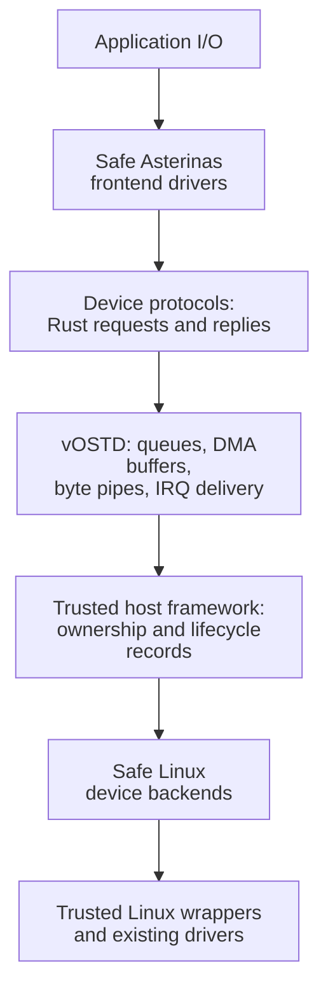
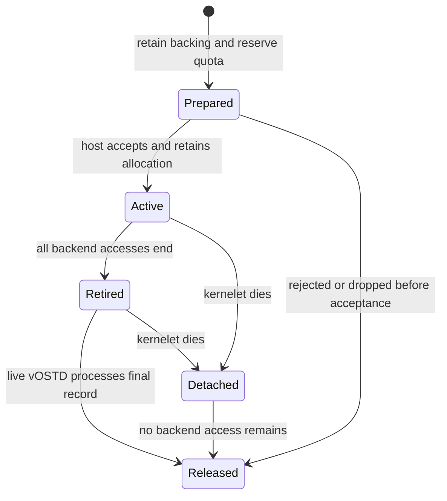
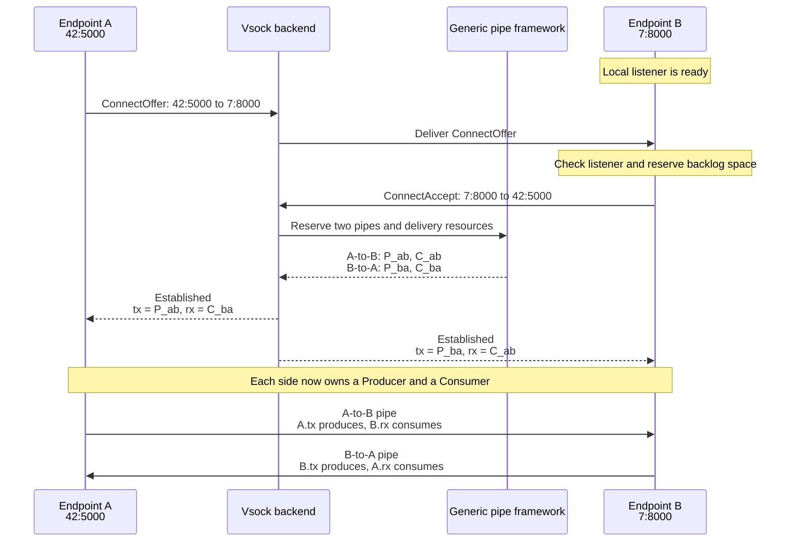

# 2026-11-08 TypedIO

- Status: Under review
- Author(s): Codex, with independent Linux, Asterinas, systems-research, and editorial review
- Discussion: See the pull request for this proposal.
- Affected chapters: [The kernelet ABI](../accepted-design/the-kernelet-abi.md), [Tasks and virtual CPUs](../accepted-design/tasks-and-virtual-cpus.md), [Stopping a kernelet](../accepted-design/stopping-a-kernelet.md), and [What vOSTD adds on top](../accepted-design/what-vostd-adds-on-top.md)
- Implementation or experiments: TypedIO is not implemented; source analysis, design review, and lessons from the [Kernelet Vsock experiment](https://github.com/tatetian/kernelet/blob/6c084ce59c87e3bab00c8e068611ca1d233d8c9e/book/src/design-proposals/2026-11-06-kernelet-vsock.md#profiling-and-the-reviewed-optimization)

TypedIO is a proposed standard interface for virtual devices in kernelets, serving the role that VirtIO plays in virtual machines. Kernelets can also use traditional VirtIO devices, but TypedIO aims to deliver better performance by exploiting the kernelet architecture.

## Motivation and Problem

Kernelets need devices to run useful workloads: block storage for filesystems and vsocks for communication with host applications or other kernelets. Linux already provides the underlying devices and services. The missing piece is a common interface between a kernelet driver, the **frontend**, and a Linux-side service, the **backend**, covering discovery, configuration, data transfer, and completion.

### Why VirtIO is a poor fit

VirtIO is a natural candidate. It standardizes virtual devices across operating systems, and Asterinas already has [VirtIO drivers and queue support](https://github.com/asterinas/asterinas/tree/ab9a4cfdc726263b3f41ccea0337633e24b443fc/kernel/core/comps/virtio). Reusing them could reduce frontend work and preserve compatibility with existing backends.

<div class="background">

**VirtIO: queues and backend placement.** VirtIO defines binary device interfaces independently of the implementation language. Its shared queues, called *virtqueues*, contain *descriptors* specifying buffer addresses, lengths, and access directions. Feature negotiation selects optional behavior supported by both sides. See the [VirtIO 1.2 specification](https://docs.oasis-open.org/virtio/virtio/v1.2/virtio-v1.2.html), especially §§1.4, 2, 3.3, and 5.

Backends process the requests. QEMU can consume virtqueues and issue host I/O in userspace. Linux also provides kernel backends for particular devices, including `vhost-net`, `vhost-vsock`, and `vhost-scsi`; these are not replacements for every QEMU device backend. See the [Linux 6.12 vhost drivers](https://github.com/torvalds/linux/blob/v6.12/drivers/vhost/Kconfig).

With kernel vhost, QEMU handles device and queue setup while a Linux backend processes ordinary I/O. This separates setup—the *control plane*—from routine processing—the *data plane*. Scheduling and notification costs remain. The [vhost interface](https://github.com/torvalds/linux/blob/v6.12/include/uapi/linux/vhost.h) exposes that setup to userspace.

*vhost-user* instead places the queue-processing backend in a separate userspace process. QEMU shares queue memory and notification handles with that process; ordinary I/O can bypass QEMU while still requiring userspace backend execution. See the [QEMU vhost-user documentation](https://www.qemu.org/docs/master/interop/vhost-user.html#introduction).

</div>

Kernelets offer a different starting point from a general-purpose VM: safe Rust drivers, a trusted OS development framework, and an existing [service interface to Linux](../accepted-design/the-kernelet-abi.md). For this setting, adopting VirtIO as the native interface has two drawbacks:

- **VirtIO loses Rust's ownership and type contracts at the boundary.** A VirtIO block request is a binary operation description plus buffer descriptors; a descriptor's address and write flag do not express ownership of a Rust buffer. Safe Rust wrappers can enforce such contracts, but they must translate them into the separately specified protocol and reconstruct them at the backend.
- **VirtIO limits optimizations enabled by the kernelet architecture.** Kernelets execute alongside the host and one another in a shared kernel address space, with Rust’s type and ownership rules constraining what safe code can access. This combination creates opportunities to reduce copying and coordination overhead. Virtual device interfaces should exploit these opportunities, but VirtIO’s existing interfaces, designed for communication across VM boundaries, limit how fully they can do so.

### Design Goals and Requirements

**Device generality.** Support a broad range of virtual devices, including block, network, vsock, and filesystem devices, without being limited to VirtIO’s device types. Provide common mechanisms for discovery, configuration, data transfer, and notification that simplify both frontend and backend development. Each **device protocol** defines its operations, message formats, and execution/completion rules in Rust.

**Memory safety.** Support frontend and backend drivers written entirely in safe Rust, with only small additions to the trusted computing base (TCB), the code relied on for memory safety: minimal vOSTD extensions and a small host framework with audited Linux wrappers. This trusted code must retain and safely reclaim cross-boundary resources despite buggy, stalled, or terminated kernelets, without relying on their destructors or cooperation. Bound and account for retained resources, and reclaim them only after all accesses have ended.

**High performance.** Exploit the shared kernel address space and Rust’s safety guarantees to reduce data movement and coordination costs. Process backend I/O in the host kernel, and eliminate stream forwarding copies by sharing a kernel buffer directly between endpoints. Explore direct host page-cache access without adding a VM’s second address-translation layer, and avoid duplicate per-page metadata where host records can be reused. VMs also support [shared buffers](https://www.qemu.org/docs/master/system/devices/ivshmem.html), and [virtiofs direct access (DAX)](https://virtio-fs.gitlab.io/) exposes host-cached file data; evaluate TypedIO against these mechanisms and in-kernel vhost backends as well as QEMU.

**Asterinas integration.** Prefer existing OSTD memory and I/O interfaces, including `IrqLine` for notifications and `DmaStream` for making kernelet buffers accessible to the host. Existing Asterinas network, socket, and block I/O stacks should support TypedIO frontends alongside VirtIO frontends, with minimal changes to their callers. Breaking API changes are a last resort.

## TypedIO design

### Overview

A frontend submits Rust values describing an operation; its backend performs the operation through Linux. vOSTD and the host framework validate access, retain buffers, and deliver results, leaving device behavior to the drivers.

Consider a frontend reading 4 KiB from a disk into an existing OSTD buffer. Both sides use the same `BlockProtocol` definition, which groups the device's configuration, request, and reply types through the `Protocol` trait. Those types implement `Message`, the contract that permits their values to cross the kernelet–host boundary. A read is expressed as a `BlockRequest::Read` value containing a sector and destination buffers.

The frontend first finds an authorized disk with `discover::<BlockProtocol>()`. It examines each `Device` through `config()` and opens a bounded request `Queue` on the selected device.

<div class="background">

**OSTD: DMA buffers.** Direct memory access (DMA) lets a device access memory without a CPU payload copy. OSTD’s `DmaCoherent` and `DmaStream` own storage prepared for device access: coherent buffers need no explicit cache synchronization, while streaming buffers provide synchronization methods. Both expose byte access through `VmReader` and `VmWriter`. Asterinas’s `Slice<Arc<DmaStream>>` describes a bounded range while sharing ownership of the DMA object.

</div>

For the block read, the frontend supplies a destination range as a `Slice<Arc<DmaStream>>`. Submitting this value lets the framework retain the buffer independently and give the host write access for the read operation.

A queue supports multiple outstanding requests. Each carries a **request tag** identifying frontend state; the driver matches arriving completions to their callers. The example uses the frontend’s synchronous `wait_reply` helper.

*Proposed frontend example. The caller supplies queue `options`, a DMA `buffer` of at least 4 KiB, and a valid `sector`. `BlockFrontend::new` installs the interrupt/completion worker; `submit` records local state before submission, and `wait_reply` waits on that state.*

```rust
let devices = discover::<BlockProtocol>()?;
let device = select_device(&devices)?;
let queue = device.open(options)?;
let frontend = BlockFrontend::new(queue)?;

let destination = Slice::new(Arc::clone(&buffer), 0..4096);
let pending = frontend.submit(BlockRequest::Read {
    sector,
    buffers: [destination].try_into()?, // A bounded list of existing DMA buffer ranges.
})?;
let reply = wait_reply(pending)?;
```

The host accepts the request into a `HostRequest`, which retains the destination independently of frontend handles. The registered backend passes it to a Linux adapter. The adapter reports **completion** only after every host access ends, making the final result available to the frontend.

Completion triggers a **virtual interrupt**, a software interrupt delivered to a kernelet virtual CPU (vCPU). vOSTD invokes the driver’s `IrqLine` callback; the driver drains tagged results and chooses which callers to notify. After a successful read, it calls `buffer.sync_from_device(0..4096)` before reading the bytes. Trusted records retain storage until host access ends even if a caller abandons the request or the kernelet dies.

Streams use **byte pipes**, shared storage carrying ordered bytes. A connection handshake delivers `Producer` and `Consumer` endpoints; each reserves a range, transfers bytes, and commits progress. Pipes reuse the same discovery, typed messages, resource checks, and interrupts as block I/O.

#### Architecture

The block and stream paths separate driver policy from trusted transfer mechanisms:

*Layer organization. Established stream payload travels directly through pipe endpoints.*



The trusted components are vOSTD, the host framework and wrappers, the message-derivation machinery, the loader, and the underlying Linux kernel. Device policies remain in safe frontend and backend code. Safe Rust does not itself prove those policies correct or ensure that a device makes progress.

| Layer | Responsibility | Excluded responsibility |
|---|---|---|
| vOSTD | Validate DMA ranges, retain local storage, expose bounded access, dispatch IRQ callbacks | Ports, connection policy, block ordering policy |
| Kernel proper | Socket state, block frontend, completion dispatch and task wakeups | Direct host-memory access or Linux calls |
| Host framework | Validate resource access, retain storage, account for requests, handle teardown | Device-specific interpretation of data |
| Safe backend | Authorization and device protocol, Linux adapter selection | Unchecked pointer access, device-access lifetimes |

### Protocol and message types

The frontend and backend need to agree on operations without sharing heap ownership or assuming that objects owned by a kernelet instance remain valid after that instance terminates. `Protocol` groups a device's configuration, request, and reply types; each must implement `Message` so the framework can transfer it safely. Both sides know every shared protocol and generated transfer-view definition; private fields restrict construction and access, not knowledge of the type.

A type is **exchangeable** in TypedIO when the framework can transfer its value between a kernelet instance and the host, or between instances, without giving safe receiver code access to unretained memory or depending on the sending instance to run cleanup. The proposed unsafe trait `Message` expresses this contract. A trusted derive macro checks ordinary structs and enums recursively; vOSTD supplies audited implementations for primitives, supported containers, and resource handles. Application and device code use the trait through safe APIs. Each resource’s audited hooks specify its permitted transfer directions.

<div class="background">

**Data representation: schemas.** A *schema* specifies a message's variants, fields, types, and size limits. A schema digest is a hash identifying a schema; equality detects agreement, not whether a particular message is valid or authorized.

</div>

*Proposed type contracts; generated transfer code and routine definitions are omitted.*

```rust
/// Marks a type whose generated or audited transfer satisfies the exchange contract.
///
/// # Safety
/// Implementations must satisfy the documented exchangeability requirements.
/// The schema must describe the transfer representation and resource hooks exactly.
pub unsafe trait Message: Sized + 'static {
    const SCHEMA: SchemaDigest;
}

/// Groups a device's configuration, request, and reply types.
pub trait Protocol {
    type Config: Message;
    type Request: Message;
    type Reply: Message;
    const ID: ProtocolId;
}
```

#### Exchangeable message types

<div class="background">

**Rust: copying and representation.** `Copy` permits duplicating a value within Rust's ownership rules; shared references and raw pointers can also be `Copy`. An application binary interface (*ABI*) specifies how compiled components represent and pass data. `#[repr(C)]` specifies a layout convention, but permits padding and does not change the representation of nested fields. Neither property keeps referenced storage alive after its owner releases it. See the [Copy contract](https://doc.rust-lang.org/std/marker/trait.Copy.html) and [layout rules](https://doc.rust-lang.org/reference/type-layout.html).

</div>

An acceptable message must satisfy all of these requirements:

| Property | Requirement |
|---|---|
| Recursive admissibility | Every field belongs to the supported set below, including fields of inactive enum variants and generic type arguments used as fields. No blanket implementation for `Copy` types is allowed. |
| Bounded transfer | The schema bounds metadata size and container lengths. Transfer cannot follow arbitrary object graphs or depend on unbounded allocation. |
| Independent lifetime | The receiver owns its local value. Any usable external resource has framework-managed retention; no sender-local reference, allocator, callback, or destructor is needed to use or retire it. |
| Stable, valid capture | Submission captures a valid typed value while its storage is live and protected from mutation. Ordinary message fields have no interior mutability; concurrent access to DMA payload is governed separately. |
| Compatible representation | Generated transfer code preserves field values and type invariants, handles padding safely, and agrees on layout wherever it copies a representation directly. A schema digest alone does not prove these properties. |

The framework initially supports these types and compositions:

| Type | Admission rule |
|---|---|
| Scalars | `()`, integers, floats, `bool`, and `char`; target-dependent widths such as `usize` are part of the compatibility check. |
| Structs, newtypes, enums, tuples, and arrays | Every field or element is exchangeable. User-defined types derive `Message` and have no custom `Drop`; a type need not implement `Copy`. |
| `Option<T>` and `Result<T, E>` | Their contained types are exchangeable. The generated transfer preserves the active variant. |
| Framework `BoundedVec<T>` | Elements are exchangeable and the schema fixes a maximum length. Only live elements transfer; a local allocation pointer never does. Ordinary `Vec`, `String`, `Box`, and arbitrary `Arc<T>` have no implementation; supported DMA owners are the explicit exception below. |
| Thin raw pointers, `*const T` and `*mut T` for sized `T` | Transfer only the opaque address. The pointee is neither traversed nor retained and need not be exchangeable. No host access authority follows from the address. |
| DMA resources | `DmaCoherent`, `DmaStream<D>`, their `Arc` forms, and bounded `Slice` views permit request-scoped transfer from a kernelet to host-local access handles. They do not import DMA owners into another kernelet or into replies. Neither the DMA object’s representation nor its `Arc` pointer crosses the boundary. |
| Pipe endpoints: `Producer`, `Consumer` | Audited hooks move the producer or consumer role and retain its pipe storage. These types are neither `Copy` nor `Clone`; transfer is rejected while a reservation is outstanding. `ProducerReservation<'_>` and `ConsumerReservation<'_>` are local borrows and are not exchangeable. |

References, function pointers, trait objects, unions, `MaybeUninit`, and interior-mutable types have no implementation in this version. References and safe function pointers would let safe receiver code access data or execute code whose lifetime has not been established. Other unsupported types require a separate audited extension; wrapping them in a `Copy` or `#[repr(C)]` struct does not make them admissible.

Raw pointers are permitted as data because safe code cannot dereference them. Transfer preserves their addresses without promising that they remain valid for memory access, even if echoed back to the sender. Trusted host adapters obtain buffer access through retained DMA resources, never by trusting a raw-pointer field. This distinction follows Rust's separation between [carrying a pointer and using it to access memory](https://doc.rust-lang.org/std/ptr/index.html#safety).

*Proposed admission examples; `Message` is the trusted derive macro.*

```rust
#[repr(C)]
#[derive(Clone, Copy, Message)]
struct ReadRange { sector: u64, bytes: u64 } // Exchangeable; direct-copy candidate.

#[derive(Message)]
struct ReadRequest {
    range: ReadRange,
    destination: Slice<Arc<DmaStream>>, // Exchangeable through framework retention.
}

#[repr(C)]
#[derive(Clone, Copy)]
struct Borrowed<'a> { bytes: &'a [u8] } // Cannot derive Message.
```

*Proposed block protocol declaration. `BlockConfig` and `BLOCK_PROTOCOL_ID` belong to the shared definition; request and reply types appear in the [block device design](#typedio-block).*

```rust
pub struct BlockProtocol;

impl Protocol for BlockProtocol {
    type Config = BlockConfig;
    type Request = BlockRequest;
    type Reply = BlockReply;
    const ID: ProtocolId = BLOCK_PROTOCOL_ID;
}
```

#### Transfer representation

Shared Rust types define message structure; generated transfer code handles representation differences between independently compiled components. The trusted macro derives `Message`, a schema descriptor, and transfer code from its types. Generated field bounds and compile-time assertions check nested types and concrete generic instantiations; the macro does not guess their properties from names. The macro and its support code belong to the TCB.

Exchangeability does not require field-by-field serialization on every call. A `Copy` value with a verified layout, no uninitialized padding, and no fields requiring resource-transfer hooks can use a direct metadata copy, including opaque raw-pointer fields with compatible representations. For example, `ReadRange` can use this path after layout checks. `#[repr(C)]` alone does not establish these conditions. Default-layout structs, tuples, and enums remain admissible through generated field transfer, without assuming their native representations match across builds.

Resource-bearing messages need additional work even when their scalar fields can be copied directly. A block read transfers its sector and buffer descriptors while trusted hooks retain the backing and create host-local access handles. Bounded lists transfer their elements into reserved receiver storage. These operations still cost CPU time; the design eliminates unnecessary representation conversion, not ownership accounting or metadata capture.

The kernelet–host boundary uses a small versioned service ABI carrying scalars and bounded transfer records. **Metadata**, the operation description and resource identifiers, is captured into host-owned storage before asynchronous dispatch; **payload**, the actual I/O bytes, stays in retained storage. Records contain initialized fields with padding omitted or initialized, and no sender-local owning objects. Raw-pointer fields travel as addresses; worker queues carry these records rather than granting arbitrary message types `Send`.

Build and loader checks must admit only trusted generated or audited implementations, including their transitive dependencies and macro expansions; a top-level `unsafe` lint alone does not establish the transfer invariants. Protocol definitions remain above vOSTD, so adding an operation requires no handwritten device-specific unsafe code.

Submission captures a valid typed value while it remains stable, preserving `bool`, `char`, and enum validity. Byte-oriented ingress must instead validate before constructing Rust values. Runtime checks still enforce sizes, device state, rights, and retention. Capture is synchronous and bounded; the host retains no caller argument address afterward.

### Device discovery and configuration

A frontend must find a device it is allowed to use and learn its limits before submitting I/O. `discover<P>` returns matching `Device<P>` handles; `config` exposes an attachment's configuration, and `open` creates its request queue.

<div class="background">

**Protection: capabilities.** A capability is an unforgeable handle granting specified access to a particular resource, such as permission to read a file. Possession confers that access; a resource identifier alone does not. Systems that reuse handle slots can attach an object *generation* to distinguish a removed resource from its replacement and reject stale handles.

</div>

The **holder**, the host process that creates and controls a kernelet, attaches devices before start, assigning a device instance and restricting its resources, peers, and access rights. Discovery returns a snapshot of those attachments. Live reconfiguration uses removal followed by a new generation; removal rejects new submissions, signals the driver through its IRQ line, and lets existing accesses finish. Handles from an old generation cannot name the replacement.

TypedIO’s device handles and DMA objects serve as capabilities. vOSTD constructs them with private fields through discovery and OSTD-compatible DMA APIs; a bounded buffer range limits the bytes a request may access. When a request reaches Linux, the host checks the handle's owning kernelet, object generation, access rights, and permitted use with that device.

Discovery checks the protocol identity/version, framework ABI version, and supported features. It requires exact agreement on the generated schemas of configuration, request, and reply types; their digests cover field types, variants, limits, target properties, and any directly copied layouts. The checked binding is retained in `Queue<P>`; submission obtains type information from `Message`, never from a caller-provided digest.

Opening reserves queue storage and **completion credits**, one reply slot for each request the queue can accept. It runs in a **sleepable context**, where the calling task may block while waiting for memory or locks. A credit is reserved before accepting a request so a full reply queue cannot block cleanup.

*Proposed discovery and opening APIs.*

```rust
/// An attachment authorized for the current kernelet.
pub struct Device<P: Protocol> { /* private capability and config */ }

/// Returns matching attachments after validating their schema and generation.
/// Unsupported schemas return an error rather than an unchecked typed device.
pub fn discover<P: Protocol>() -> Result<Vec<Device<P>>, DiscoverError>;

impl<P: Protocol> Device<P> {
    /// Returns the validated configuration snapshot for this attachment generation.
    pub fn config(&self) -> &P::Config;

    /// Opens a bounded queue with negotiated features and completion credits.
    /// May allocate and sleep; must not run under a spin-lock or interrupt-disable guard.
    pub fn open(&self, options: QueueOptions) -> Result<Queue<P>, OpenError>;
}
```

The block configuration supplies capacity, logical-block size (the required transfer unit), transfer limits, and read-only policy. Selecting a device does not bypass those limits: the host checks each submitted operation against the attachment.

### DMA buffers

An asynchronous request needs device-accessible storage that remains allocated until the device finishes. OSTD already provides the public buffer abstractions for this purpose. TypedIO uses `DmaCoherent` and `DmaStream<D>` directly, adding trusted request retention inside vOSTD and the host framework.

<div class="background">

**Memory: DMA storage lifetime.** Retaining or pinning pages keeps their storage available, whereas Rust `Pin` restricts object movement; neither guarantees exclusive access or device completion. A bounce buffer is separate storage used when direct device access is unsuitable. See [Linux's DMA guide](https://docs.kernel.org/6.12/core-api/dma-api-howto.html) and [user-page pinning](https://docs.kernel.org/6.12/core-api/pin_user_pages.html).

</div>

<div class="background">

**OSTD: DMA allocation and synchronization.** `DmaCoherent::alloc` and `DmaStream<D>::alloc` allocate DMA storage. `DmaStream<D>::map` takes ownership of an existing `USegment`, a contiguous run of untyped frames: bytes that may change through userspace or devices, rather than typed kernel objects. Keeping this storage allocated prevents its reuse for typed objects.

Streaming buffers require `sync_to_device` before device reads and `sync_from_device` after device writes. Their sealed direction types—implementable only by OSTD—are `ToDevice`, `FromDevice`, and `FromAndToDevice` (the default); they restrict permitted CPU access and synchronization. The zeroing `alloc` constructor requires a CPU-writable direction, so it is unavailable for `FromDevice`; `map` can use that direction.

Both DMA types release their mappings on drop. Their byte-access APIs permit concurrent access without providing ordinary Rust references to the bytes. See the inspected [coherent DMA API](https://github.com/asterinas/asterinas/blob/ab9a4cfdc726263b3f41ccea0337633e24b443fc/ostd/src/mm/dma/dma_coherent.rs), [streaming DMA API](https://github.com/asterinas/asterinas/blob/ab9a4cfdc726263b3f41ccea0337633e24b443fc/ostd/src/mm/dma/dma_stream.rs), [slice API](https://github.com/asterinas/asterinas/blob/ab9a4cfdc726263b3f41ccea0337633e24b443fc/kernel/libs/aster-util/src/mem_obj_slice.rs), and [memory-access contract](https://github.com/asterinas/asterinas/blob/ab9a4cfdc726263b3f41ccea0337633e24b443fc/ostd/src/mm/io/mod.rs).

</div>

For vOSTD, the device side of these DMA abstractions is the TypedIO host service. Allocation or mapping prepares storage for that service; submission authorizes a particular request to access a particular range. A disk read needs host write access, corresponding to `FromDevice`; a disk write needs host read access, corresponding to `ToDevice`. Bidirectional DMA buffers support either operation, while coherent buffers have no direction parameter. The framework checks the operation’s access requirements against the buffer’s allowed directions before accepting work.

<div class="background">

**Asterinas: block-I/O requests.** An Asterinas block-I/O request (BIO) groups an operation and its buffer segments. A `BioSegment` wraps a DMA-buffer range; a `SubmittedBio` owns the submitted request and reports its final status through `complete`. These are frontend objects, separate from Linux’s `bio` objects. See Asterinas’s [BIO types](https://github.com/asterinas/asterinas/blob/ab9a4cfdc726263b3f41ccea0337633e24b443fc/kernel/core/comps/block/src/bio.rs).

</div>

The block protocol uses the existing bidirectional `Slice<Arc<DmaStream>>` found in `BioSegment`. Its `Read` and `Write` variants specify the host access required for each request. This preserves the current block interface without converting buffers into new direction-specific wrappers. Protocols with one-way buffers can instead use `DmaStream<FromDevice>` or `DmaStream<ToDevice>`.

*Proposed frontend use of existing OSTD constructors. `buffer` is a `USegment` of at least 4 KiB; the selected vOSTD service accesses coherent memory. The request reuses the allocation; `frontend` is the initialized driver from the overview.*

```rust
let dma = Arc::new(DmaStream::map(buffer, true)?);
let request = BlockRequest::Read {
    sector,
    buffers: [Slice::new(Arc::clone(&dma), 0..4096)].try_into()?,
};
let reply = wait_reply(frontend.submit(request)?)?;
if reply.status == BlockStatus::Success {
    dma.sync_from_device(0..4096)?;
    // Read the result through dma.reader().
}
```

A caller needing new storage can use `DmaStream::alloc` or, for a protocol accepting coherent buffers, `DmaCoherent::alloc`. A frontend with an existing `BioSegment` can reuse its DMA slice without allocating or mapping again. `Slice::new` checks its range and panics on invalid input; drivers must validate externally supplied ranges before calling it.

#### Transfer and request retention

A request retains its local DMA owner and its **grant backing**, the host allocation containing its bytes. The book’s grants supply the storage for kernelet frames. The [lifetime section](#lifetime-and-resource-bounds) explains how these independent records survive early drop and instance death.

The proposed vOSTD DMA constructors register the prepared storage with the host framework and keep its identity private inside the DMA object. The `Message` support layer uses audited hooks to transfer that identity, range, and permitted access, retain the local owner, and construct a host-local buffer handle. Neither the guest’s `Arc` pointer nor its reference count or destructor crosses the boundary.

The initial DMA hooks grant request-scoped host access; they do not transfer DMA ownership between kernelets or import DMA owners in replies. Peer resource transfer supports host-owned pipe endpoints. Importing another instance’s DMA storage would need a separate lifetime and mapping contract.

Before dispatch, the host validates the owning instance, generation, range, direction, device authorization, and quota. The device address returned by `daddr()` is neither a host pointer nor sufficient authority. Rejection returns the original request and rolls back provisional retention.

This support is specific to the recognized DMA types, not a blanket implementation for `Arc<T>` or `Slice<T>`. The existing `Slice` lives in Asterinas’s `aster-util` library; its audited integration belongs in the shared message-support layer, using vOSTD’s resource hooks, rather than making vOSTD depend on the kernel library. Backends receive host-local counterparts with bounded byte-access operations, not guest DMA objects.

#### Synchronization and host access

The baseline is Asterinas/OSTD [revision `ab9a4cfdc726263b3f41ccea0337633e24b443fc`](https://github.com/asterinas/asterinas/tree/ab9a4cfdc726263b3f41ccea0337633e24b443fc), vOSTD’s documented API reference. Its DMA module and TypedIO retention hooks are proposed additions to vOSTD.

The initial vOSTD implementation uses coherent grant-backed storage: the CPU-visible and service-visible bytes are the same allocation. `map` retains an existing supported segment; `alloc` obtains supported storage. Unsupported backing is rejected during preparation, allowing the frontend to copy into a supported DMA buffer. The caller’s `is_cache_coherent` argument cannot authorize an unsafe mapping: vOSTD must establish the actual access properties. DMA preparation requires interrupts enabled under the existing OSTD contract; drivers prepare buffers before entering the non-sleeping submission path.

The frontend keeps the usual streaming synchronization sequence: `sync_to_device` before submitting a write, and `sync_from_device` after read completion and before CPU consumption. These calls need no cache maintenance for the initial coherent storage, but do not replace queue publication ordering or waiting for completion. Coherent buffers omit these calls. Neither API promises that other aliases have stopped accessing the bytes.

OSTD can also maintain separate CPU-visible and device-visible storage. Supporting that configuration later must preserve its synchronization semantics: the host accesses the registered device-visible storage, and the stream’s sync methods transfer data as required. Selecting the CPU-visible storage merely because it is easier to access would bypass that contract. A separate Linux-side bounce buffer is the host adapter’s responsibility. Its read *copy-back* must finish copying data into the registered DMA range before completion.

<div class="background">

**Compilers: opaque byte copies.** Ordinary Rust loads and stores assume its aliasing and data-race rules hold. An *opaque copy* uses an assembly routine to access concurrently mutable bytes without creating Rust references to them or letting the compiler replace those accesses with ordinary loads and stores. This technique does not by itself establish compatibility with other concurrent access methods.

</div>

Reusing OSTD DMA types does not by itself make arbitrary Linux CPU accesses safe. TypedIO adds a trusted host byte-access adapter using bounded opaque copies compatible with vOSTD’s assembly-copy model. Safe host APIs expose copying operations, not slices into shared storage. Host parsers validate private snapshots of control data; mutable payload bytes never become unchecked addresses or allocation lengths. Cloned frames, userspace mappings, or pooled aliases may corrupt a faulty frontend’s I/O, but must not induce host Rust undefined behavior.

Direct hardware DMA is allowed only through an audited target whose entire data path preserves this access model; other targets use host-private bounce buffers. The Linux adapter performs any physical-device DMA mapping separately: vOSTD preparing a buffer for a TypedIO service does not prove that a particular Linux device can access it directly. Application memory initially enters through existing `VmReader`/`VmWriter` copying or owned untyped frames; neither an arbitrary userspace address nor a `Vec<u8>` becomes a DMA resource automatically.

### Request submission and completion

A device queue must handle many requests without making the frontend wait for them in submission order. `Queue::try_submit` accepts a request and a frontend-chosen `RequestTag`; `try_pop_completion` returns whichever completed operation is next available. A completion identifies its request and carries either the protocol reply or a framework error. Each accepted request reserves completion space, so publication never depends on the frontend consuming another result first.

*Proposed queue APIs. `RequestId` is an opaque framework identity containing the queue generation and a non-reused request sequence; `RequestTag` is a correlation value, not memory authority. The `bitflags!` macro defines a set that can contain several notification causes at once.*

```rust
/// A bounded request/completion queue for one device attachment.
/// Created by `Device::open`; its protocol and attachment generation are fixed.
pub struct Queue<P: Protocol> { /* private queue and attachment state */ }

bitflags::bitflags! {
    /// Pending reasons to service a queue, returned by `Queue::take_events`.
    pub struct QueueEvents: u8 {
        /// One or more completions were published.
        /// Drain them with `try_pop_completion`; this flag is not a count.
        const COMPLETION_AVAILABLE = 1 << 0;

        /// Submission capacity changed from full to having room for a request.
        /// Retry `try_submit`; another submitter may have taken that capacity.
        const CAPACITY_AVAILABLE = 1 << 1;

        /// The attachment was removed and no longer accepts new requests.
        /// Accepted requests still require final completion after access ends.
        const REMOVED = 1 << 2;
    }
}

#[derive(Clone, Copy, PartialEq, Eq)]
pub struct RequestTag(pub u64);

pub struct Completion<R> {
    pub id: RequestId,
    pub tag: RequestTag,
    pub result: Result<R, RequestError>,
}

impl<P: Protocol> Queue<P> {
    /// Accepts an owned request, or returns it intact on rejection.
    /// Does not sleep or allocate; a full queue returns `WouldBlock`.
    pub fn try_submit(&self, request: P::Request, tag: RequestTag)
        -> Result<RequestId, SubmitError<P::Request>>;

    /// Removes one available completion, regardless of submission order.
    /// Returns `None` when no completion is currently available.
    pub fn try_pop_completion(&self) -> Option<Completion<P::Reply>>;

    /// Requests cancellation without establishing that buffer access has ended.
    pub fn cancel(&self, id: RequestId) -> Result<(), CancelError>;
}
```

Event flags are latched: each remains set until `take_events` atomically returns and clears it, and repeated occurrences coalesce into one bit. Taking events neither removes completion records nor clears the attachment's permanent removed state. The [IRQ methods](#binding-a-queue-to-an-irq-line) use these flags to coordinate draining and notification delivery.

The frontend installs its tag-to-request entry **before** calling `try_submit`, because completion can arrive before submission returns. A tag must be unique among that queue’s accepted requests and unread completions; the framework rejects duplicates. The driver also keeps its local slot reserved until it has dispatched the completion. The returned `RequestId` supports cancellation; it need not be installed before matching a completion, because the frontend already knows the tag.

If requests A, B, and C finish in the order C, A, B, draining returns C, A, B and the driver completes each corresponding local request immediately. One interrupt can cover all three. The [service loop](#draining-and-re-enabling-notifications) dispatches results to individual callers or a batch without waiting on a particular request.

An accepted request completes exactly once when host access ends, including requests that fail because of cancellation or device removal. If host access cannot be stopped, its resources remain retained and completion remains pending. Removal can notify the driver earlier, but cannot complete an active request prematurely. Rejection produces no completion and returns the unaccepted request. Dropping a queue handle or forgetting a request ID does not cancel accepted work or release its buffers; trusted records retain the resources independently.

Submission copies bounded metadata and retains prepared DMA objects in preallocated slots. Resource-transfer failure rolls back provisional ownership before rejection. Queue capacity, retention slots, and completion records are reserved before acceptance; a full queue returns `WouldBlock`. DMA allocation or mapping, device opening, and large control-message preparation occur outside this path, with interrupts enabled and in a sleepable context as required.

### Backend framework

The **TypedIO host framework** delivers authorized requests, retains buffers, and returns asynchronous results. Safe backends implement device behavior using this framework and Linux adapters.

#### Registration and dispatch

The host registers a backend for an authorized device attachment before the kernelet starts. The registration binds the device’s protocol and configuration to its handler; frontend discovery and queue opening refer to this same attachment. The framework dispatches each accepted operation through a `HostRequest`, described below.

<div class="background">

**Linux: worker context.** A work queue schedules deferred work on Linux worker tasks. A *control group* groups tasks for resource accounting and limits. Shared workers keep their own group membership; queuing work does not automatically charge it to the submitting task’s group. See the book’s [CPU accounting discussion](../accepted-design/sharing-a-processor-politely.md).

</div>

Handlers run on bounded Linux work queues after the framework releases its service locks. This lets the *carrier*, the Linux task running a kernelet vCPU, return to kernelet execution; see [Tasks and virtual CPUs](../accepted-design/tasks-and-virtual-cpus.md). A handler may submit asynchronous Linux I/O, but must not wait for the frontend to make progress. Removal stops new dispatch while the framework retains the backend and adapter state needed by outstanding work.

#### The backend request handle

The framework constructs one `HostRequest<R>` per accepted operation. It owns the captured message, authenticated caller identity, retained resources, and reserved reply slot, independently of frontend request state.

A **host-local message** preserves the protocol’s variants and ordinary fields while replacing kernelet resource owners with bounded host handles. The generated companion `host::BlockRequest`, for example, replaces DMA owners with access to retained host records. These views come from one shared protocol definition; no guest `Arc` or reference count transfers.

*Proposed common host APIs. `R` is a host-local request type; `Caller` identifies the authenticated originating instance and attachment.*

```rust
/// Handles accepted operations for a registered device.
pub trait Backend<R>: Send + Sync {
    fn handle(&self, request: HostRequest<R>);
}

/// Owns an accepted operation and its right to complete.
pub struct HostRequest<R> { /* private message and framework record */ }

impl<R> HostRequest<R> {
    /// Returns the identity established by the framework during admission.
    pub fn caller(&self) -> Caller;

    /// Borrows the captured message and its bounded host resource handles.
    pub fn message(&self) -> &R;
}
```

`message()` permits inspection of the operation without separating it from its lifetime record. Buffer handles provide checked byte-copy operations; they do not expose ordinary Rust slices into concurrently mutable kernelet storage. An asynchronous Linux adapter must consume the entire `HostRequest`, so its buffer access cannot outlive the retained resources.

The protocol’s generated completion methods, `finish` and `finish_error`, consume the request and supply a typed result. The framework publishes that result only after all registered accesses end, then appends a tagged completion and signals the queue’s IRQ line if delivery is enabled. A request handle cannot be cloned or completed twice.

Dropping a handle before handing it to an asynchronous adapter requests error completion; forgetting one leaves it charged against bounded outstanding work. Neither action releases storage beneath active Linux I/O, and teardown follows the same [lifetime rules](#lifetime-and-resource-bounds).

#### Example: a block backend

The block backend combines a safe per-attachment sequencer with a `BlockTarget` for an authorized Linux block-device range. The sequencer implements operation selection, range policy, and flush ordering. The target’s audited substrate provides Linux BIO construction, device/DMA lifetime retention, and completion after access ends. The registered handler feeds the sequencer, which submits permitted operations without waiting in the handler; see the [block design](#typedio-block).

*Proposed safe backend and registration. Host setup supplies `registry`, an authorized `attachment`, and a matching `target`; `attach` binds the protocol’s generated host request type to its backend and returns a registration handle retained by host setup.*

```rust
struct BlockBackend {
    sequencer: BlockSequencer,
}

impl Backend<host::BlockRequest> for BlockBackend {
    fn handle(&self, request: HostRequest<host::BlockRequest>) {
        self.sequencer.enqueue(request);
    }
}

let registration = registry.attach::<BlockProtocol>(
    attachment,
    Arc::new(BlockBackend { sequencer: BlockSequencer::new(target) }),
)?;
```

The sequencer owns the request until it submits it or completes it with an error. Once ordering permits, it calls `BlockTarget::submit`, moving the request into the adapter’s outstanding-I/O record on success. The adapter finishes the request after Linux I/O and any copy-back end.

If submission fails before taking ownership, it returns a `Rejected` value containing the intact request and error. The sequencer calls `finish_error()` on that rejection to complete the request without starting I/O.

The [host submission section](#safe-host-submission) specifies the adapter’s obligations. The [Vsock example](#typedio-vsock) shows a different backend using the same request/completion mechanism to route control messages.

### Byte pipes and reservations

A stream needs to preserve byte order across calls and reuse storage as the reader consumes data. A byte pipe supplies `Producer` and `Consumer` endpoints for one direction; a connection uses two pipes. A safe backend requests their creation through the host framework, which reserves capacity and transfers the data endpoints in a connection event. The backend retains generic pipe-close authority, described below.

A pipe uses a circular buffer with host-owned, untyped, zero-initialized storage and trusted indexes. A **reservation** claims a contiguous range while bytes are transferred.

Each pipe has its own metadata lock and readiness state, avoiding the experiment’s global wake queue. Shared IRQ lines can still schedule several sources’ service routines. Registry lookup and accounting remain bounded operations whose contention must be measured separately.

`ProducerReservation::produce` transfers bytes into that range; `ConsumerReservation::consume` transfers bytes out. Both use `commit` to finalize recorded progress: the producer publishes a prefix, and the consumer releases a prefix for reuse. The direct transfer helpers report partial faults so correct callers can commit only the transferred bytes.

`try_reserve` never sleeps or waits for space or data. Its `limit` is an upper bound: any nonempty contiguous range can satisfy the call, even if it is shorter than requested. A zero limit is invalid. A full producer or empty open consumer returns `WouldBlock`; an empty closed consumer reports end-of-file. Wraparound is handled with successive reservations.

Each reservation holds `&mut` access to its endpoint until it is committed or dropped. Endpoints are move-only, so safe code cannot create a second reservation or move an endpoint while that borrow is live. The frontend serializes concurrent application calls; vOSTD and the host still enforce reservation ownership at runtime, including when safe code forgets a reservation.

*Proposed common byte-pipe APIs. Private fields also track the claimed range and transferred prefix. `produce` and `consume` may be called repeatedly within the reservation; each advances through its remaining range.*

```rust
impl Producer {
    /// Reserves up to `limit` bytes without waiting; returns `WouldBlock` if full.
    pub fn try_reserve(&mut self, limit: usize)
        -> Result<ProducerReservation<'_>, PipeError>;
}

pub struct ProducerReservation<'a> {
    producer: &'a mut Producer,
    // Private range and progress state.
}

impl ProducerReservation<'_> {
    /// Produces bytes directly from `src`, reporting partial progress on a fault.
    pub fn produce(&mut self, src: &mut VmReader)
        -> Result<usize, (Error, usize)>;

    /// Publishes a produced prefix and releases unused capacity.
    /// Rejects a length beyond the progress recorded by transfer operations.
    pub fn commit(self, bytes: usize) -> Result<(), PipeError>;
}

impl Consumer {
    /// Reserves available data without waiting; `Ok(None)` means end-of-file.
    /// Returns `WouldBlock` if empty but still open.
    pub fn try_reserve(&mut self, limit: usize)
        -> Result<Option<ConsumerReservation<'_>>, PipeError>;
}

pub struct ConsumerReservation<'a> {
    consumer: &'a mut Consumer,
    // Private range and progress state.
}

impl ConsumerReservation<'_> {
    /// Consumes bytes directly into `dst`, reporting partial progress on a fault.
    pub fn consume(&mut self, dst: &mut VmWriter)
        -> Result<usize, (Error, usize)>;

    /// Releases a consumed prefix; the remaining bytes stay available.
    /// Rejects a length beyond the progress recorded by transfer operations.
    pub fn commit(self, bytes: usize) -> Result<(), PipeError>;
}
```

*Proposed production through a connected, mutable `tx: Producer`. `reader` is an OSTD `VmReader`; `partial_result` separates the transferred count from an optional memory fault.*

```rust
let mut reservation = tx.try_reserve(reader.remain())?;
let (n, fault) = partial_result(reservation.produce(reader));
reservation.commit(n)?;
```

The caller reports `n` and any fault using its device API’s partial-I/O rules. After `commit` returns, the mutable borrow ends and `tx` can be used again. The consumer follows the same sequence with `try_reserve`, `consume`, and `commit`, handling `Ok(None)` as end-of-file. Nonblocking reservation does not imply that accessing application memory cannot fault; no pipe metadata lock is held during the payload transfer.

#### Vectored I/O

Asterinas socket callers supply `MultiRead` and `MultiWrite`, which operate on collections of application-memory ranges. Their [existing methods](https://github.com/asterinas/asterinas/blob/ab9a4cfdc726263b3f41ccea0337633e24b443fc/kernel/core/src/util/iovec.rs) need a bounded OSTD writer or reader, rather than exposing one underlying buffer. The following reservation-scoped callbacks bridge those interfaces without a staging copy or a dependency from vOSTD on kernel-local traits.

*Proposed generic reservation extensions. `Infallible` describes the retained pipe-side memory; application-memory access can still report a fault.*

```rust
impl ProducerReservation<'_> {
    /// Lends bounded pipe storage to a local producer and records its progress.
    pub fn produce_with<F>(&mut self, transfer: F) -> Result<usize, (Error, usize)>
    where
        F: for<'a> FnOnce(&mut VmWriter<'a, Infallible>)
            -> Result<usize, (Error, usize)>;
}

impl ConsumerReservation<'_> {
    /// Lends bounded pipe data to a local consumer and records its progress.
    pub fn consume_with<F>(&mut self, transfer: F) -> Result<usize, (Error, usize)>
    where
        F: for<'a> FnOnce(&mut VmReader<'a, Infallible>)
            -> Result<usize, (Error, usize)>;
}
```

The callback cannot retain its VM view beyond the reservation’s borrow. The framework checks reported progress against the offered range, then records that count for `commit`; the direct `produce`/`consume` helpers measure their own transfer progress. A faulty callback can misreport progress and corrupt its stream, but cannot access beyond the reservation or expose uninitialized storage. Pipe storage is initialized before first exposure to a new pipe or protection scope; returned counts never grant memory authority.

*Proposed Asterinas adapter fragment. `source: &mut dyn MultiRead` is kernel-local; zero-length I/O returns before reservation. The adapter holds no socket-state spin lock during application-memory access.*

```rust
let mut reservation = tx.try_reserve(source.sum_lens())?;
let (n, fault) = partial_result(reservation.produce_with(|dst| source.read(dst)));
reservation.commit(n)?;
```

The receive adapter similarly uses `consume_with(|src| destination.write(src))`. It commits the reported prefix, or commits zero when peeking without consuming. A driver serializes use of each endpoint with a sleepable lock and releases it before waiting for pipe readiness.

#### Closing a pipe

Closing a connection needs authority that remains with its backend after the data endpoints move. Generic host pipe creation therefore also returns a host-local `PipeControl`, retained by the creator and not exchangeable. It identifies only that pipe and can be obtained only through checked creation; the safe Vsock backend owns the mapping from a flow to its pipe controls.

*Proposed host-only control API; these methods return without waiting for active transfers.*

```rust
impl PipeControl {
    /// Stops new production and later publication; published bytes drain to EOF.
    pub fn close_producer(&self);
    /// Stops further reservations and production; notifies the producer of closure.
    pub fn close_consumer(&self);
    /// Stops both endpoints and discards queued data.
    pub fn reset(&self);
}
```

Close, reset, reserve, and commit are ordered under the pipe’s host lock. Closing production rejects new producer reservations and later producer commits; closing consumption also rejects new consumer reservations and producer publication. Reset rejects new producer and consumer reservations and their commits.

An already-running transfer may finish, but its reservation still retains storage and can be finalized for cleanup. Unpublished production is discarded, so a forgotten reservation cannot delay logical closure, although it can retain charged storage until access is known to have ended.

Dropping a reservation cancels uncommitted progress: a producer returns capacity, while a consumer leaves its data available. Both paths reevaluate readiness, including cancellation of a zero-byte prefix. Forgetting a reservation keeps it charged and prevents another reservation or endpoint transfer; explicit close/reset can still signal terminal state while retaining storage.

Dropping a live `Producer`, including one discarded with a completion, closes production and relinquishes its role; dropping a `Consumer` closes consumption and relinquishes its role. Successful transfer disarms the sender’s wrapper without closing the transferred role; rejection restores ownership.

Dropping `PipeControl` releases only that control handle and does not reset live endpoints. These handle drops are bounded and non-sleeping; deferred reclamation uses already reserved records and never releases storage beneath a reservation.

Forgotten handles remain charged. Instance death revokes its roles through host records after stopping carriers, without running `Drop`; active accesses still retain storage.

#### Notifications and readiness

Notifications should announce possible progress to an interested driver. Reserving bytes publishes neither data nor returned capacity and sends no readiness notification. This follows the [Kernelet Vsock notification experiment](https://github.com/tatetian/kernelet/blob/6c084ce59c87e3bab00c8e068611ca1d233d8c9e/book/src/design-proposals/2026-11-06-kernelet-vsock.md#profiling-and-the-reviewed-optimization): avoiding needless wakeups matters even when payload already uses shared storage.

**Readiness** means that an operation can proceed without waiting. `SpaceAvailable` means the producer can reserve at least one byte; `DataAvailable` means the consumer can reserve published data. These predicates include reservation ownership, not just ring positions. Readiness is advisory: callers still handle `WouldBlock` and a prefix shorter than requested.

Every commit or cancellation checks both endpoints and latches an interested cause when readiness changes from false to true. This includes releasing an occupied role with a zero-byte commit or reservation drop, even though no byte counter changes. Closure and errors have separate terminal causes.

<div class="background">

**I/O: readiness notification and polling.** Linux `poll` and `epoll` let applications wait for readiness, such as readable data, without issuing a blocking read. Their subscriptions can therefore exist independently of blocked readers or writers. Busy polling instead repeatedly checks for work while consuming CPU time, rather than sleeping for notification.

</div>

A frontend supplies an **interest mask** selecting the readiness causes it needs. It combines local blocking demand with independent poll/epoll subscriptions; the absence of a blocked read or write never proves that nobody is polling. vOSTD sees only the aggregate mask and an IRQ binding, not socket policy or task-wakeup registrations. An empty mask suppresses ordinary readiness delivery, while terminal causes remain pending for a bound driver.

*Proposed endpoint notification APIs. `ProducerInterest` selects `SPACE_AVAILABLE`; `ConsumerInterest` selects `DATA_AVAILABLE`. Both support `empty()`. Event sets contain those readiness causes plus closure and errors.*

```rust
impl Producer {
    /// Binds a line with empty readiness interest and delivery suppressed.
    pub fn bind_irq(&mut self, line: &IrqLine) -> Result<(), BindError>;
    /// Replaces readiness interest and suppresses delivery until service/rearm.
    pub fn set_interest(&mut self, interest: ProducerInterest)
        -> Result<(), PipeError>;
    /// Takes pending causes without reserving bytes or changing interest.
    pub fn take_events(&mut self) -> ProducerEvents;
    /// Enables delivery only if no eligible cause remains; otherwise returns false.
    pub fn rearm_irq(&mut self) -> bool;
}

impl Consumer {
    /// Binds a line with empty readiness interest and delivery suppressed.
    pub fn bind_irq(&mut self, line: &IrqLine) -> Result<(), BindError>;
    /// Replaces readiness interest and suppresses delivery until service/rearm.
    pub fn set_interest(&mut self, interest: ConsumerInterest)
        -> Result<(), PipeError>;
    /// Takes pending causes without reserving bytes or changing interest.
    pub fn take_events(&mut self) -> ConsumerEvents;
    /// Enables delivery only if no eligible cause remains; otherwise returns false.
    pub fn rearm_irq(&mut self) -> bool;
}
```

Interest updates, reservation state changes, and rearming share the pipe's host lock. Enabling a previously disabled cause checks current readiness and latches it if already true; binding or updating interest also observes terminal state. Disabling a cause removes its obsolete readiness bit but preserves closure and errors. `rearm_irq` checks pending eligible causes, rather than repeatedly testing an already-ready level, so a continuously ready endpoint cannot cause an interrupt loop.

*Proposed initial Asterinas receive setup. Keep read interest enabled for sockets exposed to polling until subscriber lifetimes can be tracked reliably. The preallocated worker services pending causes and rearms; the producer uses `SPACE_AVAILABLE` in the same way.*

```rust
rx.set_interest(ConsumerInterest::DATA_AVAILABLE)?;
service.schedule();
```

A frontend with reliable subscription tracking updates the aggregate mask only when demand changes. It may select `empty()` only when neither blocking callers nor poll subscribers need ordinary readiness; every update schedules service before rearming.

A blocking frontend installs demand before its final readiness check. Its local wait primitive registers before retrying the entire reserve–transfer–commit operation, then sleeps only if progress remains impossible. The [Asterinas adapter](#data-path-and-waiting-policy) preserves signal-aware waits and balances each caller’s demand without removing other waiters or poll subscriptions.

Publication before interest installation is found by the installation check or retry; publication afterward leaves a pending cause. The worker updates local readiness and wakes waiters before rearming.

The endpoint lock serializes interest updates with local I/O and is released before sleeping. IRQ callbacks only schedule work; pending causes survive suppression and a reservation’s mutable borrow.

The [shared IRQ rules](#interrupt-delivery-and-completion-draining) still govern delivery and teardown. Terminal notification is never conditional on ordinary readiness interest. Removal racing registration or rearming must either be observed synchronously or leave a pending terminal cause; it cannot require another data commit. Instance death must publish its terminal state without waiting for a lock held by an evicted carrier, with retained host records supporting any deferred cleanup.

### Interrupt delivery and completion draining

An interrupt tells a driver that a device needs service; it need not identify a waiting task. TypedIO delivers queue and pipe notifications through OSTD’s `IrqLine` callback interface. The frontend driver drains results or checks readiness, then chooses whether to run a completion callback, schedule work, or wake a task. Neither the host nor vOSTD maintains task-wakeup registrations for TypedIO requests.

<div class="background">

**OSTD: IRQ callbacks.** `IrqLine::alloc` allocates an interrupt line, and `on_active` registers a callback taking `&TrapFrame`, the saved processor context. Callbacks execute with local interrupts disabled and should do only short, non-blocking work; this is the *top half* of interrupt handling. A driver can defer the remaining work to a worker or a *bottom half*. The line handle owns its callback registrations: dropping it removes those callbacks, while cloning a line shares the line identity but does not copy its registrations. See OSTD’s [IRQ model](https://github.com/asterinas/asterinas/blob/ab9a4cfdc726263b3f41ccea0337633e24b443fc/ostd/src/irq/mod.rs) and [IrqLine implementation](https://github.com/asterinas/asterinas/blob/ab9a4cfdc726263b3f41ccea0337633e24b443fc/ostd/src/irq/top_half.rs).

</div>

#### Binding a queue to an IRQ line

The frontend allocates a line, registers its callback, and binds the queue to that line. vOSTD translates the binding into an authorized host notification route containing the instance, resource generation, line identity, and target vCPU. The host sees no Rust callback address. Delivery enters vOSTD, which looks up the local line and invokes its callbacks.

*Proposed IRQ methods for `Queue`, using the `QueueEvents` flags defined above.*

```rust
impl<P: Protocol> Queue<P> {
    /// Binds this queue to a local IRQ line with notification delivery disabled.
    ///
    /// May allocate. After binding, schedule the driver worker to drain completions
    /// and handle pending notification causes, then call `rearm_irq`.
    /// Repeat that work if `rearm_irq` returns false.
    /// This queue will not request an interrupt until rearming succeeds.
    pub fn bind_irq(&self, line: &IrqLine) -> Result<(), BindError>;

    /// Atomically takes and clears pending `QueueEvents` flags.
    /// Leaves completion records and the attachment's removed state unchanged.
    pub fn take_events(&self) -> QueueEvents;

    /// Enables notifications only if no completions or unhandled causes remain.
    /// Returns false, leaving notifications suppressed, if more service is needed.
    ///
    /// Notifications stay disabled while the worker drains the queue, allowing
    /// one interrupt to cover several completions. A completion can arrive just
    /// after `try_pop_completion` returns `None`, while delivery is still disabled.
    /// Returning at that point could leave the completion queued with no interrupt
    /// to wake the worker. Always finish draining with this handshake.
    ///
    /// The check and enabling step share the host lock used for publication.
    /// Pending work makes it return false, requiring another drain pass.
    /// Otherwise it enables delivery before releasing the lock, so work published
    /// after successful rearming requests an interrupt.
    ///
    /// # Example
    ///
    /// Run this loop in one serialized driver worker after binding the queue
    /// and whenever its IRQ callback schedules work. `pending.complete` delivers
    /// each tagged result. `handle_state_changes` handles `CAPACITY_AVAILABLE`
    /// by prompting submission retries and `REMOVED` by stopping new submissions;
    /// it does not complete requests whose host accesses are still active.
    ///
    /// ```rust
    /// loop {
    ///     let events = queue.take_events();
    ///     // Drain records even if COMPLETION_AVAILABLE was already cleared.
    ///     while let Some(done) = queue.try_pop_completion() {
    ///         pending.complete(done.tag, done.result);
    ///     }
    ///     handle_state_changes(events);
    ///     if queue.rearm_irq() {
    ///         break; // Later work will request an interrupt.
    ///     }
    ///     // Work arrived during draining; retry without waiting for an IRQ.
    /// }
    /// ```
    ///
    /// Scheduling must preserve an IRQ-triggered reschedule even if this worker
    /// has not returned yet. If a processing budget expires before rearming,
    /// schedule another run before returning; do not wait for an interrupt
    /// while delivery remains disabled.
    pub fn rearm_irq(&self) -> bool;
}
```

*Proposed frontend setup. `service` is an existing driver worker with preallocated work state; `schedule` is safe in interrupt context, coalesces requests, and preserves a reschedule arriving while the worker runs.*

```rust
let mut irq = IrqLine::alloc()?;
let weak_service = Arc::downgrade(&service);
irq.on_active(move |_| {
    if let Some(service) = weak_service.upgrade() {
        service.schedule();
    }
});
queue.bind_irq(&irq)?;
service.schedule(); // Start draining explicitly; this queue cannot notify yet.
// Keep `irq`, `queue`, and `service` in the frontend until shutdown.
```

Binding leaves notification delivery disabled so the frontend can process existing work before enabling interrupts. Completions or removal events may already be pending; waiting for the first interrupt would leave them unprocessed. The worker runs the loop documented on `rearm_irq`, enabling delivery only when no pending work remains.

The initial implementation uses a fixed target vCPU for each line. Several queues can share one line; its callbacks schedule the corresponding service routines, which inspect their own queues. A driver retains the original line handle carrying the registrations, not just a clone. Polling drivers may leave a queue unbound and use the same completion-draining API.

Queue and pipe bindings are bounded resources; the host accounts for bindings and retained notification state. A request completion does not get its own IRQ line.

The current prototype has virtual-interrupt pending bits and upcalls, but `prototype/vostd/src/irq/mod.rs` does not yet provide `IrqLine`; `prototype/vostd/src/vcpu.rs` treats `VIRQ_LINES` as a rescheduling signal. Implementing OSTD-compatible IRQ allocation and callbacks, source routing, and the publication/rearm handshake is proposed work. The framework must retain pending source identities independently of the coalesced vCPU bit and recheck them during dispatch, so acknowledgement cannot erase a concurrent notification.

#### Draining and re-enabling notifications

The host publishes the result with release/acquire synchronization before marking its notification cause pending; the interrupt itself is not a memory barrier. When delivery is enabled, it also suppresses further notifications for that source, sets the virtual-interrupt pending bit, and wakes an idle carrier. Thus an IRQ is a coalesced prompt to inspect state, not one message per completion. Completion records remain queued until consumed, even if interrupts are masked.

A single serialized service routine drains each queue. Its interrupt callback may do a small bounded amount of work directly, or schedule a worker as above. The `rearm_irq` example runs in that worker; the local pending table selects the appropriate completion action for each tag.

Draining alone is insufficient because finding the queue empty and returning from the worker are separate steps. Suppose `try_pop_completion` returns `None`, then the host publishes a completion before the worker returns. Notifications are still suppressed, so that publication does not request an interrupt; returning without rearming could leave the completion unprocessed indefinitely.

`rearm_irq` closes this gap by checking the completion queue and pending causes under the same host lock used for publication. If work remains, it returns `false` and the worker drains again; otherwise it enables delivery before releasing the lock. Publication therefore either leaves work for another drain pass or requests a new interrupt after rearming. Merely clearing the vCPU’s interrupt bit never consumes a completion or a source’s cause bits.

`take_events`, completion draining, and rearming use bounded, non-sleeping service operations. A production worker limits work per pass; if its budget expires, it keeps notifications suppressed and schedules another pass before returning. It must not wait for another interrupt while work remains.

Completion consumption returns submission credits; capacity notifications prompt retry of `try_submit`, without promising that another producer has not already consumed those credits. Pipe readiness interest must not gate request retirement or completion recording on application waiters: asynchronous drivers still drain abandoned requests. A polling worker can suppress IRQ delivery while actively draining, then use the same rearm handshake before becoming idle.

#### Waiting belongs to the frontend

A synchronous driver wrapper can still return a local `Pending<R>` handle, but that handle is ordinary frontend state. It contains a result slot and an OSTD `WaitQueue`; neither is registered with the host. Before submission the driver inserts the slot into its tag table. Its completion worker stores the result under the slot’s lock, releases the lock, then calls `wake_all`. It removes the table entry only after dispatching that result.

*Proposed frontend-only, uninterruptible helper. `Pending::try_take` takes the stored result under a lock; the initialized driver services the queue independently of this waiting task.*

```rust
fn wait_reply<R>(pending: Pending<R>) -> Result<R, RequestError> {
    pending.waiters.wait_until(|| pending.try_take())
}
```

OSTD’s [WaitQueue::wait_until](https://github.com/asterinas/asterinas/blob/ab9a4cfdc726263b3f41ccea0337633e24b443fc/ostd/src/sync/wait.rs) registers a local waiter and rechecks the condition before sleeping, so completion between the initial check and sleep is not lost. No queue lock is held while waiting.

For a batch, the same completion worker updates a shared completed list or remaining-count and wakes a batch wait queue; the caller can wait for any result or all results without serializing device completion. Abandoning a local waiting handle does not prevent the worker from draining that request’s completion.

#### Removing devices and interrupt bindings

On removal, the framework preserves the removed state, records a notification cause, and rejects new operations while outstanding accesses finish. The driver keeps draining their final completions.

Unbinding disables host routing and invalidates its generation before line reuse; stale notifications cannot reach a replacement binding. Frontend shutdown unbinds the source, unregisters callbacks, and synchronizes with queued worker execution before dropping driver state. Callback removal must synchronize with dispatch and must not run from inside that callback.

Kernelet death detaches routing and stops carriers before abandoning local callbacks; host resource retirement requires no callback into the dead instance.

### Lifetime and resource bounds

Dropping frontend objects cannot be the cleanup protocol: a kernelet may forget them or stop executing entirely. Trusted vOSTD and host records therefore track accepted work independently. Drivers need no additional cleanup API to keep host accesses safe.

#### Retaining and retiring requests

Two retention records protect the same bytes. A trusted vOSTD pending reference retains the DMA owner, preventing local frame reuse or retyping; a host-owned **lease** keeps the containing grant backing alive independently of instance teardown. Both records must be established before host acceptance, independently of frontend handles. Host records contain page/range descriptions and host-owned state, never a pointer to a kernelet `Arc`, destructor, callback, or allocator.

**Retirement** records that backend access has ended. The live kernelet then *drains* those records: vOSTD processes them, releases its pending references, and makes replies available. **Detachment** disconnects a dead kernelet from host notifications and completion delivery.



After death, release also waits for carrier eviction and tenant mapping teardown.

For the overview's 4 KiB read, abandoning the frontend’s local pending handle leaves both retention records active at least until host access ends. Final completion waits for all CPU accesses, DMA, and any read copy-back. Only then may live vOSTD release its pending reference and publish the reply.

Internal retirement processing is independent of a caller waiting for its result. A live vOSTD can release its pending DMA reference after processing retirement; the bounded completion record remains until the driver consumes it or the instance is torn down. If the kernelet stops servicing retirement or completions, it exhausts its credits rather than gaining unlimited retained memory.

Death changes who performs reclamation. The host rejects new work, stops carriers using the existing eviction mechanism, detaches notifications, and destroys tenant mappings before releasing their allocations. The instance’s private state and heap can then be abandoned without invoking vOSTD or kernel-proper destructors. The grant allocation itself stays in a host-owned retired-allocation record until every host lease ends; no completion after detachment touches vOSTD's reference counts.

The current prototype frees the grant as a unit, so even one retained page can retain the whole grant. Accounting must charge that full extent.

Acceptance, removal, and teardown share a lock-protected decision about whether the instance can accept new work. Host ownership is recorded before work is dispatched, including work that completes immediately. Every failure before acceptance rolls back prepared references; after acceptance, exactly one final completion path owns retirement. Generation counters never wrap into reuse: exhaustion permanently disables the affected set of handle slots. Locks protect records, not payload copies, device calls, or waits.

Cancellation does not establish **quiescence**, the condition in which all current accesses have ended and no new access can begin. Unstarted work can terminate immediately; submitted Linux I/O retains its storage until completion or a backend-specific reset proves no future access. Safe backend APIs cannot release a retained DMA buffer early: borrowed host views cannot outlive their request, and asynchronous Linux wrappers consume the whole request into a framework-owned record of outstanding I/O. Completion publication waits for all such accesses, even if the backend asks to finish earlier.

#### Resource bounds

**Admission** accepts work only after reserving its resources. It charges DMA registration and retention slots, request and completion records, pipe capacity, the full retained allocations, and queued/running worker slots to the originating kernelet. Limits are reserved before acceptance; completions and teardown need no new allocation. Per-instance limits are backed by host-wide limits, so repeatedly killing and restarting kernelets cannot accumulate unbounded retired grants. Shared pipes are charged once to an explicitly designated attachment owner; a peer cannot evade its own request limits by sending work through them.

Worker limits bound each instance’s queued and concurrently executing handlers, backed by host-wide limits. Host-private adapter allocations and outstanding I/O records retain the originating attachment’s TypedIO accounting owner until retirement. These quotas do not enforce per-instance CPU time or Linux memory/I/O control-group limits on shared workers: worker execution does not inherit the carrier’s controller membership. Preserving that attribution requires explicit adapter support and is outside the initial guarantee.

A timeout can fail a peer operation or request cancellation, but cannot authorize freeing memory still accessible by a device. There is no unconditional wall-clock reclamation bound for arbitrary Linux I/O or faulting host user-copy operations. Backends with a bounded reset contract can provide one; otherwise the host **quarantines** the allocation, keeping it charged and unavailable for reuse. It refuses further admission as needed and reports the outstanding resource. This preserves memory safety while making the availability limitation explicit.

## Device designs

The following devices combine the common APIs with device-specific policy and existing Asterinas interfaces.

### TypedIO Vsock

#### Overview

TypedIO Vsock multiplexes many socket connections over a device attachment. A **flow** is identified by its source and destination addresses, each containing a context identifier (CID) and port. The Asterinas frontend owns its local port bindings, listeners, accept backlogs, and socket state machines. The safe Vsock backend routes control messages between contexts and arranges generic byte pipes for established flows. vOSTD provides typed queues, resource transfer, byte pipes, and IRQ delivery; it does not interpret Vsock addresses or maintain socket tables.

<div class="background">

**VirtIO: Vsock flows.** VirtIO Vsock identifies traffic using `src_cid`, `src_port`, `dst_cid`, and `dst_port`. Connection establishment uses `REQUEST` and `RESPONSE`; `RST` rejects or resets a connection, and `SHUTDOWN` communicates direction closure. Binding a port, listening, and accepting are local socket operations rather than messages in that transport protocol. Payload packets and per-socket buffer credits carry the established stream. See [VirtIO 1.2, §5.10.6](https://docs.oasis-open.org/virtio/virtio/v1.2/virtio-v1.2.html).

</div>

TypedIO follows this flow-addressed control model. Once a connection is established, its payload uses two byte pipes instead of packets carrying a repeated flow header. Port allocation and connection policy remain in the frontend and safe backend; generic storage retention remains in vOSTD and the host framework.

Consider endpoint A at `42:5000` connecting to a listener at B’s `7:8000`. B’s frontend admits the connection, and the backend obtains two pipes from the generic framework. Each endpoint receives a `Producer` for sending and a `Consumer` for receiving: A’s producer feeds B’s consumer, and B’s producer feeds A’s consumer.

*Successful connection setup. Both frontends have posted receive slots; transport-send acknowledgements are omitted.*



`P_ab` and `C_ab` are the A-to-B pipe’s producer and consumer; `P_ba` and `C_ba` form the reverse pipe. `Established` attaches these roles to the local sockets.

#### Protocol types and addressing

`VsockConfig` supplies the attachment’s assigned CID and limits on flows, pipe capacity, and control queues. Each local socket selects or binds a port within that CID. One attachment can therefore carry, for example, both `(42:5000 → 7:8000)` and `(42:5001 → 7:8000)`. The destination listener distinguishes these connections by their full address pairs.

If an instance has several Vsock attachments, the frontend also selects the attachment whose configured CID owns the local address.

`VsockRequest` selects a device operation; `VsockControlKind` describes a peer handshake or state change.

*Proposed shared protocol types, known to both frontend and backend. Address and control types are ordinary exchangeable values; they require no Vsock-specific resource hooks in vOSTD.*

```rust
/// An operation submitted to the TypedIO Vsock device.
/// Sending control and receiving events use separate queues.
#[derive(Message)]
pub enum VsockRequest {
    /// Submits a control message for validation and routing to its peer.
    SendControl(
        /// The addressed message and connection attempt it concerns.
        VsockControlMessage,
    ),
    /// Posts one receive slot, completed when an incoming event is available.
    ReceiveEvent,
}

/// The successful result of a device operation; failures use the error path.
#[derive(Message)]
pub enum VsockReply {
    /// The backend accepted the control message; connection setup may be pending.
    ControlSent,
    /// Delivers one incoming event and consumes its posted receive slot.
    Event(
        /// The event to dispatch to the frontend’s local socket state.
        VsockEvent,
    ),
}

/// An incoming control message or the data endpoints of an established flow.
#[derive(Message)]
pub enum VsockEvent {
    /// Delivers peer control to the recipient’s socket state machine.
    Control(
        /// The message’s destination identifies the local socket.
        VsockControlMessage,
    ),
    /// Completes the handshake and transfers this side’s two pipe roles.
    Established {
        /// The source is the peer; the destination is this event’s recipient.
        flow: Flow,
        /// Identifies the handshake that created these pipes.
        attempt: AttemptId,
        /// Produces bytes from the local destination toward the peer source.
        tx: Producer,
        /// Consumes bytes produced by the peer source for the local destination.
        rx: Consumer,
    },
}

/// A control message exchanged between two socket addresses.
/// Its flow and attempt identify the connection whose state may change.
/// Stream payload travels through the established byte pipes.
#[derive(Clone, Copy, Message)]
pub struct VsockControlMessage {
    /// Identifies this message’s sender and recipient.
    pub flow: Flow,
    /// Distinguishes this handshake from earlier uses of the same address pair.
    pub attempt: AttemptId,
    /// Specifies the connection-state transition being communicated.
    pub kind: VsockControlKind,
}

/// The meaning of a control message, independent of queue submission.
#[derive(Clone, Copy, Message)]
pub enum VsockControlKind {
    /// Proposes a connection to the destination’s listener.
    ConnectOffer,
    /// Admits the peer’s offer; the backend must still establish the pipes.
    /// This is a protocol response, not the application’s `accept` operation.
    ConnectAccept,
    /// Announces permanent closure of one or both sender-side directions.
    Shutdown(
        /// The directions being closed, from the control sender’s perspective.
        ShutdownDirection,
    ),
    /// Rejects a pending offer or aborts an existing connection attempt.
    Reset,
}

/// Selects which directions the sender of a shutdown message is closing.
#[derive(Clone, Copy, Message)]
pub enum ShutdownDirection {
    /// The sender will produce no more bytes.
    Send,
    /// The sender will consume no more bytes from its peer.
    Receive,
    /// The sender ends both production and consumption.
    Both,
}

/// The ordered address pair carried by a control message or incoming event.
/// A peer’s response reverses the pair; socket lookup also uses `AttemptId`.
#[derive(Clone, Copy, PartialEq, Eq, Message)]
pub struct Flow {
    /// The sender of control, or the peer of an established-event recipient.
    pub source: Address,
    /// The recipient of the control message or established event.
    pub destination: Address,
}

/// A socket address within a host-assigned communication context.
/// Addresses identify sockets but do not grant permission to access them.
#[derive(Clone, Copy, PartialEq, Eq, Message)]
pub struct Address {
    /// The communication context containing the socket.
    pub cid: ContextId,
    /// The socket’s port within that context.
    pub port: Port,
}

/// Identifies a communication context assigned to a Vsock attachment or the host.
#[derive(Clone, Copy, PartialEq, Eq, Message)]
pub struct ContextId(
    /// The host-assigned numeric context identifier.
    pub u64,
);

/// Identifies a local socket binding within one communication context.
/// A connection is distinguished by both local and peer addresses.
#[derive(Clone, Copy, PartialEq, Eq, Message)]
pub struct Port(
    /// The port number selected or bound by the local socket implementation.
    pub u32,
);

/// Identifies one handshake and the connection established from it.
/// The initiator chooses it and peers echo it throughout the connection.
#[derive(Clone, Copy, PartialEq, Eq, Message)]
pub struct AttemptId(
    /// A value never reused for this address pair within an attachment generation.
    pub u64,
);
```

`VsockProtocol` implements the common `Protocol` trait with `Config = VsockConfig`, `Request = VsockRequest`, and `Reply = VsockReply`. These definitions belong to the device protocol; vOSTD uses their generic `Message` implementations without interpreting their fields.

A reply from the peer reverses the control message’s source and destination and echoes its `AttemptId`. Each side indexes its connection state by `(local address, peer address, attempt)`.

Attempt IDs prevent delayed messages from changing a later connection. The initiator must not reuse an attempt ID for the same address pair within an attachment generation; stale messages cannot update a new attempt. The backend checks the current attempt and connection state, and attachment removal invalidates its routes. These rules belong to the safe Vsock drivers.

The backend obtains the sender’s attachment identity from `HostRequest::caller`, verifies that the source CID belongs to it, and applies the attachment’s peer and port restrictions. A caller-supplied address is routing data, not authority. An unknown destination, disallowed route, or invalid state transition is rejected without allocating an unbounded flow record. Framework resource checks still apply independently when a message transfers pipe endpoints.

#### Control delivery and connection setup

Incoming connection attempts must reach a frontend even when it has sent no request for that flow. The driver keeps a bounded set of `VsockRequest::ReceiveEvent` operations posted on a receive queue. The backend holds each accepted operation until an event is available, then completes it with `VsockReply::Event(event)`; the driver drains that queue through its IRQ callback and replenishes receive slots. This uses the common request/completion mechanism and never blocks a host worker waiting for the kernelet.

Control sends use a separate queue with independently reserved credits. Completing a send with `ControlSent` means that the backend accepted the control message; it does not mean that a connection is established. A receive queue occupied by pending receives cannot exhaust the send queue’s credits. Backend pending events, flow records, and pipe storage are bounded and charged; admission reserves space for terminal events so a new connection attempt cannot consume the resources needed to reset an existing flow.

Connection setup proceeds as follows:

1. The initiating frontend selects its local address, installs a connecting socket entry, and sends `ConnectOffer` with both addresses and a fresh attempt ID.
2. The backend validates the source and routes the request to the destination context. The destination frontend looks up its local listener and reserves backlog space. It sends `ConnectAccept` if the connection can be admitted, or `Reset` otherwise. No application-level `accept` call is required to process this handshake.
3. On a valid `ConnectAccept`, the safe backend reserves two generic byte pipes and event capacity for both peers. It publishes an `Established` event to each side, with the appropriate producer and consumer roles. Pipe creation and endpoint transfer use framework mechanisms; flow lookup and the decision to establish the connection belong to the Vsock backend.
4. Each frontend associates the received endpoints with its socket entry. The initiator completes its local connect operation; the listener places the established socket on its local accept queue. An application’s `accept` dequeues that socket locally.

Preparation publishes no pipe endpoints until both event deliveries have reserved storage. If allocation fails, the backend rejects the attempt and releases unpublished resources. If a peer disappears after publication, the backend resets the surviving side and closes the associated pipe directions; outstanding reservations retain their storage until access ends. Bounded timeouts can abandon protocol setup, but cannot override those storage lifetimes.

`Shutdown` describes the sender’s direction closure. Ending production fences new reservations and publication and exposes end-of-file after already-published bytes drain; ending consumption informs the peer that further production cannot succeed. `Reset` aborts the flow; the backend applies these transitions through generic pipe closure.

The backend rejects late messages for a retired attempt. It retains bounded retirement state until queued control and teardown work is resolved before permitting address-pair reuse.

#### Frontend and backend integration

Asterinas already separates its local port, listener, and connection tables in the [Vsock transport state](https://github.com/asterinas/asterinas/blob/ab9a4cfdc726263b3f41ccea0337633e24b443fc/kernel/core/src/net/socket/vsock/transport/space.rs). Its current implementation is tied to VirtIO and supports one Vsock device.

TypedIO integration introduces a transport beneath those socket state machines. TypedIO puts socket operations above vOSTD’s generic mechanisms. Supporting multiple device attachments additionally requires extending device selection. Multiple sockets on one attachment are part of the flow model from the outset.

*Proposed frontend receive dispatch. `sockets` is an Asterinas-side table; its helpers process control transitions or attach pipe endpoints to the identified local socket.*

```rust
match event {
    VsockEvent::Control(control) => sockets.on_control(control)?,
    VsockEvent::Established { flow, attempt, tx, rx } => {
        sockets.establish(
            flow.destination, flow.source, attempt, tx, rx,
        )?;
    }
}
```

The established socket’s send path uses `tx.try_reserve`, `produce`, and `commit`; its receive path uses the corresponding consumer operations. The frontend preserves the existing `MultiRead`/`MultiWrite` buffer interfaces, partial-I/O rules, and `Pollee` readiness notifications. Local connect and accept waiters are awakened by socket-state transitions, not by transport-send completion. See the existing [connected-stream layer](https://github.com/asterinas/asterinas/blob/ab9a4cfdc726263b3f41ccea0337633e24b443fc/kernel/core/src/net/socket/vsock/stream/connected.rs).

*Proposed safe backend sketch. `route_control` implements the validation, routing, handshake, and bounded event publication above. `receivers.enqueue` uses the authenticated caller to select its incoming-event queue and retains the receive until it can complete with an event, or an error on removal. Both helpers validate the queue’s configured send/receive role.*

```rust
impl Backend<host::VsockRequest> for VsockBackend {
    fn handle(&self, request: HostRequest<host::VsockRequest>) {
        match request.message() {
            host::VsockRequest::SendControl(control) => {
                let result = self.route_control(request.caller(), *control);
                match result {
                    Ok(()) => request.finish(host::VsockReply::ControlSent),
                    Err(error) => request.finish_error(error),
                }
            }
            host::VsockRequest::ReceiveEvent => self.receivers.enqueue(request),
        }
    }
}
```

The backend’s route and flow tables remain ordinary safe Rust state above TypedIO’s generic resource and notification mechanisms.

<div class="background">

**Linux: files and descriptors.** A kernel file object holds an open file or endpoint’s state and operations. A file descriptor is an integer in a particular task’s descriptor table referring to that object. Creating a file on a worker does not install a descriptor in the application’s table.

</div>

For host applications, a host-local socket adapter owns the host context’s port bindings, listeners, and accept backlog and participates in the same flow protocol. A trusted Linux file adapter exposes accept/read/write/poll, installs descriptors in the calling task, and retains file and pipe resources across asynchronous work. Failure to expose an established connection to an application resets that flow and closes its pipe endpoints safely. This proposed interface preserves Vsock addressing and stream behavior but does not support unchanged host `AF_VSOCK` binaries.

The file adapter reports partial user-copy progress and commits only transferred prefixes; a faulting host copy may sleep while its reservation retains storage. A kernelet-to-host or kernelet-to-kernelet stream copies once from the sender’s application memory into a pipe and once from the pipe to the receiver’s memory, without an intermediate backend payload copy. The Vsock backend does not forward established stream payloads. **Zero-copy** here means eliminating a copy at that transport boundary, not eliminating application-memory copies.

#### Data-path and waiting policy

The default Vsock path uses direct pipe transfers, interest-gated IRQ delivery, and task-level waits. Waiting inside a Linux carrier would stop unrelated kernelet tasks on that vCPU; the frontend instead parks only the calling task. Busy polling remains an optional policy to evaluate.

The Asterinas adapter uses `Pollee`, its readiness registration/cache object, and preserves [its contract](https://github.com/asterinas/asterinas/blob/ab9a4cfdc726263b3f41ccea0337633e24b443fc/kernel/core/src/process/signal/poll.rs): register before checking, notify when readiness arrives, and invalidate cached readiness when it disappears. It exposes no subscriber-count API, so the initial adapter keeps poll interest enabled for exposed sockets, as in the common example. More precise tracking belongs above vOSTD and must account for subscription lifetimes, not just blocked callers.

The socket frontend keeps Asterinas’s signal-aware `SocketPrivate::block_on` / `Pollable::wait_events` path and timeout handling; a new wait queue would use the kernel’s `Pause` extension. Bare OSTD `WaitQueue::wait_until` is uninterruptible. Frontend guards balance demand on every return, honoring partial-I/O rules before reporting interruption.

The host file adapter keeps blocking waits separate from poll/epoll delivery. A *wait generation* counts blocking notifications and terminal changes. The adapter snapshots it before testing the condition, registers demand before unlocking, and waits only while the generation is unchanged.

The active file operation retains its endpoint through lock reacquisition and balances demand on every return. Independent poll delivery and terminal wakeups preserve progress across zero-byte cancellation and peer-death races. Linux wait queues and socket policy remain outside vOSTD.

A large application operation can transfer several available prefixes within a bounded byte/time budget, amortizing service and scheduling overhead. Each prefix is committed promptly, including partial progress before a fault or wait; the driver never waits to fill a batch before publishing a small write. Pipe capacity is negotiated and charged through `VsockConfig`, not fixed by the prototype's 64 KiB setting. Measure capacity, batching, and core placement together: larger buffers retain more memory and do not remove request/reply dependencies.

### TypedIO Block

<div class="background">

**Linux: BIO submission and completion.** Linux’s separate block-I/O object (`bio`) describes a block operation with page ranges and an end-I/O callback, `bi_end_io`. A request submitted through `submit_bio` may complete asynchronously or even before that function returns. See the [Linux 6.12 block API](https://docs.kernel.org/6.12/core-api/kernel-api.html) and [submission implementation](https://elixir.bootlin.com/linux/v6.12/source/block/blk-core.c).

</div>

The block protocol uses distinct read and write variants so the required host access is visible in Rust; both reuse the bidirectional DMA buffers already held by Asterinas BIOs. The host attaches an authorized block-device range with fixed capacity, logical-block size, transfer limits, and read-only policy. Both frontend and backend validate alignment and reject arithmetic overflow; the host derives the real target from attachment authority, never from a request-supplied Linux device number.

A **flush** asks the device to make earlier writes survive a loss of power before reporting success. `BoundedVec` below is a framework list bounded by both the schema maximum and the negotiated segment limit.

*Proposed block protocol types.*

```rust
/// A block operation within an attached device's authorized sector range.
#[derive(Message)]
pub enum BlockRequest {
    /// Reads into buffers writable by the host.
    Read { sector: Sector, buffers: BoundedVec<Slice<Arc<DmaStream>>> },
    /// Writes bytes readable by the host.
    Write { sector: Sector, buffers: BoundedVec<Slice<Arc<DmaStream>>> },
    /// Persists preceding accepted writes before completing.
    Flush,
}

/// A final status published only after every buffer access has ended.
#[derive(Message)]
pub struct BlockReply {
    pub status: BlockStatus,
}
```

The initial attachment has one ordered submission queue. At successful admission, the framework assigns the queue-local sequence in `RequestId` and records it before scheduling workers. The safe per-attachment sequencer follows that accepted order independently of handler invocation order. Each accepted entry reaches it as a request or a terminal record, so cancellation before dispatch leaves no gap; rejected submissions create no entry. This bookkeeping uses the already reserved request slots.

Data operations may complete out of order, but `Flush` waits for all earlier accepted writes and their final status, submits the underlying device flush, and completes only after that flush. Later writes are held until that ordering barrier completes.

Unsupported flush is reported during negotiation and never silently treated as success. Failed or cancelled writes are not made successful by a later flush; their errors remain visible.

The frontend implements Asterinas’s existing [block interface](https://github.com/asterinas/asterinas/blob/ab9a4cfdc726263b3f41ccea0337633e24b443fc/kernel/core/comps/block/src/lib.rs), `BlockDevice::enqueue(SubmittedBio)`. It obtains each segment’s `Slice<Arc<DmaStream>>` through `inner_dma_slice()`; `BioSegment::new_from_segment` already accepts `USegment`. Page-cache callers keep using those objects.

*Proposed frontend sketch. `request_from_bio` checks ranges and direction, creates owned slices by cloning the existing DMA `Arc`s, and synchronizes write buffers before submission. `finish_bio` maps the completion result to BIO status and synchronizes successful read buffers before calling `SubmittedBio::complete`. The pending table is a bounded frontend structure; its helpers roll back ownership on rejection. The IRQ service loop calls `drain_completed`, then handles notification causes and rearms delivery as described above.*

```rust
fn enqueue(&self, bio: SubmittedBio) -> Result<(), BioEnqueueError> {
    let request = request_from_bio(&bio)?;
    // Publish local state before the host can complete, even on another vCPU.
    let tag = self.pending.insert(bio)?;
    match self.queue.try_submit(request, tag) {
        Ok(_id) => Ok(()),
        Err(error) => self.pending.reject(tag, error),
    }
}

fn drain_completed(&self) {
    while let Some(done) = self.queue.try_pop_completion() {
        let bio = self.pending.remove(done.tag);
        finish_bio(bio, done.result);
    }
}
```

BIOs already contain prepared DMA storage. Request construction uses bounded, preallocated metadata; any path needing new DMA storage or other sleeping preparation uses a bounded staging queue and an Asterinas worker.

The driver keeps `SubmittedBio` until retirement, including its `BioSegment` objects, so normal pooled-buffer reuse follows existing completion ownership. The trusted pending table additionally retains the DMA owner if a buggy driver drops the BIO early. Holding the whole `DmaStream` does not prevent its safe pool from reusing a subrange; such reuse can corrupt this kernelet's I/O, but remains legal untyped access and cannot permit storage retyping.

Synchronous enqueue rejection drops owned segments and the closure, rolls back provisional buffer retention, and returns `BioEnqueueError`; `Bio::submit` resets its retained status metadata. The error does not return a BIO. Once enqueue succeeds, every later failure—including preparation or host rejection in a staging worker—calls `complete` exactly once.

The I/O path is application or filesystem → existing block/page-cache machinery → BIO segments → TypedIO block frontend → host backend → Linux BIO.

The inspected [page-cache backend](https://github.com/asterinas/asterinas/blob/ab9a4cfdc726263b3f41ccea0337633e24b443fc/kernel/core/src/vm/page_cache/mod.rs) maps an existing cache page for reads, but copies a stable snapshot for writeback. TypedIO preserves that snapshot copy.

After enqueue succeeds, lower-level failure or device removal becomes a final BIO error after every segment is quiescent. No completion closure crosses the kernelet–host boundary; the frontend calls the original closure only while its kernelet instance is alive.

#### Safe host submission

The [block backend example](#example-a-block-backend) hands its accepted request to the adapter below. This is the ownership boundary between safe device code and the trusted Linux submission machinery.

*Proposed trusted adapter’s safe API; `host::BlockRequest` is generated from the shared request definition.*

```rust
impl BlockTarget {
    /// Validates and submits a request within this target's authorized range.
    /// Consumes all resources on success; rejection returns the intact request.
    /// Publishes completion only after all BIOs, DMA, and copy-back have ended.
    pub fn submit(&self, request: HostRequest<host::BlockRequest>)
        -> Result<(), Rejected<host::BlockRequest>>;
}
```

The trusted wrapper builds Linux BIOs from validated host records and establishes ownership before calling `submit_bio`. It splits requests to respect device limits on separate memory ranges (*scatter/gather*), combines their final statuses, and defers cleanup that may sleep until execution leaves the interrupt handler.

The wrapper retains pages, the backing device, and module code until `bi_end_io` and all follow-up work are done. Abandoning frontend request state or dropping a safe host request cannot free storage still owned by a submitted BIO. Allocation failures preserve the same ownership rules.

Direct submission is restricted to coherent, audited DMA paths that do not make incompatible CPU accesses to shared payload. The wrapper selects this mode from trusted target capabilities. For other Linux targets it copies through private bounce storage using the host byte-access adapter; read completion includes the final copy-back. A device mapping or successful Linux page reference alone does not establish that every layer of a storage target permits concurrent shared-byte access.

These wrappers are proposed work. Linux 6.12's [Rust block module](https://elixir.bootlin.com/linux/v6.12/source/rust/kernel/block.rs) exposes the multi-queue driver module `mq`, not the complete safe consumer-side submission and retained-shared-buffer interface above. Its [network module](https://elixir.bootlin.com/linux/v6.12/source/rust/kernel/net.rs) likewise does not supply this stream file adapter. Safe backends are feasible only after implementing and auditing the BIO, byte-access, file/poll, accounting, and work-lifetime wrappers; their code belongs in the TCB budget.

### TypedIO Filesystem

A filesystem device can reuse typed requests, DMA buffers, completion credits, and capability-scoped handles. Its protocol must still define lookup, metadata, directory iteration, permissions, and cancellation semantics. Keeping host and kernelet page caches consistent, marking stale cached data invalid, and ordering their locks are additional protocol obligations, not consequences of the queue types. A first implementation should use explicit reads/writes and bounded server requests; host requests to an unresponsive frontend time out without allowing retained memory to be freed prematurely.

### TypedIO Persistent Memory

<div class="background">

**Storage: persistent memory.** Persistent memory retains data across power loss and can be accessed with CPU loads and stores. A write visible to another CPU may still reside only in a volatile cache, so *durability* requires explicit persistence operations and ordering.

</div>

Persistent memory needs a longer-lived mapping capability, beyond request-scoped DMA retention. Such a capability must remain authoritative across mappings, withdraw access rights (revoke the capability) only after access has stopped, and define persistence ordering and failure behavior. CPU visibility does not imply durability. TypedIO discovery and accounting apply, but this proposal does not claim that byte pipes or block completion already provide safe direct-access persistent memory.

## Evaluation and next steps

### Alternatives and related work

The alternatives below are judged against the [design goals and requirements](#design-goals-and-requirements), especially safety, integration, trusted-code size, and efficiency.

| Alternative | Why it is not the initial design | When to revisit |
|---|---|---|
| Keep only existing per-device services | Avoids new framework work but duplicates isolation and lifecycle rules across devices | If only console output is needed |
| Transfer arbitrary native Rust objects | Couples heaps, layouts, destructors, and unload lifetimes; only checked exchangeable types are supported | Additional types with audited transfer contracts |
| Serialize every message field | Unnecessary for types with a verified direct-copy representation; retained for composites whose layouts differ | Measurements or deployment needs favor a uniform encoding |
| Require exclusive moves of new TypedIO buffers | Offers stronger no-mutation semantics but does not fit cloned/mapped OSTD and BIO storage | Workloads that need immutable snapshots or exclusive zero-copy objects |
| Use VirtIO as the native device interface | Preserves compatibility, but keeps the binary protocol separate from Rust type contracts and constrains device data paths; see [motivation](#why-virtio-is-a-poor-fit) | Compatibility with existing VirtIO drivers and backends is the primary goal |
| Use shared metadata without locks immediately | Could reduce service calls, but requires proving safe index validation, publication, and withdrawal of access | Measurements show metadata operations dominate |
| Copy every block payload | Simplifies access compatibility, but adds bandwidth and latency costs | Unsupported target/backing; retained as the fallback |

[RedLeaf (OSDI 2020)](https://www.usenix.org/conference/osdi20/presentation/narayanan-vikram), §3.1.1–3.1.5, is the closest ownership baseline. Its exchangeable set includes selected scalar types, recursive composites, tracked shared-heap references (`RRef<T>`), and supported trait interfaces mediated by proxies. TypedIO adopts recursive admission and tracked resource transfer, but retains existing DMA buffers and device handles rather than a general shared object heap or cross-domain trait calls. Unlike RedLeaf's pointer exclusion, TypedIO permits raw pointers as opaque addresses without memory access authority.

RedLeaf’s retry design relies on inputs remaining unchanged across failure. A [later analysis of Rust-system guarantees](https://sing.stanford.edu/site/assets/publications/tiffany-plos26.pdf), §3, shows how interior mutability can violate that assumption. TypedIO excludes interior-mutable metadata and makes no unchanged-input retry claim for its mutable payloads. RedLeaf already demonstrates zero-copy exchange between components isolated by language rules. TypedIO proposes adapting those principles to Linux-backed kernelets and existing OSTD storage.

[Theseus (OSDI 2020)](https://www.usenix.org/conference/osdi20/presentation/boos), §4.1–4.3, motivates preserving types and ownership across interfaces. Its shared runtime and forced stack unwinding, which runs cleanup for stopped tasks, differ from this book's destructor-abandoning teardown, so its reclamation argument cannot be imported.

[Tock (SOSP 2017)](https://tockos.org/assets/papers/tock-sosp2017.pdf), §4.2–4.4, informs per-client accounting and bounded access; its immediate grant reclamation relies on execution assumptions that concurrent Linux I/O does not satisfy.

[State spill (EuroSys 2017)](https://www.yecl.org/publications/boos2017eurosys.pdf), §§4 and 7, examines state that one component retains on behalf of another. It explains why moving policy out of a module does not remove outstanding callbacks and shared state. TypedIO deliberately retains a small lifecycle record in trusted host storage.

### Performance hypotheses and validation

TypedIO avoids device-emulation machinery on the kernelet side, but still pays for service entry, metadata copying, validation, locks, queueing, and wakeups. Reducing those costs is plausible; superiority over a tuned in-kernel VirtIO backend is not established. The [inter-component communication study (PLOS 2021)](https://mars-research.github.io/doc/2021-plos-ipc-overheads.pdf), §§2–3, also motivates measuring register, cache, and abstraction costs rather than counting privilege transitions alone.

#### Lessons from Kernelet Vsock

The [earlier experiment](https://github.com/tatetian/kernelet/blob/6c084ce59c87e3bab00c8e068611ca1d233d8c9e/book/src/design-proposals/2026-11-06-kernelet-vsock.md#profiling-and-the-reviewed-optimization) compared three notification policies, numbered **0, 1, and 2** in the implementation. The following medians come from 14 benchmark runs per case of serialized tenant echo, counting payload in both directions, with 64 KiB rings. They measure Kernelet Vsock, not TypedIO.

| Mode | Notification policy | 4 KiB (MiB/s) | 16 KiB (MiB/s) | 64 KiB (MiB/s) |
|---|---|---:|---:|---:|
| 0 | Reserve and commit notify the original shared wait queue | 257.3 | 644.9 | 1,510.4 |
| 1 | Suppress reserve notifications | 321.4 | 709.0 | 2,240.8 |
| 2 | Also separate poll delivery and gate blocking commit wakes on ring demand | 321.1 | 1,155.1 | 3,320.8 |

Mode 2 improved goodput over mode 0 by about 1.25×, 1.79×, and 2.20×. At 4 KiB it did not improve median goodput over mode 1, but the median of the per-run 95th-percentile (p95) round-trip latencies fell from 37.77 to 28.69 µs.

Mode 2 changes poll separation and demand gating together, so this comparison cannot isolate their individual contributions. Copies, service count, carrier parking, and memory protection were unchanged.

Separate 64 KiB diagnostic runs reduced unsuccessful retries from 20,608 to 1 while copied volume stayed constant. The counters count notification calls, not delivered interrupts; measured reserve/copy/commit intervals include preemption and are not a partition of CPU cost. The [retained evidence](https://github.com/tatetian/kernelet/blob/6c084ce59c87e3bab00c8e068611ca1d233d8c9e/book/src/design-proposals/2026-11-06-kernelet-vsock.md#validation-and-evidence), including the [benchmark summary](https://github.com/tatetian/kernelet/blob/6c084ce59c87e3bab00c8e068611ca1d233d8c9e/prototype/bench/vsock/comparison-summary.txt) and [profiling counters](https://github.com/tatetian/kernelet/blob/6c084ce59c87e3bab00c8e068611ca1d233d8c9e/prototype/bench/vsock/profile-summary.json), supports eliminating needless notifications before changing handles or memory protection.

These results motivate TypedIO’s [notification contract](#notifications-and-readiness) and [Vsock waiting policy](#data-path-and-waiting-policy). Per-pipe locking, subscriber tracking, and task-level IRQ delivery remain unmeasured extensions of that experiment.

These results establish a design priority, not an optimal configuration or a TypedIO speedup. The measured `vhost-vsock` reference was faster at 4 KiB, while optimized Kernelet Vsock won at 16 and 64 KiB. Its peer ran outside the VM on a different Linux version; the other peers ran inside. The direct-API diagnostic was only about 1–5% faster than the tenant peer at these sizes and changed both syscall entry and memory access, so it does not identify an isolated syscall cost. The experiment did not exercise TypedIO's proposed task-level IRQ path or establish multi-connection scalability.

#### Costs and validation

| Path | Potential benefit | Costs and fair baseline |
|---|---|---|
| Shared stream pipes | One payload store shared by endpoints; no forwarding copy | Two application-boundary copies, reservation calls, lock/cache traffic; compare matched virtio-vsock/vhost paths |
| Direct block DMA | Existing BIO storage reaches DMA without an added payload copy | Buffer-retention bookkeeping and Linux BIO work; VirtIO block can also avoid payload copies |
| Bounced block I/O | Safe compatibility with more targets | Extra copies may erase any transition savings |
| Host scheduling | No separate userspace backend process | In-kernel vhost already avoids that process; endpoint syscalls and worker scheduling remain |
| Batched requests/events | Fewer service calls and wakeups per operation | Latency tradeoffs, queue contention, and readiness bookkeeping |

TypedIO itself has not been executed. Its integration constraints come from source inspection; the preceding measurements concern Kernelet Vsock. The prototype baseline is repository revision `9cb55eccba6a0afe7ec162b286752ccc5ff267c8`, with Linux 6.12 and the Asterinas revision cited above. Existing frame, memory-access, BIO, and socket APIs establish integration constraints; none establishes the soundness or speed of the proposed wrappers.

Implementation validation must audit every unsafe wrapper against its access and lifetime contract, then test the [stated requirements](#design-goals-and-requirements):

| Area | Cases and acceptance criterion |
|---|---|
| Message transfer | Audit nested types, layout mismatches, padding, opaque pointers, dependency admission, stale device/DMA/IRQ generations, and resource-transfer rollback. No invalid Rust value or unauthorized access may be constructed. |
| Request lifetime | Exercise submit-versus-kill, inline/late completion, abandoned requests, early BIO drop, and partial copy-back. No access may reach reclaimed storage; each retired request has one final result and no callback enters a detached instance. |
| Queues and IRQs | Exercise out-of-order completion, shared lines, drain/rearm races, interest installation/removal versus publication or death, polling, and batch waits. Retained work must remain discoverable without a lost wake or unbounded interrupt loop. |
| Vsock and pipes | Exercise concurrent flows, incoming handshakes, delayed controls/address reuse, receive-credit exhaustion, partial/vectored transfers, full-to-available and reservation-release transitions, zero-byte cancellation, poll/epoll-only listeners, interrupted waits, peeking, endpoint drop/transfer, discarded completions, forgotten reservations, and shutdown races. Preserve ordering and partial-I/O behavior; no endpoint may access beyond retained storage. |
| Block integration | Run existing BIO/page-cache callers through pooled buffers, DMA direction/range checks, streaming synchronization, and flush barriers. Preserve completion ownership, writeback snapshots, and persistence ordering. |
| Resource bounds | Exercise saturation, quarantine, and repeated death/restart under per-instance and host-wide quotas. Charges remain until resources can be reclaimed, including whole grants retained by small requests. |

Performance comparisons must match backing devices, payload sizes, queue depths, core placement, polling, and batching across userspace and in-kernel VirtIO baselines. A minimal per-device native service with the same storage, scheduling, and copy policy isolates common-framework overhead. Compare direct metadata copying with generated field transfer where both apply; measure throughput, tail latency (delays among the slowest operations), CPU time, payload copies, service/notification counts, and retained memory.

Keep instrumented diagnostics separate from timing runs; count reservation/commit service calls, eligible and suppressed notifications, IRQ deliveries, worker activations, unsuccessful retries, and lock contention. Use benchmark-only controls to compare reserve-and-commit notifications, commit-only notifications, and independent poll/demand gating within TypedIO, holding storage, locking, and task scheduling fixed. Then isolate subscriber tracking, task-level waits, and batching.

Cover small-message echo, sustained streaming, multiple connections, and several runnable tasks per vCPU; sweep pipe capacity and verify notification savings do not merely move work into polling or worsen tail latency.

Include asynchronous backend CPU within a stated accounting scope without adding overlapping endpoint and VM totals. A win in one configuration does not establish a general ordering.

### Integration work

Implementation would package the shared protocol definitions in Rust libraries (crates), add frontend adapters in Asterinas and common primitives in vOSTD, and place a Rust host framework beside the endovisor. The image ABI needs versioned discovery, submission, retirement, pipe, and IRQ-routing services. The host grant teardown must defer backing release independently of teardown of the instance’s private state and heap; the accepted ABI and stopping chapters would need updates only after approval.

The remaining implementation obligations are implementing OSTD-compatible DMA and IRQ interfaces, proving request retention and notification rearming, proving the message-derivation and transfer contracts, auditing each direct-DMA target, proving the cross-kernel byte-access wrapper, and implementing the identified safe Linux wrappers. Failure of those audits requires a copying path or a narrower supported target set, not weakening memory safety.
