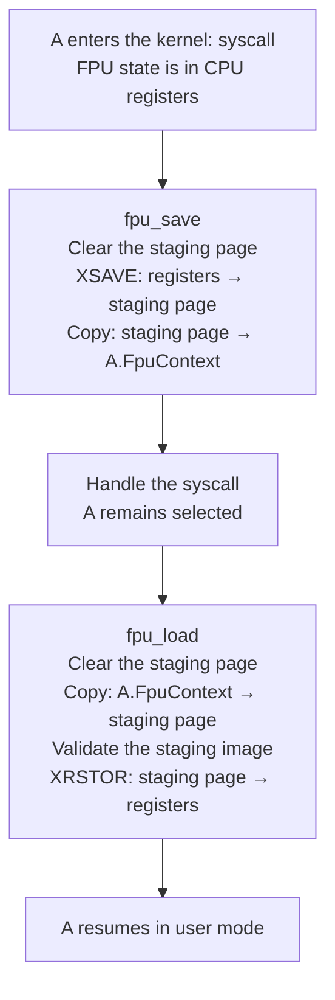
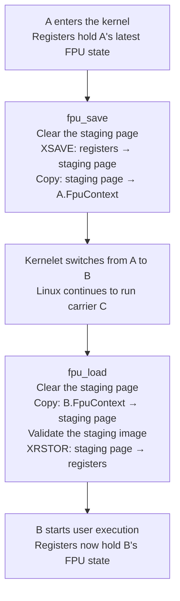
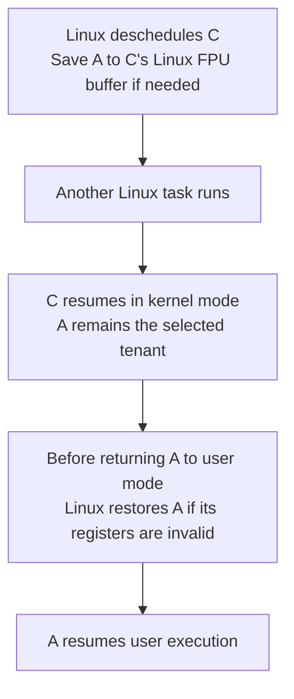
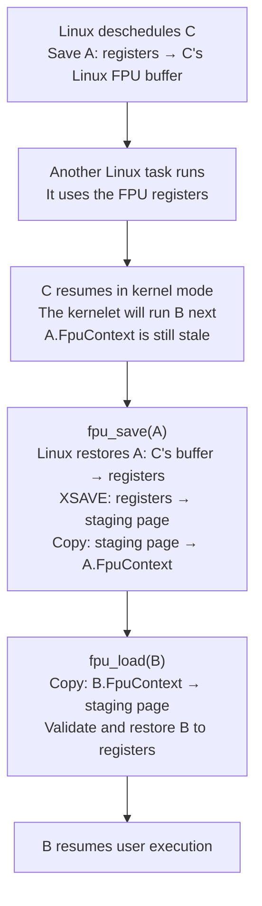

# 2026-11-09 FPU state management

- Status: Draft
- Author(s): Plucky923
- Discussion: Local design discussion beginning on 2026-11-09, revised on 2026-11-11; public review link not yet available.
- Affected chapters: [Tasks and virtual CPUs](../accepted-design/tasks-and-virtual-cpus.md), [The kernelet ABI](../accepted-design/the-kernelet-abi.md), [Into user mode and back](../accepted-design/into-user-mode-and-back.md), [Virtual interrupts](../accepted-design/virtual-interrupts.md), and [What it costs](../accepted-design/what-it-costs.md).
- Implementation or experiments: The complete protocol is not yet implemented. The source review uses Linux v6.12 and the current prototype; functional and performance validation of this protocol remains pending.

## Summary

**Omit tenant FPU transfers on eligible syscalls; remove staging copies and software image validation from direct transfers.** The syscall must request no FPU-state operation, and kernelet code must preserve FPU state. The ABI defines permitted state; instruction faults trigger cleanup and instance termination. Linux carrier recovery can still require an extra restore. Host containment and performance of the complete protocol remain unvalidated.

## Problem and motivation

<div class="background">

**x86: FPU state.** FPU state includes the contents of floating-point and vector registers, plus control and status fields such as rounding modes. It is separate from the general-purpose register state. On x86, `XSAVE` saves extended processor state from registers to memory, and `XRSTOR` restores it from memory to registers. These transfers let threads share the registers without losing their state.

</div>

**An ordinary syscall in native Linux or Asterinas need not save or restore FPU state.** The state can remain in the registers if the same task runs throughout the syscall, kernel code does not use the FPU registers, and no explicit FPU-state operation is requested.

**When switching from task A to task B, the kernel saves A's latest FPU state to memory if needed.** B's state need not be restored during the switch, but the registers must hold B's state before B runs in user mode.

**Kernelet adds FPU work through its save/load policy and its use of separate buffers.** Let A and B be tenants on Linux carrier C. Each tenant has a `FpuContext`; Linux keeps a separate save area for C. The kernelet [switches between A and B](../accepted-design/tasks-and-virtual-cpus.md#one-carrier-many-threads) on the same Linux carrier C.

We distinguish four basic scheduling cases and one combination:

1. **A syscall without a task switch.** A makes a syscall and resumes on C; neither scheduler switches tasks.
2. **A tenant switch within C.** The kernelet switches from A to B on the same carrier.
3. **Linux deschedules C, then resumes A.** Linux runs another task, then resumes C with A still selected.
4. **Carrier scheduling followed by a tenant switch.** Linux resumes C, then the kernelet switches from A to B before A returns to user mode.

### A syscall without a task switch

Under the baseline conditions above, A's FPU state can stay in the registers throughout the syscall. The PoC scheduler example still saves and reloads it through a temporary endovisor buffer, the staging page:



Each syscall therefore adds **one register save, one restore, two buffer copies, two page clears, one validation, and two service calls**. The conditional `CpuSync` handler skips both services: A enters the kernel, the handler processes the syscall, and A resumes with its FPU state still in the registers. Task-local access, callbacks, and state checks remain.

### A tenant switch within C

When A's latest FPU state is only in the registers, the kernelet must save A before loading B. Here, Linux neither deschedules C nor uses the FPU during the handoff:



**Saving A's registers and restoring B's registers are necessary**, as in native task switching. The staging protocol adds **two buffer copies, two page clears, one image validation, and two service calls** per A→B switch. The conditional `CpuSync` policy still needs the save and load services for this switch.

### Linux deschedules C while it runs A

Linux sees C as the running task. When it deschedules C, it saves A's live FPU state in C's Linux buffer as needed. If C continues A after resuming, the flow is:



These saves and restores belong to the native baseline. **When A continues without an explicit FPU-state operation, conditional `CpuSync` adds no tenant save/load calls or staging copies.** Resuming C in kernel mode does not require an immediate restore of A.

### A carrier switch followed by a tenant switch

Linux has saved A in C's buffer and resumed C in kernel mode. Before A returns to user mode, the kernelet switches to B. If `A.FpuContext` is stale and A's registers are invalid, `fpu_save` must first recover A from C's buffer:



Linux's first save of A and the final restore of B are baseline work. The PoC adds **one restore of A and another save of A** because Linux's saved image does not update `A.FpuContext`. The internal switch's two copies, two page clears, one validation, and two service calls also remain. These counts assume no further Linux scheduling or kernel FPU use during the handoff. If A's registers remain valid, Linux skips the restore of A. The extra recovery's latency and frequency remain unmeasured.

### Why staging and validation are used

**Staging keeps the validated state unchanged until restoration.** `fpu_load` copies the tenant's image into an endovisor-private page, then validates and restores that copy. A design that retains validation must keep those bytes unchanged until restoration. The proposal instead removes software image validation and requires Host containment for untrusted input.

**Invalid format or control fields can trigger an exception while `XRSTOR` executes in Linux kernel mode.** The current service checks the layout and permitted components and filters control bits. It does not check floating-point or vector data values. See [Intel's restore rules](https://cdrdv2-public.intel.com/843827/253665-sdm-vol-1-dec-24.pdf#page=336).

| Check | Example input | Possible effect |
|---|---|---|
| State components | The image declares AVX state that Linux has not enabled. | A kernel-mode exception during `XRSTOR`. |
| Control fields | A reserved bit in the vector control field is set to 1. | A kernel-mode exception when that field is restored. |

### Experimental results

<div class="background">

**x86: test states.** x87 holds floating-point values. SSE, AVX, and AVX-512 use overlapping 128-, 256-, and 512-bit vector registers; AVX-512 also adds mask registers. See the [Intel manual](https://cdrdv2-public.intel.com/843827/253665-sdm-vol-1-dec-24.pdf).

</div>

**Same-tenant syscalls, ns/call.** With FPU state preloaded, we compared Linux `getpid` with constant-return kernelet handlers: a minimal handler without tenant FPU management, and the same `CpuSync` handler with conditional or per-call save/load.

| Active state | Linux | Minimal kernelet handler | Conditional `CpuSync` | `CpuSync`: save/load every syscall |
|---|---:|---:|---:|---:|
| x87 + SSE | 57.340 | 62.849 | 67.350 | 399.212 |
| + AVX | 57.336 | 63.094 | 66.591 | 404.881 |
| + AVX-512 | 57.368 | 62.906 | 67.479 | 411.222 |

Conditional handling makes no tenant FPU service calls or transfers in the timed loop; its management path adds 3.5–4.6 ns over the minimal handler. Per-call save/load adds **331.9–343.7 ns** over conditional handling. Its two services save and restore registers, copy a 2,688-byte state image twice (**5,376 bytes**), clear 8,192 bytes, and validate one image per syscall.

**Task switching, ns per A→B→A.** We compared two Linux threads, two carriers with one tenant each, and two tenants within one carrier. Each round trip includes two work blocks, two syscalls, and two switches. FPU groups perform arithmetic before each handoff; Linux participants alternate with `SCHED_FIFO` and yield.

| User work | Linux threads | Two carriers | Two tenants in one carrier |
|---|---:|---:|---:|
| x87 + SSE | 796.2 | 810.7 | 1314.7 |
| x87 + AVX | 817.6 | 837.1 | 1393.8 |
| x87 + AVX-512 | 865.6 | 889.0 | 1272.2 |

**Carrier switches:** Linux preserves FPU state; diagnostics record **zero tenant services or staging copies**. The active-FPU gap of 14.5–23.4 ns includes the experimental yield service and syscall handling.

**Tenant switches:** each diagnostic round trip saves and restores both tenants through four services. Staging adds four 2,688-byte copies (**10,752 bytes**), 16,384 cleared bytes, and two validations. The active-FPU gap from Linux is **406.6–576.2 ns**, including scheduling and handoff costs.

## Proposed change

### Design constraints

**Use the recovery path as the sole fallback for FPU instruction faults.** If `XSAVE` or `XRSTOR` faults, the Host recovery path terminates the entire kernelet instance.

**No runtime checks or intermediate copies in normal FPU saves and loads.** `XSAVE` writes directly to the tenant's `FpuContext`, and `XRSTOR` reads directly from it. Neither uses the endovisor staging page. Do not validate image contents or buffer metadata, sanitize control fields, repair state, or retry failed operations on this path. Initialize storage once.

**Linux retains a separate FPU save area for each carrier.** When Linux schedules the carrier out, it saves the carrier's live FPU state there as needed. This updates Linux's save area, not the tenant's `FpuContext`.

### Recover faults and stop the instance

Route instruction faults to one common Host recovery and termination path. Reuse Linux's [signal-return recovery](https://github.com/torvalds/linux/blob/v6.12/arch/x86/kernel/fpu/signal.c#L294) and [`fpu__clear_user_states()`](https://github.com/torvalds/linux/blob/v6.12/arch/x86/kernel/fpu/core.c#L736) cleanup logic. This path does not return to the save/load service. Connect it directly to the kernelet instance termination path.

<div class="background">

**Linux: FPU restore faults.** Linux v6.12 marks kernel FPU restore instructions with [`EX_TYPE_FPU_RESTORE`](https://github.com/torvalds/linux/blob/v6.12/arch/x86/kernel/fpu/xstate.h#L130), which selects their exception handler. If invalid reserved bits cause a restore fault, [`ex_handler_fprestore()`](https://github.com/torvalds/linux/blob/v6.12/arch/x86/mm/extable.c#L112) calls [`fpu_reset_from_exception_fixup()`](https://github.com/torvalds/linux/blob/v6.12/arch/x86/kernel/fpu/core.c#L190) to reset the FPU registers from `init_fpstate`. The handler resumes execution after the failed instruction; it does not terminate the task.

</div>

### New execution paths

**A syscall without a task switch.** Neither scheduler switches tasks during A's syscall. If kernel code does not use the FPU and the syscall requests no FPU-state operation, A's state stays in the registers. As in native execution, this path needs no FPU save, restore, buffer copy, or service call.

**A to B within carrier C.** Assume C's FPU state is live, with no pending Linux restoration, and Linux neither preempts C nor borrows its FPU registers. vOSTD saves A directly to `A.FpuContext` before another tenant uses the registers. It restores B directly from `B.FpuContext` before B enters user mode:

```text
CPU registers -> A.FpuContext    XSAVE
B.FpuContext -> CPU registers   XRSTOR
```

vOSTD manages tenant ownership, buffer lifetime, and synchronization. This internal switch needs no endovisor FPU service.

<div class="background">

**Linux: deferred FPU restoration.** After a task switch, Linux sets `TIF_NEED_FPU_LOAD` and normally restores FPU state, if needed, before user return. Resuming vOSTD only resumes kernel code, so it does not trigger this deferred restoration.

</div>

**Carrier preemption during the switch.** Without coordination, the following sequence can occur:

1. Linux preempts C while it runs A and saves A's FPU state in C's Linux area.
2. Another Linux task uses the FPU registers.
3. C resumes in vOSTD, but A's state remains in C's Linux area because restoration is deferred until user return.
4. vOSTD selects B and executes `XSAVE` into `A.FpuContext`, saving the other task's register contents as A.
5. vOSTD loads `B.FpuContext` into the registers. Linux still records a pending restore for C.

A later Linux restore can overwrite B's registers with A. Reusing C's save area before recovering A loses A's latest state.

**Restore C before vOSTD resumes.** Keep Linux's carrier save area, but run its [restore logic](https://github.com/torvalds/linux/blob/v6.12/arch/x86/kernel/fpu/context.h#L54) before vOSTD resumes. Restore registers when needed, update CPU ownership, then clear `TIF_NEED_FPU_LOAD`. Clearing the flag alone does not restore the registers. Keep the registers valid through entry or return to vOSTD, including after Linux FPU use.

**Alternative: save directly to the tenant context.** Linux could save into the active tenant's `FpuContext` when descheduling C. This would avoid restoring A to save it again, but requires adapting Linux's FPU save and restore paths to tenant context selection and format. The current proposal keeps the carrier save area and changes restoration timing.

**Remaining cost.** Normal tenant switches retain register saves and restores, ownership tracking, and synchronization, with no FPU services, staging copies, clears, or image validation. If A's latest state is only in C's save area, resuming C and then switching to B still adds a restore and save of A. Earlier restoration can also add work if C is descheduled again before user return. The protocol remains unimplemented and unvalidated; its latency is unmeasured.


## Alternatives and tradeoffs

## Implementation and integration

## Validation and evidence

## Open questions


## Decision and follow-up
