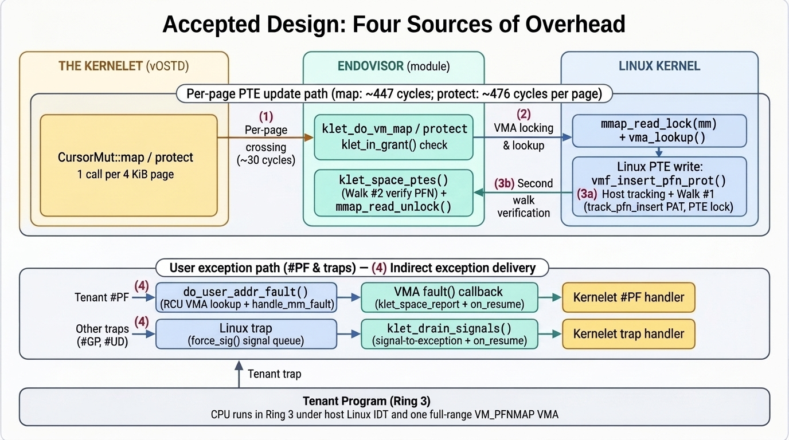
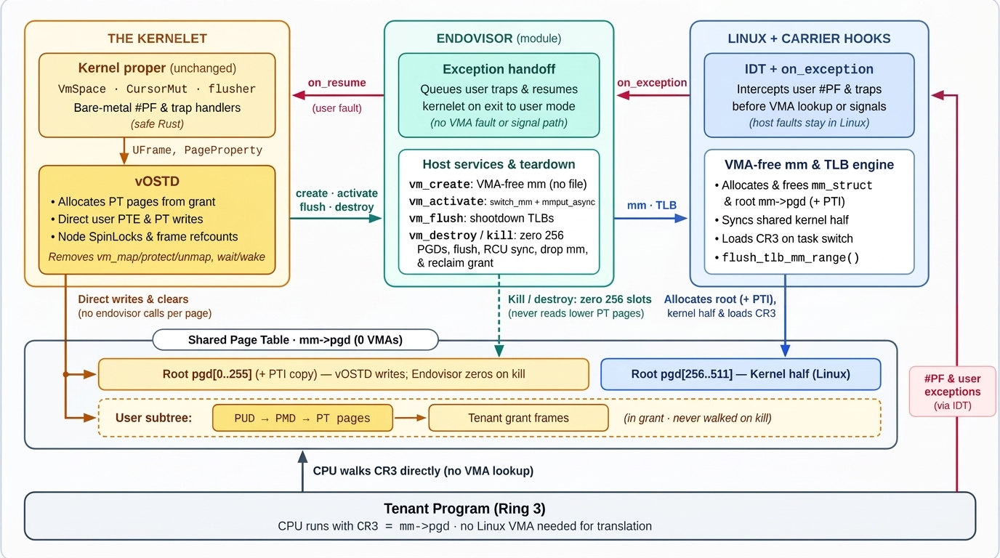

# 2026-11-13 Direct page-table updates in vOSTD

- Status: Draft
- Author(s): Plucky923
- Discussion: Revised from the initial `2026-11-13` batched-services draft; batched services appear under [Alternatives and tradeoffs](#alternatives-and-tradeoffs).
- Affected chapters: [The kernelet ABI](../accepted-design/the-kernelet-abi.md), [Carrier hooks and patch overview](../accepted-design/carrier-hooks.md), [Into user mode and back](../accepted-design/into-user-mode-and-back.md), [Stopping a kernelet](../accepted-design/stopping-a-kernelet.md), [Tenant memory on Linux's page tables](../accepted-design/tenant-memory-on-linux-page-tables.md), [What vOSTD adds on top](../accepted-design/what-vostd-adds-on-top.md), and [What it costs](../accepted-design/what-it-costs.md).
- Implementation or experiments: Not yet implemented. Baseline `fork` measurements appear below; the [validation plan](#validation-and-evidence) precedes implementation.

## Summary

The accepted design maps tenant memory under a full-range `VM_PFNMAP` VMA and crosses into Linux for every PTE write. Crossing costs 30 cycles; over 90% of `map` goes to host `mmap_lock`, VMA lookup, double walks, and vOSTD book-keeping. This proposal deletes the VMA and removes `vm_map`, `vm_protect`, `vm_unmap`, `vm_wait`, and `vm_wake`. vOSTD allocates lower page-table pages from the sandbox grant and writes user PTEs in memory under per-node locks. Linux retains one VMA-free `mm_struct` per `VmSpace` for `CR3` scheduling, kernel-half updates, and `vm_flush` TLB shootdowns. A synchronous `on_exception` hook delivers user faults and the 11 supported traps to the kernelet without VMA callbacks or signals.

## Problem and motivation

### Who manages tenant page tables

Each carrier runs as a Linux task. Its page table must work with Linux scheduling, restrict mappings to the sandbox grant, and update quickly.

[Tenant memory on Linux's page tables](../accepted-design/tenant-memory-on-linux-page-tables.md#the-problem) delegates user PTE writes to Linux. Because Linux PTE helpers require a VMA, the endovisor creates one `mm_struct` and one full-range `VM_PFNMAP` VMA per `VmSpace`. On each `map`, `protect`, or `unmap`, vOSTD calls the endovisor to check the frame and invoke Linux.

This delegation adds four costs:

1. **Per-page crossings (`map`, `protect`).** Each single-page update enters `klet_do_vm_map()` or `klet_do_vm_protect()`.
2. **VMA locking (`map`, `protect`).** Each call takes `mmap_read_lock()` and runs `vma_lookup()`.
3. **Host tracking and double walks (`map`, `protect`).** `vmf_insert_pfn_prot()` checks PAT, walks the table, locks the PTE, and writes it. `klet_do_vm_map()` then walks and locks the slot again (`klet_space_ptes()`) to verify the PFN.
4. **Indirect trap delivery (`#PF`, traps).** `#PF` traverses RCU VMA lookup, `handle_mm_fault()`, and `klet_space_report()`. Other traps traverse `force_sig()` and `klet_drain_signals()` before `on_resume`.

<figure class="diagram">

<figcaption>Four sources of overhead across the per-page PTE update path (steps 1–3) and user exception path (step 4).</figcaption>
</figure>

### What that choice costs

We measured five-boot medians on one KVM VM (2 vCPUs, 512 MiB RAM, Linux 6.12, 3.19 GHz Ryzen 7 5800H). Native Linux forks 64 MiB of 4 KiB anonymous pages (`MADV_NOHUGEPAGE`, 16,384 pages) in 0.34 ms (~21 ns or ~66 cycles/page), including VMA duplication. Linux walks each 2 MiB leaf table once, updates PTEs in per-table batches, and flushes the TLB once.

In the same VM, the baseline kernelet benchmark forks 64 MiB (256 frames mapped 64 times) by calling `protect` and `map` 16,384 times. That `fork` takes 7.85 ms (25.07 M cycles, ~479 ns or ~1,530 cycles/page) against 0.34 ms on native Linux.

| Kernelet operation (3.19 GHz VM) | Median | Median per page |
|---|---:|---:|
| null service crossing (stack switches) | 30 cycles (~9 ns) | n/a |
| `map`, one page per call | 447 cycles (140 ns) | 447 cycles (140 ns) |
| `map`, 512 pages under one cursor | reported per page | 472 cycles (148 ns) |
| `protect` 2 MiB read-only + flush (512 pages) | 243,808 cycles (76.3 µs) | ~476 cycles |
| `munmap` 64 MiB in one range call (16,384 pages) | 872,480 cycles (0.27 ms) | ~53 cycles |

One `CursorMut` across 512 pages still costs 472 cycles/page, whereas single-call `munmap` drops to ~53 cycles/page. A null crossing costs 30 cycles (<7% of `map`), leaving >93% in host VMA locks, double walks, and vOSTD book-keeping.

## Proposed change

### Why Linux need not maintain user page tables

A kernelet needs neither a Linux VMA nor per-PTE host calls:

- **No Linux VMA policy.** The kernel proper runs demand paging and copy-on-write. The accepted design set `VM_PFNMAP` to disable Linux page accounting and kept a VMA only for `vmf_insert_pfn_prot()` and `zap_vma_ptes()`.
- **Hardware ignores VMAs.** The x86-64 MMU reads `CR3` alone. With a VMA-free `mm_struct`, the MMU uses vOSTD-written PTEs while Linux VMA scanners skip user memory.
- **vOSTD enforces grant bounds.** Hypervisors intercept PTE writes because untrusted guest code builds the tables. Here, operator-compiled vOSTD maps only grant `UFrame`s ([Why a kernel of your own](../accepted-design/why-a-kernel-of-your-own.md), [What vOSTD adds on top](../accepted-design/what-vostd-adds-on-top.md)). Grant-backed tables let host kill reclaim the sandbox whole.

### Overview

Four layers divide page-table management:

- **Kernel proper (unchanged).** Uses OSTD `VmSpace`, `CursorMut`, and `TlbFlusher` APIs and handles user faults as on bare metal.
- **vOSTD.** Allocates grant tables and writes `mm->pgd[0..255]` and lower PTEs under node locks ([What vOSTD adds on top](../accepted-design/what-vostd-adds-on-top.md#reading-the-table)). It calls only `vm_create`, `vm_activate`, `vm_flush`, and `vm_destroy`.
- **Endovisor.** Allocates a VMA-free `mm_struct` in `vm_create`, switches spaces in `vm_activate`, runs `vm_flush`, forwards traps, and tears down spaces.
- **Linux and carrier hooks.** Loads `CR3` from `mm->pgd`, updates the kernel half, runs `flush_tlb_mm_range()`, and intercepts user traps via `on_exception`.

<figure class="diagram">

<figcaption>Division of responsibilities around the tenant's hardware page-table root (<code>mm-&gt;pgd</code> pair).</figcaption>
</figure>

Each kernel-proper operation moves from host VMA calls to direct vOSTD paths:

| Kernel proper call or event | Accepted design | Proposed design |
|---|---|---|
| `VmSpace::new()` | `vm_create` allocates `mm`, file, `VM_PFNMAP` VMA (two `kernelet_switch_mm` calls) | `vm_create` allocates VMA-free `mm_struct` (no file, VMA, or switch), publishes `root_paddr` |
| `vm_space.activate()` | `vm_activate` records space; `klet_space_adopt` switches before user mode | `vm_activate` pins `sp`, calls `mmget` + `kernelet_switch_mm()`, drops `old` via `mmput_async()` |
| `cursor.map(frame, prop)` | `vm_map` crossing (+ `withheld` `BTreeMap` if `!R`) | vOSTD allocates grant PT pages if needed and writes PTE in memory (including `!R`) |
| `cursor.protect_next(len, op)` | `vm_protect` crossing (or `vm_unmap`/`vm_map` across `withheld`) | vOSTD updates PTE atomically in place (caller flushes via `TlbFlusher`) |
| `cursor.unmap(len)` | Walk + `vm_unmap` (`zap_vma_ptes` + flush) + `rcu::synchronize` | vOSTD clears PTEs in stack batches, calls `vm_flush`, runs `rcu::synchronize()`, drops frames |
| `flusher.dispatch_tlb_flush()` | `vm_flush` (VMA leaf flush) | `vm_flush` (`flush_tlb_mm_range()`) |
| `VmSpace` drop (`retire::destroy`) | Walk + `vm_unmap` + `vm_destroy` (`zap_vma_ptes` + `mmput`) | Detaches root user slots, runs `rcu::synchronize()` + `vm_destroy`, drops roots via `on_drop` |
| Tenant `#PF` / user trap | VMA `fault`/`pfn_mkwrite` or `force_sig` + `klet_drain_signals` | `on_exception` intercepts user trap and delivers it via `on_resume` |

### VMA-free mm_struct and root page

On x86-64, one 4-level root (`mm->pgd`) maps both halves: shared Linux kernel slots `256..511` and tenant slots `0..255`. Deleting the VMA drops Linux's user-range tracking, but each `VmSpace` retains one VMA-free `mm_struct` because Linux still needs it to:

1. **Own and sync the root page.** Allocate `mm->pgd` and propagate host kernel updates in `256..511`.
2. **Restore `CR3` on schedule.** Reload `mm->pgd` across host preemptions and CPU migrations.
3. **Track CPUs and PCIDs.** Maintain `mm_cpumask` and PCID generations for `flush_tlb_mm_range()`.
4. **Switch tenant spaces.** Swap `current->mm` in `kernelet_switch_mm()` when a carrier changes tenant threads.

Previously, `klet_do_vm_create()` called `vm_mmap()` to build the VMA, which required an `anon_inode` file and switching `current->mm` in and back. Without VMAs, `klet_do_vm_create()` allocates only `sp->mm` and publishes `__pa(sp->mm->pgd)`:

*Proposed (error handling omitted): simplifying `klet_do_vm_create` in `prototype/linux/endovisor/space.c`.*

```c
s64 klet_do_vm_create(struct klet_carrier *c)
{
	struct klet_space *sp = alloc_free_space(c->inst);

	sp->mm = kernelet_mm_alloc(c->inst->owner);
	// Block core dumps and non-root `ptrace` on tenant spaces.
	set_mask_bits(&sp->mm->flags, MMF_DUMPABLE_MASK, SUID_DUMP_DISABLE);
	WRITE_ONCE(sp->rec->root_paddr, __pa(sp->mm->pgd));
	smp_store_release(&sp->live, true);
	return sp->id;
}
```

Every `mm->pgd` maps Linux's direct map (`linear_map_base`) in slots `256..511`. vOSTD therefore reads and updates any `VmSpace` at `linear_map_base + paddr` without changing `CR3`.

User execution still loads the target `mm->pgd` into `CR3`. Because `VmSpace::activate()` masks virtual interrupts and `mmput(old)` can sleep, the accepted design deferred switching until user-mode entry. Now `vm_activate` pins a live space via `klet_space_get()` and skips switching when `current->mm == sp->mm`. Otherwise it calls `mmget(sp->mm)`, switches via `kernelet_switch_mm(sp->mm)` (consuming that reference), and drops `old` via `mmput_async(old)` while keeping `c->blank_mm` for carrier exit. Because `old` has no VMAs, `mmput_async(old)` never walks or frees lower page tables.

### Direct page-table writes in vOSTD

vOSTD runs upstream OSTD's page-table logic (`CursorMut::map`, `protect_next`, and `unmap`) directly in memory. Lower tables (levels 1–3) use grant frames, [`MetaSlot`](2026-11-16-allocate-the-kernelet-heap-from-the-grant.md#use-ostds-frame-model-within-the-grant) node locks (`PageTablePageMeta`, never implementing `AnyUFrameMeta`), and hand-over-hand locking (`vcpu::on_spin()` on contention). All concurrent PTE reads (`copy_regions`, `query`) and writes use aligned `AtomicU64` operations (`Release` stores publish zeroed child tables before readers traverse them). Extra rules handle Linux's `mm->pgd` root, x86 hardware bits, and lockless host walkers.

<div class="background">

**Linux: page-table isolation (PTI).** To mitigate Meltdown, PTI removes full kernel mappings from user mode's `CR3`. Under `X86_FEATURE_PTI`, Linux allocates two adjacent 4 KiB pages per `mm->pgd` on an 8 KiB boundary. The first page is the kernel root (`root_paddr`), and the second is the user root (`root_paddr | PAGE_SIZE`). Its upper half maps only minimal entry structures (such as the trampoline and CPU entry area) in `256..511`. Across user slots `0..255`, both roots share one lower subtree. Linux loads `root_paddr` on kernel entry and `root_paddr | PAGE_SIZE` on user return. In the kernel root, [`__pti_set_user_pgtbl()`](https://elixir.bootlin.com/linux/v6.12/source/arch/x86/mm/pti.c#L124) sets `_PAGE_NX` on present user entries when `_PAGE_NX` is supported. Because vOSTD writes user PGD slots, it maintains both roots.

</div>

Because Linux allocates `mm->pgd` outside the grant `MetaSlot` array, `VmSpace` keeps a dedicated root lock for level 4. `BootArgs` exports `pti_enabled` (`X86_FEATURE_PTI`), `physical_mask`, and `pgtable_levels`; load-time checks require 4-level paging (`pgtable_levels == 4`), `_PAGE_NX` support, and unencrypted RAM (`sme_me_mask == 0`). Under the root lock, vOSTD zeroes and initializes new child tables before publishing them (`__pti_set_user_pgtbl()`). When `pti_enabled` holds, it writes `root_paddr | PAGE_SIZE` without `_PAGE_NX` first, then `Release`-stores `root_paddr` with `_PAGE_NX` on `PRESENT | USER` entries (`0` when clearing). Non-leaf entries at levels 2–4 set `PRESENT | WRITE | USER | ACCESSED`, clear `HUGE`, and clear `NO_EXECUTE` outside the kernel PTI root.

An empty VMA tree stops VMA-based Linux scanners (`pagemap`, MGLRU, `exit_mmap()`). Two lockless Linux paths still walk `mm->pgd` on `current->mm`.

<div class="background">

**Linux: lockless page-table walkers and non-present PTE bits.** `perf_virt_to_phys()` walks `mm->pgd` in NMI context via `get_user_page_fast_only()`. `gup_fast_pgd_range()` (`gup_fast` in `mm/gup.c`) walks page tables with interrupts disabled before checking VMAs. `gup_fast_pte_range()` rejects an entry when `pte_special()` (`_PAGE_SPECIAL`), `pte_protnone()`, devmap, or permission checks fail; otherwise it pins the frame's `struct page`. On x86-64, Linux reuses bit 8 (`_PAGE_GLOBAL`) on non-present PTEs as `_PAGE_PROTNONE` and defines `pte_present()` as `_PAGE_PRESENT | _PAGE_PROTNONE` (`arch/x86/include/asm/pgtable_types.h`).

</div>

`on_syscall` blocks carrier calls such as `O_DIRECT` from `gup_fast`, while host `perf` samples carriers in NMI context. To protect lockless walkers without patching Linux, `CursorMut::unmap` clears leaf PTEs and leaves lower tables (levels 1–3) attached until `VmSpace` destruction.

Before writing a leaf PTE, vOSTD verifies a typed `UFrame`, alignment, user-range bounds, and overflow-safe multi-segment `in_grant(paddr)` ([2026-11-16](2026-11-16-allocate-the-kernelet-heap-from-the-grant.md)), then encodes four bit rules:

- **Writeback PAT policy.** x86 PTE bits `PWT`, `PCD`, and `PAT` index `IA32_PAT` cache types. vOSTD restricts mappings to `CachePolicy::Writeback` (`PWT = PCD = PAT = 0`), matching Linux's direct map without touching `IA32_PAT` or `memtype` tables.
- **Special and global bits.** Mapped leaf PTEs set `_PAGE_SPECIAL` (bit 9) and clear `_PAGE_GLOBAL` (bit 8). Regular `gup_fast` falls back to its VMA slow path and exits, while `perf`'s `get_user_page_fast_only()` safely records physical address `0` without touching `struct page`.
- **Saved-dirty write protection.** On x86 CET CPUs, `WRITE = 0` with `DIRTY = 1` marks a shadow-stack PTE (`arch/x86/include/asm/pgtable.h`). Clearing `WRITE` moves `_PAGE_DIRTY` (bit 6) to `_PAGE_SAVED_DIRTY` (bit 58), and `PageFlags::DIRTY` reads both bits.
- **L1TF-safe `!R` leaves.** Readable entries set `PRESENT | USER | ACCESSED | SPECIAL` plus `WRITE`, `NO_EXECUTE`, and dirty bits. Non-readable (`!PageFlags::R`) entries clear `PRESENT` and `_PAGE_GLOBAL`, set `SOFTW2` (bit 10), and invert PFN bits within `physical_mask` (`arch/x86/include/asm/pgtable-invert.h`) to block L1TF speculation. Kernel proper resolves `SEGV_ACCERR` versus `SEGV_MAPERR` from its VMAR table.

### TLB flushing and space teardown

vOSTD sees only virtual CPUs and edits memory without changing `CR3`. Only Linux tracks which physical CPUs hold a space (`mm_cpumask`), sends cross-CPU IPIs, and runs host RCU:

- **Runtime TLB flushes (`vm_flush`).** Local `invlpg` misses remote physical CPUs in `mm_cpumask`, inactive spaces edited via the direct map, and PTI user PCIDs. Callers must dispatch `TlbFlusher` (`vm_flush` calling `flush_tlb_mm_range()`) before relying on reduced permissions (`protect_next`) or reusing unmapped frames.
- **Space teardown (`vm_destroy`).** Without VMAs, `exit_mmap()` skips user tables and table-freeing TLB flushes. Reclaiming grant page tables requires evicting host CPUs holding stale `CR3` roots and waiting for host RCU readers. On `KLET_KILL`, kernelet cleanup never runs, so the endovisor must sever host references itself.

<div class="background">

**Linux: lazy TLB mode.** On kernel threads, x86 Linux leaves the last user `mm` in `CR3` (`arch/x86/mm/tlb.c`). Page shootdowns skip lazy CPUs until they exit lazy mode. Freeing page-table pages requires `flush_tlb_mm_range()` with `freed_tables = true`: CPUs cache upper-level paging structures, walk `CR3` speculatively, and must switch lazy CPUs back to `init_mm`.

</div>

Runtime `VmSpace` retirement (`retire::destroy`) and sandbox exit or kill (`klet_spaces_destroy()`) run four host teardown steps in order:

1. Wait for active `vm_activate` and `vm_flush` calls on the space to finish, and detach referencing vCPUs.
2. Zero user entries `0..255` in `mm->pgd` (and `root_paddr | PAGE_SIZE` under PTI) without reading lower tables.
3. Run `flush_tlb_mm_range(mm, 0, TLB_FLUSH_ALL, 0, true)` to clear paging-structure caches and evict lazy-TLB CPUs.
4. Clear `mm->owner`, run host `synchronize_rcu()` to drain NMI `perf`, `gup_fast`, and `mm->owner` readers, and call `mmput(mm)`.

On runtime `VmSpace` retirement, `VmSpace::reader` borrows `&VmSpace`, so no `VmReader` outlives the last `Arc<VmSpace>`. `retire::destroy` detaches user PGD slots `0..255` into stack-held `PageTableNode` handles, runs `rcu::synchronize()` (draining vOSTD lockless readers) and `vm_destroy` (steps 1–4), and drops those handles. `PageTablePageMeta::on_drop` (decoding `SOFTW2` and inverted PFNs) then frees every lower table and `UFrame` once without heap allocation. On sandbox exit or `KLET_KILL`, the endovisor runs steps 1–4 on every space without reading lower tables. Host grant segments free only after active I/O leases ([TypedIO](2026-11-08-typed-io.md)) drain and the last sandbox descriptor closes.

### User-mode exception hook

On x86-64, user faults and traps enter Linux's IDT handlers first. Without a VMA, Linux treats every tenant page fault as an invalid access and turns user exceptions into POSIX signals (`SIGSEGV`, `SIGILL`, `SIGFPE`). Just as `on_syscall` intercepts system calls, `on_exception` intercepts user exceptions before Linux runs VMA lookup or queues a signal:

*Proposed: extending `struct carrier_event_hooks` in `prototype/linux/patches/0001-carrier-hooks.patch` (`include/linux/kernelet.h`).*

```c
struct carrier_event_hooks {
	// Intercepts a carrier's user-mode system calls before Linux's table.
	bool (*on_syscall)(struct pt_regs *regs);

	// Intercepts a carrier's user-mode CPU exceptions before Linux handles them.
	//
	// Returns `true` if the kernelet claims the exception and schedules delivery via `on_resume`,
	// or `false` to let Linux run its normal handler.
	bool (*on_exception)(struct pt_regs *regs, unsigned int trapnr,
			     unsigned long error_code, unsigned long addr);

	// Delivers pending kernelet events before returning to user mode.
	void (*on_resume)(struct pt_regs *regs);
};
```

Unlike `on_syscall`, `on_exception` runs on trap-entry contexts (such as `#DB`'s IST stack) where the kernelet cannot sleep or switch tasks. Therefore, `on_exception` only captures the trap and hands execution off to Linux's exit-to-user hook `on_resume` in `exit_to_user_mode_loop()`:

1. **Linux trap entry.** On `#PF`, `do_user_addr_fault()` (after `sanitize_error_code()` and before `emulate_vsyscall()` or VMA lookup) and user-mode `do_kern_addr_fault()` invoke `on_exception`. `arch/x86/kernel/traps.c` forwards user traps after vector-specific host work (split/bus-lock checks on `#DB` with user `dr6`, FPU status sync on `#MF`/`#XM`, vDSO fixups on `#GP`).

*Proposed: forwarding `#PF` in `prototype/linux/patches/0001-carrier-hooks.patch` (`arch/x86/mm/fault.c`).*

```c
// Forward carrier user-mode page faults after error-code sanitization,
// before vsyscall emulation or VMA lookup.
if (unlikely(user_mode(regs) && tsk->carrier_hooks &&
	     tsk->carrier_hooks->on_exception)) {
	sanitize_error_code(address, &error_code);
	if (tsk->carrier_hooks->on_exception(regs, X86_TRAP_PF,
					     error_code, address))
		return;
}
```

2. **Endovisor capture.** `klet_on_exception()` verifies `KLET_USER`, records `(trapnr, error_code, addr)` on the carrier, sets `TIF_NOTIFY_RESUME`, and returns `true` without touching `pt_regs`:

*Proposed: `klet_on_exception` in `prototype/linux/endovisor/carrier.c`.*

```c
static bool klet_on_exception(struct pt_regs *regs, unsigned int trapnr,
			      unsigned long error_code, unsigned long addr)
{
	struct klet_carrier *c = klet_current_carrier();

	if (c->state != KLET_USER)
		return false;
	// Record the trap now; `on_resume()` enters the kernelet on the normal stack.
	c->exc_trap = trapnr;
	c->exc_error = error_code;
	c->exc_addr = addr;
	c->exc_pending = true;
	set_thread_flag(TIF_NOTIFY_RESUME);
	return true;
}
```

3. **Kernelet dispatch via `on_resume`.** Returning from the trap enters `exit_to_user_mode_loop()` on the task's sleepable kernel stack with interrupts enabled. Seeing `exc_pending`, `on_resume` enters `klet_enter(KLET_RUN_EXCEPTION)` under the accepted stack model, or `user_event_entry(UserEvent::Exception)` when paired with `UserEventHandler` ([PR #3](https://github.com/tatetian/kernelet/pull/3)):

*Proposed: dispatching `exc_pending` from `on_resume` under the `UserEventHandler` model ([PR #3](https://github.com/tatetian/kernelet/pull/3)).*

```rust
// 3a. In `on_resume(regs)` (`exit_to_user_mode_loop()`):
// Clear `c->exc_pending`, write `(exc_trap, exc_error, exc_addr)` to `vrec`,
// mask virqs, set `regs->orig_ax = -1`, and jump to `user_event_entry(UserEvent::Exception)`.

// 3b. In vOSTD `user_event_entry(raw_event)` (with virqs still masked):
let mut user = UserMode::for_current_carrier(); // reads exception from `vrec`
unmask_virtual_interrupts();
__ostd_user_handle(data, UserEvent::Exception, &task, &mut user);

// 3c. In kernel proper `UserEventHandler::handle`:
UserEvent::Exception => {
    let exception = user.take_exception();
    handle_exception(&ctx, user.context_mut(), exception.unwrap()); // resolves `#PF` via `CursorMut::map`
}
// Returning runs `pre_user_run` -> `user_run()` -> `kernelet_return_to_user()`.
```

Four constraints bound the hook:

- **User traps only.** `on_exception` runs only when `user_mode(regs)` and `KLET_USER` hold; kernel-mode faults return `-EFAULT` via Linux's exception table.
- **Per-vector host checks first.** Linux runs reserved-bit/SMAP/error-code sanitization (`#PF`), split/bus-lock handling (`#DB`), and FPU status sync (`#MF`/`#XM`) before calling `on_exception`.
- **Forwarded vs. host-handled vectors.** Linux forwards Asterinas's 11 user traps (`#DE`, `#DB`, `#BP`, `#OF`, `#UD`, `#SS`, `#GP`, `#PF`, `#MF`, `#XM`, `#AC`). `CR0.TS` `#NM` runs host lazy-FPU restore, non-XFD `#NM` and `#BR` deliver fatal signals, and `#DF`/`#MC` remain host machine handlers.
- **No host VMAs or notifiers.** Because `on_syscall` blocks host memory system calls, no carrier can attach a VMA or `mmu_notifier` to a tenant `mm`.

## Alternatives and tradeoffs

- **Keep per-page Linux calls.** Leaving PTE writes in Linux avoids PTI and PTE encoding in vOSTD. However, baseline `fork` (256 frames × 64) takes 7.85 ms against 0.34 ms on native Linux (16,384 distinct pages).
- **Batch Linux PTE calls.** vOSTD could buffer `map` or `protect_next` updates and submit them under one `mmap_lock`. That cuts crossings on large contiguous ranges, but single-page faults (`#PF`) and small ranges still cross into Linux, take `mmap_lock`, and run Linux's double walk. Direct vOSTD writes remove Linux from every update path, speeding up both single-page and bulk operations.

## Implementation and integration

- **Linux patch** (`prototype/linux/patches/0001-carrier-hooks.patch`). Complete the `on_exception` hooks: sanitize `error_code` on `#PF`, pass user debug status on `#DB`, and sync FPU state before `#MF`/`#XM`.
- **Endovisor** (`prototype/linux/endovisor/kernelet.h`, `space.c`, `carrier.c`, `sandbox.c`). Require 4-level paging (`pgtable_levels == 4`), `_PAGE_NX`, and `sme_me_mask == 0`, export `pti_enabled` and `physical_mask` in `klet_boot_args`, and bump `KLET_ABI_VERSION`. Delete `vm_map`, `vm_protect`, `vm_unmap`, `vm_wait`, `vm_wake`, `klet_space_adopt`, `anon_inode` creation, and `VM_PFNMAP` setup. Pin live spaces in `vm_activate` (`mmget` + `kernelet_switch_mm()` + `mmput_async()`). Update `klet_space_teardown` (steps 1–4), delete fault-signal decoding in `klet_drain_signals()`, and wire `klet_on_exception` (into `klet_enter` or `UserEventHandler`).
- **vOSTD** (`prototype/vostd/src/mm/page_table.rs`, `vm_space.rs`, `frame.rs`, `arch/cpu/context.rs`). Build on the shared `MetaSlot` and multi-segment `in_grant()` model ([2026-11-16](2026-11-16-allocate-the-kernelet-heap-from-the-grant.md)). Replace `read_volatile` with `AtomicU64` PTE accesses, delete `SpaceRec::lock`, `vm_wait`/`vm_wake`, `withheld`, and `map`/`protect_next`/`unmap` Rule 2 checks, and drain `unmap` in stack batches without heap allocation. Add `PageTablePageMeta` locks (`vcpu::on_spin()`), `VmSpace` root locking, PTI dual-root writes, Writeback/`_PAGE_SPECIAL`/`_PAGE_SAVED_DIRTY`/L1TF-inverted `SOFTW2` PTEs, `on_drop` subtree reclamation, and 11-vector trap mapping.
- **Book and proposals.** On acceptance, update the seven Accepted Design chapters listed above. Future grant-reclaim designs must keep installed page-table pages pinned until `klet_space_teardown` finishes.

## Validation and evidence

**Benchmarks.** Run five-boot benchmarks (no in-loop `rdtsc`) on the 2-vCPU, 512 MiB KVM VM with a 256 MiB multi-segment grant ([2026-11-16](2026-11-16-allocate-the-kernelet-heap-from-the-grant.md)) and `MADV_NOHUGEPAGE`. Compare native Linux, the accepted design, and this proposal across single-page faults, 16-page fault-around, 64 MiB populate, and both 256-frame and distinct-page 64 MiB `fork`. Also compare 2 MiB and 64 MiB read-only `protect` + flush, 1-ref and 2-ref COW faults, 64 MiB `munmap`, and `exit`. Verify zero first-touch faults after `map`, and measure the single-lock 512-PFN host bound to evaluate batched Linux calls.

**Correctness and safety tests.** Pass adapted `make mem-func`, `mem-conc`, `mem-pressure`, and `mem-kill`. Update `mem-r2` so `map`, `protect_next`, and stack-batched `unmap` succeed under spin locks or masked IRQs. `vm_create` and `vm_destroy` (plus `mem_alloc` before [2026-11-16](2026-11-16-allocate-the-kernelet-heap-from-the-grant.md)) must still trigger Rule 2 panics. Add tests for:

- `pti=on` (`CONFIG_MITIGATION_PAGE_TABLE_ISOLATION=y`), checking user execution and kernel `_PAGE_NX`;
- CET saved-dirty write protection, L1TF PFN inversion on `!R` pages, and `SEGV_ACCERR` vs. `SEGV_MAPERR` signal codes;
- two-vCPU races installing shared PMD, PUD, and PGD entries, plus sparse map/unmap lower-table memory bounds;
- `perf` NMI callchain and `get_user_page_fast_only()` sampling (reporting physical `0` on `_PAGE_SPECIAL`) during lazy-TLB `VmSpace` churn;
- all 11 forwarded vectors, kernel `-EFAULT`, QEMU `-cpu SapphireRapids` `#NM` XFD, and `#AC`/`#DB`/`#GP`/`#MF`/`#XM` host checks;
- fatal `#BR` and non-XFD `#NM` termination, plus `#DF` and `#MC` in isolated fault-injection VMs;
- `KLET_KILL` with corrupted grant PTEs and active I/O leases, confirming clean module unload.

**Acceptance criteria.** All correctness and safety tests pass. Per-page `map`, `protect`, and matched-layout `fork` approach memory speed without regressing `munmap`, `exit`, or first-touch latency, and sparse lower-table retention stays within documented grant budgets.

## Open questions

- Adding a `CONFIG_MITIGATION_PAGE_TABLE_ISOLATION=y` build to CI, since `tinyconfig` disables PTI.
- Whether sparse `mmap`/`munmap` workloads need low-watermark batch pruning of empty lower tables under `freed_tables = true` and `synchronize_rcu()`.
- Sizing multi-segment startup grants ([2026-11-16](2026-11-16-allocate-the-kernelet-heap-from-the-grant.md)) across user pages, unpruned lower page tables (~1 table per 2 MiB touched), and the local heap.
- Measuring `synchronize_rcu()` latency in `vm_destroy` under rapid `fork` + `exit` churn.
- Whether full Asterinas needs high-watermark `retire` draining at syscall return or after `after_switching_to()` IRQ re-enable when `vcpu_idle` and `vm_create` do not run.

## Decision and follow-up

Pending prototype implementation, benchmark results, and review.
