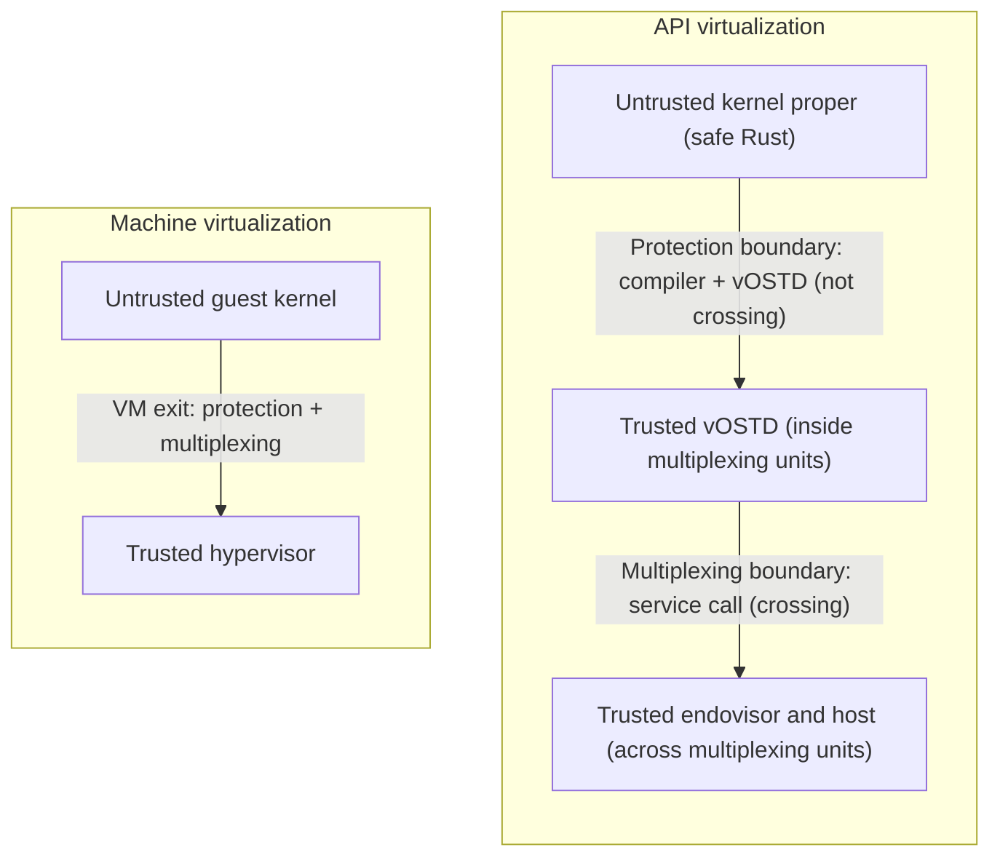

# 2026-11-16 Principles of API virtualization

- Status: Draft
- Author(s): Plucky923
- Discussion: No public review opened yet.
- Affected chapters: [Why a kernel of your own](../accepted-design/why-a-kernel-of-your-own.md), [The kernelet ABI](../accepted-design/the-kernelet-abi.md), [Tenant memory on Linux's page tables](../accepted-design/tenant-memory-on-linux-page-tables.md), [What vOSTD adds on top](../accepted-design/what-vostd-adds-on-top.md), and [What it costs](../accepted-design/what-it-costs.md).
- Implementation or experiments: Explanatory design framework synthesized from first principles and corroborated by the accepted design and companion proposals ([PR #3](https://github.com/tatetian/kernelet/pull/3), [PR #4](https://github.com/tatetian/kernelet/pull/4), [PR #5](https://github.com/tatetian/kernelet/pull/5), [TypedIO](2026-11-08-typed-io.md), [PR #7](https://github.com/tatetian/kernelet/pull/7), [Direct page-table updates in vOSTD](2026-11-13-direct-page-table-updates-in-vostd.md), and [Allocate the kernelet heap from the grant](2026-11-16-allocate-the-kernelet-heap-from-the-grant.md)).

## Summary

API virtualization turns a single-machine framekernel framework (`OSTD`) into a multi-tenant sandbox framework (`vOSTD`) inside a shared host kernel. Existing descriptions either sketch individual host mechanisms or sort OSTD items empirically (`Identical`, `Virtualized`, `Absent`) without stating the rules that decide where an operation belongs or when a virtualized operation should cross into the host. Derived from first principles, this proposal establishes two rules:

1. **Principle 1 (Three-way classification):** Classify every operation by semantic ownership and multiplexing/lifecycle closure into `Absent`, `Identical`, or `Virtualized` (after decoupling any bare-metal hardware or execution assumptions in OSTD).
2. **Principle 2 (Decouple protection from multiplexing):** Enforce protection locally at the `kernel proper → vOSTD` boundary rather than across the service table, so `Virtualized` operations stay **not crossing** inside `vOSTD` and **cross** into the host only to manage a host multiplexing unit or mediate cross-domain lifetimes.

## Problem and motivation

A kernelet rests on one architectural premise: language confinement (`forbid(unsafe_code)`) restricts an untrusted but memory-safe `kernel proper` to calling `vOSTD`, while `vOSTD` and the host kernel share the trusted computing base (TCB), ring 0, and a single kernel address space under multi-tenant sharing and uncooperative sandbox termination.

Earlier blueprints in [`kernelet-book`](https://github.com/tatetian/kernelet-book/blob/main/src/blueprint/asterinas-mode/virtualizing-ostd/README.md) observed empirically that 22 of 38 virtualized OSTD items never cross into the host, yet left the underlying boundary rule unstated. Without explicit principles derived from the premise above, API virtualization falls into two structural mistakes:

1. **Carrying VM-exit habits into the service boundary.** Classical machine virtualization fuses *protection* and *multiplexing* onto one hardware trap boundary because the guest kernel is untrusted. Pushing every privileged or sensitive operation across the [service table](../accepted-design/the-kernelet-abi.md#the-three-tables) treats `vOSTD → host` as a second trust boundary, which cannot remove `vOSTD` from the TCB (since `vOSTD` already runs in ring 0 with the host's direct map) while importing host locks, defensive copies, and sleeping paths into non-sleeping kernel operations.
2. **Preserving bare-metal interface artifacts.** Treating a single-machine framework's API shape as untouchable carries hardware and execution illusions across the boundary—for example, forcing a suspended kernel stack across user mode (`UserMode::execute`) or emulating device registers (`IoMem`)—instead of exploiting the shared kernel address space and Rust's type system.

**Virtualization: protection vs. multiplexing.** Classical virtualization ([Popek and Goldberg, 1974](https://dl.acm.org/doi/10.1145/361011.361073)) divides instructions into *innocuous* and *sensitive* ones so the hypervisor can intercept every sensitive instruction. Because a VM's guest kernel is untrusted binary code, both *protection* (preventing a guest from corrupting host state) and *multiplexing* (sharing physical CPUs, memory, and I/O across guests) must occur at the same hardware trap boundary.

Although a null service crossing costs only 36 cycles ([What it costs](../accepted-design/what-it-costs.md#the-crossing)), our prototype and companion proposals illustrate the real price of both mistakes:

- **Over-crossing on instance-local operations:** Per-page `vm_map`/`vm_protect` pulls in `mmap_lock`, VMA lookup, and double walks (making 64 MiB `fork` take 7.85 ms vs. 0.34 ms on native Linux in [Direct page-table updates in vOSTD](2026-11-13-direct-page-table-updates-in-vostd.md#what-that-choice-costs)) and violates spin-lock context rules ([What vOSTD adds on top](../accepted-design/what-vostd-adds-on-top.md#the-rule-about-sleeping)); forwarding Rust allocations to `mem_alloc`/`mem_free` costs 449 cycles per pair and forces per-block host teardown scans ([Allocate the kernelet heap from the grant](2026-11-16-allocate-the-kernelet-heap-from-the-grant.md#how-the-accepted-host-heap-works-and-what-it-costs)); and staging FPU images through the endovisor adds ~330–340 ns per syscall ([PR #7](https://github.com/tatetian/kernelet/pull/7)).
- **Bare-metal coupling:** Retaining `UserMode::execute`'s suspended call stack copies registers twice per syscall (125.1 ns vs. 63.7 ns with `UserEventHandler` in [PR #3](https://github.com/tatetian/kernelet/pull/3)), and retaining `IoMem` forces VirtIO register emulation over typed Rust protocols ([TypedIO](2026-11-08-typed-io.md)).

## Proposed change

Classical virtualization couples **protection** and **multiplexing** at one trap boundary. API virtualization **decouples protection from multiplexing**: compiler checks and trusted `vOSTD` enforce protection within the instance at zero crossing cost, so runtime host crossings serve only **multiplexing** and cross-domain coordination. Two principles govern the entire design.

### Principle 1: Classify operations by semantic ownership and closure

Every operation in a single-machine kernel framework maps into three categories based on whether its semantics belong to a single tenant OS and whether its implementation closes cleanly within instance-owned state:

1. **Absent (machine-global authority).** Capabilities that govern physical hardware topology or host-global state rather than a single tenant OS are omitted from `vOSTD`, converting unauthorized reach into a compile-time error.
2. **Identical (instance-closed tenant semantics).** Operations whose state stays within instance-owned resources, whose execution preserves OSTD's atomic-context contracts, and whose storage can be reclaimed wholesale on abrupt kill without host-side per-object destructors compile verbatim.
3. **Virtualized (multiplexed or host-coupled tenant semantics).** Tenant OS primitives whose bare-metal implementation touches shared physical execution, host-coupled state, or external resources keep their semantic contract while `vOSTD` rebinds their implementation to single-instance confinement.

**Decoupling bare-metal assumptions in OSTD.** Because single-machine frameworks occasionally bind valid OS semantics to bare-metal mechanisms or omit ingress checks—such as coupling user-mode loops to a suspended stack (`UserMode::execute`), routing virtual devices through `IoMem`, mixing sleepable setup with atomic hot paths, or omitting validation on externally imported `FpuContext` bytes—`vOSTD` first decouples the OS semantic from the bare-metal artifact. Doing so aligns the interface with Principles 1 and 2 without creating a fourth category.

### Principle 2: Cross only at multiplexing-unit and fault-domain boundaries

Because `vOSTD` sits inside the TCB and shares the host kernel address space, **`vOSTD → endovisor` is a coordination boundary between a single-instance view and a machine-wide view, never a trust boundary.**

**Keep protection inside `vOSTD` (`Not crossing`); cross into the host (`Crossing`) if and only if an operation manages a host multiplexing unit—acquiring, switching, synchronizing across physical CPUs, or retiring it—or mediates I/O and lifetimes across fault domains.**

Classification applies per operation and execution path rather than monolithically per Rust type, cleanly separating fast-path local execution from boundary crossings:

- **Not crossing (inside a multiplexing unit).** Never cross into the host merely to validate permissions or to manipulate state that the host kernel itself does not consume. Once a multiplexing unit is bound to the instance, `vOSTD` validates untrusted inputs locally and operates directly on the instance's real state in the shared address space—preserving memory-speed execution and atomic-context invariants. To remain sound, `vOSTD` must enforce its invariants directly rather than trusting conventions in `kernel proper` (such as enforcing grant bounds on PTE writes, validating imported FPU state, and enforcing vCPU pinning).
- **Crossing (at multiplexing-unit or fault-domain boundaries).** Cross only where the host kernel's own machinery must schedule, synchronize across physical CPUs, account global quotas, or hold independent lifetimes across fault domains. Composite types naturally pair a `Not crossing` fast path with a `Crossing` boundary path: `SpinLock` acquires locally under virtual guards and calls `vcpu_on_spin` only on extended contention ([Sharing a processor politely](../accepted-design/sharing-a-processor-politely.md)), `Task` switches contexts locally while `kstack_alloc`/`kstack_free` provision stacks, and `CursorMut` runs `map` and `protect_next` locally while `unmap` calls `vm_flush` for cross-CPU TLB shootdown ([Direct page-table updates in vOSTD](2026-11-13-direct-page-table-updates-in-vostd.md)).

### Target API mapping across subsystems

Applying Principles 1 and 2 to the OSTD inventory (`ab9a4cfdc`) together with our companion proposals yields the target architecture below, showing each subsystem's multiplexing unit alongside `Absent`, `Identical`, and the two halves of `Virtualized` (`Not crossing` and `Crossing`):

| Subsystem *(unit)* | Absent | Identical | Not crossing | Crossing |
|---|---|---|---|---|
| **Tasks & Sync** *(vCPU carrier)* | `PendingIpis`, hardware IPIs | `Scheduler`, `WaitQueue`, `Mutex` | `Task` switch, `SpinLock` fast path, `cpu_local!`, `%gs` mirror, `Jiffies` | `vcpu_boot`, `vcpu_idle`, `vcpu_kick`, `vcpu_yield`, `vcpu_on_spin` |
| **Memory & Heap** *(Coarse `Grant` & `kstack` pool)* | `KVirtArea`, `VMALLOC_*`, linear map ops | Grant `Frame<M>`, `MetaSlot`, frame/slab alloc | `Fallible` `VmReader` / `VmWriter` (PT walk), `paddr_to_vaddr` | Coarse grant alloc / return, `kstack_alloc` / `free` |
| **Address Spaces** *(`mm_struct` root)* | Kernel-half PT ops | `PageProperty`, `PageFlags` | `VmSpace` / `CursorMut` walks, `map`, `protect_next`, PTE clear | `vm_create`, `vm_activate`, `vm_flush` (`unmap` / flusher), `vm_destroy` |
| **User Mode & FPU** *(Carrier ring-3 & FPU)* | — | `GeneralRegs`, `CpuException`, `UserEvent` | `UserContext` (`pt_regs`), checked `FpuContext`, `XSAVE` / `XRSTOR` | `user_run` (ring-3 gate & carrier FPU recovery) |
| **Devices & IPC** *(Attachment & lease)* | `IoPort`, `IRQ_CHIP`, `ACPI_INFO` | `Protocol` / `Message`, driver `WaitQueue` & tags | Local `DmaStream` sync, `IrqLine` callbacks, pipe copies | `discover` / `open`, `try_submit` & leases, pipe `reserve` / `commit`, `bind_irq` / `rearm_irq` |
| **Boot, Log & Panic** *(Sandbox lifecycle & sinks)* | 16550 UART, `SERIAL_PORT`, `DEVICE_TREE` | `catch_unwind`, `Error`, `Result`, pure `util` | `BootInfo` & `tsc_freq` (`BootArgs`), log formatting / filter | `console_write`, `log_write`, `poweroff` / `abort` (`stop`) |

Relative to the accepted prototype—where per-page PTE calls, per-object `kmalloc` calls, and per-switch FPU staging still cross the service table—every companion proposal applies the exact same move: lifting the crossing boundary from fine-grained protection checks up to the subsystem's natural **multiplexing unit**, returning unit-internal work to `Identical` or `Not crossing`. Even an address-space `mm_struct` illustrates the cut: its root shell (`vm_create`, `vm_activate`, `vm_flush`, `vm_destroy`) crosses because the host's own scheduler and cross-CPU TLB machinery run on it, whereas the VMA-free user PTEs inside it stay `Not crossing`.

## Alternatives and tradeoffs

- **Keep subsystem-by-subsystem rationales without unifying principles.** Concrete mechanisms remain documented locally, but contributors lack a predictive rule for new subsystems or alternative hosts.
- **Mediate every privileged operation at the service table.** Checking every PTE write or FPU load inside the endovisor can catch certain `vOSTD` logic bugs, yet does not remove `vOSTD` from the TCB ([Why a kernel of your own](../accepted-design/why-a-kernel-of-your-own.md#the-same-kernel-a-different-framework)) while imposing host locks, crossing overhead, and sleeping-context restrictions.
- **Add a fourth taxonomic class for OSTD interface adaptations.** Treating `UserEventHandler`, `FpuContext::read_from`, or `TypedIO` as a separate virtualization category obscures that they repair bare-metal coupling in the framework itself, after which every operation follows Principles 1 and 2.

## Implementation and integration

This proposal introduces no standalone runtime code; it provides the unifying architectural model for the book and companion proposals:

- **[Why a kernel of your own](../accepted-design/why-a-kernel-of-your-own.md#the-same-kernel-a-different-framework):** Introduce the protection-vs.-multiplexing decoupling and Principle 1 (`Absent`, `Identical`, `Virtualized`, plus decoupling bare-metal OSTD assumptions).
- **[The kernelet ABI](../accepted-design/the-kernelet-abi.md#the-three-tables), [Tenant memory on Linux's page tables](../accepted-design/tenant-memory-on-linux-page-tables.md), and [What vOSTD adds on top](../accepted-design/what-vostd-adds-on-top.md):** Frame the service table around Principle 2 (`Not crossing` inside multiplexing units vs. `Crossing` at multiplexing-unit and fault-domain boundaries) as per-object heap, per-page PTE, and per-switch FPU services are retired.
- **[What it costs](../accepted-design/what-it-costs.md):** Attribute system costs between zero-crossing local enforcement and irreducible multiplexing-unit crossings.

## Validation and evidence

- **Taxonomic completeness:** Verify that every item in the OSTD public API inventory (`ab9a4cfdc`) maps cleanly to `Absent`, `Identical`, `Virtualized (not crossing)`, or `Virtualized (crossing)` with zero unclassifiable remainders.
- **Local soundness obligations:** Audit every `Not crossing` boundary in `vOSTD` to verify that protection invariants are enforced inside `vOSTD` rather than assumed of safe `kernel proper` code (for example, checked FPU import, grant-bounded PTE writes, and enforced vCPU pinning rather than scheduler conventions).
- **Empirical corroboration:** Confirm the performance and contract gains predicted by Principle 2 across the companion proposals: `UserEventHandler` + in-place `pt_regs` cuts syscall time from 125.1 ns to 63.7 ns ([PR #3](https://github.com/tatetian/kernelet/pull/3)); local `XSAVE`/`XRSTOR` cuts intra-carrier FPU switch round trips by 34.3–38.1% ([PR #7](https://github.com/tatetian/kernelet/pull/7)); and direct PTE updates plus grant-local heap allocation remove the remaining >90% host-lock bottlenecks and spin-lock sleeping violations ([Direct page-table updates in vOSTD](2026-11-13-direct-page-table-updates-in-vostd.md), [Allocate the kernelet heap from the grant](2026-11-16-allocate-the-kernelet-heap-from-the-grant.md)).

## Open questions

- In Accepted Design, should Principles 1 and 2 appear together in [Why a kernel of your own](../accepted-design/why-a-kernel-of-your-own.md), or should Chapter 1 state Principle 1 and [The kernelet ABI](../accepted-design/the-kernelet-abi.md) introduce Principle 2?
- Which core OSTD refinements (`UserEventHandler`, `FpuContext::read_from`) should be upstreamed into Asterinas's `ostd` crate so bare-metal OSTD and `vOSTD` share identical definitions, while supporting `TypedIO` frontends alongside `VirtIO` in the upper driver components?

## Decision and follow-up

Status remains Draft pending review alongside the companion proposals.
