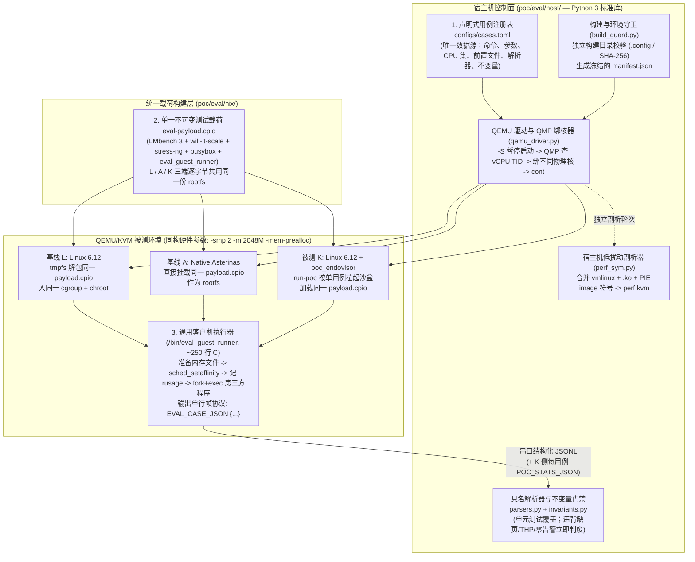

# Kernelet 实验与评测框架总体方案（Syscall & MM 开销评估 + 防腐软件架构设计）

- 更新日期：2026-11-16
- 状态：**已定稿（Accepted Master Plan — R1–R3 已全部确认）**
- 当前聚焦范围：**量化并拆解 Syscall 与内存管理（MM）开销**；全部采用未修改测试逻辑的第三方标准工具（`LMbench 3` + `will-it-scale` + `stress-ng`），在同构 `QEMU/KVM` 环境内完成严谨对照，不引入外部沙盒系统（gVisor / Firecracker / runc）与外部设备应用
- 关联文档：
  - 书中微基准章节：[`what-it-costs.md`](../../book/src/accepted-design/what-it-costs.md)
  - 既有页表与系统调用实验记录：[`../user-page-table/experiment-plan.md`](../user-page-table/experiment-plan.md)、[`../user-page-table/results.md`](../user-page-table/results.md)
  - 全路径开销源码审查（含历史测量缺陷 B1–B5）：[`../user-page-table/overhead-review/README.md`](../user-page-table/overhead-review/README.md)、[`../user-page-table/syscall-overhead-source-audit.md`](../user-page-table/syscall-overhead-source-audit.md)

---

## 1. 严谨性复核：实验方案与现有测试代码的双重问题诊断

在写任何新测试脚本之前，对照仓库源码（[`prototype/linux/config.fragment`](../../prototype/linux/config.fragment)、[`poc/linux/bench/`](../../poc/linux/bench/)、[`poc/test/initramfs/`](../../poc/test/initramfs/)）做了一次全面复核。目前同时存在 **5 个实验严谨性漏洞** 和 **4 个测试代码架构坏味道**：

### 1.1 实验方法与配置层面的 5 个严谨性漏洞

1. **基线归因盲区（只比 `QEMU + Linux` 无法分离 Asterinas 自身实现差距）**：
   - 砍掉 gVisor / Firecracker 等外部系统完全合理；但 `Kernelet` 内部跑的是 `aster-core`（Rust 实现的 VFS、VMAR、进程管理），而 `QEMU + Linux` 跑的是 Linux 6.12（C 实现，含 RCU dcache、Per-VMA Lock、Maple Tree）。
   - 若只有 `L (QEMU+Linux)` 与 `K (Kernelet)` 两列，`open`、`mmap`、`page_fault`、`fork/exec` 的差值 `K - L` 混杂了 **Kernelet 框架税（`K - A`）** 与 **Asterinas 相比 Linux 的实现差距（`A - L`）**。必须把**同一 `poc/` 源码关闭 `kernelet` 特性直接启动的 `A (QEMU + Native Asterinas)`** 纳入同一套自动化基线。
2. **宿主 Linux `.config` 存在严重配置不对等（源码已查实）**：
   - 现有 `tinyconfig + config.fragment` 直接用于性能对比有四处硬伤：
     1. 默认 `CONFIG_CC_OPTIMIZE_FOR_SIZE=y`（`-Os`）且开 `CONFIG_INIT_STACK_ALL_ZERO=y`，而 Rust 侧 `kernelet-image.elf` 是 `--release` 速度优化；
     2. 开启了调试检查 `CONFIG_DEBUG_ATOMIC_SLEEP=y` 与 `CONFIG_SCHEDSTATS=y`，污染系统调用与睡眠锁热路径；
     3. 开启了 **`CONFIG_TRANSPARENT_HUGEPAGE_ALWAYS=y`**，同时 `tinyconfig` **未开 `CONFIG_ADVISE_SYSCALLS`**（用户态 `madvise(MADV_NOHUGEPAGE)` 直接返回 `-ENOSYS` 静默失效），Linux 跑匿名内存测试会自动合并 2 MiB 大页，而 Kernelet 走 4 KiB 页，缺页次数相差 512 倍；
     4. 未开 `CONFIG_PERF_EVENTS`，客户机内直接调 `perf` 会报 `-ENOSYS`；且客户机内高频 `vPMU` 中断会引发额外 `VM-exit` 扭曲采样热点。
3. **区分 `prototype/` 与 `poc/` 的真实实现状态**：
   - 教学原型 `prototype/`（4 MiB Grant）使用的是宿主 `HostHeap`（`mem_alloc`/`mem_free`）；而运行 POSIX 第三方基准的 **`poc/` 当前已采用基于 Grant 的 OSDK 本地堆与 Direct PTE**（见 [`overhead-review/README.md`](../user-page-table/overhead-review/README.md#L95)），计划中不能把已不存在于 `poc/` 热路径的 `HostHeap` 误列为待测瓶颈。
4. **第三方工具落地时的失真陷阱**：
   - `LMbench lat_pagefault` 依赖文件映射失效，而 Linux 6.12 的 `msync(MS_INVALIDATE)`（[`mm/msync.c`](../../reference/linux-6.12/mm/msync.c)）并不驱逐 `tmpfs`/`ramfs` 页或清 PTE，不校验真实 `ru_minflt` 极易测成缓存命中；
   - `LMbench` 内部高频调 `gettimeofday()`，若两侧 `vDSO` 状态不对等（一边走纯用户态 `vDSO`、一边陷入内核），计时开销会直接污染结果；
   - `will-it-scale` 的 `page_fault1` 默认**每任务映射 `128 MiB`**，双进程（`-t 2`）在 `256 MiB` Grant 下必触发 OOM，必须固定为 **`512 MiB` Grant** 配合 QEMU `-m 2048M -mem-prealloc`（消除宿主机侧首次 EPT 缺页）。
5. **大内存 `fork + COW` 场景缺口（与 R2 冲突说明）**：
   - `LMbench lat_proc fork` 仅测极小进程，`will-it-scale` 不含 `fork + COW`；原计划拟通过 `stress-ng --cow` 补齐大地址空间写时复制，但经源码核实 `stress-ng 0.18.06` **并不存在 `--cow` stressor**（`--fork` 不带预分配大 `MAP_PRIVATE` 写时复制，`--vm` 不做 `fork`，`--mmapfork` 在 `fork` 后才做 `MAP_SHARED`）。在严格遵守“100% 第三方工具、不写自制跑分”的前提下，`mm.sng.cow` **作为已知覆盖缺口明确保留并标记为 `COVERAGE GAP`（不可称为全矩阵完成）**；当前以 `stress-ng --fork` / `--vm` / `--mprotect` / `--mmap --mmap-mprotect` 覆盖各自独立路径。

### 1.2 现有测试代码的 4 个“屎山”苗头（必须在架构上根治）

审视 [`poc/linux/bench/host_init.c`](../../poc/linux/bench/host_init.c)、[`pack_initramfs.sh`](../../poc/linux/bench/pack_initramfs.sh) 与 [`bench_linux_and_aster.sh`](../../poc/test/initramfs/src/benchmark/bench_linux_and_aster.sh)，现有写法若直接堆叠 20+ 个第三方测试会迅速腐化：

1. **在 C 语言 PID 1 里硬编码 `strcmp` 分支**：`host_init.c` 每加一个测试模式就要加一组 `poc_mode` / `poc_async_destroy` 字符串判断，并额外打一个专用 `guest-*.cpio` 塞进宿主 initramfs；
2. **`L` / `A` / `K` 运行环境不对称**：`L` 直接在宿主 initramfs 根目录跑，而 `K` 在嵌套的 `guest-*.cpio` 里把测试程序当 `/init` 跑，两边目录树、动态库路径、挂载点、cgroup 层级、控制终端均不一致；
3. **脆弱的 Shell 正则抠数字**：`bench_linux_and_aster.sh` 用 `awk` + `sed 's/[^0-9.]*//g'` 混在启动脚本里裸抓串口文本，既无单元测试也无异常拦截；
4. **原地覆盖构建目录与整机粗粒度统计**：共用 `prototype/.build/linux-6.12` 原地改配置重编，导致产物与日志对不上哈希；`POC_STATS_JSON` 只在整套运行结束打一次，分不清哪个子项触发了异常或刷了 TLB。

---

## 2. 测试与评测系统的五层软件架构设计（杜绝“屎山”）

核心设计思想：**配置声明化、载荷单一化、执行器通用化、协议结构化、校验门禁化**。新增或调整任何第三方 Benchmark 子项，**只需修改一份声明式配置文件，C 代码与内核/镜像构建逻辑零改动**。



### 2.1 目录组织（独立内聚，不污染内核树与旧测试）

在 `poc/eval/` 下集中管理全部评测工程代码，与内核实现和旧功能回归彻底解耦：

```text
poc/eval/
├── Makefile                        # 唯一命令入口：build-kernels / build-payload / selfcheck / run / profile / test
├── configs/
│   ├── linux-perf-base.fragment    # 性能基线配置：-O2, 无 DEBUG_ATOMIC_SLEEP, ADVISE_SYSCALLS=y, PERF_EVENTS=y
│   ├── linux-perf-pti.fragment     # 对称开启 CPU_MITIGATIONS + PTI 的对照配置
│   └── cases.toml                  # 所有 Syscall & MM 测试用例的声明式定义
├── nix/
│   ├── default.nix                 # 打包单一 eval-payload.cpio（复用仓库 lmbench.nix + will-it-scale.nix + stress-ng）
│   └── will-it-scale.nix           # 纯 C 编译 will-it-scale 各 *_processes / *_threads 二进制（无 Python 依赖）
├── guest/                          # 极简、无业务逻辑的 C 组件（总计 < 450 行）
│   ├── eval_init.c                 # ~150 行通用 Linux VM PID 1：挂载 fs、加载模块、执行 cmdline 指定脚本、卸载检查、关机
│   ├── eval_guest_runner.c         # ~220 行通用单用例包装器：环境准备、绑核、rusage 差分、执行第三方二进制、输出 JSONL
│   └── vdso_selfcheck.c            # ~60 行前置探针：校验 clock_gettime / gettimeofday 是否零 syscall 命中 vDSO
└── host/                           # Python 3 标准库编写的宿主机编排与校验层（零第三方 pip 依赖）
    ├── cli.py                      # 命令行入口
    ├── schema.py                   # CaseSpec / RunManifest / CaseRecord 数据结构定义
    ├── build_guard.py              # 独立构建目录管理、.config 断言检查、全产物 SHA-256 清单生成
    ├── qemu_driver.py              # QEMU 生命周期、QMP 精确物理核绑定、串口日志流式捕获
    ├── parsers.py                  # LMbench / will-it-scale / stress-ng --metrics-brief 专用解析纯函数
    ├── invariants.py               # 失败即阻断（Fail-Closed）的有效性门禁规则
    ├── report.py                   # 打乱轮次调度、跨启动中位数/[min,max] 聚合、Markdown 与 CSV 导出
    ├── perf_sym.py                 # Host perf-kvm 符号表合成器（拼接 vmlinux + .ko + PIE kernelet-image 基址）
    └── tests/                      # 针对 parsers.py / invariants.py / schema.py 的离线单元测试
```

### 2.2 关键组件职责与接口契约

1. **声明式用例表 `configs/cases.toml`（消灭硬编码分支）**：
   每个用例是一段纯数据配置，例如：
   ```toml
   [cases."mm.wis.page_fault1.p1"]
   suite = "will-it-scale"
   binary = "/benchmark/bin/will-it-scale/page_fault1_processes"
   args = ["-t", "1", "-s", "5"]
   cpus = [0]                        # 单流绑 CPU 0；双流用例设为 [0, 1]
   tmpfiles = []                     # LMbench 文件类用例在此声明 {path="/tmp/test_file", size_mb=64}
   parser = "will_it_scale_ops"
   unit = "ops/s"
   higher_is_better = true
   [cases."mm.wis.page_fault1.p1".invariants]
   min_minor_faults = 32768          # 至少完成一轮 128 MiB / 4 KiB 真实缺页
   forbid_thp = true
   ```
2. **单一不可变载荷 `eval-payload.cpio`（保证三端环境 100% 同构）**：
   - 包含 `busybox`、`LMbench 3` 二进制、`will-it-scale` 二进制、`stress-ng` 二进制、`vdso_selfcheck`、`eval_guest_runner` 及其完整 Nix 动态库闭包（`/nix/store/...`）；
   - **`A`（Native Asterinas）**：直接作为 QEMU `-initrd eval-payload.cpio` 启动，内核参数传入 `/bin/eval_guest_runner ...`；
   - **`K`（Kernelet）**：由 `run-poc --grant-mb 512 --vcpus 2 --initramfs /payload/eval-payload.cpio` 启动；**每个用例新建一个干净沙盒实例**（一次 VM 启动内顺序跑完本轮用例，既自然拿到精确到单用例的 `POC_STATS_JSON`，又避免跨用例页表/内存池残留污染，同时通过一个空载 `noop` 用例扣除固定启动底噪）；
   - **`L`（Native Linux）**：`eval_init` 将同一份 `/payload/eval-payload.cpio` 解包至独立的 `tmpfs` 目录 `/mnt/payload`，将执行进程加入与 `run-poc` 完全相同的 `/sys/fs/cgroup/sandbox`，`chroot` 进入 `/mnt/payload` 调用同一个 `/bin/eval_guest_runner`。
3. **QMP 启动前无竞态三层绑核（`qemu_driver.py`）**：
   - QEMU 以 `-S -qmp unix:...,server,nowait` **暂停态启动**；
   - 宿主机编排器通过 QMP `query-cpus-fast` 精确拿到 `vCPU 0`、`vCPU 1` 对应的宿主线程 `TID`，读取 `/sys/devices/system/cpu/cpu*/topology/thread_siblings_list` 校验并绑定到**两个不同的物理核心**（避开同核超线程 SMT），将 QEMU I/O 主线程绑到第 3 个核心，随后发送 QMP `cont` 放行启动——从客户机第 1 条指令起就零竞态、零漂移。
4. **结构化帧协议与独立构建树（消灭串口文本混杂与脏构建）**：
   - 彻底告别在 `prototype/.build/linux-6.12` 原地改配置：使用 `O=` 分离出独立的内核构建目录（`poc/eval/.build/linux-perf-base`、`poc/eval/.build/linux-perf-pti`），保留 `prototype/` 原有调试构建不动；
   - `eval_guest_runner` 只输出严格前缀的单行 JSON：`EVAL_CASE_JSON {"case_id":..., "rc":0, "wall_ns":..., "minflt_delta":..., "cpu_start":0, "cpu_end":0, "stdout_b64":...}`；第三方工具原始文本封装在字段内交给带单元测试的纯函数 `parsers.py` 解析，绝不与内核 `printk` 混在一起用正则硬抠。

### 2.3 五条硬性防“屎山”工程红线

1. **零 C 分支扩展红线**：新增、删减或调参任何第三方测试项，严禁修改 `eval_init.c`、`eval_guest_runner.c` 或 `run-poc.c`。
2. **单一载荷红线**：严禁为 `L`、`A`、`K` 分别手工维护不同的测试二进制或目录打包脚本；`build_guard.py` 强制校验三端使用的 `eval-payload.cpio` SHA-256 完全一致。
3. **门禁即阻断（Fail-Closed）红线**：任何一次运行只要违反以下任一条件，`invariants.py` 直接将该次结果标为 `INVALID` 并报错退出，绝不静默写入汇总表：
   - 性能模式下混入了 `-Os` 或 `CONFIG_DEBUG_ATOMIC_SLEEP=y`；
   - Linux `/proc/vmstat` 中 `thp_fault_alloc` 增量 $> 0$；
   - 缺页类测试实测缺页增量低于声明下界（如把缓存命中误当缺页）；
   - 测试线程发生跨允许集合的 CPU 迁移，或宿主 `dmesg` 出现 `BUG:` / `WARNING:` / `Oops:`，或 `rmmod poc_endovisor` 卸载失败。
4. **解析器必测红线**：每种输出格式（LMbench 延迟 stderr 格式、LMbench 带宽格式、will-it-scale `average:` 格式、`stress-ng --metrics-brief` 格式）在 `host/tests/` 下必须有固定样本的离线单元测试（`python3 -m unittest` 一秒跑完）。
5. **新旧代码隔离红线**：旧 `poc/linux/bench/test_mm_safety.c` 保留为独立的安全门禁，旧 `bench_mm.c` / `bench_syscall_fpu.c` 冻结归档，不再往 `poc/linux/bench/host_init.c` 里堆砌新模式。

---

## 3. 第三方 Benchmark 选型矩阵（聚焦 Syscall 与 MM）

全部复用社区标准工具（`LMbench 3` 测单次延迟 µs/op + `will-it-scale` 测固定窗口吞吐 ops/s 与双核并发 + `stress-ng` 补齐大内存 COW/fork/mprotect），不修改任何测试算法源码：

### 3.1 前置公平性自检项（Step 0 必跑）

- `selfcheck.vdso`：运行 `vdso_selfcheck`，分别统计 `L`、`A`、`K` 执行 100,000 次 `clock_gettime(CLOCK_MONOTONIC)` 与 `gettimeofday()` 触发的真实 syscall 次数，确认 `vDSO` 是否对称生效；
- `selfcheck.noop`：执行空命令 `/bin/true`，标定单沙盒生命周期的固定启动系统调用与缺页底噪（用于校准单用例 `POC_STATS_JSON`）。

### 3.2 Syscall 基准子集

| 用例 ID | 工具与命令 | 单位 | 覆盖的核心路径 | 自动门禁不变量 |
|---|---|---|---|---|
| `sys.lm.null` | `lat_syscall -P 1 null` | µs/op | 纯进出钩子 + Endovisor 切栈 + vOSTD 事件入口 + 零参分派 + `SYSRET` | `fpu_saves == 0`, `non_sysret == 0` |
| `sys.lm.read`<br>`sys.lm.write` | `lat_syscall -P 1 read`<br>`lat_syscall -P 1 write` | µs/op | VFS fd 表查询 + `/dev/zero`、`/dev/null` 分派 + `VmReader`/`VmWriter` 1B 校验拷贝 | `rc == 0`, 计时区 `page_faults == 0` |
| `sys.lm.fstat`<br>`sys.lm.stat`<br>`sys.lm.open` | `lat_syscall -P 1 fstat /tmp/f`<br>`lat_syscall -P 1 stat /tmp/f`<br>`lat_syscall -P 1 open /tmp/f` | µs/op | 路径字符串跨界拷贝、内存文件系统 dentry/inode 查找、fd 分配与回收 | 三端统一基于 `tmpfs`/`ramfs` 相同路径深度 |
| `sys.lm.pipe`<br>`sys.lm.select` | `lat_pipe -P 1`<br>`lat_select -P 1 file` | µs/op | 管道读写同步切换、事件就绪轮询检查 | 记录 `vcpu_idles` 与 `virqs` 增量 |
| `sys.lm.fork`<br>`sys.lm.exec`<br>`sys.lm.shell` | `lat_proc -P 1 fork`<br>`lat_proc -P 1 exec`<br>`lat_proc -P 1 shell` | µs/op | Task/内核栈分配、`VmSpace` 创建与 RCU 销毁、ELF 加载与动态库映射（允许双核 `[0, 1]`） | `vm_creates == vm_destroys`, `rc == 0` |
| `sys.wis.getppid`<br>`sys.wis.open`<br>`sys.wis.dup`<br>`sys.wis.pipe` | `getppid1_processes` 等（分别跑 `-t 1` 单核与 `-t 2` 双核，`-s 5`） | ops/s | 稳态吞吐率及 2 个 vCPU 并发陷入时的跨核扩展性（是否存在隐藏全局锁/缓存行乒乓） | 校验 0 跨核违例迁移 |

### 3.3 MM（内存管理与缺页）基准子集

沙盒统一配置 **`512 MiB` Grant**，QEMU 统一配置 `-m 2048M -mem-prealloc`，Guest Linux 统一开启 `CONFIG_ADVISE_SYSCALLS=y` 与启动参数 `transparent_hugepage=never`：

| 用例 ID | 工具与命令 | 单位 | 覆盖的核心路径 | 自动门禁不变量 |
|---|---|---|---|---|
| `mm.wis.pf_anon` | `page_fault1_processes`（`-t 1` 与 `-t 2`，每任务循环 `mmap` 128 MiB 匿名内存 + 逐页写 + `munmap`） | ops/s | **核心匿名页写缺页闭环**：`#PF` 转发 + VMAR 查找 + Grant 分配清零 + 写 PTE + 批量拆表刷 TLB | `minflt >= 32768`, `thp_fault_alloc == 0` |
| `mm.wis.pf_file` | `page_fault2_processes` / `page_fault3_processes`（`-t 1` 与 `-t 2`） | ops/s | 共享/文件页缺页装入（剥离现场清零成本）与多核页表中间级锁 / TLB shootdown 扩展性 | 核查 `vm_flushes` 与 `page_faults` 比值 |
| `mm.wis.vma` | `mmap1_processes`、`mmap2_processes`、`brk1_processes`、`malloc1_processes`（`-t 1` 与 `-t 2`） | ops/s | VMAR 区间树高频增删合并、`brk` 伸缩、OSDK 本地堆压力与单页/小批量 TLB 刷新策略 | 沙盒正常退出后 Grant 100% 回收 |
| `mm.lm.mmap`<br>`mm.lm.mmap_bw` | `lat_mmap 64m /tmp/f`<br>`bw_mmap_rd 64m mmap_only /tmp/f` | µs / MB/s | 64 MiB 文件映射建立、预读（fault-around）装填 PTE 与 `munmap` 拆除全周期延迟/吞吐 | 记录两侧实际 `#PF` 次数（区分预读步长差异） |
| `mm.lm.pf_lat` | `lat_pagefault -P 1 <target_file>` | µs/page | 单次缺页异常端到端延迟 | **两阶段计时区缺页门禁**：通过 `lmbench-timing-rusage.patch` 区分 `benchmark_mmap`（阶段 1）与 `benchmark`（阶段 2），校验证第 2 计时阶段 `timing_stages[1].minflt >= 1024`（计入 Linux fault-around）且 `thp_fault_alloc == 0` |
| `mm.lm.prot` | `lat_sig -P 1 prot /tmp/f`（`64m`） | µs/fault | **写只读页 `#PF(PROT)` $\to$ `on_exception` $\to$ `SIGSEGV` 信号帧 $\to$ `rt_sigreturn`**（注：`lat_sig prot` 实测不调用 `mprotect`；页表 `mprotect` 改权限闭环由 `mm.stress.mprotect.*` 与 `mm.stress.mmap_mprotect.*` 覆盖） | 验证异常转发、FPU/信号恢复完整闭环 |
| `mm.lm.bw_mem` | `bw_mem -P 1 64m rd / wr / rdwr / fcp` | MB/s | PTE 建好后的纯用户态访存带宽基线 | 计时区 `timing_minflt == 0`，验证稳态访存与原生 1.00x 对齐 |
| `mm.stress.*`<br>`mm.sng.cow` *(缺口)* | `stress-ng --fork / --vm (--vm-bytes 64M@p1, 128M@p2) / --mprotect / --mmap --mmap-mprotect (--mmap-bytes 64M@p1, 128M@p2) --metrics-brief --timeout 5s`（`1` 核与 `2` 核） | bogo-ops/s | `fork` 进程创建、每 worker 64 MiB 匿名缺页写、`mprotect + SIGSEGV` 及大区段 `mprotect`；**大地址空间 `fork + COW` (`mm.sng.cow`) 为 `stress-ng` 无 `--cow` 导致的设计缺口（自动标记 `SKIPPED / COVERAGE GAP`）** | `thp_fault_alloc == 0`, `rc == 0` |

---

## 4. 对照基线与开销拆解闭环

### 4.1 三列同构基线 + 按需消融列

| 代号 | 环境与构建配置 | 科学定位 |
|---|---|---|
| **`L`** | `QEMU/KVM` + `linux-perf-base` (`-O2`, `THP=never`) + `chroot(eval-payload)` | 成熟 Linux 6.12 内核在同一虚拟硬件上的性能基准 |
| **`A`** | `QEMU/KVM` + 原生 Asterinas (`--release`, 关闭 `kernelet`) + `eval-payload` | 同一 `poc/` 源码剥离宿主后的原生 Asterinas 基线 |
| **`K`** | `QEMU/KVM` + `linux-perf-base` + `poc_endovisor.ko` + `kernelet-image.elf` (`pt_mode=0`) + `eval-payload` | 完整 Kernelet 系统（Direct PTE + 本地 OSDK 堆） |
| **消融组** *(按需)* | `K_vma`（`pt_mode=1` 旧 VMA 服务对照）；`L_pti` vs `K_pti`（同开 `linux-perf-pti` + `pti=on`） | 定量验证 Direct PTE 收益及开启硬件 PTI 缓解后的真实相对开销 |

### 4.2 三层递进开销分析流程（正式计时与剖析严格物理分离）

1. **第 1 层——无扰动基线差分**：
   - 先看 `K vs L`（相对 Linux 总开销），再用 `K vs A` 与 `A vs L` 切分责任边界：若 `K ≈ A < L`，瓶颈在 `aster-core` 共有实现；若 `K < A ≈ L`，瓶颈确属 Kernelet 跨界交接、事件包装或宿主协同（如 [`overhead-review`](../user-page-table/overhead-review/README.md) 列出的 S1–S9、I1–I6、M2–M6）。
2. **第 2 层——单用例窗口计数器审计**：
   - 对照每个 `case_id` 对应的 `rusage` 与校准后 `POC_STATS_JSON`（`syscalls`、`page_faults`、`vm_flushes`、`fpu_saves`、`virqs`、`forced_yields`），先排除“事件次数异常放大”（例如 5 页修改就触发全量 TLB flush 的 M3 策略，或意外 `vcpu_idle` 睡眠）。
3. **第 3 层——冻结产物反汇编 + 宿主机 `perf kvm` 全栈采样**：
   - 先核对冻结二进制反汇编；随后在独立剖析轮次（Linux 加 `nokaslr` 方便固定符号），由 `perf_sym.py` 将 `vmlinux`、`poc_endovisor.ko` 各节地址与 `kernelet-image.elf` PIE 加载基址合并成一份符号表，在**宿主机侧**对绑核的 vCPU 线程运行 `perf kvm --guestkallsyms=... record/stat`（避免客户机内部 `vPMU` 中断引发额外 `VM-exit` 失真），生成贯通 **`Linux entry -> endovisor -> vOSTD -> aster-core`** 的真实热点分布。

---

## 5. 统计纪律与可复现归档

- **打乱顺序多轮启动**：正式评估执行 **5 轮独立批次**，每轮按固定随机种子打乱 `L / A / K` 执行顺序（如 `R1: L K A`, `R2: K A L`...），抵消宿主机温升与背景漂移；
- **诚实统计指标**：汇总表同时列出 5 轮的 **中位数（Median）**、**`[min, max]` 区间**、**均值（Mean）** 以及 **`K/L`、`K/A` 比值**；不将吞吐倒数或 5 轮样本伪称为单次系统调用 p99 尾延迟；
- **自包含结果归档**：每次运行输出到 `research/evaluation-plan/results/<YYYYMMDD-HHMMSS>-<tag>/`，自动保存 `manifest.json`（含仓库 commit、`git diff` 补丁、内核 `.config`、全部二进制 SHA-256、宿主机 CPU 拓扑与频率状态）、原始串口日志、结构化 `records.jsonl` 及生成的 Markdown/CSV 报表。

---

## 6. 模块化实施里程碑（按软件工程标准分步交付）

| 阶段 | 交付内容 | 验收标准（Definition of Done） |
|---|---|---|
| **M0：骨架、配置隔离与单测** | 建立 `poc/eval/` 目录骨架、`linux-perf-base.fragment` 独立内核构建、数据结构 `schema.py`、解析器 `parsers.py` 与门禁 `invariants.py` | `make -C poc/eval test` 离线解析与门禁单元测试 100% 通过；`build_guard.py` 能自动拦截 `-Os` / `DEBUG_ATOMIC_SLEEP` 配置 |
| **M1：统一载荷与 QMP 绑核底座** | 完成 `eval_init.c`、`eval_guest_runner.c`、`vdso_selfcheck.c` 与 Nix `eval-payload.cpio`（含 `LMbench 3` + `will-it-scale` + `stress-ng`）；打通 `qemu_driver.py` QMP 暂停绑核 | `L`、`A`、`K` 三端均能加载同一个 `eval-payload.cpio` 跑通 `selfcheck.vdso` 与 `selfcheck.noop`，核实 `THP=0` 且 0 线程迁移 |
| **M2：全矩阵基线采集与门禁验证** | 编写完整 `configs/cases.toml`，执行 5 轮打乱顺序的 `L / A / K`（含 `K_vma` 消融）全量 Syscall & MM 测试 | 全部通过 `invariants.py` 校验（含 `lat_pagefault` 真实缺页核验），自动生成首份完整基线报告与 `manifest.json` |
| **M3：宿主机全栈剖析工具与优化闭环** | 实现 `perf_sym.py` PIE 符号合并与宿主 `perf kvm` 采样脚本，对差距显著子项生成全栈火焰图，支撑后续热路径精简验收 | 能在一份符号化报告中同时解析出 `vmlinux`、`poc_endovisor`、`vostd` 与 `aster_core` 函数符号占比 |

---

## 7. 已确认的关键架构决策记录（R1–R3）

| 编号 | 确认事项 | 最终决定 | 状态 |
|---|---|---|---|
| **R1** | **同构基线列设置** | 采纳 **`L (QEMU+Linux)` + `A (QEMU+Native Asterinas)` + `K (Kernelet)`** 三列同构基线（不引任何外部系统），从而严谨分离 `K - A`（Kernelet 自身机制税）与 `A - L`（Asterinas 内核实现差距）。 | **已决定** |
| **R2** | **大内存 `fork + COW` 与 `stress-ng` 边界** | 采用标准包 **`stress-ng 0.18.06`** 启用 `--fork` / `--vm` / `--mprotect` / `--mmap --mmap-mprotect --metrics-brief`（100% 第三方工具，零自写跑分代码）；因该工具无 `--cow` stressor，`mm.sng.cow` 在 `cases.toml` 与报告中**明确保留为覆盖缺口（`COVERAGE GAP`）**，待修订 R2 或更换工具后再补齐。 | **已决定（含明确缺口）** |
| **R3** | **代码目录落点与旧代码边界** | 将新框架独立建于 **`poc/eval/`**（不往 `poc/linux/bench/host_init.c` 继续堆分支）；保留 `test_mm_safety.c` 作为独立安全门禁，冻结淘汰旧自写性能循环。 | **已决定** |
