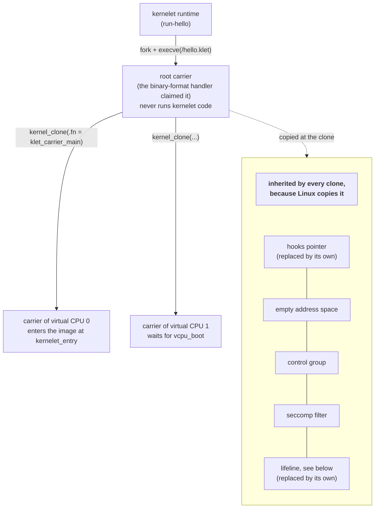

# Carriers

Chapter 4 attached two hooks to a Linux task. This chapter is about those tasks: where they come from, what they inherit, and how the endovisor learns when one dies.

A **carrier** is a Linux task that belongs to a sandbox. Linux schedules carriers like any tasks; it does not know what they carry. A sandbox has a fixed number of carriers, chosen when it is created: one **root carrier**, which holds the sandbox together and never runs kernelet code, and one carrier per **virtual CPU**, which runs the kernelet's code and enters user mode on the kernelet's behalf; a virtual CPU is one of the processors the kernelet believes it has. Chapter 9 says what a virtual CPU is in full; for now, a sandbox with one virtual CPU, like the hundred-line kernel's, has a root carrier and one other.

## Why a carrier is not a kernel thread

Linux has a kind of task that runs only kernel code, the *kernel thread*, and it is the natural first thought for "a task that runs the kernelet". It is the wrong one. A kernel thread has no user address space and can never return to user mode, and a carrier must: entering user mode to run the tenant's program is the one thing the kernelet cannot do for itself. So a carrier is an ordinary user task, with an address space and a `pt_regs`, which happens to spend most of its time in kernel mode.

<div class="linux">

**Linux: how tasks are made.** Almost every task is created by one function, [`kernel_clone()`](https://elixir.bootlin.com/linux/v6.12/source/kernel/fork.c#L2745), which underlies `fork`, `clone` and kernel-thread creation. It copies the parent's task structure and then, depending on flags, shares or copies the address space, open files and so on. Called with a function pointer in its arguments and *without* the kernel-thread flag, it makes a task that starts in that function in kernel mode and, when the function returns, continues to user mode with a copy of its parent's registers in which the instruction pointer, the stack pointer and `ax` are zero. That is how Linux itself starts `init`. The function is not exported to modules; the patch exports it.

The other way to give a task a fresh address space is [`execve`](https://elixir.bootlin.com/linux/v6.12/source/fs/exec.c#L2097): Linux offers the file to each registered **binary-format handler** ([`struct linux_binfmt`](https://elixir.bootlin.com/linux/v6.12/source/include/linux/binfmts.h#L82)) in turn, and the one that recognizes the file replaces the process's address space and sets its starting registers. A module can register a handler of its own.

</div>

## The root carrier is born by exec

The endovisor registers a binary-format handler for files that begin with the four bytes `KLET`. A **sandbox file** is such a file: the magic, an ABI version, the number of virtual CPUs, and a command line for the kernel. The *kernelet runtime*, the host program that creates sandboxes, is in this prototype a tiny C program that forks a child, drops the child's ability to gain privileges, and executes the sandbox file:

*Simplified from `prototype/host/runtime/run-hello.c`: `main`.*

```c
pid = fork();
if (pid == 0) {
	prctl(PR_SET_NO_NEW_PRIVS, 1, 0, 0, 0);
	execve("/hello.klet", argv, envp);
	_exit(127);
}
waitpid(pid, &status, 0);          /* until the sandbox has ended */
```

Everything the runtime set up on that child before the `execve`, such as its control group, its user identity and its seccomp filter, is inherited by every carrier, because every carrier descends from it. The prototype sets only the one `prctl`; a real runtime would set them all.

<div class="linux">

**Linux: control groups.** A control group is a set of tasks that Linux accounts and limits together: their share of the processors, their memory, and more. A child starts in its parent's group. Containers are built on them, and so is a sandbox: because every carrier is in the sandbox's group, the processor time the kernelet burns is charged to the tenant by machinery Linux already has, and so is any memory allocated on a carrier with the flag that asks for it (`__GFP_ACCOUNT`). Linux charges the tenant's page tables that way by itself, to the carrier whose fault or mapping causes them; the endovisor charges the pages of the kernelet's stacks and its heap with the same flag (`GFP_KERNEL_ACCOUNT`); the one grant is allocated when the module loads, before any sandbox exists, and is not charged to anyone.

</div>

<div class="linux">

**Linux: `TIF_NOTIFY_RESUME`.** Linux enters the exit loop of chapter 4, and so runs the resume hook, only if the task has a work flag set (chapter 4's box). So the hook runs for every kind of exit work, not only the kernelet's, and must be written to find nothing of its own to do. Kernel code that wants the loop to run sets the flag [`TIF_NOTIFY_RESUME`](https://elixir.bootlin.com/linux/v6.12/source/arch/x86/include/asm/thread_info.h#L87) on the task: a plain flag-set on the current task, or `set_notify_resume()` on another, which also nudges the processor that task is on. The book says the endovisor *flags the carrier* when it means this.

</div>

The handler is where the child becomes the root carrier:

*Simplified from `prototype/linux/endovisor/main.c`: `klet_load_binary`, `klet_empty_mm`.*

```c
static int klet_load_binary(struct linux_binprm *bprm)
{
	klet_read_config(inst, bprm, &nr_vcpus);   /* the magic, the version, the vCPU count */

	begin_new_exec(bprm);                       /* a fresh, empty address space; signal handlers reset (ignored signals stay ignored) */
	klet_personality_64bit();
	setup_new_exec(bprm);
	klet_empty_mm();                            /* unmap the one area exec left: the argument stack */
	set_binfmt(&klet_format);
	finalize_exec(bprm);

	start_thread(current_pt_regs(), 0, 0);      /* valid 64-bit user registers, even though it never uses them */

	root = klet_carrier_new(inst, KLET_ROOT, -1);
	klet_carrier_attach(root);                  /* install the hooks and the lifeline */
	sigprocmask(SIG_SETMASK, &none, NULL);      /* no signal blocked ... */
	for (sig = 1; sig <= _NSIG; sig++)          /* ... and every one that can be ignored is: chapter 8 says why */
		if (!sig_kernel_only(sig))              /* (SIGKILL and SIGSTOP cannot be) */
			kernel_sigaction(sig, SIG_IGN);

	set_thread_flag(TIF_NOTIFY_RESUME);         /* make the resume hook run on the way out */
	return 0;
}
```

Each line does what any program loader does, with one difference. The ELF loader would now map the program and its stack into the new address space; this handler maps nothing, and even unmaps the temporary page that holds the `execve` arguments, so that the address space is empty. Nothing of the host's is left in it for a tenant to read.

The call to `start_thread` looks pointless for a task that will never run user code, and is not: a task cloned from this one copies its saved registers, segment selectors and flags included, and those clones *will* run user code. The root carrier's registers are the template.

The last line is the handoff. The root carrier returns from the handler and heads for user mode, as every `execve` does. On the way it passes through the exit loop, and because the flag is set, the resume hook runs. For the root carrier that hook returns only to die: it is where the root carrier does its work.

## The root carrier starts the others

*Simplified from `prototype/linux/endovisor/carrier.c`: `klet_root_loop`, `klet_spawn_vcpu`.*

```c
static void klet_root_loop(struct klet_carrier *root)
{
	for (i = 0; i < inst->nr_vcpus; i++)
		klet_spawn_vcpu(inst, i);

	for (;;) {                                   /* then sleep until the sandbox ends */
		wait_event_interruptible(inst->root_wq,
			inst->stopped || inst->dying || fatal_signal_pending(current));
		if (inst->stopped || inst->dying || fatal_signal_pending(current))
			break;
		klet_drain_signals(root);                /* discard anything but SIGKILL */
	}
	klet_carrier_die(root);
}

static int klet_spawn_vcpu(struct klet_inst *inst, int vcpu)
{
	struct kernel_clone_args args = {
		.flags = CLONE_UNTRACED,
		.exit_signal = SIGCHLD,
		.fn = klet_carrier_main,                 /* the child starts here, in kernel mode */
		.fn_arg = (void *)(long)vcpu,
	};
	pid_t pid;

	for (tries = 0; tries < 8; tries++) {
		klet_drain_signals(klet_current_carrier());   /* kernel_clone refuses while a signal is pending (chapter 8) */
		pid = kernel_clone(&args);
		if (pid != -ERESTARTNOINTR)
			break;
	}
	return pid >= 0 ? 0 : -EAGAIN;
}
```

`wait_event_interruptible` is Linux's ordinary way to sleep until a condition holds: a waker *wakes* the queue the sleeper named, and the sleeper checks its condition again. An *interruptible* sleep also ends whenever a signal is pending for the task. The clones use the *killable* variant, which ends only for `SIGKILL`, because a `SIGSTOP` sent to a carrier stays pending until the carrier next heads for user mode (chapter 8) and must not end the wait early.

Each clone is a separate process, not a thread: no `CLONE_VM`, no `CLONE_FILES`, no `CLONE_THREAD`. It gets a *copy* of the root's empty address space, a copy of its descriptor table, and, because Linux copies the task structure, the root's hooks pointer, syscall-work bit, control group, credentials and seccomp filter. The control group, the credentials and the seccomp filter it keeps as they came: the endovisor sets none of them up per carrier; `fork` does. The hooks pointer and the lifeline (defined below) it replaces at once: the clone's first act, below, is to clear the inherited pointer, so that nothing it does before it is attached can reach the root's record, then to attach a record of its own, and to close the inherited copy of the root's lifeline and open one of its own.



The child's start function builds the carrier's record and enters the kernelet:

*Simplified from `prototype/linux/endovisor/carrier.c`: `klet_carrier_main`.*

```c
static int klet_carrier_main(void *arg)
{
	int vcpu = (int)(long)arg;

	clear_syscall_work(KERNELET);               /* not a carrier until attached: the inherited pointer must not be used */
	current->carrier_hooks = NULL;
	f = fget(inst->root_lifeline_fd);           /* the inherited copy of the root's lifeline: close it, and drop */
	close_fd(inst->root_lifeline_fd);           /* the reference now rather than at the next return to user mode, */
	__fput_sync(f);                             /* in case the root died meanwhile and this copy was the last */
	c = klet_carrier_new(inst, KLET_VCPU, vcpu);
	klet_carrier_attach(c);                     /* this task's own hooks and lifeline */
	mmget(current->mm);                         /* keep a reference to the empty address space ... */
	c->blank_mm = current->mm;                  /* ... which chapter 13 drops when a tenant's replaces it */
	inst->vcpus[vcpu] = c;

	if (vcpu != 0) {                            /* virtual CPU 0 boots; the others wait to be started */
		wait_event_state(c->idle_wq, c->boot_requested || inst->dying,   /* only SIGKILL cuts the wait short; */
				 TASK_KILLABLE | TASK_NOLOAD);                                 /* NOLOAD: not counted in the load average */
		if (!c->boot_requested) {                /* woken because the sandbox is dying */
			klet_carrier_die(c);
			return 0;
		}
	}

	klet_enter(c, KLET_RUN_EVENT);              /* switch to a kernelet stack and run kernelet code */

	set_thread_flag(TIF_NOTIFY_RESUME);         /* when the kernelet first wants user mode: the resume hook applies the registers */
	return 0;
}
```

`klet_enter` is the subject of the next chapter. For virtual CPU 0 it leads to `kernelet_entry` from chapter 3, and so to the kernel proper's `main`. The carrier returns from `klet_enter` only when the kernelet has asked to run a user program, and then the function returns, Linux's fork-return path takes the task to user mode, and the resume hook, requested by the flag, puts the right registers in place first.

## Lifelines

A carrier can die without the endovisor's involvement: the operator kills it, or Linux's out-of-memory killer does. Losing a carrier is losing a processor with whatever the kernelet was doing on it, and the sandbox cannot continue. The endovisor needs to *hear* of the death, however it happened, and Linux offers a clean way.

<div class="linux">

**Linux: descriptors and release.** Every process has a table of open file descriptors. When a task exits for any reason, Linux closes them all, and when the last reference to an open file goes, the file's `release` operation runs. A module can make an open file of its own with [`anon_inode_getfile()`](https://elixir.bootlin.com/linux/v6.12/source/fs/anon_inodes.c#L143), with whatever operations it likes.

</div>

So each carrier holds, in its descriptor table, one open file of the endovisor's that nothing ever reads or writes: its **lifeline**. Its `release` is the death notice.

*Simplified from `prototype/linux/endovisor/carrier.c` and `prototype/linux/endovisor/main.c`: `klet_carrier_attach`, `klet_lifeline_release`.*

```c
int klet_carrier_attach(struct klet_carrier *c)
{
	struct file *file = anon_inode_getfile("[kernelet-carrier]", &klet_lifeline_fops, c, O_RDWR);
	int fd = get_unused_fd_flags(0);
	fd_install(fd, file);

	current->carrier_hooks = &c->hooks;         /* attach the hooks ... */
	set_syscall_work(KERNELET);                 /* ... and ask for the syscall hook */
	return 0;
}

static int klet_lifeline_release(struct inode *inode, struct file *file)
{
	klet_carrier_lifeline_closed(file->private_data);   /* the carrier is gone */
	return 0;
}
```

A clone starts with a copy of its parent's descriptor table, which is why `klet_carrier_main` closes the inherited copy of the root's lifeline first: otherwise the root's death notice would wait until the last carrier died. The close forces the file's release at once, because Linux normally defers a release to the closer's next return to user mode, and a root that died between the clone and the close, leaving this copy as the last reference, would otherwise be noticed only when the new carrier first got there; a clone that finds the root gone does not become a carrier. A tenant cannot close a lifeline, because closing a descriptor is a Linux system call, and the syscall hook takes those.

When a lifeline closes, the endovisor takes the carrier off its lists. If the sandbox was still running, whichever carrier's lifeline it was, the sandbox is over: the endovisor marks the kernelet dying and ends every other carrier, which is chapter 12. The root's lifeline ends it even after the kernelet has stopped itself, for a reason chapter 12 gives.

<div class="recap">

**Recap.** A carrier is an ordinary Linux user task that runs kernelet code and enters user mode for it. The root carrier is made by `execve` of a sandbox file, which the endovisor's binary-format handler claims, giving it an empty address space and the hooks; it never runs user code and it returns from the resume hook only to die. It clones one carrier per virtual CPU with `kernel_clone`, and each clone inherits the hooks, the empty address space, the control group and the seccomp filter by the ordinary rules of `fork`. Every carrier holds a lifeline, an open file whose release tells the endovisor that the carrier has died.

</div>
