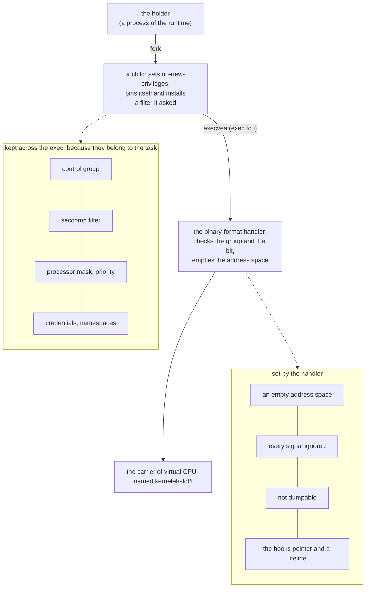

# Carriers

Chapter 5 attached two hooks to a Linux task. This chapter is about those tasks: where they come from, what they inherit, and how the endovisor learns when one dies.

A **carrier** is a Linux task that carries one of a sandbox's virtual CPUs: it runs the kernelet's code and enters user mode on the kernelet's behalf, and a virtual CPU is one of the processors the kernelet believes it has. Linux schedules carriers like any tasks; it does not know what they carry. A sandbox has a fixed number of them, one per virtual CPU, chosen when it is created, and nothing else of the sandbox is a task: the holder of chapter 2, which created the sandbox, is a process of the runtime and runs no kernelet code. What a virtual CPU is in full comes with the kernelet's own scheduler; for now, a sandbox with one virtual CPU, like the hundred-line kernel's, has one carrier.

## Why a carrier is not a kernel thread

A carrier is an ordinary user task, not a kernel thread, because it must enter user mode. Linux has a kind of task that runs only kernel code, the *kernel thread*, and it is the natural first thought for "a task that runs the kernelet". It is the wrong one. A kernel thread has no user address space and can never return to user mode, and a carrier must: entering user mode to run the tenant's program is the one thing the kernelet cannot do for itself. So a carrier has an address space and a `pt_regs`, and happens to spend most of its time in kernel mode.

## A carrier is born by fork and exec

<div class="background">

**Linux: how tasks are made.** Almost every task is created by one function, [`kernel_clone()`](https://elixir.bootlin.com/linux/v6.12/source/kernel/fork.c#L2745), which underlies `fork`, `clone` and kernel-thread creation. It copies the parent's task structure and then, depending on flags, shares or copies the address space, open files and so on. A child made by `fork` is therefore a copy of its parent in every property Linux keeps on the task: control group, credentials, namespaces, processor mask, priority, resource limits, seccomp filter, and the hooks pointer the patch added.

A task gets a fresh address space only from [`execve`](https://elixir.bootlin.com/linux/v6.12/source/fs/exec.c#L2097). Linux offers the file to each registered **binary-format handler** ([`struct linux_binfmt`](https://elixir.bootlin.com/linux/v6.12/source/include/linux/binfmts.h#L82)) in turn, and the one that recognizes the file replaces the process's address space and sets its starting registers. A module can register a handler of its own. What `exec` keeps of the task and what it resets is the box of chapter 2.

</div>

A carrier has whatever its process set on itself before the exec, because `exec` keeps the task's properties and replaces only its program. For each virtual CPU the holder asks the sandbox for an exec descriptor, forks a child, and the child, after arranging itself with ordinary system calls, executes the descriptor with `execveat`. What the child set is what the carrier has: its control group, which the holder joined before creating the sandbox; its processor mask and priority; its seccomp filter, if the runtime installed one. The prototype's child sets the no-new-privileges bit, which the endovisor insists on, and pins itself or installs a filter if its options ask.

A sandbox is charged through its control group: every carrier is in it, so the kernelet's processor time and accounted memory are the tenant's. Chapter 2's box introduced control groups, and `KLET_CREATE` records the holder's group and refuses the exec of an exec descriptor from any other. A child starts in its parent's group, and `exec` does not change it. The processor time the kernelet burns is therefore charged to the tenant by machinery Linux already has, and so is any memory allocated on a carrier with the flag that asks for it (`__GFP_ACCOUNT`). Linux charges the tenant's page tables that way by itself, to the carrier whose fault or mapping causes them; the endovisor charges the grant, the pages of the kernelet's stacks and its heap with the same flag (`GFP_KERNEL_ACCOUNT`), all of them allocated on a carrier of the sandbox.

The endovisor's half is the binary-format handler, where the child becomes the carrier:

*Simplified from `prototype/linux/endovisor/main.c`: `klet_load_binary`, `klet_empty_mm`, `klet_ignore_signals`.*

```c
static int klet_load_binary(struct linux_binprm *bprm)
{
	if (memcmp(bprm->buf, KLET_EXEC_MAGIC, KLET_EXEC_MAGIC_LEN) != 0)
		return -ENOEXEC;                        /* not ours: the next handler's turn */
	inst = klet_exec_lookup(bprm, &vcpu);       /* which sandbox and virtual CPU, by the file's inode */
	if (!inst)
		return -ENOEXEC;
	err = klet_exec_claim(inst, vcpu);          /* not killed; not started; the sandbox's group; no new privileges */
	if (err)
		return err;                             /* ESRCH, EBUSY or EPERM: the exec fails and the process lives on */

	begin_new_exec(bprm);                       /* the point of no return: a fresh address space, signal handlers reset */
	klet_personality_64bit();
	setup_new_exec(bprm);
	klet_empty_mm();                            /* unmap the one area exec left: the argument stack */
	set_binfmt(&klet_format);
	finalize_exec(bprm);
	start_thread(current_pt_regs(), 0, 0);      /* valid 64-bit user registers, though it never uses them */
	klet_ignore_signals();                      /* every signal that can be ignored is: chapter 8 says why */
	set_mask_bits(&current->mm->flags, MMF_DUMPABLE_MASK, SUID_DUMP_DISABLE);   /* not dumpable, whoever the holder is */
	snprintf(comm, sizeof(comm), "kernelet/%d/%u", inst->slot, vcpu);          /* the name ps shows */
	strscpy_pad(current->comm, comm, sizeof(current->comm));

	c = klet_carrier_new(inst, vcpu);
	klet_carrier_attach(c);                     /* the hooks and the lifeline */
	mmget(current->mm);                         /* keep a reference to the empty address space ... */
	c->blank_mm = current->mm;                  /* ... dropped when a tenant's replaces it, with tenant memory */
	inst->vcpus[vcpu] = c;

	if (!inst->started)                         /* the first arrival starts the sandbox: */
		klet_sandbox_start(inst);               /* the image's data restored, the grant, the boot arguments */
	inst->arrived++;
	wake_up_all(&inst->arrive_wq);              /* virtual CPU 0 may be waiting for this one */

	set_thread_flag(TIF_NOTIFY_RESUME);         /* make the resume hook run on the way out */
	return 0;
}
```

The calls from `begin_new_exec` to `start_thread` are what every program loader makes, with one difference. The ELF loader would now map the program and its stack into the new address space; this handler maps nothing, and even unmaps the temporary page that holds the `execveat` arguments, so that the address space is empty. Nothing of the host's is left in it for a tenant to read.

One line undoes what the holder's identity would otherwise leave: the carrier is made non-dumpable. Linux makes a process that executed a file it cannot read dumpable only as `fs.suid_dumpable` allows, which by default is not at all, but root can read an execute-only file, so for a root holder the rule would leave the carrier dumpable; the handler clears the dumpable bits itself, for the carrier and, later, for every address space the kernelet creates.

`start_thread` gives the task a valid 64-bit user register frame, as every loader must; the resume hook will overwrite it before the task ever reaches user mode.

The last line hands the carrier to the resume hook. The carrier returns from the handler and heads for user mode, as every `execve` does. On the way it passes through the exit loop, and because the flag is set, the resume hook runs. The carrier never arrives in user mode on its own account: from here on it goes there only when the kernelet sends it. Setting `TIF_NOTIFY_RESUME` on a carrier, by a plain flag-set on the current task or by [`set_notify_resume()`](https://elixir.bootlin.com/linux/v6.12/source/include/linux/resume_user_mode.h#L21) on another, which also nudges the processor that task is on, is what the book calls *flagging the carrier*.



## Entering the kernelet

The resume hook is where a new carrier enters the kernelet, once its virtual CPU may start. Its first trip through the hook finds the carrier in the state `NEW`:

*Simplified from `prototype/linux/endovisor/carrier.c`: `klet_on_resume`, `klet_vcpu_await`.*

```c
		if (c->state == KLET_NEW) {                 /* the carrier's first way out to user mode, from the exec */
			if (!klet_vcpu_await(c)) {              /* wait until this virtual CPU may enter the image */
				klet_carrier_die(c);                /* the sandbox ended, or the carrier was killed, while it waited */
				return;
			}
			klet_enter(c, KLET_RUN_EVENT);          /* switch to a kernelet stack and run kernelet code */
			continue;
		}

static bool klet_vcpu_await(struct klet_carrier *c)
{
	if (c->vcpu == 0)                           /* virtual CPU 0 boots the kernelet, once every carrier has arrived */
		wait_event_state(inst->arrive_wq, inst->arrived == inst->nr_vcpus || inst->dying,
				 TASK_KILLABLE | TASK_NOLOAD);
	else                                        /* the others wait for the kernel proper to start their processor */
		wait_event_state(c->idle_wq, c->boot_requested || inst->dying,
				 TASK_KILLABLE | TASK_NOLOAD);
	return !inst->dying && !fatal_signal_pending(current) &&
	       (c->vcpu == 0 ? inst->arrived == inst->nr_vcpus : c->boot_requested);
}
```

The kernelet boots only when every virtual CPU's carrier has arrived, because a kernel that starts its other processors expects each of them to answer.

Carriers wait in a killable, no-load sleep. `wait_event_state` is Linux's ordinary way to sleep until a condition holds: a waker *wakes* the queue the sleeper named, and the sleeper checks its condition again. The sleep is *killable*, ended only by `SIGKILL`, because a `SIGSTOP` sent to a carrier stays pending until the carrier next heads for user mode and must not end the wait early; and *no-load*, so that a waiting carrier is not counted in the load average.

`klet_enter` runs the kernelet until it asks to run a user program, or leaves for good. For virtual CPU 0 it leads to `kernelet_entry` from chapter 4, and so to the kernel proper's `main`; for the others, to `vcpu_entry`, once the kernel proper has asked for that processor through the service `vcpu_boot`. When the carrier returns from `klet_enter` with a program to run, the hook's loop puts the right registers in place and lets Linux return to user mode. `klet_enter` itself is the subject of the next chapter.

## Lifelines

The endovisor must hear of a carrier's death however it happens, because a sandbox cannot continue without one of its processors. A carrier can die without the endovisor's involvement: the operator kills it, or Linux's out-of-memory killer does. Losing a carrier is losing a processor with whatever the kernelet was doing on it. Linux offers a clean way to hear of it.

<div class="background">

**Linux: descriptors and release.** When a task exits, Linux closes its open files, and the last close of a file runs the file's `release` operation. Every process has a table of open file descriptors, and a task's exit closes them all, whatever the reason for the exit. A module can make an open file of its own with [`anon_inode_getfile()`](https://elixir.bootlin.com/linux/v6.12/source/fs/anon_inodes.c#L143), with whatever operations it likes.

</div>

So each carrier holds, in its descriptor table, one open file of the endovisor's that nothing ever reads or writes: its **lifeline**. Its `release` is the death notice.

*Simplified from `prototype/linux/endovisor/carrier.c` and `prototype/linux/endovisor/main.c`: `klet_carrier_attach`, `klet_lifeline_release`.*

```c
int klet_carrier_attach(struct klet_carrier *c)
{
	struct file *file = anon_inode_getfile("[kernelet-carrier]", &klet_lifeline_fops, c, O_RDWR);
	int fd = get_unused_fd_flags(0);
	fd_install(fd, file);                       /* into this task's own table, which the exec made sure no other task shares */

	current->carrier_hooks = &c->hooks;         /* attach the hooks ... */
	set_syscall_work(KERNELET);                 /* ... and ask for the syscall hook */
	return 0;
}

static int klet_lifeline_release(struct inode *inode, struct file *file)
{
	klet_carrier_lifeline_closed(file->private_data);   /* the carrier is gone */
	return 0;
}
```

Only the carrier's death can close its lifeline. It is installed after the `exec`, so no other task holds a copy of it: the exec made sure the child's table is shared with no other task. A tenant cannot close it, because closing a descriptor is a Linux system call, and the syscall hook takes those. A copy taken later with `pidfd_getfd`, which needs `CAP_SYS_PTRACE` against a non-dumpable task, delays the notice until that copy closes.

A closed lifeline ends the sandbox, and the last one to close marks it exited. When a lifeline closes, the endovisor takes the carrier off its lists. If the sandbox was still running, whichever carrier's lifeline it was, the sandbox is over: the endovisor marks the kernelet dying and ends every other carrier. When the last lifeline closes, no carrier is left and the sandbox has exited, which is what the holder's `KLET_WAIT` was waiting for.

<div class="recap">

**Recap.** A carrier is an ordinary Linux user task that runs kernelet code and enters user mode for it. The holder forks one child per virtual CPU, and each child executes that virtual CPU's exec descriptor, which the endovisor's binary-format handler claims: it checks the child's control group and its no-new-privileges bit, gives it an empty address space, ignores every signal that can be ignored, makes it non-dumpable, names it, and attaches the hooks and a lifeline. The child keeps what it set on itself before the exec, by the ordinary rules of `exec`. On its way out the resume hook holds it until every carrier has arrived, then enters the kernelet. Every carrier holds a lifeline, an open file whose release tells the endovisor that the carrier has died.

</div>
