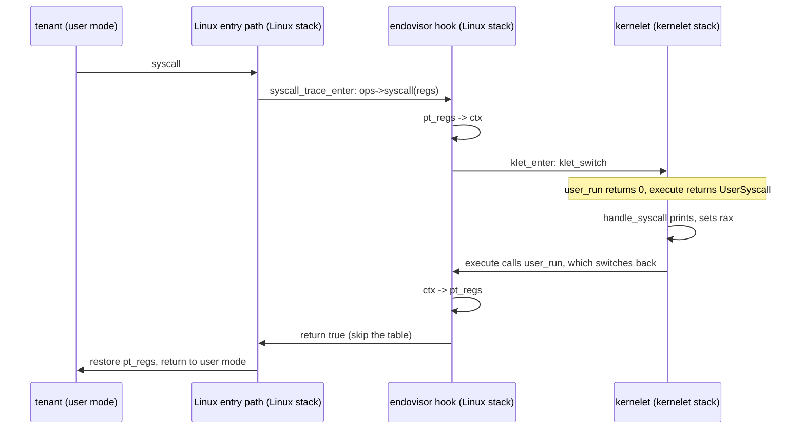

# Into user mode and back

Everything is now in place for the hundred-line kernel to run its program. The kernel proper's task calls `execute`, which in vOSTD is the service `user_run`. This chapter follows that call out of the kernelet, through Linux, into user mode, and back in again on the program's first system call. At the end the kernel prints *Hello, world*.

## Leaving: the `user_run` service

`UserMode::execute` in vOSTD is the real OSTD's code with one line changed: where OSTD runs its own assembly to enter user mode, vOSTD calls `user_run` with a pointer to the context, and interprets the number it returns.

*Simplified from `prototype/vostd/src/arch/cpu/context.rs`: `execute`.*

```rust
fn execute<T: UserModeHooks>(&mut self, hooks: &T) -> ReturnReason {
    self.user_context.general.rflags |= RFLAGS_IF | RFLAGS_ID;
    loop {
        match self.user_context.run() {         // the user_run service
            0 => return ReturnReason::UserSyscall,
            1 => {
                self.exception = CpuException::new(trap_num, error_code, fault_addr);
                return ReturnReason::UserException;
            }
            _ => {                              // 2: something to look at, then try again
                crate::vcpu::deliver_no_switch();
                if hooks.has_kernel_event() { return ReturnReason::KernelEvent; }
            }
        }
    }
}
```

So `user_run` returns `0` for a system call, `1` for an exception and `2` for "an event happened; the kernel may want to know, then call me again". The third case is for chapter 9. The context it is given is a `RawUserContext`: the eighteen general registers, in a fixed order, followed by three fields for exceptions.

On the endovisor's side, `user_run` is one of the two services that do not use the stub of the last chapter. It records the context, switches to the Linux stack, and does not come back until a hook brings the carrier into the kernelet again:

*Simplified from `prototype/endovisor/carrier.c`: `klet_svc_user_run`.*

```c
static u64 klet_svc_user_run(struct klet_user_ctx *ctx)
{
	struct klet_carrier *c = klet_current_carrier();

	c->ctx = ctx;                               /* where the registers are, and where to put them later */
	WRITE_ONCE(c->state, KLET_USER);            /* "in, or on the way to, user mode" */
	if (atomic_read(&c->vrec.pending)) {        /* a virtual interrupt arrived meanwhile: chapter 9 */
		WRITE_ONCE(c->state, KLET_RUNNING);
		return KLET_RUN_EVENT;
	}
	klet_switch(&c->coro_sp, c->linux_sp);      /* to the Linux stack, inside whichever hook entered us */
	return c->run_ret;                          /* ... much later, with the reason the hook recorded */
}
```

The switch lands inside the `klet_enter` that last entered the kernelet on this carrier, which returns into its caller. On the very first trip that caller is `klet_carrier_main`, the carrier's start function from chapter 5, which returns into Linux's fork-return path. On every later trip it is one of the two gate hooks.

## Putting the registers where Linux will find them

Whoever `klet_enter` returns into now has one job: copy the context into the carrier's `pt_regs`, so that when Linux returns to user mode, it returns to the tenant's program.

*Simplified from `prototype/endovisor/carrier.c`: `klet_ctx_to_regs`.*

```c
static void klet_ctx_to_regs(struct klet_carrier *c, struct pt_regs *regs)
{
	struct klet_user_ctx *x = c->ctx;

	regs->ax = x->rax; regs->bx = x->rbx; regs->cx = x->rcx; regs->dx = x->rdx;
	regs->si = x->rsi; regs->di = x->rdi; regs->bp = x->rbp; regs->sp = x->rsp;
	regs->r8 = x->r8;  /* ... through r15 ... */
	regs->ip = x->rip;
	regs->flags = (x->rflags & KLET_RFLAGS_USER) | X86_EFLAGS_IF | X86_EFLAGS_FIXED;
	regs->cs = __USER_CS;
	regs->ss = __USER_DS;
	regs->orig_ax = -1;      /* no system call in progress: Linux must not try to restart one */
}
```

Three details keep this safe. The flags are sanitized: the interrupt-enable bit is forced on and the privilege-level bits are cleared, so a tenant cannot talk its kernel into giving it a program that runs with interrupts off. The code and stack segment selectors are fixed to Linux's user segments. And `orig_ax`, Linux's record of which system call is in progress, is set to -1, which switches off Linux's system-call restart logic; restarting is the kernel proper's business.

<div class="linux">

**Linux: `TIF_NOTIFY_RESUME`.** Linux enters the exit loop, and so runs the resume hook, only if the task has a *work flag* set. A pending signal sets one. A module that wants the loop to run sets the flag [`TIF_NOTIFY_RESUME`](https://elixir.bootlin.com/linux/v6.12/source/include/linux/resume_user_mode.h#L16) on the task, with a plain flag-set on the current task or `set_notify_resume()` on another, which also nudges the processor that task is on. The book says the endovisor *flags the carrier* when it means this.

</div>

The first trip has a wrinkle. When `klet_carrier_main` returns, Linux's fork-return path zeroes the `ax` it is about to restore, so registers applied there would not survive. That is why `klet_carrier_main` ends by flagging the carrier: the resume hook then runs last and applies the full register file.

## Coming back by a system call

The tenant runs, and executes `syscall`. Linux saves its registers in `pt_regs`, reaches the gate, and calls the syscall hook:

*Simplified from `prototype/endovisor/carrier.c`: `klet_gate_syscall`, `klet_regs_to_ctx`.*

```c
static bool klet_gate_syscall(struct pt_regs *regs)
{
	struct klet_carrier *c = klet_current_carrier();

	if (c->kind == KLET_ROOT || c->state != KLET_USER || !c->ctx)
		return false;                           /* not a carrier in user mode: not ours */
	if (regs->cs != __USER_CS || in_compat_syscall()) {
		/* a 32-bit entry instruction: report what a machine would raise, a #GP */
		c->exc_trap = X86_TRAP_GP; c->exc_pending = true;
		set_thread_flag(TIF_NOTIFY_RESUME);
		return true;
	}

	klet_regs_to_ctx(c, regs);                  /* pt_regs -> the kernelet's context */
	regs->orig_ax = -1;
	klet_enter(c, KLET_RUN_SYSCALL);            /* run the kernelet: user_run returns 0 there */

	/* ... the kernelet handled the call and called user_run again ... */
	if (c->state == KLET_USER) {
		klet_space_adopt(c, c->vrec.space);     /* the right address space: chapter 12 */
		klet_ctx_to_regs(c, regs);              /* its new registers */
	} else {
		klet_carrier_die(c);                    /* the kernelet stopped instead */
	}
	return true;                                /* Linux: do not dispatch this call */
}

static void klet_regs_to_ctx(struct klet_carrier *c, struct pt_regs *regs)
{
	x->rax = regs->orig_ax;                     /* the call number as issued; ax itself holds -ENOSYS by now */
	x->rbx = regs->bx; /* ... every register ... */ x->rip = regs->ip; x->rflags = regs->flags;
	x->trap_num = 0; x->error_code = 0; x->fault_addr = 0;
}
```

Read the middle of it twice. `klet_enter` switches to the kernelet stack, where `user_run` is waiting inside `klet_switch`; `user_run` returns `0`; `execute` returns `UserSyscall`; the kernel proper's loop handles the call and calls `execute` again; `user_run` switches back to the Linux stack, which lands *here*, just after `klet_enter`. Then the hook copies the kernelet's new registers out, returns `true`, and Linux returns to user mode with them, skipping its own system-call table entirely.

The `syscall` instruction itself overwrites two registers on the way in: it puts the return address in `rcx` and the flags in `r11`. `pt_regs` holds them as the instruction left them, so the kernel proper sees exactly the registers it would see on a machine, and the call number is in `orig_ax`, where Linux's entry code put it.



Note what the sequence does *not* say: that the task which comes back is the one that left. Between the two switches the kernelet's own scheduler may have run another task, and then it is that task's `execute` that leaves, with another thread's registers. Nothing in Linux's exit path minds, because everything Linux will restore from the stack is in `pt_regs`, and the hook overwrites all of it. One thing is not there: the base of the segment register that programs use for thread-local storage, which Linux keeps per task and restores from its own record. The prototype's context carries no such base, so its tenant threads share their carrier's; a full vOSTD would carry one per thread and have the endovisor set it on each trip.

## Coming back by an exception

A tenant's instruction can fault: divide by zero, an illegal instruction, a touch of an address with no mapping. The kernel proper expects `execute` to return `UserException` with the trap number, and for a page fault the address. On a machine, OSTD's trap handler would fill those in from the hardware.

<div class="linux">

**Linux: exceptions become signals.** When a user instruction faults, Linux's exception handler records the trap number, error code and address in the task's thread structure, queues a **signal** on the task (`SIGSEGV`, `SIGILL`, `SIGFPE`, and so on) with [`force_sig()`](https://elixir.bootlin.com/linux/v6.12/source/kernel/signal.c#L1666), and heads for user mode. Signals are acted on in the exit loop: Linux either kills or stops the task or arranges for a handler in the program to run. Two signals cannot be caught or blocked: `SIGKILL` and `SIGSTOP`. For a fault, Linux's handlers queue the signal with [`force_sig_fault()`](https://elixir.bootlin.com/linux/v6.12/source/kernel/signal.c#L1733), whose `si_code` says what kind of fault it was.

</div>

The resume hook runs at the top of that loop, before Linux delivers anything. So the endovisor takes the signals off the queue itself:

*Simplified from `prototype/endovisor/carrier.c`: `klet_drain_signals`.*

```c
static bool klet_drain_signals(struct klet_carrier *c)
{
	sigset_t mask = current->blocked;
	sigaddset(&mask, SIGKILL);                  /* the two signals nobody may take are left in the queue */
	if (c->kind != KLET_ROOT)                   /* (the root carrier never returns to user mode, where a stop would act) */
		sigaddset(&mask, SIGSTOP);

	spin_lock_irq(&current->sighand->siglock);
	while ((signr = dequeue_signal(&mask, &info, &type)) != 0) {
		if (klet_is_fault_signal(signr, info.si_code) && !exception) {   /* raised by a trap handler for this task's own fault */
			c->exc_trap = current->thread.trap_nr;
			c->exc_error = current->thread.error_code;
			c->exc_addr = (unsigned long)info.si_addr;
			c->exc_pending = true;
			exception = true;
		}
		/* any other signal came from the host side and is dropped */
	}
	spin_unlock_irq(&current->sighand->siglock);
	return exception;
}
```

A fault signal is recognized by its number and its `si_code` together: `SIGSEGV`, `SIGBUS`, `SIGILL`, `SIGFPE` or `SIGTRAP` with a code that Linux's trap handlers use, which is positive and below the value the kernel reserves for signals it sends on its own account; a general-protection fault is the one trap that arrives as `SIGSEGV` with that kernel code. Anything else, whether sent by a process, which on the host side can only be the operator, or by Linux for a reason of its own, is discarded. `SIGKILL` and `SIGSTOP` are left alone: the first is how the operator and the endovisor end a carrier, and Linux acts on it in the same loop; the second stops a carrier as it stops any task, on its way to user mode, and a stopped carrier is a stopped virtual CPU until `SIGCONT`. The root carrier is the exception for `SIGSTOP`: it never returns to user mode, so a stop could never act on it, and one left pending would make every clone it attempts fail, so it drops the signal with the rest.

The resume hook brings the exception into the kernelet:

*Simplified from `prototype/endovisor/carrier.c`: `klet_gate_resume`.*

```c
static void klet_gate_resume(struct pt_regs *regs)
{
	struct klet_carrier *c = klet_current_carrier();

	if (c->kind == KLET_ROOT) { klet_root_loop(c); return; }   /* chapter 5 */

	for (;;) {
		if (c->state == KLET_DEAD || c->inst->stopped || c->inst->dying) {
			klet_carrier_die(c);                                 /* chapter 11 */
			return;
		}
		if (c->state == KLET_NEW) {                              /* never entered: defensive, the start function enters first */
			klet_enter(c, KLET_RUN_EVENT);
			continue;
		}
		if (c->state == KLET_USER && !c->exc_pending && klet_drain_signals(c) && c->user_live)
			klet_regs_snapshot(c, regs);                         /* the faulting registers, into ctx */
		if (c->exc_pending) {                                    /* from a signal, or from the fault handler of chapter 12 */
			c->exc_pending = false;
			if (c->state == KLET_USER && c->user_live)
				klet_regs_snapshot(c, regs);                     /* same: ctx must hold the registers of the faulting instruction */
			klet_ctx_set_exception(c);                           /* trap, error code, address -> ctx */
			klet_enter(c, KLET_RUN_EXCEPTION);                   /* user_run returns 1 */
			continue;
		}
		if (atomic_read(&c->vrec.pending)) {                     /* a virtual interrupt: chapter 9 */
			klet_regs_snapshot(c, regs);
			klet_enter(c, KLET_RUN_EVENT);                       /* user_run returns 2 */
			continue;
		}
		/* KLET_USER and nothing pending: the kernelet wants user mode */
		klet_space_adopt(c, c->vrec.space);
		klet_ctx_to_regs(c, regs);
		return;
	}
}
```

The loop shape matters: each `klet_enter` returns when the kernelet calls `user_run` again, and the hook then goes round once more to see whether anything else is pending before it finally applies the registers and returns to Linux. Two lines are easy to miss and were a bug once: before an exception is reported, by either route, the hook must copy the *current* `pt_regs` into the context (`klet_regs_snapshot`), because the context still holds the registers of the previous trip, and the kernel proper must see the registers of the faulting instruction. `user_live` records that the tenant has run since the context was last applied, so that the snapshot is taken exactly once per trip.

Page faults on tenant memory take a shorter path through the endovisor's own fault handler, which sets `exc_pending` directly; that is chapter 12. What the kernel proper sees is the same in both cases: `execute` returns `UserException`, with a `CpuException::PageFault` carrying the address.

## Hello, world

With chapters 3 to 7 built, `make hello` boots Linux in QEMU, loads the module, runs the runtime, and this appears in the serial log (one line of Linux's own about an out-of-tree module, and four lines of statistics at unload, are left out):

```
INIT: loading kernelet.ko
kernelet: kernelet image text [0xffffffffc02bf4a4, 0xffffffffc02cc945), 54433 bytes; virq_entry at +0x1ef9
kernelet: endovisor loaded: grant 4096 KiB at 0xc00000, linear map 0xffff96b340000000, watch on, mirror on, fpu area 1088 B, tsc 3791992 kHz
INIT: running /tests/10-hello
RUN-HELLO: creating a sandbox from /hello.klet
kernelet: host offsets: gs:current 0x1fac0, gs:preempt_count 0x1fac8, task->kernelet +1968, gate->vrec +8
kernelet: root carrier exec (pid 34), address space emptied, 1 virtual CPU(s), cmdline ""
kernelet: vcpu 0 carrier starting (pid 35)
kernelet: service stub: 34 cycles through the stack switch, 25 for the service body alone (least of 7 rounds of 2000, rdtsc, interrupts off)
kernelet: vOSTD up: grant 0xc00000..0x1000000, linear map 0xffff96b340000000, 1 vCPU(s), tsc 3791992 kHz, fpu area 1088 B
kernelet: space 1 created: root 0x902000, area [0x10000, 0x7ffffffff000), its own inode, mm owner a task
kernelet: Hello, world
kernelet:
kernelet: stopped, exit code 0
kernelet: vcpu 0 carrier (pid 35) dying
kernelet: root carrier (pid 34) dying
kernelet: vcpu 0 carrier (pid 35) lifeline closed
kernelet: root carrier (pid 34) lifeline closed, the last one
RUN-HELLO: root carrier (pid 34) killed by signal 9
RUN-HELLO: no carrier left (module references: 0)
RUN-HELLO: done
INIT: /tests/10-hello exited 0
INIT: unloading kernelet
kernelet: endovisor unloaded
INIT: done
```

Line by line: the endovisor publishes the offsets by which vOSTD will find its way around Linux (chapter 8); the root carrier is made by the handler (chapter 5); it clones the carrier of virtual CPU 0, which enters the image (chapter 3) and, before anything else, times a service call that does nothing (chapter 14); the kernel proper creates its address space (chapter 12); the program's `write` arrives by the syscall hook and the kernel proper prints the message through `log_write`, followed by the message's own newline as an empty line; its `exit` becomes the `stop` service (chapter 11); both carriers die and their lifelines close; the module's reference count reaches zero and it unloads. The build checks that the log contains the greeting, the exit code, a clean unload, and no Linux error report.

<div class="recap">

**Recap.** `execute` is the service `user_run`, which records the context, marks the carrier as in user mode, and switches to the Linux stack inside whatever hook last entered the kernelet. That hook copies the context into `pt_regs` and returns, and Linux returns to user mode. A system call brings the carrier back through the syscall hook, which copies `pt_regs` into the context and enters the kernelet, where `user_run` returns 0. An exception becomes a signal, which the resume hook takes off the queue before Linux delivers it and reports as `user_run` returning 1. The hundred-line kernel now prints its greeting.

</div>
