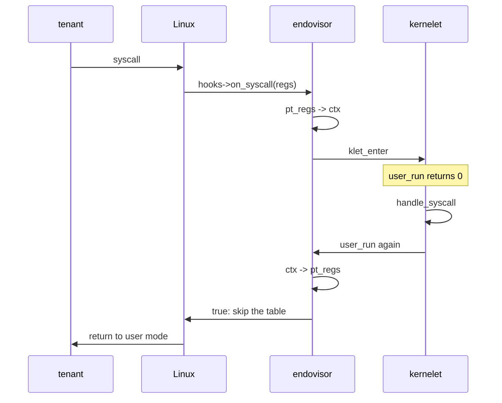

# Into user mode and back

Everything is now in place for the hundred-line kernel to run its program. The kernel proper's task calls `execute`, which in vOSTD is the service `user_run`. This chapter follows that call out of the kernelet, through Linux, into user mode, and back in again on the program's first system call. At the end the kernel prints *Hello, world*.

## Leaving: the `user_run` service

`UserContext::execute` in vOSTD, which `UserMode::execute` calls, keeps OSTD's signature and loop: where OSTD enters user mode with its own assembly and decodes the trap number, vOSTD calls `user_run` with a pointer to the context, and interprets the number it returns.

*Simplified from `prototype/vostd/src/arch/cpu/context.rs`: `execute`.*

```rust
fn execute<T: UserModeHooks>(&mut self, hooks: &T) -> ReturnReason {
    self.user_context.general.rflags |= RFLAGS_IF | RFLAGS_ID;
    loop {
        match self.user_context.run() {         // the user_run service
            0 => return ReturnReason::UserSyscall,
            1 => {
                self.exception = CpuException::new(trap_num, error_code, fault_addr);
                return ReturnReason::UserException;
            }
            _ => {                              // 2: something to look at, then try again
                crate::vcpu::deliver_no_switch();
                if hooks.has_kernel_event() { return ReturnReason::KernelEvent; }
            }
        }
    }
}
```

So `user_run` returns `0` for a system call, `1` for an exception and `2` for "an event happened; the kernel may want to know, then call me again". The third case is how a virtual interrupt reaches the kernel while its program runs.

The context it is given is a `RawUserContext`: the eighteen registers of chapter 3, in a fixed order, followed by three fields for exceptions.

On the endovisor's side, `user_run` is the one service that does not use the stub of the last chapter. It records the context, switches to the Linux stack, and does not come back until a hook brings the carrier into the kernelet again:

*Simplified from `prototype/linux/endovisor/carrier.c`: `klet_svc_user_run`.*

```c
static u64 klet_svc_user_run(struct klet_user_ctx *ctx)
{
	struct klet_carrier *c = klet_current_carrier();

	c->ctx = ctx;                               /* where the registers are, and where to put them later */
	WRITE_ONCE(c->state, KLET_USER);            /* "in, or on the way to, user mode" */
	smp_mb();                                   /* the state is published before the pending word is read: see virtual interrupts */
	if (atomic_read(&c->vrec.pending)) {        /* a virtual interrupt arrived meanwhile */
		WRITE_ONCE(c->state, KLET_RUNNING);
		return KLET_RUN_EVENT;
	}
	klet_mirror_out(c, false);                  /* give Linux its preemption count back: the mirror, built later */
	klet_switch(&c->coro_sp, c->linux_sp);      /* to the Linux stack, inside whichever hook entered us */
	return c->run_ret;                          /* ... much later, with the reason the hook recorded */
}
```

The switch lands inside the `klet_enter` that last entered the kernelet on this carrier, which returns into its caller. That caller is always one of the two hooks: on the very first trip it is the resume hook, running on the carrier's way out of the `execveat` that made it (chapter 6), and on every later trip it is whichever hook brought the carrier in.

## Putting the registers where Linux will find them

Whoever `klet_enter` returns into now has one job: copy the context into the carrier's `pt_regs`, so that when Linux returns to user mode, it returns to the tenant's program.

*Simplified from `prototype/linux/endovisor/carrier.c`: `klet_ctx_to_regs`.*

```c
static void klet_ctx_to_regs(struct klet_carrier *c, struct pt_regs *regs)
{
	struct klet_user_ctx *x = c->ctx;

	regs->ax = x->rax; regs->bx = x->rbx; regs->cx = x->rcx; regs->dx = x->rdx;
	regs->si = x->rsi; regs->di = x->rdi; regs->bp = x->rbp; regs->sp = x->rsp;
	regs->r8 = x->r8;  /* ... through r15 ... */
	regs->ip = x->rip;
	regs->flags = (x->rflags & KLET_RFLAGS_USER) | X86_EFLAGS_IF | X86_EFLAGS_FIXED;
	regs->cs = __USER_CS;
	regs->ss = __USER_DS;
	regs->orig_ax = -1;      /* no system call in progress: Linux must not try to restart one */
}
```

Three details keep this safe. The flags are sanitized: the interrupt-enable bit is forced on and the privilege-level bits are cleared, so a tenant cannot talk its kernel into giving it a program that runs with interrupts off. The code and stack segment selectors are fixed to Linux's user segments. And `orig_ax`, Linux's record of which system call is in progress, is set to -1, which switches off Linux's system-call restart logic; restarting is the kernel proper's business.

The first trip needs nothing special. The carrier arrived by a system call, so the registers Linux will restore are the `pt_regs` of that call, and the resume hook overwrites them as it will on every later trip; the registers the exec had prepared for the carrier's own program, which does not exist, are simply never used.

## Coming back by a system call

The tenant runs, and executes `syscall`. Linux saves its registers in `pt_regs`, finds the task's hooks, and calls the syscall hook:

*Simplified from `prototype/linux/endovisor/carrier.c`: `klet_on_syscall`, `klet_regs_to_ctx`.*

```c
static bool klet_on_syscall(struct pt_regs *regs)
{
	struct klet_carrier *c = klet_current_carrier();

	if (c->state != KLET_USER || !c->ctx)
		return false;                           /* not a carrier in user mode: not ours */
	if (regs->cs != __USER_CS || in_compat_syscall()) {
		/* a 32-bit entry instruction: report roughly what a machine would raise, a #GP (general-protection fault) */
		c->exc_trap = X86_TRAP_GP; c->exc_pending = true;
		set_thread_flag(TIF_NOTIFY_RESUME);
		return true;
	}

	klet_regs_to_ctx(c, regs);                  /* pt_regs -> the kernelet's context */
	c->user_live = false;                       /* the context is now the authority on the registers */
	regs->orig_ax = -1;
	klet_enter(c, KLET_RUN_SYSCALL);            /* run the kernelet: user_run returns 0 there */

	/* ... the kernelet handled the call and called user_run again ... */
	if (c->state == KLET_USER) {
		klet_space_adopt(c, c->vrec.space);     /* the right address space: built with tenant memory */
		klet_ctx_to_regs(c, regs);              /* its new registers */
		c->user_live = true;                    /* from here on pt_regs is the authority, until the next hook */
	} else {
		klet_carrier_die(c);                    /* the kernelet stopped instead */
	}
	return true;                                /* Linux: do not dispatch this call */
}

static void klet_regs_to_ctx(struct klet_carrier *c, struct pt_regs *regs)
{
	x->rax = regs->orig_ax;                     /* the call number as issued; ax itself holds -ENOSYS by now */
	x->rbx = regs->bx; /* ... every register ... */ x->rip = regs->ip; x->rflags = regs->flags;
	x->trap_num = 0; x->error_code = 0; x->fault_addr = 0;
}
```

The `klet_enter` in the middle of the hook runs the kernel proper's whole handling of the call. `klet_enter` switches to the kernelet stack, where `user_run` is waiting inside `klet_switch`; `user_run` returns `0`; `execute` returns `UserSyscall`; the kernel proper's loop handles the call and calls `execute` again; `user_run` switches back to the Linux stack, which lands *here*, just after `klet_enter`. Then the hook copies the kernelet's new registers out, returns `true`, and Linux returns to user mode with them, skipping its own system-call table entirely.

The kernel proper sees exactly the registers it would see on a machine. The `syscall` instruction itself overwrites two registers on the way in: it puts the return address in `rcx` and the flags in `r11`. `pt_regs` holds them as the instruction left them, and the call number is in `orig_ax`, where Linux's entry code put it.



Note what the sequence does *not* say: that the task which comes back is the one that left. Between the two switches the kernelet's own scheduler may have run another task, and then it is that task's `execute` that leaves, with another thread's registers. Nothing in Linux's exit path minds, because everything Linux will restore from the stack is in `pt_regs`, and the hook overwrites all of it.

The thread-pointer base is not in `pt_regs`, so in the prototype every tenant thread on a carrier shares the carrier's. A program keeps a pointer to its thread's private variables in a segment register (`%fs` on x86-64), and Linux saves that register's base per task, in its own record, not on the stack. The prototype's context carries no such base; a full vOSTD would carry one per thread and have the endovisor set it on each trip.

## Coming back by an exception

A tenant's fault must reach the kernel proper as `execute` returning `UserException`, with the trap number and, for a page fault, the address. A tenant's instruction can fault: divide by zero, an illegal instruction, a touch of an address with no mapping. On a machine, OSTD's trap handler would fill those in from the hardware.

<div class="background">

**Linux: exceptions become signals.** When a user instruction faults, Linux's exception handler records the trap number, error code and address in the task's thread structure, queues a **signal** on the task (`SIGSEGV`, `SIGILL`, `SIGFPE`, and so on) with [`force_sig()`](https://elixir.bootlin.com/linux/v6.12/source/kernel/signal.c#L1666), and heads for user mode. For a fault, Linux's handlers queue the signal with [`force_sig_fault()`](https://elixir.bootlin.com/linux/v6.12/source/kernel/signal.c#L1733), whose `si_code` says what kind of fault it was.

Signals are acted on in the exit loop: Linux either kills or stops the task or arranges for a handler in the program to run. Two signals cannot be caught or blocked: `SIGKILL` and `SIGSTOP`.

</div>

The endovisor takes the signals off the queue itself, in the resume hook, which runs at the top of that loop before Linux delivers anything:

*Simplified from `prototype/linux/endovisor/carrier.c`: `klet_drain_signals`.*

```c
static bool klet_drain_signals(struct klet_carrier *c)
{
	sigset_t mask = current->blocked;
	sigaddset(&mask, SIGKILL);                  /* the two signals nobody may take are left in the queue, */
	sigaddset(&mask, SIGSTOP);
	/* ... and so is any signal Linux has made fatal and immutable (SA_IMMUTABLE): a seccomp kill's SIGSYS */

	spin_lock_irq(&current->sighand->siglock);
	while ((signr = dequeue_signal(&mask, &info, &type)) != 0) {
		spin_unlock_irq(&current->sighand->siglock);
		if (!sig_kernel_only(signr))            /* Linux forced it, un-ignoring it on the way: ignore it again */
			kernel_sigaction(signr, SIG_IGN);   /* (which takes the lock itself) */
		if (klet_is_fault_signal(signr, info.si_code) && !exception) {   /* raised by a trap handler for this task's own fault */
			c->exc_trap = current->thread.trap_nr;
			c->exc_error = current->thread.error_code;
			c->exc_addr = (unsigned long)info.si_addr;
			c->exc_pending = true;
			exception = true;
		}
		/* anything else Linux forced (a seccomp trap's SIGSYS) is dropped */
		spin_lock_irq(&current->sighand->siglock);
	}
	spin_unlock_irq(&current->sighand->siglock);
	return exception;
}
```

A fault signal is recognized by its number and its `si_code` together. The number is one of `SIGSEGV`, `SIGBUS`, `SIGILL`, `SIGFPE` and `SIGTRAP`, and the code is one a trap handler uses: positive, and below `SI_KERNEL`, the code Linux puts on signals it sends on its own account. Four more signals are accepted with `SI_KERNEL`, because some of x86's trap handlers have no finer code to give and send `SI_KERNEL` themselves ([`arch/x86/kernel/traps.c`](https://elixir.bootlin.com/linux/v6.12/source/arch/x86/kernel/traps.c)): `SIGSEGV` for a general-protection fault, an invalid task-state segment, an overflow trap (`int 4`), a bounds-check fault from 32-bit code, and the fault a processor raises on a disabled extended-state feature; `SIGBUS` for a segment-not-present and a stack fault; `SIGTRAP` for a breakpoint (`int3`); and `SIGFPE` for the coprocessor segment overrun that no current processor raises. In the extended-state case the trap number Linux left in the thread structure is stale, and the kernel proper sees whatever the last exception was. No process can forge that code, since `kill` sends `SI_USER`.

Every other signal the drain finds is discarded, with one exception left for Linux. A signal sent by a process is dropped: on the host side that is a process allowed to signal the carrier, since a tenant's `kill` is a system call and the syscall hook takes those. So is a signal Linux sends for a reason of its own, once a fault has reset its action. One kind is left alone: a signal Linux has made fatal and marked immutable, which is what a seccomp filter's *kill* action does to its `SIGSYS`; the drain leaves it in the queue, Linux delivers it on the same pass, and the carrier's death ends the sandbox.

`SIGKILL` and `SIGSTOP` are left in the queue. The first is how the operator and the endovisor end a carrier, and Linux acts on it in the same loop. The second takes effect at the carrier's next return to user mode, where Linux stops it as it stops any task; a stopped carrier is a stopped virtual CPU until `SIGCONT`, and a virtual CPU that does not return to user mode, because it is idle or runs only kernel tasks, keeps running with the stop pending.

Most signals never reach the queue at all, and that is arranged earlier. The binary-format handler of chapter 6 sets every signal but `SIGKILL` and `SIGSTOP`, which cannot be, to be *ignored*, and clears the signal mask, in every carrier, since each arrives by an exec of its own. An ignored signal is discarded the moment it is sent, so an operator's `SIGTERM`, `SIGQUIT` or `SIGTSTP` to a carrier does nothing.

The drain alone would not do, for two reasons. A signal whose default action is to end the task without a core dump, `SIGTERM`, `SIGINT`, `SIGPIPE` and their kind, is fatal at the moment it is sent: the sender sees that nothing will catch it and turns it into a `SIGKILL` on the spot ([`complete_signal()`](https://elixir.bootlin.com/linux/v6.12/source/kernel/signal.c#L994)), before any drain. And the drain runs at the top of one pass of the exit loop, while Linux delivers signals later in the same pass if one was pending when the pass began, so a `SIGQUIT` that arrived between the two would dump core and end the carrier.

The fault signals are ignored too, and still arrive. Linux sends a fault with `force_sig_info_to_task()`, which first sets an ignored signal back to its default action, so the signal is queued and the drain sees it. The drain then ignores it again, so that the next fault is forced the same way and a `SIGSEGV` a process sends in between is discarded.

The resume hook brings the exception into the kernelet:

*Simplified from `prototype/linux/endovisor/carrier.c`: `klet_on_resume`.*

```c
static void klet_on_resume(struct pt_regs *regs)
{
	struct klet_carrier *c = klet_current_carrier();

	for (;;) {
		if (c->state == KLET_DEAD || c->inst->stopped || c->inst->dying) {
			klet_carrier_die(c);                                 /* stopping a kernelet, later */
			return;
		}
		if (c->state == KLET_NEW) {                              /* the first time, out of the exec: wait for the sandbox's start, then enter (chapter 6) */
			if (!klet_vcpu_await(c)) { klet_carrier_die(c); return; }
			klet_enter(c, KLET_RUN_EVENT);
			continue;
		}
		if (c->state == KLET_USER && !c->exc_pending && klet_drain_signals(c) && c->user_live) {
			klet_regs_snapshot(c, regs);                         /* the faulting registers, into ctx */
			c->user_live = false;                                /* ctx is the authority again */
		}
		if (c->exc_pending) {                                    /* from a signal, or from the endovisor's own fault handler, later */
			c->exc_pending = false;
			if (c->state == KLET_USER && c->user_live) {
				klet_regs_snapshot(c, regs);                     /* same: ctx must hold the registers of the faulting instruction */
				c->user_live = false;
			}
			klet_ctx_set_exception(c);                           /* trap, error code, address -> ctx */
			klet_enter(c, KLET_RUN_EXCEPTION);                   /* user_run returns 1 */
			continue;
		}
		if (atomic_read(&c->vrec.pending)) {                     /* a virtual interrupt: the next chapter but one */
			if (c->state == KLET_USER && c->user_live) {
				klet_regs_snapshot(c, regs);                     /* the interrupted registers, into ctx */
				c->user_live = false;
			}
			klet_enter(c, KLET_RUN_EVENT);                       /* user_run returns 2 */
			continue;
		}
		if (c->state == KLET_USER && c->user_live)               /* nothing for the kernelet, and the tenant's registers */
			return;                                              /* are live in pt_regs: work of Linux's own brought us here */
		/* KLET_USER with a context the kernelet has just handed over: it wants user mode */
		klet_space_adopt(c, c->vrec.space);
		klet_ctx_to_regs(c, regs);
		c->user_live = true;
		return;
	}
}
```

The loop shape matters: each `klet_enter` returns when the kernelet calls `user_run` again, and the hook then goes around once more to see whether anything else is pending before it finally applies the registers and returns to Linux.

Before an exception is reported, by either route, the hook copies the current `pt_regs` into the context, so that the kernel proper sees the faulting instruction's registers. The copy, `klet_regs_snapshot`, is needed because the context still holds the registers of the previous trip. `user_live` says which of the two copies is the authority: it is set when the context is applied to `pt_regs`, and cleared when `pt_regs` is copied back into the context, by the syscall hook or by a snapshot; so the snapshot is taken exactly once per trip, and never over registers the kernelet has already seen.

The same flag keeps the hook from rewinding a tenant when it runs for Linux's own work. The exit loop runs the hook for work of Linux's own as well, a reschedule, a signal the drain dropped, a stop and a continue, and then nothing is pending for the kernelet and the registers in `pt_regs` are the tenant's live ones. Applying the context over them would send the tenant back to the return of its last system call, a rewind of everything it had done since, so the hook leaves them alone and returns. The hook therefore runs for every kind of exit work, not only the kernelet's, and is written to find nothing of its own to do.

One of the memory tests, `make mem-kill`, runs a tenant that keeps a count in a register and the same count in memory and reports the first moment they part, while it is preempted, signaled, and stopped and continued.

Page faults on tenant memory take a shorter path through the endovisor's own fault handler, which sets `exc_pending` directly, as the chapter on tenant memory shows. What the kernel proper sees is the same in both cases: `execute` returns `UserException`, with a `CpuException::PageFault` carrying the address.

## Hello, world

With chapters 4 to 8 built, `make hello` boots Linux in QEMU, loads the module, runs the holder, and this appears in the serial log (the run is `prototype/.build/uapi2-run1-serial-hello.log`; one line of Linux's own about an out-of-tree module, the lines of a self-test of the interface that the test runs first, and the counters printed at unload are left out):

```
INIT: loading endovisor.ko
kernelet: endovisor loaded: /dev/endovisor, API 1, image ABI 6, watch on, mirror on, fpu area 1088 B, tsc 3791992 kHz
INIT: running /tests/10-hello
RUN-TEST: running /holder register hello /hello.image
kernelet: image loaded: 59877 bytes of text at ffffffffc0207000, 32983 of read-only data, 50656 of data and bss at ffffffffc021f000, 2798 relocations applied
kernelet: kind 0 "hello" registered: an image of 328680 bytes, text [0xffffffffc0207000, 0xffffffffc02159e5), 94208 bytes shared
holder: kind 0 registered: hello from /hello.image
RUN-TEST: /holder register hello /hello.image exited 0
RUN-TEST: running /holder run -c /sys/fs/cgroup/sandbox --console /hello.console --log /hello.log hello 1
kernelet: sandbox 0 created: kind 0 "hello", 1 vcpu(s), memory 4096 KiB (max 65536 KiB), max_tasks 256, cmdline ""
holder: sandbox 0 created: kind hello, 1 vcpu(s), cmdline ""
kernelet: sandbox 0: vcpu 0 carrier (pid 47) arrived as kernelet/0/0: address space emptied, every signal ignored, dumpable 1 -> 0
kernelet: sandbox 0: host offsets: gs:current 0x1fac0, gs:preempt_count 0x1fac8, task->carrier_hooks +1968, hooks->vrec +16
kernelet: sandbox 0 started: kind "hello" loaded as its instance (53248 bytes of data restored), grant 4096 KiB at 0x1000000, charged to its control group
kernelet: sandbox 0: every virtual CPU's carrier has arrived (1); booting the kernelet
kernelet: service stub: 36 cycles through the stack switch, 24 for the service body alone (least of 7 rounds of 2000, rdtsc, interrupts off)
kernelet: space 1 created: root 0x7c1000, area [0x10000, 0x7ffffffff000), its own inode, mm owner a task
kernelet: stopped, exit code 0
kernelet: arming the eviction sweep every 1000 us on 2 cpu(s)
kernelet: sandbox 0: vcpu 0 carrier (pid 47) dying
kernelet: sandbox 0: vcpu 0 carrier (pid 47) lifeline closed, the last one
kernelet: sandbox 0 is gone: 7 heap block(s) the kernelet still held freed (752 bytes), 2 kernelet stack(s) returned to vmalloc (1 still in use)
kernelet: sandbox 0 exited: the kernel proper powered off, exit code 0
holder: sandbox 0 at its end: state 5 (exited), 1 vcpu(s), 4096 KiB granted, 14022 service call(s), 0 virtual interrupt(s), 0 line(s) dropped
holder: sandbox 0 at its end: vcpu 0 pid 47 state 3 (gone), ran 13 ms, waited 0 ms runnable
kernelet: sandbox 0 destroyed
holder: sandbox 0 exited: the kernel proper powered off, exit code 0
holder: no carrier left (module references: 0)
RUN-TEST: /holder run -c /sys/fs/cgroup/sandbox --console /hello.console --log /hello.log hello 1 exited 0
RUN-TEST: /hello.console: Hello, world
RUN-TEST: /hello.console: 
RUN-TEST: /hello.console: 2 line(s)
RUN-TEST: /hello.log: vOSTD up: grant 0x1000000..0x1400000, linear map 0xffff9a7480000000, 1 vCPU(s), tsc 3791992 kHz, fpu area 1088 B
RUN-TEST: /hello.log: vOSTD: heap: a 64-byte allocation and its free, 449 cycles the pair (least of 7 rounds of 1000, rdtsc)
RUN-TEST: /hello.log: 2 line(s)
RUN-TEST: done
INIT: /tests/10-hello exited 0
INIT: unloading endovisor
kernelet: endovisor unloaded
INIT: done
```

The log follows one sandbox from registration to destruction. The holder registers the image as a kind, and the endovisor loads it where modules live (chapter 4); the holder creates the sandbox with a console file and a log file, and forks and execs its one carrier, which the handler turns into one (chapter 6); the endovisor publishes the offsets by which vOSTD will find its way around Linux, restores the image's data and allocates the grant (chapter 4), and, every carrier having arrived, boots the kernelet, which enters the image and, before anything else, times a heap allocation and its free and then, at its first log line, a service call that does nothing (the numbers are the subject of the last chapter); the kernel proper creates its address space; the program's `write` arrives by the syscall hook and the kernel proper prints the message through `console_write` to the console file, followed by the message's own newline as an empty line; its `exit` becomes the `stop` service, which arms the sweep that takes a processor back from a virtual CPU left spinning; the carrier dies and its lifeline closes, and the last release returns what the kernelet held, the stack the stopping carrier was still standing on included; the holder reads the sandbox's statistics, destroys it, and the test prints the two files; the module's reference count reaches zero and it unloads.

The build checks that the console file holds the greeting, that the serial log has the exit code, a clean unload, and no Linux error report.

<div class="recap">

**Recap.** `execute` is the service `user_run`, which records the context, marks the carrier as in user mode, and switches to the Linux stack inside whatever hook last entered the kernelet. That hook copies the context into `pt_regs` and returns, and Linux returns to user mode. A system call brings the carrier back through the syscall hook, which copies `pt_regs` into the context and enters the kernelet, where `user_run` returns 0. An exception becomes a signal, which the resume hook takes off the queue before Linux delivers it and reports as `user_run` returning 1. The hundred-line kernel now prints its greeting.

</div>
