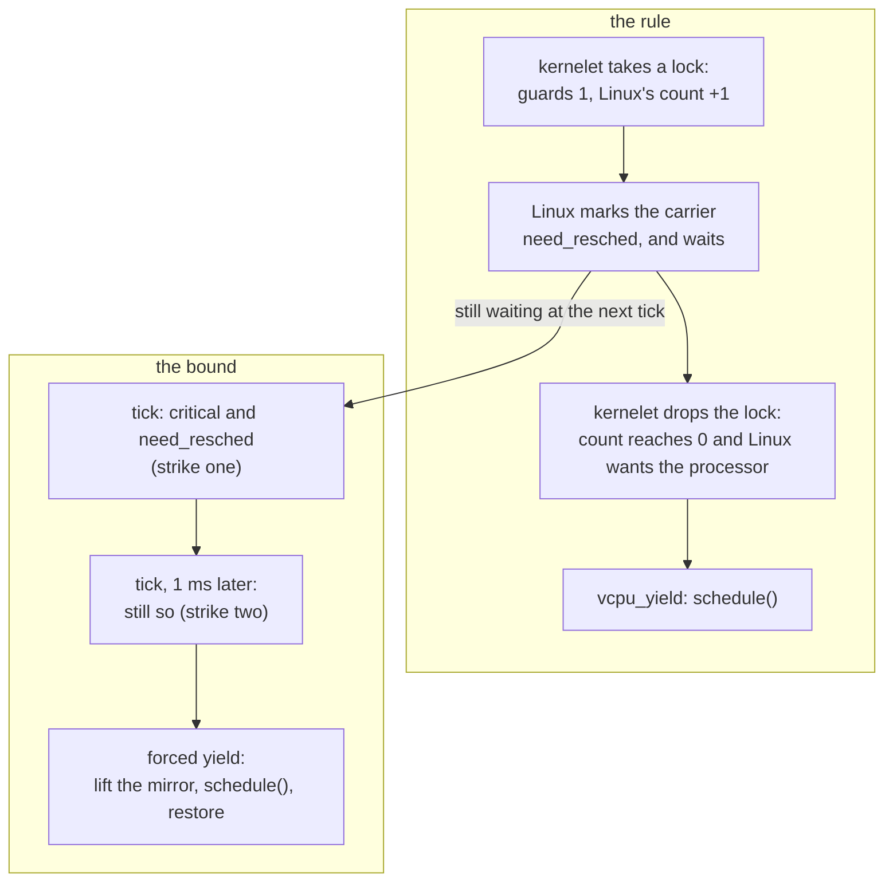

# Sharing a processor politely

Linux will take a processor away from a carrier whenever its own policy says so: the sandbox's turn is over, or a host task with a better claim woke up. This chapter is about three ways in which the kernelet and Linux can get in each other's way over that, and how each is resolved. The watch timer gives the processor up for a kernelet that cannot (Problem 1). vOSTD copies the kernelet's critical sections into Linux's own preemption count (Problem 2). The watch timer bounds how long that copy may hold Linux off (Problem 3). A last section keeps a waiting virtual CPU from spinning on a lock whose holder Linux has descheduled.

## Problem 1: a Linux that does not preempt kernel code

<div class="linux">

**Linux: preemption models.** Linux decides *that* a task should give way by setting a flag on it, `need_resched`, which the scheduler does at a timer tick when the task's slice is used up, or when a task with a better claim wakes; the *preemption models* differ in *when* the flag is acted on. A kernel is built with one of several models, three of which, `none`, `voluntary` and `full`, can also be chosen at boot with the parameter `preempt=`. Under *full* a task running kernel code can be rescheduled at almost any instruction, on return from an interrupt. Under *voluntary* and *none*, common on servers, a task in kernel mode keeps its processor until it sleeps, returns to user mode, or reaches one of the many places where Linux's own code calls [`cond_resched()`](https://elixir.bootlin.com/linux/v6.12/source/include/linux/sched.h#L2063), the voluntary preemption point. The kernel this book builds is compiled with the full model and keeps the count described under Problem 2 under every model; `preempt=none` only stops Linux from acting on it in kernel code.

</div>

Under `preempt=none`, a kernelet task that computes holds its processor for as long as it computes, against every other task that wants it, because kernelet code contains no call to `cond_resched()`: it cannot call Linux.

The remedy is for the watch timer to do what a call to `cond_resched()` would: give the processor up on the kernelet's behalf when Linux wants it. It has two forms. Usually the upcall of chapter 10 does it: on its way out, if Linux has set `need_resched` meanwhile, vOSTD calls `vcpu_yield`, which reschedules in Linux. vOSTD notices because it keeps a copy of its critical sections in Linux's preemption count, which Problem 2 explains; a decrement of that count to zero says that Linux wants the processor. When the upcall cannot be taken, because the interrupted task's stack has too little room left for the handlers, the timer points the interrupted frame at a **yield stub** in the endovisor instead, by rewriting the frame's instruction pointer as it does for the upcall. The stub needs only the seventeen words it pushes, where the upcall's handlers need 32 KiB, and the reschedule itself runs on the Linux stack. This is the middle branch of the callback shown before, in full; `again` is its last lines, which re-arm the timer and return:

*Simplified from `prototype/linux/endovisor/watch.c`: `klet_watch_fn`.*

```c
	if (!klet_critical(c)) {
		if (klet_virq_redirect(c, regs))       /* an upcall was possible: it will yield on its way out */
			goto again;
		if (need_resched()) {                  /* no room for an upcall, and Linux wants the processor */
			c->yield_ip = regs->ip;
			c->forced = false;                 /* forced only selects a counter; Problem 3 sets it */
			regs->ip = (unsigned long)klet_yield_stub;
		}
		goto again;
	}
```

The stub saves every register and the flags on the kernelet stack, as the upcall does, then hops to the Linux stack exactly like a service call and reschedules there:

*Simplified from `prototype/linux/endovisor/switch.S` and `prototype/linux/endovisor/carrier.c`: `klet_yield_stub`, `klet_yield_body`, `klet_do_yield`.*

```asm
klet_yield_stub:
	leaq	-8(%rsp), %rsp    /* a slot for the return address; lea, not sub, which would change the flags */
	pushfq
	pushq	%rax ... pushq %r15
	movq	%rsp, %rbp
	andq	$-16, %rsp
	call	klet_yield_body   /* 0: the kernelet died meanwhile; else the ip to resume at */
	movq	%rbp, %rsp
	testq	%rax, %rax
	jz	.Lleave
	movq	%rax, 128(%rsp)   /* into the slot */
	popq	%r15 ... popq %rax
	popfq
	ret
```

```c
unsigned long klet_yield_body(void)
{
	struct klet_carrier *c = klet_current_carrier();
	struct klet_svc_args args = { .op = KLET_SVC_VCPU_YIELD };
	unsigned long ip = c->yield_ip;

	klet_run_on_linux_stack(c->linux_sp, &args);   /* klet_svc_body -> klet_do_yield, on the Linux stack */
	if (args.ret || c->doomed)                      /* the kernelet stopped, or this carrier was killed */
		return 0;
	return ip;
}

static void klet_do_yield(struct klet_carrier *c)
{
	if (!cond_resched() && need_resched())
		schedule();
}
```

`klet_svc_body` sets `ret` for this service when the sandbox is stopped, dying or evicted, and if the kernelet died while the carrier was away the stub does not return into it: `.Lleave` leaves the kernelet stack for good, as an evicted carrier does. `cond_resched()` does nothing under the full model, so when it has not rescheduled and Linux still wants the processor, `schedule()` is called directly.

The two forms exist for the configurations in which Linux does not preempt kernel code. On a Linux that does, Linux reschedules by itself on the way out of the interrupt, and neither form has anything left to do.

The test `make yield` shows the remedy working. The test kernel in `prototype/kernels/yield/src/lib.rs` computes for seconds, and the test runs it twice on a kernel booted with `preempt=none`, with a competing host process pinned to the same processor: once with the watch timer turned off (the module parameter `klet_watch=0`) and once with it on. With the timer off, the competitor gets nothing for the kernelet's whole computation, 4.4 s in the last run; Linux's RCU stall detector stays silent, because the kernel is built preemptible and RCU still sees a quiescent state at every tick taken at preempt count zero. With the timer on, the competitor's progress reports never pause for as long as a second, which is what the test asserts. The test also checks that the stub restores every register: a checksum the kernel computes over a long run in ten live variables comes out identical, and equal to a user-space reference, whether the kernelet was diverted through the upcall and yield stubs thousands of times or never.

## Problem 2: a lock holder loses its processor

If Linux preempts a carrier while the kernelet task on it holds a spin lock, every other virtual CPU that wants that lock spins until Linux runs the first one again, which may be a whole time slice later. This is *lock-holder preemption*. There are two families of remedy: tell the host when not to preempt, and make waiting cheap when it preempted anyway. This section is the first remedy; the backstop at the end of the chapter is the second.

<div class="linux">

**Linux: the preemption count.** Linux keeps a per-processor **preemption count**, which [`preempt_disable()`](https://elixir.bootlin.com/linux/v6.12/source/include/linux/preempt.h#L213) and every spin lock raise and their counterparts lower; on return from an interrupt, Linux reschedules kernel code only if the count is zero. The word is a set of bit fields: the low eight bits are the preemption depth, and the bits above count software- and hardware-interrupt nesting, which is how Linux knows it is in an interrupt. It lives in the per-processor block that `%gs` points at.

On x86-64 one decrement tests both conditions at once, because a copy of the current task's `need_resched` flag is folded, inverted, into the top bit of the *same word* ([`PREEMPT_NEED_RESCHED`](https://elixir.bootlin.com/linux/v6.12/source/arch/x86/include/asm/preempt.h#L12)): a single decrement yields zero exactly when the count is zero *and* a reschedule is wanted, which is what `preempt_enable()` tests. In numbers: with one guard held and no reschedule wanted the word is `0x80000001`, and a decrement gives `0x80000000`, not zero; if Linux has cleared the top bit to ask for the processor, the word is `0x00000001`, and the decrement gives zero.

</div>

The rule, then: **the kernelet's critical sections are Linux's critical sections**, and this copy of the kernelet's critical section in Linux's count is what the book calls the **mirror**. When the kernel proper enters a critical section, by taking a preemption guard, a spin lock or an interrupts-off guard while it held none, vOSTD executes the same single instruction Linux's `preempt_disable()` does, an increment of the per-processor word through `%gs`, at the offset the boot arguments published. When the section ends, it executes the matching decrement. If that leaves the word at zero, Linux is waiting for this processor, and vOSTD hands it over at once with the service `vcpu_yield`: the same decrement and zero test as Linux's `preempt_enable()`, except that vOSTD yields whatever the preemption model. The increment and the decrement always land on the same processor, because Linux does not move a task whose count is raised, and every path on which the carrier can leave the processor takes the increment out first.

*Simplified from `prototype/vostd/src/vcpu.rs` and `prototype/vostd/src/task/preempt/cpu_local.rs`: `host_preempt_inc`, `host_preempt_dec_and_test`, `inc_guard_count`, `dec_guard_count`.*

```rust
pub(crate) fn host_preempt_inc() {
    if mirrored() { return; }                                    // already up: idempotent
    unsafe { asm!("inc dword ptr gs:[{o}]", o = in(reg) GS_PREEMPT_COUNT) };
    set_mirrored(true);                                          // after, so the flag never claims more than the count holds
}

pub(crate) fn host_preempt_dec_and_test() -> bool {
    if !mirrored() { return false; }
    set_mirrored(false);                                         // before, for the same reason
    let zero: u8;
    unsafe { asm!("dec dword ptr gs:[{o}]", "setz {z}", o = in(reg) GS_PREEMPT_COUNT, z = out(reg_byte) zero) };
    zero != 0                                                    // zero: no guards left, and Linux wants the processor
}

pub(crate) fn inc_guard_count() {
    let was_critical = in_critical_section();
    add_assign(1);                                               // the kernelet's own count
    if !was_critical { vcpu::host_preempt_inc(); }               // the first guard raises Linux's
}

pub(crate) fn dec_guard_count() {
    let leaving = get_guard_count() == 1 && !irq_is_off();
    let host_wants_cpu = if leaving { vcpu::host_preempt_dec_and_test() } else { false };
    sub_assign(1);
    if host_wants_cpu { vcpu::host_yield(); }                    // the vcpu_yield service: schedule()
    if leaving { vcpu::deliver_if_pending(); }                   // a virtual interrupt that arrived meanwhile
}
```

Linux's count rises by one however deeply the kernelet's guards nest, and that is deliberate. Linux's count has only eight bits for the preemption depth, and a kernel proper that nested more guards than that would spill into the fields that say "in an interrupt" and make Linux misjudge its own state.

vOSTD raises and lowers Linux's count according to a flag, `mirrored`, in the virtual CPU's record, rather than by pairing each guard's entry with its exit: the increment happens when a critical section begins and the flag is clear; the decrement when one ends and the flag is set. Raising twice is a no-op, and so is lowering when nothing is raised. A pairing would not do, because the code that ends a critical section is often not the code that began it: a section can begin with a guard and end with an unmask, or begin in the upcall, and OSTD's `switch_to_task` takes a guard that the next task, not the one that took it, drops. Showing that every lowering meets exactly one raising on all those paths proved beyond reach, and a single unmatched decrement would leave that processor's count at -1 for every task that runs there afterwards. With the flag, the worst a mistake costs is one preemption Linux was not asked to defer.

The flag is set *after* the increment and cleared *before* the decrement, so that it never claims more than the count holds. The preemption notifier relies on that: it counts a carrier that Linux switches out while the flag is set as a failure of the mirror, and a switch in the few instructions between the two updates is then never counted.

**The mirror exists only while kernelet code runs.** A service may sleep, and Linux forbids sleeping with the preemption count raised. OSTD holds a preemption guard while it edits a page table, and the service that maps a page under it may have Linux allocate memory. So the service body, on the Linux stack, takes out of Linux's count what the kernelet's guards added, and puts it back on return.

The endovisor measures the amount itself: it recorded Linux's count when the carrier entered kernelet code, and the excess over that is the kernelet's. It does not ask the kernelet.

*Simplified from `prototype/linux/endovisor/carrier.c`: `klet_mirror_in`, `klet_mirror_out`, `klet_svc_body`.*

```c
static void klet_mirror_in(struct klet_carrier *c)     /* on the way into kernelet code */
{
	c->pc_base = preempt_count();
	if (c->excess > 0) { preempt_count_add(c->excess); c->excess = 0; }
}

static void klet_mirror_out(struct klet_carrier *c, bool forever)   /* on the way out, in task context */
{
	int excess = preempt_count() - c->pc_base;         /* measured, never read from the kernelet */

	if (excess < 0 || excess > 1) {                    /* the kernelet corrupted host state: re-normalize */
		preempt_count_set(c->pc_base);
		c->excess = 0;
		return;
	}
	if (excess > 0) preempt_count_sub(excess);
	c->excess = forever ? 0 : excess;
}

void klet_svc_body(struct klet_svc_args *args)
{
	c->depth++;
	klet_mirror_out(c, false);     /* the service may sleep now */
	switch (args->op) { /* ... */ }
	klet_watch_arm(c);             /* back in kernelet code soon: make sure this processor is watched (defensive) */
	klet_mirror_in(c);
	c->depth--;
}
```

The mirror makes a kernelet's critical section atomic to Linux only while kernelet code runs. Across a service, which may sleep, and at a forced yield (Problem 3, below), the carrier can still lose the processor while a kernelet guard is held. So a kernelet guard promises only that no *kernelet* task switch happens on this virtual CPU until it drops, and the kernelet is correct under that, as a guest kernel is correct when its hypervisor deschedules a virtual CPU. The memory services depend on that rule, and the chapter that builds them states it precisely.

The effect is that Linux defers an involuntary preemption of a virtual CPU until the kernelet's critical section ends, by Linux's own mechanism. The kernelet then gives the processor up the moment it can. The test `make sched-coop` runs four kernelet tasks hammering one spin lock for ten seconds, under the full model, while two competitors in a sibling control group make Linux preempt the carriers constantly, and counts, in the preemption notifier, every time a carrier is switched out involuntarily while vOSTD's `mirrored` flag says it is in a critical section. With the mirror on, the test asserts that the count is zero. With it off (the module parameter `klet_mirror=0`, under which vOSTD still keeps the flag but skips the increment), the last run counted 2781.

## Problem 3: a critical section that never ends

The mirror lets a kernelet defer Linux's preemption, so a kernel proper whose logic the tenant controls could defer it forever by entering a critical section and never leaving. The watch timer bounds the deferral at two of its periods, from interrupt context whatever the count. A tick that finds a carrier in kernelet code in a critical section with `need_resched` set notes the time; if the next tick, a millisecond later, finds the same, it **forces** the yield through the same stub. Nothing in the stub changes: the service body lifts the mirror for every service, so here, where the kernelet is inside a critical section, it takes the kernelet's increment out of Linux's count before `schedule()` and puts it back after. The `forced` flag only tells the endovisor which counter to add the yield to.

*Simplified from `prototype/linux/endovisor/watch.c`: `klet_watch_fn`.*

```c
	/* a critical section, and Linux wants the processor */
	if (!c->strike1_ns) { c->strike1_ns = now; goto again; }     /* strike one */
	if (now - c->strike1_ns < NSEC_PER_MSEC) goto again;           /* less than a tick ago */
	c->strike1_ns = 0;
	c->yield_ip = regs->ip;
	c->forced = true;                                              /* strike two: yield anyway */
	regs->ip = (unsigned long)klet_yield_stub;
```

The bound is on time held, not on time elapsed. The note of the first strike is dropped whenever a tick finds the carrier out of a critical section or Linux no longer wanting the processor, and when the carrier leaves the processor, since a carrier that has given the processor back is deferring nothing. The grace is two ticks when the ticks arrive on time; a tick the host delivers late lengthens it.

What the kernelet borrows costs its neighbors latency, never share. Linux accounts the extra run time to the sandbox's control group like any other, and in `make sched-fair` a sibling group's share stays within 3 % of its due with an overstayer in the sandbox; what a neighbor can lose is at most the grace, per preemption. Forced yields are counted and reported in the kernel log when the endovisor unloads, so a sandbox that collects them is misbehaving in a way the operator can see. The rule and the bound, together:



## The backstop: do not spin on an absent holder

When a lock's holder is off the processor, vOSTD's spin lock gives the waiter's own turn up rather than spinning on. That happens after a forced yield, or while the holder's carrier sleeps in a service it called under the lock. After a thousand failed attempts the lock calls the service `vcpu_on_spin`, at most once per tick per virtual CPU, and the endovisor guesses, as KVM does for a spinning guest: it picks a sibling carrier of the same sandbox that is runnable but not running and calls Linux's exported [`yield_to()`](https://elixir.bootlin.com/linux/v6.12/source/kernel/sched/syscalls.c#L1468) on it, or yields plainly if there is none.

<div class="linux">

**Linux: `yield_to()`.** Asks the scheduler to run a named runnable task next in place of the caller; it is a hint the scheduler may decline. On v6.12 with the scheduler's default features, and with the second argument false as the endovisor passes it, the call only gives up the caller's own turn: it pushes the caller's deadline back and reschedules, does not make Linux pick the named task, and does not reschedule that task's processor. KVM makes the same call with the argument true.

</div>

*Simplified from `prototype/vostd/src/sync/spin.rs`: `acquire_lock`.*

```rust
fn acquire_lock(&self) {
    let mut spins: u32 = 0;
    while !self.try_acquire_lock() {
        core::hint::spin_loop();
        spins += 1;
        if spins == SPINS_BEFORE_ON_SPIN {       // 1000
            spins = 0;
            crate::vcpu::on_spin();              // "my holder may not be running"
        }
    }
}
```

The service is only a hint: whether or not it finds a sibling to run, the loop goes on trying, so the lock is correct without it. No test of this book exercises the path; in every `make sched-coop` boot, the counters of spins that called the service and of calls to `yield_to()` were zero.

<div class="recap">

**Recap.** On a Linux that does not preempt kernel code, the watch timer gives the processor up for a carrier that Linux wants, through the upcall when it can and otherwise through a yield stub, which saves everything, reschedules on the Linux stack, and resumes the kernelet exactly where it was. To keep Linux from preempting a carrier inside a critical section, vOSTD mirrors *whether* the kernelet is in one into Linux's own preemption count, as one increment, with the same instruction `preempt_disable()` uses. It yields the moment the section ends if Linux was waiting. Every service lifts the mirror for its duration so that it may sleep. A section that outlasts two ticks while Linux waits is forced to yield. A waiter that spins too long gives its turn to a sibling virtual CPU with `yield_to`.

</div>
