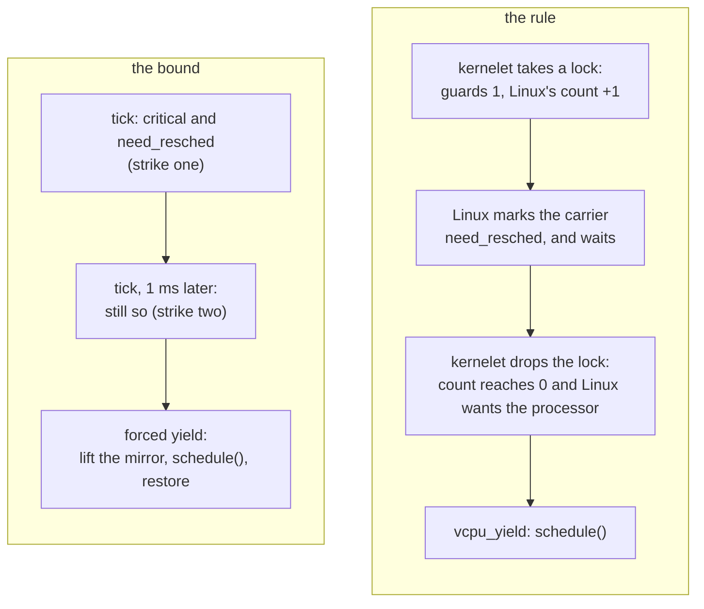

# Sharing a processor politely

Linux will take a processor away from a carrier whenever its own policy says so: the sandbox's turn is over, or a host task with a better claim woke up. That is right and necessary. This chapter is about three ways in which the kernelet and Linux can get in each other's way over it, and the one mechanism, the watch timer of chapter 9, that resolves all three.

## Problem 1: a Linux that does not preempt kernel code

<div class="linux">

**Linux: preemption models.** A Linux kernel is built with one of several preemption models, three of which can also be chosen at boot on recent kernels. Under the *full* model a task running kernel code can be rescheduled at almost any instruction, on return from an interrupt. Under *voluntary* and *none*, common on servers, a task in kernel mode keeps its processor until it sleeps, returns to user mode, or reaches one of the many places where Linux's own code calls [`cond_resched()`](https://elixir.bootlin.com/linux/v6.12/source/include/linux/sched.h#L2063), the voluntary preemption point. Linux decides *that* a task should give way by setting a flag on it, `need_resched`; the models differ in *when* the flag is acted on.

</div>

Kernelet code contains no call to `cond_resched()`, because it cannot call Linux. On a kernel booted with `preempt=none`, a kernelet task that computes for a few seconds would hold its processor for those seconds, against every other task that wants it. The test kernel in `prototype/yield/src/lib.rs` does exactly that, and `make yield` runs it twice on such a kernel, once with the mechanism below turned off and once with it on, with a competing host process pinned to the same processor. Without it, the competitor stalls for the kernelet's whole computation, long enough for Linux's own stall detector to complain; with it, the competitor's progress reports never pause for as long as a second, which is what the test asserts.

The mechanism is the watch timer volunteering on the kernelet's behalf, and it has two forms. Usually the upcall of chapter 9 does it: on its way out, if Linux has set `need_resched` meanwhile, vOSTD calls `vcpu_yield`, which reschedules in Linux (how vOSTD notices is the mirror of Problem 2, below). When the upcall cannot be taken, because the interrupted task's stack has too little room left for the handlers, the timer points the interrupted frame at a **yield stub** in the endovisor instead, by the same means:

*Simplified from `prototype/endovisor/watch.c`: `klet_watch_fn`.*

```c
	if (!klet_critical(c)) {
		if (klet_virq_redirect(c, regs))       /* an upcall was possible: it will yield on its way out */
			goto again;
		if (need_resched()) {                  /* no room for an upcall, and Linux wants the processor */
			c->yield_ip = regs->ip;
			c->forced = false;
			regs->ip = (unsigned long)klet_yield_stub;
		}
		goto again;
	}
```

The stub saves every register and the flags on the kernelet stack, as the upcall does, then hops to the Linux stack exactly like a service call and reschedules there:

*Simplified from `prototype/endovisor/switch.S` and `prototype/endovisor/carrier.c`: `klet_yield_stub`, `klet_yield_body`, `klet_do_yield`.*

```asm
klet_yield_stub:
	leaq	-8(%rsp), %rsp    /* a slot for the return address; lea, not sub, which would change the flags */
	pushfq
	pushq	%rax ... pushq %r15
	movq	%rsp, %rbp
	andq	$-16, %rsp
	call	klet_yield_body   /* 0: the kernelet died meanwhile; else the ip to resume at */
	movq	%rbp, %rsp
	testq	%rax, %rax
	jz	.Lleave
	movq	%rax, 128(%rsp)   /* into the slot */
	popq	%r15 ... popq %rax
	popfq
	ret
```

```c
unsigned long klet_yield_body(void)
{
	struct klet_carrier *c = klet_current_carrier();
	struct klet_svc_args args = { .op = KLET_SVC_VCPU_YIELD };
	unsigned long ip = c->yield_ip;

	klet_run_on_linux_stack(c->linux_sp, &args);   /* klet_svc_body -> klet_do_yield, on the Linux stack */
	if (args.ret || c->doomed)                      /* the kernelet stopped, or this carrier was killed (chapter 11) */
		return 0;
	return ip;
}

static void klet_do_yield(struct klet_carrier *c)
{
	if (!cond_resched() && need_resched())
		schedule();
}
```

On a Linux that does preempt kernel code, Linux reschedules by itself on the way out of the interrupt, and neither form has anything left to do; they exist for the configurations that do not. The test's checksum, computed over a long run through ten live registers, comes out identical whether the kernelet was interrupted at every tick or never, which is the register-preservation argument made by experiment.

## Problem 2: a lock holder loses its processor

Now the other direction. Suppose Linux preempts a carrier while the kernelet task on it holds a spin lock. Every other virtual CPU that wants that lock spins until Linux runs the first one again, which may be a whole time slice later. This is *lock-holder preemption*, and there are two families of remedy: tell the host when not to preempt, and make waiting cheap when it preempted anyway. The design uses both.

<div class="linux">

**Linux: the preemption count.** Under the full model, what stops Linux from rescheduling kernel code at a bad moment, such as inside a spin-locked section, is a per-processor **preemption count** that [`preempt_disable()`](https://elixir.bootlin.com/linux/v6.12/source/include/linux/preempt.h#L213) and every spin lock raise and their counterparts lower; on return from an interrupt, Linux reschedules only if the count is zero. On x86-64 the `need_resched` flag is kept, inverted, in the top bit of the *same word* ([`PREEMPT_NEED_RESCHED`](https://elixir.bootlin.com/linux/v6.12/source/arch/x86/include/asm/preempt.h#L12)), so that a single decrement yields zero exactly when the count is zero *and* a reschedule is wanted, which is what `preempt_enable()` tests. In numbers: with one guard held and no reschedule wanted the word is `0x80000001`, and a decrement gives `0x80000000`, not zero; if Linux has cleared the top bit to ask for the processor, the word is `0x00000001`, and the decrement gives zero. The word lives in the per-processor block that `%gs` points at.

</div>

The rule, then: **the kernelet's critical sections are Linux's critical sections.** When the kernel proper enters a critical section, by taking a preemption guard, a spin lock or an interrupts-off guard while it held none, vOSTD executes the same single instruction Linux's `preempt_disable()` does, an increment of the per-processor word through `%gs`, at the offset the boot arguments published. When the section ends, it executes the matching decrement, and if that leaves the word at zero, Linux is waiting for this processor, and vOSTD hands it over at once with the service `vcpu_yield`. This is, instruction for instruction, what Linux's own `preempt_enable()` does.

*Simplified from `prototype/vostd/src/vcpu.rs` and `prototype/vostd/src/task/preempt/cpu_local.rs`: `host_preempt_inc`, `host_preempt_dec_and_test`, `inc_guard_count`, `dec_guard_count`.*

```rust
pub(crate) fn host_preempt_inc() {
    if mirrored() { return; }                                    // already up: idempotent
    unsafe { asm!("inc dword ptr gs:[{o}]", o = in(reg) GS_PREEMPT_COUNT) };
    set_mirrored(true);                                          // after, so the flag never claims more than the count holds
}

pub(crate) fn host_preempt_dec_and_test() -> bool {
    if !mirrored() { return false; }
    set_mirrored(false);                                         // before, for the same reason
    let zero: u8;
    unsafe { asm!("dec dword ptr gs:[{o}]", "setz {z}", o = in(reg) GS_PREEMPT_COUNT, z = out(reg_byte) zero) };
    zero != 0                                                    // zero: no guards left, and Linux wants the processor
}

pub(crate) fn inc_guard_count() {
    let was_critical = in_critical_section();
    add_assign(1);                                               // the kernelet's own count
    if !was_critical { vcpu::host_preempt_inc(); }               // the first guard raises Linux's
}

pub(crate) fn dec_guard_count() {
    let leaving = get_guard_count() == 1 && !irq_is_off();
    let host_wants_cpu = if leaving { vcpu::host_preempt_dec_and_test() } else { false };
    sub_assign(1);
    if host_wants_cpu { vcpu::host_yield(); }                    // the vcpu_yield service: schedule()
    if leaving { vcpu::deliver_if_pending(); }                   // chapter 9
}
```

The **mirror**, as the book calls it, is one increment however deeply the kernelet's guards nest, and that is deliberate. Linux's count is a bit field with only eight bits for the preemption depth, and a kernel proper that nested more guards than that would spill into the fields that say "in an interrupt" and make Linux misjudge its own state.

So vOSTD keeps a private flag, `mirrored`, in the record, and the flag is the authority: the increment happens when a critical section begins and the flag is clear; the decrement when one ends and the flag is set. Raising twice is a no-op, and so is lowering when nothing is raised. A pairing kept by construction would not have been enough, because OSTD's guard lifetimes cross a context switch. Task A takes a guard inside `switch_to_task`, and task B, now running, drops it; if the increment and the decrement were tied to the guard's own code, nothing local could tell whether this drop is the one that matches that raise. The flag answers that directly.

The order of the two stores in each function is also deliberate. The flag is set *after* the increment and cleared *before* the decrement, so that the flag never claims more than the count holds; the endovisor reads the flag to tell a genuine failure of the mirror from the two-instruction window in which the kernelet is between the updates.

The effect is that Linux defers an involuntary preemption of a virtual CPU until the kernelet's critical section ends, by Linux's own mechanism, and that the kernelet gives the processor up the moment it can. The test `make sched-coop` runs four kernel tasks hammering one spin lock for ten seconds while two competitors in a sibling control group make Linux preempt the carriers constantly, and counts, in the preemption notifier, every time a carrier is switched out involuntarily while the mirror is up. With the mirror on, the count is zero; with it off (a module parameter, `klet_mirror=0`), it is not, by a wide margin.

**The mirror exists only while kernelet code runs.** A service may sleep, and Linux forbids sleeping with the preemption count raised. OSTD calls services under a guard all the time: every page-table cursor holds a preemption guard, and a `vm_map` under one may have Linux allocate memory. So every service stub, on its way to the Linux stack, takes out of Linux's count what the kernelet's guards added, and puts it back on return. It does not ask the kernelet how much that is: the endovisor recorded Linux's count when the carrier entered kernelet code, and the excess over that is the kernelet's.

*Simplified from `prototype/endovisor/carrier.c`: `klet_mirror_in`, `klet_mirror_out`, `klet_svc_body`.*

```c
static void klet_mirror_in(struct klet_carrier *c)     /* on the way into kernelet code */
{
	c->pc_base = preempt_count();
	if (c->excess > 0) { preempt_count_add(c->excess); c->excess = 0; }
}

static void klet_mirror_out(struct klet_carrier *c, bool forever)   /* on the way out, in task context */
{
	int excess = preempt_count() - c->pc_base;         /* measured, never read from the kernelet */

	if (excess < 0 || excess > 1) {                    /* the kernelet corrupted host state: re-normalize */
		preempt_count_set(c->pc_base);
		c->excess = 0;
		return;
	}
	if (excess > 0) preempt_count_sub(excess);
	c->excess = forever ? 0 : excess;
}

void klet_svc_body(struct klet_svc_args *args)
{
	c->depth++;
	klet_mirror_out(c, false);     /* the service may sleep now */
	switch (args->op) { /* ... */ }
	klet_watch_arm(c);             /* back in kernelet code soon: make sure this processor is watched */
	klet_mirror_in(c);
	c->depth--;
}
```

A kernelet in a critical section is therefore *not* in Linux's **atomic mode**, the state of holding something that forbids a task switch and in which code must not sleep. Its guards promise only that no kernelet task switch happens on this virtual CPU until the guard drops; the carrier may still lose the processor, by a Linux sleep inside a service as by a Linux preemption, and the kernelet is already correct under that, as a guest kernel is correct when its hypervisor deschedules a virtual CPU. Chapter 13 states the rule precisely, because the memory services depend on it.

## Problem 3: a critical section that never ends

The mirror lets a kernelet defer Linux's preemption, and "must not defer it for long" has to be enforced against a kernel proper whose logic the tenant may control. The watch timer fires in interrupt context whatever the count, and it enforces a bound of two of its own periods: when a tick finds a carrier in kernelet code in a critical section with `need_resched` set, it notes the time; if the next tick a millisecond later finds the same, it **forces** the yield, through the same stub, with one difference: the forced stub also takes the kernelet's increment out of Linux's count before it calls `schedule()`, and puts it back after, which the service prologue above already knows how to do.

*Simplified from `prototype/endovisor/watch.c`: `klet_watch_fn`.*

```c
	/* a critical section, and Linux wants the processor */
	if (!c->strike1_ns) { c->strike1_ns = now; goto again; }     /* strike one */
	if (now - c->strike1_ns < NSEC_PER_MSEC) goto again;           /* less than a tick ago */
	c->strike1_ns = 0;
	c->yield_ip = regs->ip;
	c->forced = true;                                              /* strike two: yield anyway */
	regs->ip = (unsigned long)klet_yield_stub;
```

The note of the first strike is dropped when the carrier leaves the processor, since a carrier that has given the processor back is deferring nothing, and the bound is on time held, not on time elapsed. The grace is two ticks when the ticks arrive on time; a tick the host delivers late lengthens it. What the kernelet borrows is charged: Linux accounts the extra run time to the sandbox's control group like any other, so the sandbox's long-run share does not grow by a microsecond; what a neighbor can lose is latency, at most the grace, per preemption. Forced yields are counted, and a sandbox that collects them is misbehaving in a way the operator can see.



## The backstop: do not spin on an absent holder

After a forced yield, or when Linux preempts a virtual CPU in user mode while another spins, a waiter can still meet a lock whose holder is off the processor. vOSTD's spin lock, after a thousand failed attempts, calls the service `vcpu_on_spin`, and the endovisor gives the waiter's turn to a sibling carrier of the same sandbox that is runnable but not running, with Linux's exported [`yield_to()`](https://elixir.bootlin.com/linux/v6.12/source/kernel/sched/syscalls.c#L1468), the same function KVM uses for its spinning guests.

*Simplified from `prototype/vostd/src/sync/spin.rs`: `acquire_lock`.*

```rust
fn acquire_lock(&self) {
    let mut spins: u32 = 0;
    while !self.try_acquire_lock() {
        core::hint::spin_loop();
        spins += 1;
        if spins == SPINS_BEFORE_ON_SPIN {       // 1000
            spins = 0;
            crate::vcpu::on_spin();              // "my holder may not be running"
        }
    }
}
```

Until the service does anything, this is still an ordinary spin, so correctness does not depend on it.

<div class="recap">

**Recap.** On a Linux that does not preempt kernel code, the watch timer sends a carrier that Linux wants through a yield stub, which saves everything, reschedules on the Linux stack, and resumes the kernelet exactly where it was. To keep Linux from preempting a carrier inside a critical section, vOSTD mirrors the kernelet's guard depth into Linux's own preemption count, one increment per critical section, with the same instruction `preempt_disable()` uses, and yields the moment the section ends if Linux was waiting; every service lifts the mirror for its duration so that it may sleep. A section that outlasts two ticks while Linux waits is forced to yield. A lock whose holder is not running is handed off with `yield_to`.

</div>
