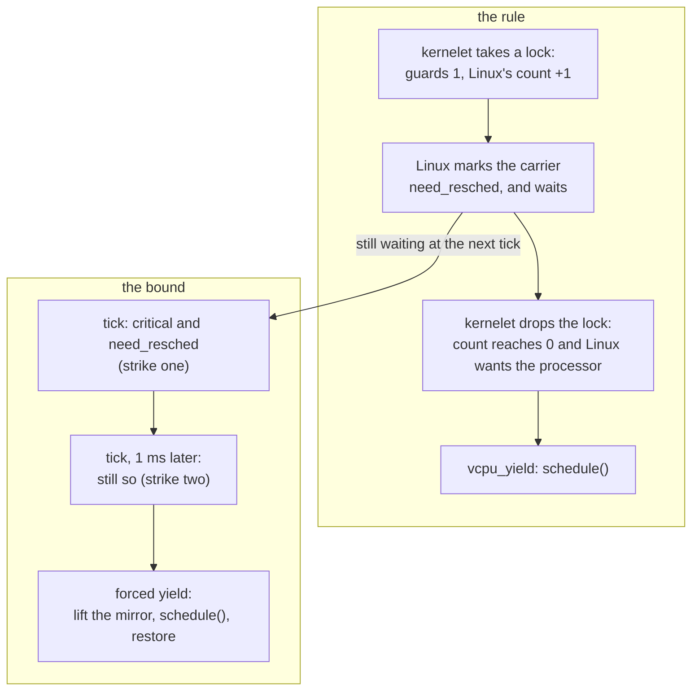

# Sharing a processor politely

This chapter resolves three conflicts between a kernelet and Linux over who holds a processor, and adds one backstop. Linux will take a processor away from a carrier whenever its own policy says so: the sandbox's turn is over, or a host task with a better claim woke up. The watch timer gives the processor up on behalf of a kernelet that cannot give it up itself (Problem 1). vOSTD copies the kernelet's critical sections into Linux's own preemption count (Problem 2). The watch timer bounds how long that copy may hold Linux off (Problem 3). A last section keeps a waiting virtual CPU from spinning on a lock whose holder Linux has descheduled.

## Problem 1: a Linux that does not preempt kernel code

<div class="linux">

**Linux: preemption models.** Linux decides *that* a task should give way by setting a flag on it, `need_resched`, which the scheduler does at a timer tick when the task's slice is used up, or when a task with a better claim wakes. The *preemption models* differ in *when* the flag is acted on. A kernel is built with one of several models; one built with the full model and the option `PREEMPT_DYNAMIC`, as this book's is, can be switched at boot to `none`, `voluntary` or `full` with the parameter `preempt=`. Under *full* a task running kernel code can be rescheduled at almost any instruction, on return from an interrupt. Under *voluntary* and *none*, common on servers, a task in kernel mode keeps its processor until it sleeps, returns to user mode, or reaches one of the many places where Linux's own code calls [`cond_resched()`](https://elixir.bootlin.com/linux/v6.12/source/include/linux/sched.h#L2063), the voluntary preemption point.

</div>

Under `preempt=none`, a kernelet task that computes holds its processor for as long as it computes, against every other task that wants it, because kernelet code contains no call to `cond_resched()`: it cannot call Linux.

The remedy is for the watch timer to do what a call to `cond_resched()` would: give the processor up on the kernelet's behalf when Linux wants it. The two forms below exist for the configurations in which Linux does not preempt kernel code; on a Linux that does, Linux reschedules by itself on the way out of the interrupt, and neither has anything left to do.

Usually the upcall of chapter 10 does it. On its way out, if Linux has set `need_resched` meanwhile, vOSTD calls `vcpu_yield`, which reschedules in Linux. vOSTD notices through the preemption count, since this book's kernel maintains the count under every model, even booted `preempt=none` (Problem 2 shows how).

When the upcall cannot be taken, because the interrupted task's stack has too little room left, the timer points the interrupted frame at a **yield stub** in the endovisor instead, by rewriting the frame's instruction pointer as it does for the upcall. The upcall needs 32 KiB left on the stack, 16 KiB for its own frames and 16 KiB reserved for a Linux interrupt on the same stack; the stub needs a few dozen words, the seventeen it pushes and one small C frame, and the reschedule itself runs on the Linux stack. Nothing checks for those few words; as with any kernelet-stack overflow, running out is not caught.

This replaces chapter 10's middle branch, the call to `klet_virq_redirect`; `again` is the callback's last lines, which re-arm the timer and return:

*Simplified from `prototype/linux/endovisor/watch.c`: `klet_watch_fn`.*

```c
	if (!klet_critical(c)) {
		if (klet_virq_redirect(c, regs))       /* an upcall was possible: it will yield on its way out */
			goto again;
		if (need_resched()) {                  /* no room for an upcall, and Linux wants the processor */
			c->yield_ip = regs->ip;
			c->forced = false;                 /* forced only selects a counter; Problem 3 sets it */
			regs->ip = (unsigned long)klet_yield_stub;
		}
		goto again;
	}
```

The stub saves every register and the flags on the kernelet stack, as the upcall does, then hops to the Linux stack exactly like a service call and reschedules there:

*Simplified from `prototype/linux/endovisor/switch.S` and `prototype/linux/endovisor/carrier.c`: `klet_yield_stub`, `klet_yield_body`, `klet_do_yield`.*

```asm
klet_yield_stub:
	leaq	-8(%rsp), %rsp    /* a slot for the return address; lea, not sub, which would change the flags */
	pushfq
	pushq	%rax ... pushq %r15
	movq	%rsp, %rbp
	andq	$-16, %rsp
	call	klet_yield_body   /* 0: the kernelet died meanwhile; else the ip to resume at */
	movq	%rbp, %rsp
	testq	%rax, %rax
	jz	.Lleave
	movq	%rax, 128(%rsp)   /* into the slot */
	popq	%r15 ... popq %rax
	popfq
	ret
```

```c
unsigned long klet_yield_body(void)
{
	struct klet_carrier *c = klet_current_carrier();
	struct klet_svc_args args = { .op = KLET_SVC_VCPU_YIELD };
	unsigned long ip = c->yield_ip;

	klet_run_on_linux_stack(c->linux_sp, &args);   /* klet_svc_body -> klet_do_yield, on the Linux stack */
	if (args.ret || c->doomed)                      /* the kernelet stopped, or this carrier was killed */
		return 0;
	return ip;
}

static void klet_do_yield(struct klet_carrier *c)
{
	if (!cond_resched() && need_resched())
		schedule();
}
```

The stub never returns into a kernelet that died while the carrier was away. `klet_svc_body` sets `ret` for this service when the sandbox is stopped, dying or removed by force, and `.Lleave` then abandons the kernelet stack and returns to Linux, never resuming the kernelet.

The same body serves every yield: the upcall's, the stub's, and the forced one of Problem 3. `cond_resched()` does nothing under the full model, so when it has not rescheduled and Linux still wants the processor, `schedule()` is called directly.

The test `make yield` shows the remedy working. The test kernel in `prototype/kernels/yield/src/lib.rs` computes for seconds. The test runs it twice on a kernel booted with `preempt=none`, with a competing host process pinned to the same processor: once with the watch timer turned off (the module parameter `klet_watch=0`) and once with it on. With the timer off, the competitor gets nothing for the kernelet's whole computation, 4.4 s in the last run. With the timer on, the competitor's progress reports never pause for as long as a second, which is what the test asserts.

The test also shows that the upcall loses no register: a checksum the kernel computes over a long run in ten live variables comes out identical, and equal to a user-space reference, whether the kernelet was diverted through the upcall thousands of times or never. The yield stub is not entered in this test, because every tick finds room for the upcall; its forced form runs over a thousand times in `make sched-coop`'s overstayer boot, where no checksum is taken.

## Problem 2: a lock holder loses its processor

If Linux preempts a carrier while the kernelet task on it holds a spin lock, every other virtual CPU that wants that lock spins until Linux runs the first one again, which may be a whole time slice later. This is *lock-holder preemption*. There are two families of remedy: tell the host when not to preempt, and make waiting cheap when it preempted anyway. This section is the first remedy; the backstop at the end of the chapter is the second.

<div class="linux">

**Linux: the preemption count.** Linux keeps a per-processor **preemption count**, which [`preempt_disable()`](https://elixir.bootlin.com/linux/v6.12/source/include/linux/preempt.h#L213) and every spin lock raise and their counterparts lower; on return from an interrupt, Linux reschedules kernel code only if the count is zero. The word is a set of bit fields: the low eight bits are the preemption depth, and the bits above count software- and hardware-interrupt nesting, which is how Linux knows it is in an interrupt. It lives in the per-processor block that `%gs` points at.

On x86-64 one decrement tests both conditions at once, because a copy of the current task's `need_resched` flag is folded, inverted, into the top bit of the *same word* ([`PREEMPT_NEED_RESCHED`](https://elixir.bootlin.com/linux/v6.12/source/arch/x86/include/asm/preempt.h#L12)): a single decrement yields zero exactly when the count is zero *and* a reschedule is wanted, which is what `preempt_enable()` tests. In numbers: with one guard held and no reschedule wanted the word is `0x80000001`, and a decrement gives `0x80000000`, not zero; if Linux has cleared the top bit to ask for the processor, the word is `0x00000001`, and the decrement gives zero.

</div>

The rule, then: **the kernelet's critical sections are Linux's critical sections.** vOSTD keeps a copy of whether the kernelet is in one in Linux's count, and the book calls that copy the **mirror**; the interrupts-off guard's `irq_mask` and `irq_unmask` do the same as the preemption guard's increment and decrement below.

When the kernel proper enters a critical section, by taking a preemption guard, a spin lock or an interrupts-off guard while it held none, vOSTD executes the same single instruction Linux's `preempt_disable()` does, an increment of the per-processor word through `%gs`, at the offset the boot arguments published. When the section ends, it executes the matching decrement. If that leaves the word at zero, Linux is waiting for this processor, and vOSTD hands it over at once with the service `vcpu_yield`: the same decrement and zero test as Linux's `preempt_enable()`, except that vOSTD yields whatever the preemption model. The increment and the decrement always land on the same processor, because Linux does not move a task whose count is raised, and every path on which the carrier can leave the processor takes the increment out first.

*Simplified from `prototype/vostd/src/vcpu.rs` and `prototype/vostd/src/task/preempt/cpu_local.rs`: `host_preempt_inc`, `host_preempt_dec_and_test`, `inc_guard_count`, `dec_guard_count`.*

```rust
pub(crate) fn host_preempt_inc() {
    if mirrored() { return; }                                    // already up: idempotent
    unsafe { asm!("inc dword ptr gs:[{o}]", o = in(reg) GS_PREEMPT_COUNT) };
    set_mirrored(true);                                          // after, so the flag never claims more than the count holds
}

pub(crate) fn host_preempt_dec_and_test() -> bool {
    if !mirrored() { return false; }
    set_mirrored(false);                                         // before, for the same reason
    let zero: u8;
    unsafe { asm!("dec dword ptr gs:[{o}]", "setz {z}", o = in(reg) GS_PREEMPT_COUNT, z = out(reg_byte) zero) };
    zero != 0                                                    // zero: no guards left, and Linux wants the processor
}

pub(crate) fn inc_guard_count() {
    let was_critical = in_critical_section();
    add_assign(1);                                               // the kernelet's own count
    if !was_critical { vcpu::host_preempt_inc(); }               // the first guard raises Linux's
}

pub(crate) fn dec_guard_count() {
    let leaving = get_guard_count() == 1 && !irq_is_off();
    let host_wants_cpu = if leaving { vcpu::host_preempt_dec_and_test() } else { false };
    sub_assign(1);
    if host_wants_cpu { vcpu::host_yield(); }                    // the vcpu_yield service: schedule()
    if leaving { vcpu::deliver_if_pending(); }                   // a virtual interrupt that arrived meanwhile
}
```

Linux's count rises by one however deeply the kernelet's guards nest, and that is deliberate. Linux's count has only eight bits for the preemption depth, and a kernel proper that nested more guards than that would spill into the fields that say "in an interrupt" and make Linux misjudge its own state.

vOSTD raises and lowers Linux's count according to a flag, `mirrored`, in the virtual CPU's record, rather than by pairing each guard's entry with its exit: the increment happens when a critical section begins and the flag is clear; the decrement when one ends and the flag is set. Raising twice is a no-op, and so is lowering when nothing is raised. A pairing would not do, because the code that ends a critical section is often not the code that began it: a section can begin with a guard and end with an unmask, or begin in the upcall, and OSTD's `switch_to_task` takes a guard that the next task, not the one that took it, drops. We could not show that every lowering meets exactly one raising on all those paths. A single unmatched decrement would wrap Linux's word below zero, borrowing into the interrupt-nesting fields, so that Linux would believe it is in an interrupt for as long as the kernelet runs there; the endovisor's measurement, below, catches that only when the carrier next leaves kernelet code. With the flag, the worst a mistake costs is one preemption Linux was not asked to defer.

The flag is set *after* the increment and cleared *before* the decrement, so that it never claims more than the count holds. The test below relies on that: its preemption notifier counts a carrier that Linux switches out while the flag is set as a failure of the mirror, and a switch in the few instructions between the two updates is then never counted.

**The mirror exists only while kernelet code runs.** A service may sleep, and Linux forbids sleeping with the preemption count raised. OSTD holds a preemption guard while it edits a page table, and the service that maps a page under it may have Linux allocate memory. So the service body, on the Linux stack, takes out of Linux's count what the kernelet's guards added, and puts it back on return.

The endovisor measures the amount itself: it recorded Linux's count when the carrier entered kernelet code, and the excess over that is the kernelet's. It does not ask the kernelet.

*Simplified from `prototype/linux/endovisor/carrier.c`: `klet_mirror_in`, `klet_mirror_out`, `klet_svc_body`.*

```c
static void klet_mirror_in(struct klet_carrier *c)     /* on the way into kernelet code */
{
	c->pc_base = preempt_count();
	if (c->excess > 0) { preempt_count_add(c->excess); c->excess = 0; }
}

static void klet_mirror_out(struct klet_carrier *c, bool forever)   /* on the way out, in task context */
{
	int excess = preempt_count() - c->pc_base;         /* measured, never read from the kernelet */

	if (excess < 0 || excess > 1) {                    /* the kernelet corrupted host state: re-normalize */
		preempt_count_set(c->pc_base);
		c->excess = 0;
		return;
	}
	if (excess > 0) preempt_count_sub(excess);
	c->excess = forever ? 0 : excess;
}

void klet_svc_body(struct klet_svc_args *args)
{
	c->depth++;
	klet_mirror_out(c, false);     /* the service may sleep now */
	switch (args->op) { /* ... */ }
	klet_watch_arm(c);             /* back in kernelet code soon: make sure this processor is watched (defensive) */
	klet_mirror_in(c);
	c->depth--;
}
```

A kernelet guard therefore promises only that no *kernelet* task switch happens on this virtual CPU until it drops. Linux defers preempting a kernelet's critical section only while kernelet code runs: across a service, which may sleep, and at a forced yield (Problem 3, below), the carrier can still lose the processor while a kernelet guard is held. The kernelet is correct under that weaker promise, as a guest kernel is correct when its hypervisor deschedules a virtual CPU. The memory services depend on this weaker promise. The chapter that builds them states it precisely.

The test `make sched-coop` shows the mirror working. It runs four kernelet tasks hammering one spin lock for ten seconds, under the full model, while two competitors in a sibling control group make Linux preempt the carriers constantly. It counts, in the preemption notifier, every time a carrier is switched out involuntarily, outside a service, while vOSTD's `mirrored` flag says it is in a critical section. With the mirror on, the test asserts that the count is zero. With it off (the module parameter `klet_mirror=0`, under which vOSTD still keeps the flag but skips the increment), the last run counted 2781.

## Problem 3: a critical section that never ends

The mirror lets a kernelet defer Linux's preemption, so a kernel proper whose logic the tenant controls could defer it forever by entering a critical section and never leaving.

The watch timer bounds the deferral at two of its periods, from interrupt context whatever the count. A tick that finds a carrier in kernelet code in a critical section with `need_resched` set notes the time; if the next tick finds the same, and at least a millisecond has passed since the note (`now` is the monotonic clock), it **forces** the yield. The grace is two ticks when the ticks arrive on time; a tick the host delivers late lengthens it, and a second strike that comes less than a millisecond after a late first one is skipped, so the grace can reach three ticks.

Nothing in the stub changes for a forced yield: the service body lifts the mirror for every service, so here, where the kernelet is inside a critical section, it takes the kernelet's increment out of Linux's count before `schedule()` and puts it back after.

*Simplified from `prototype/linux/endovisor/watch.c`: `klet_watch_fn`.*

```c
	/* a critical section, and Linux wants the processor */
	if (!c->strike1_ns) { c->strike1_ns = now; goto again; }     /* strike one */
	if (now - c->strike1_ns < NSEC_PER_MSEC) goto again;           /* less than a tick ago */
	c->strike1_ns = 0;
	c->yield_ip = regs->ip;
	c->forced = true;                                              /* strike two: yield anyway */
	regs->ip = (unsigned long)klet_yield_stub;
```

The count of strikes restarts whenever the carrier stops deferring Linux: both strikes must come from consecutive ticks that each find the carrier holding Linux off. The note of the first strike is dropped whenever a tick finds the carrier out of a critical section or Linux no longer wanting the processor, and when the carrier leaves the processor, since a carrier that has given the processor back is deferring nothing.

Time a kernelet keeps the processor past Linux's wish delays its neighbors but does not shrink their share. Linux accounts the extra run time to the sandbox's control group like any other; in `make sched-fair`, with a kernelet task that holds a guard for 10 ms at a time, a sibling group's share was within 2 % of its due in each of three runs and varied by under 3 % between them (measured on the booted prototype). What a neighbor can lose is at most the grace, per preemption.

Forced yields are counted and reported in the kernel log when the endovisor unloads, so a sandbox that collects them is misbehaving in a way the operator can see.

The rule and the bound, together:



## The backstop: do not spin on an absent holder

When a lock's holder is off the processor, vOSTD's spin lock tells the endovisor rather than spinning on. That happens after a forced yield, or while the holder's carrier sleeps in a service it called under the lock. After a thousand failed attempts the lock calls the service `vcpu_on_spin`. The endovisor applies a limit of one attempt per Linux timer tick (4 ms here) per virtual CPU, and then guesses, in the shape of KVM's directed yield: it tries the first sibling carrier of the same sandbox that is runnable but not running with Linux's exported [`yield_to()`](https://elixir.bootlin.com/linux/v6.12/source/kernel/sched/syscalls.c#L1468), and failing that calls `cond_resched()`, which gives the processor up only if Linux already wants it, and under the full model does nothing. A holder asleep in a service is not runnable, so in that case the waiter keeps spinning until Linux's own slice end, or the watch timer's forced yield, takes the processor.

<div class="linux">

**Linux: `yield_to()`.** With its second argument false, as the endovisor passes it, `yield_to()` on v6.12 only gives up the caller's own turn. In general it asks the scheduler to run a named runnable task next in place of the caller, a hint the scheduler may decline. With the scheduler's default features it pushes the caller's deadline back, if other tasks share its run queue, and reschedules; it does not make Linux pick the named task, and with the argument false it does not reschedule that task's processor either. KVM makes the same call with the argument true, to reschedule the sibling's processor; the endovisor does not, keeping the hint cheap.

</div>

*Simplified from `prototype/vostd/src/sync/spin.rs`: `acquire_lock`.*

```rust
fn acquire_lock(&self) {
    let mut spins: u32 = 0;
    while !self.try_acquire_lock() {
        core::hint::spin_loop();
        spins += 1;
        if spins == SPINS_BEFORE_ON_SPIN {       // 1000
            spins = 0;
            crate::vcpu::on_spin();              // "my holder may not be running"
        }
    }
}
```

The lock is correct without the service: whether or not the endovisor finds a sibling to run, the loop goes on trying.

No test of this book exercises the path; in every `make sched-coop` boot, the counters of spins that called the service and of calls to `yield_to()` were zero.

<div class="recap">

**Recap.** On a Linux that does not preempt kernel code, the watch timer gives the processor up for a carrier that Linux wants, through the upcall when it can and otherwise through a yield stub, which saves everything, reschedules on the Linux stack, and resumes the kernelet exactly where it was. To keep Linux from preempting a carrier inside a critical section, vOSTD mirrors *whether* the kernelet is in one into Linux's own preemption count, as one increment, with the same instruction `preempt_disable()` uses. It yields the moment the section ends if Linux was waiting. Every service lifts the mirror for its duration so that it may sleep. A section that outlasts two ticks while Linux waits is forced to yield. A waiter that spins too long tells the endovisor, which hints Linux with `yield_to` to run a sibling; the lock is correct without it.

</div>
