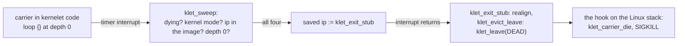

# Stopping a kernelet

A kernelet ends in one of three ways: its kernel asks to, by powering off; its kernel fails, with a panic nothing catches; or the host decides, because the operator killed it. Whatever the cause, the same thing must follow: every carrier stops, everything the kernelet held goes back, and Linux is left exactly as it was. The hard case is a carrier that is running kernelet code and will not come out.

## The shape of a death

1. The kernelet is **marked** stopped or dying, which is a single store.
2. Every carrier is **stopped**, at a point where it holds nothing of Linux's.
3. When no carrier is left, the module's reference count reaches zero and the sandbox has **exited**.

No code from the kernelet image runs after the mark. Nothing is unwound and no destructor runs; a kernelet's state is abandoned, not tidied, because tidying would mean running the tenant's kernel on the host's behalf at the moment it is least trusted.

## Stopping from inside

The kernel proper's `poweroff` is the service `stop`, and a panic in the kernelet ends in the same service. On the endovisor's side it marks the instance and sends `SIGKILL` to every carrier, the caller included; then the calling carrier leaves its kernelet stack for the last time.

*Simplified from `prototype/endovisor/carrier.c`: `klet_stop_instance`, `klet_svc_stop`, `klet_carrier_die`.*

```c
void klet_stop_instance(struct klet_inst *inst, u64 code)
{
	inst->stopped = true;
	inst->exit_code = code;
	pr_info("kernelet: stopped, exit code %llu\n", code);
	list_for_each_entry(c, &inst->carriers, link)
		send_sig(SIGKILL, c->task, 1);          /* every carrier, root included */
	wake_up_all(&inst->root_wq);               /* and whoever sleeps in a service */
}

static void klet_svc_stop(u64 code)              /* the service, called by the kernelet */
{
	klet_svc_enter(KLET_SVC_STOP, code, 0, 0);   /* klet_stop_instance, on the Linux stack */
	for (;;)
		klet_leave(c, KLET_DEAD);                /* abandon this kernelet stack for good */
}

static void klet_carrier_die(struct klet_carrier *c)
{
	klet_detach(c);                              /* current->kernelet = NULL; free the stack and the records */
	if (!fatal_signal_pending(current))
		force_sig(SIGKILL);                      /* a user task can only end by Linux's own exit path */
}
```

`klet_leave` with the state `DEAD` switches to the Linux stack and lands, as always, inside whichever hook entered the kernelet. That hook sees the state and calls `klet_carrier_die`, which detaches the task from the gate and lets Linux kill it. Linux offers a module no direct way to end a task that is not a kernel thread, so a carrier ends as any process does, by a fatal signal acted on in the exit loop; detaching first keeps the gate's hooks from running on a task that no longer carries anything.

Where each carrier is at the moment of the mark decides what stops it:

| the carrier is | what stops it |
|---|---|
| in user mode | Linux's signal handling: the carrier enters the exit loop, the resume hook sees the mark and dies |
| asleep in a service (`vcpu_idle`, `vm_wait`) | the sleep is *killable*, so `SIGKILL` wakes it; the service sees the mark and leaves for good |
| running a service | the service completes; the epilogue sees the mark |
| **running kernelet code** | nothing in Linux can reach it: **eviction**, below |

## Stopping from outside

The operator kills the root carrier, or the out-of-memory killer does, or `run-probe` does it in the test: `kill(pid, SIGKILL)` on the root carrier's process id. The root carrier is in its resume hook, sleeping in `wait_event_interruptible`; the signal wakes it, it dies, and Linux closes its descriptors, among them its lifeline. The lifeline's release is the endovisor's notice:

*Simplified from `prototype/endovisor/carrier.c`: `klet_carrier_lifeline_closed`, `klet_kill_instance`.*

```c
void klet_carrier_lifeline_closed(struct klet_carrier *c)
{
	list_del_init(&c->link);
	last = atomic_dec_and_test(&inst->nr_carriers);
	if (c->kind == KLET_ROOT && !last)
		klet_kill_instance(inst);                /* the root's death is the sandbox's death */
	/* release what a carrier killed in user mode never detached: its stack, its empty address space */
	klet_carrier_put(c);
}

void klet_kill_instance(struct klet_inst *inst)
{
	inst->dying = true;
	list_for_each_entry(c, &inst->carriers, link)
		send_sig(SIGKILL, c->task, 1);
	klet_evict_arm(inst);                        /* for whoever is inside kernelet code */
}
```

A carrier killed while in user mode dies in Linux's exit path without the gate ever running again, so `klet_detach` never runs for it. The lifeline's release frees what the detach would have: this is why the death notice, not the detach, is the place where a carrier's records are finally released.

## Eviction

<div class="linux">

**Linux: signals and kernel mode.** Linux acts on a signal, even `SIGKILL`, only when the task is about to return to user mode. A task that stays in kernel mode is never killed by a signal, however long it stays. Linux's own kernel code is written to come out: it sleeps in killable waits and passes voluntary preemption points. Code that Linux did not write does neither.

</div>

A carrier looping in kernelet code, say in a `loop {}` reached through a logic bug a tenant found, never returns to user mode. Linux by itself would never kill it, and the sandbox could never be destroyed. The endovisor has to take the processor back by force, and it has the means from chapter 9: a timer interrupt on the carrier's processor, and the right to change the interrupted instruction pointer.

The **eviction sweep** is one `hrtimer` per processor, pinned and hard like the watch timer, armed on every processor when a kernelet is marked dying, and re-armed every millisecond until no carrier is left. Its callback checks four things about what it interrupted: that the task is a carrier of a dying kernelet, that the interrupted context is kernel mode, that the interrupted instruction lies inside the kernelet image's text, and that the carrier's service-call depth is zero. If all four hold, it overwrites the saved instruction pointer with the address of an **exit stub**, and nothing else.

*Simplified from `prototype/endovisor/evict.c`: `klet_sweep`.*

```c
static enum hrtimer_restart klet_sweep(struct hrtimer *timer)
{
	struct pt_regs *regs = get_irq_regs();

	if (atomic_read(&inst->nr_carriers) == 0)
		return HRTIMER_NORESTART;
	if (!regs || user_mode(regs) || !klet_in_image_text(regs->ip) || !current->kernelet)
		goto again;
	c = klet_current_carrier();
	if (!inst->dying || c->depth != 0 || c->evicted || c->state != KLET_RUNNING)
		goto again;

	c->evicted = true;
	regs->ip = (unsigned long)klet_exit_stub;    /* the only register the endovisor touches */
again:
	hrtimer_forward_now(timer, ns_to_ktime(KLET_SWEEP_INTERVAL_NS));
	return HRTIMER_RESTART;
}
```

The interrupt then returns to the stub instead of the loop. The stub realigns the stack pointer, because an interrupt can land between any two instructions, and leaves through the ordinary stack switch, never to come back:

*Simplified from `prototype/endovisor/switch.S` and `prototype/endovisor/carrier.c`: `klet_exit_stub`, `klet_evict_leave`.*

```asm
klet_exit_stub:
	andq	$-16, %rsp
	call	klet_evict_leave
	ud2                        /* never reached */
```

```c
void klet_evict_leave(void)
{
	struct klet_carrier *c = klet_current_carrier();
	c->evicted = true;
	for (;;)
		klet_leave(c, KLET_DEAD);   /* to the Linux stack; the hook there calls klet_carrier_die */
}
```



Why this is safe to do at an arbitrary instruction: at depth 0, in kernelet text, a carrier holds nothing of Linux's. It cannot hold a Linux lock, because kernelet code cannot call Linux; the only thing it may hold is the one increment of Linux's preemption count from chapter 10, and `klet_leave` with the state `DEAD` runs `klet_mirror_out` with `forever` set, which measures and removes it. The kernelet's own half-finished state, its locks and its data, does not matter: the kernelet is dying, and no kernelet code runs afterwards. Kernelet code cannot mask hardware interrupts, since vOSTD has no interface for that, so there is no state in which the timer cannot land.

A carrier that is not on a processor at that instant is sent nothing; it is caught by the sweep when it next runs, since the sweep is on every processor. A carrier inside a service call is left alone by the depth test, and finishes the service; the epilogue sees the mark.

## The test

`make probe` runs the kernel in `prototype/probe/src/lib.rs`, whose handler for system call number 1000 is `loop {}`. The test's runtime waits a second and then kills the root carrier. The log shows the root's lifeline closing, the sweep being armed, the spinning carrier evicted within one or two sweeps at an address Linux's symbol lookup places inside the kernelet's user-task function, both carriers dying, and the module unloading with its reference count at zero. The build checks each of those lines and that Linux printed no warning.

The same test exercises the two other mechanisms of chapter 7 that the hundred-line kernel never reaches: a demand-paging fault (chapter 12) and an illegal instruction, which the kernel proper steps over.

<div class="recap">

**Recap.** A kernelet ends by the `stop` service or by the root carrier's death; either marks the instance and sends `SIGKILL` to every carrier. A carrier in user mode or asleep in a killable service dies by Linux's own exit path, after the gate's hook or the service's epilogue sees the mark and detaches it. A carrier running kernelet code is evicted: a timer on its processor finds the interrupted instruction in the image's text at depth 0 and points it at an exit stub, which leaves through the stack switch for good. The last lifeline's release is the sandbox's end.

</div>
