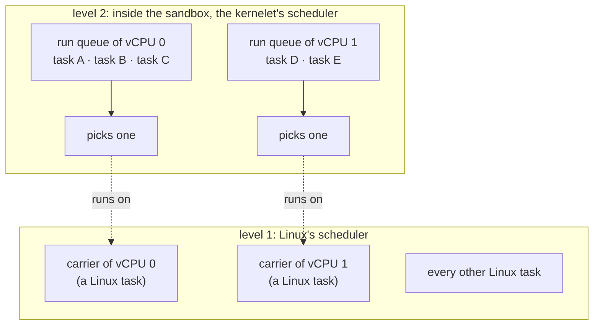

# Tasks and virtual CPUs

The hundred-line kernel has one task. A real kernel has thousands: a thread per tenant process, kernel threads for its own work, and a scheduler that decides which runs where. This chapter gives the kernelet all of that, and it is shorter than you might expect, because the kernelet brings its own.

## Two levels

There are two ways to run a kernel's tasks inside another kernel. The first makes every kernelet task a Linux task and lets Linux schedule them all; the kernelet's scheduler is compiled in and never asked. It is simple, and it throws away the kernelet's policy: the tenant's real-time thread is not real-time, and the kernel proper's scheduler is dead code.

The second, which the design uses, has **two levels**. Linux schedules a sandbox's **virtual CPUs**, a handful per sandbox, and knows nothing else about it. On each virtual CPU, the kernelet's own scheduler decides which kernelet task runs, for how long, and what preempts what.



A **virtual CPU** is one of the processors a sandbox is given when it is created; a **carrier** carries one of them for the sandbox's whole life. Whatever the virtual CPU does, that Linux task does it: it runs the kernelet's tasks one after another, enters user mode for whichever tenant thread the kernelet picked, and sleeps in Linux when the virtual CPU has nothing to run. Which physical processor the carrier is on is Linux's business and changes without notice; the virtual CPU moves with it.

## The kernelet's tasks are its own

vOSTD's task layer is the real OSTD's code: a task is a function, a stack and a saved register set; switching tasks saves one set of callee-saved registers and loads another; waiting is a matter of OSTD's own wait queues. None of it involves Linux, which never sees a kernelet task at all. The two places where the machine shows through are the stack and the context switch, and both are familiar from chapter 6.

*Simplified from `prototype/vostd/src/task/mod.rs` and `prototype/vostd/src/task/kernel_stack.rs`: `build`, `KernelStack`.*

```rust
pub fn build(self) -> Result<Task> {
    let kstack = KernelStack::new_with_guard_page()?;          // the kstack_alloc service
    let mut ctx = TaskContext::new();
    ctx.set_instruction_pointer(kernel_task_entry_wrapper as usize);   // where the first switch lands
    ctx.set_stack_pointer(kstack.end_vaddr() - 16);
    Ok(Task { func: ..., data: ..., ctx, kstack, ... })
}

impl KernelStack {
    pub(super) fn new_with_guard_page() -> Result<Self> {
        let base = unsafe { (svc().kstack_alloc)() } as Vaddr;  // from the endovisor's pool
        if base == 0 { return Err(Error::NoMemory); }
        Ok(Self { base, size: KERNEL_STACK_SIZE })
    }
}
```

The context switch is OSTD's `switch.S`, byte for byte: save eight words (the stack pointer, six callee-saved registers and the return address), load eight, return on the other stack. It is the same idea as the endovisor's `klet_switch`, written on the Rust side, and it switches between two *kernelet* stacks, which is why the endovisor neither sees nor cares which of the kernelet's tasks is current. The endovisor remembers only where the kernelet was when it last left, and resumes there.

The kernel proper chooses the policy. It implements OSTD's `Scheduler` trait (chapter 3's box), a run queue per CPU with `enqueue`, `pick_next` and `update_current`, and registers it with `inject_scheduler` before it creates any task; OSTD calls those functions without knowing the type, which is how a scheduler written for a bare-metal kernel runs unchanged in a kernelet. If the kernel proper registers none, OSTD's own first-in-first-out scheduler is used, which is what the hundred-line kernel gets. The test kernel in `prototype/sched/src/lib.rs` injects a strict-priority scheduler with round-robin inside each level, a policy that Linux's fair scheduler, under which every carrier runs, would never produce, and the test `make sched-policy` checks every one of its switches against a model of the policy.

## The virtual CPU record

A carrier and the kernelet need a small amount of shared state per virtual CPU, and they need the kernelet to find it fast, since "which CPU am I on" is on the hottest path a kernel has. The **virtual CPU record** is that state: a C-layout structure the endovisor owns and both sides write.

*Simplified from `prototype/endovisor/kernelet.h`: `klet_vcpu_rec`.*

```c
struct klet_vcpu_rec {
	u32 vcpu_id;            /* which virtual CPU this is: CpuId::current() reads it */
	u32 nr_vcpus;
	atomic_t pending;       /* virtual interrupts raised and not yet taken: chapter 9 */
	u32 preempt_info;       /* OSTD's preemption word: guard count and need-preempt bit */
	u32 irq_off;            /* the virtual interrupt flag, inverted */
	u32 mirrored;           /* chapter 10 */
	u64 virq_ip;            /* where an upcall interrupted the kernelet: chapter 9 */
	u64 space;              /* the tenant address space this vCPU has activated: chapter 12 */
	u64 stack_limit;        /* the bottom of the current task's kernelet stack */
	u64 stolen_ns;          /* how long Linux kept this vCPU off a processor */
};
```

The record is embedded in the endovisor's per-carrier structure, directly after the gate structure that `task_struct` points at. That placement is what makes it fast to find.

<div class="linux">

**Linux: per-processor data and `%gs`.** Linux keeps a block of per-processor variables, and on x86-64 the segment register `%gs` points at the current processor's block, so that reading one of them is a single `mov` with a `%gs:` prefix, whichever processor the code is on. Two of those variables matter here: the pointer to the **current task**, and the **preemption count** of chapter 10. The block's layout is Linux's own, so a module learns the offsets at run time.

</div>

At module load the endovisor computes the `%gs`-relative offset of the current-task pointer, checks it by reading the pointer back and comparing it with `current`, and publishes it in the boot arguments together with the offset of the gate pointer inside `task_struct` and the offset of the record from the gate. vOSTD then finds its record with two dependent loads and no call:

*Simplified from `prototype/vostd/src/vcpu.rs`: `vrec`.*

```rust
pub(crate) fn vrec() -> &'static VcpuRec {
    let task: usize;
    unsafe { asm!("mov {t}, gs:[{o}]", t = out(reg) task, o = in(reg) GS_CURRENT_TASK) };
    let gate = unsafe { core::ptr::read((task + TASK_GATE_OFF) as *const usize) };
    unsafe { &*((gate + GATE_VREC_OFF) as *const VcpuRec) }
}
```

Whichever processor the carrier is on, `%gs` names that processor's block, the block's current task is this carrier, and this carrier's gate leads to this virtual CPU's record. Being moved between processors between the two loads changes nothing.

Everything OSTD keeps per CPU, such as the scheduler's run-queue locks and the timer callbacks, is in vOSTD an array with one slot per virtual CPU, indexed by the `vcpu_id` in the record. The one per-CPU word that must be updated with single instructions, OSTD's preemption word, lives in the record itself, and chapter 9 says why.

## Starting, idling, kicking

A machine's processors are started at boot, halted when idle, and interrupted when another processor wants their attention. A virtual CPU does the same three things through three services.

**Starting.** The carrier of virtual CPU 0 enters the image at `kernelet_entry`. The others wait in their start function (chapter 5) until the kernel proper, as it would on a machine, registers an entry function for the secondary processors with `register_ap_entry`. vOSTD then calls `vcpu_boot(i)` for each, the endovisor wakes the waiting carrier, and it enters the image at `vcpu_entry`, runs the registered function, and falls into the idle loop below.

**Idling.** When a virtual CPU's run queue is empty, the kernelet must not spin: that would burn the sandbox's share of a real processor for nothing. It calls `vcpu_idle`, and the carrier sleeps in Linux until something is pending.

*Simplified from `prototype/endovisor/carrier.c`: `klet_do_vcpu_idle`.*

```c
static void klet_do_vcpu_idle(struct klet_carrier *c, u64 deadline_ns)
{
	set_current_state(TASK_KILLABLE | TASK_FREEZABLE);   /* 1. announce the sleep */
	WRITE_ONCE(c->idle, true);                            /* 2. mark the vCPU idle */
	smp_mb();
	if (!atomic_read(&c->vrec.pending) && !inst->dying)   /* 3. only then look */
		schedule_hrtimeout(&timeout, HRTIMER_MODE_REL);   /*    and sleep, at most until the deadline */
	__set_current_state(TASK_RUNNING);
	WRITE_ONCE(c->idle, false);
	atomic_or(KLET_VIRQ_TICK, &c->vrec.pending);          /* time passed: the timer callbacks are owed a run */
}
```

The order of the first three lines is the one every Linux sleep uses so that no wake-up is lost: the sleeper marks itself, *then* checks; the waker sets the bit, *then* checks the mark. One of the two always sees the other. The sleep is *killable*, so that `SIGKILL` ends it (chapter 11).

**Kicking.** When the kernelet's scheduler puts a task on another virtual CPU's run queue, that virtual CPU should notice soon, as a machine would be told by an inter-processor interrupt. vOSTD calls `vcpu_kick(i)`, which sets a KICK bit in the target's record and does whichever of three things gets it seen: wakes the carrier if it is asleep in `vcpu_idle`, flags it if it is in user mode, or, if it is running kernelet code on another processor right now, sends that processor an interrupt that makes the kick be delivered within microseconds instead of at the next tick (chapter 9).

<div class="rust">

**Rust: closures.** `|x, y| expr` is a closure: a function without a name, written where it is used, which may use the variables around it. A function that takes `f: F` where `F: FnMut(...)` accepts one, and calls it as `f(args)`. `reschedule` below takes the scheduling decision as a closure, so that `yield_now`, `park_current` and the others share its loop and differ only in the decision.

</div>

*Simplified from `prototype/vostd/src/task/scheduler/mod.rs`: `reschedule`, `set_need_preempt`.*

```rust
fn set_need_preempt(cpu_id: CpuId) {
    let guard = disable_preempt();
    if guard.current_cpu() == cpu_id {
        cpu_local::set_need_preempt();           // this vCPU: just set the flag
    } else {
        crate::vcpu::kick(cpu_id.into());        // another: the vcpu_kick service
    }
}

fn reschedule<F>(mut f: F) {                     // the heart of every scheduling decision
    cpu_local::clear_need_preempt();
    let next_task = loop {
        match f(local_run_queue) {
            ReschedAction::DoNothing => return,
            ReschedAction::Retry => {            // nothing runnable here
                spins += 1;
                if spins >= IDLE_SPINS { crate::vcpu::idle(0); } else { spin_loop(); }
            }
            ReschedAction::SwitchTo(next) => break next,
        }
    };
    processor::switch_to_task(next_task);
}
```

`Retry` means the run queue is empty: the virtual CPU spins a little, in case a sibling is about to enqueue something, and then calls `vcpu_idle` (a deadline of zero means "until the next tick"). When the sleep ends, TICK is pending, the closure runs again, and either finds a task or sleeps again.

## One carrier, many threads

A virtual CPU runs the threads of many tenant processes in turn, and each process has its own address space. The kernel proper, as on a machine, activates the right `VmSpace` before it runs a thread; in vOSTD, `activate` records the space in the virtual CPU's record (the `space` field above), and the carrier switches to that process's Linux address space on its next trip to user mode. The switch itself is chapter 12's `klet_space_adopt`, which both hooks of chapter 7 call just before they apply the registers.

The floating-point and vector registers belong to a tenant thread too. To Linux they are the *carrier's* user state: Linux saves them when it switches the carrier out and restores them, lazily, before the carrier next returns to user mode, and it does not know that the kernelet has put a different thread on the carrier in between.

OSTD already has the type for a thread's own copy, `FpuContext`, which the kernel proper saves when a thread leaves user mode and loads before it returns. vOSTD implements its `save` and `load` with two services, `fpu_save` and `fpu_load`. Each first makes the registers live, if Linux had deferred restoring them, and then executes the same `xsave` or `xrstor` instruction a machine would.

The instruction never touches the kernelet's buffer directly. `xrstor` reads a header from the buffer and acts on it, and the kernelet's buffer may lie in a frame that the kernelet has also mapped into a tenant, which could rewrite it between a check and the instruction. So the endovisor copies the buffer to a page of its own, validates the copy, and runs the instruction on that.

<div class="recap">

**Recap.** Linux schedules a sandbox's virtual CPUs, each carried by one Linux task; on each, the kernelet's own scheduler, injected by the kernel proper, picks which kernelet task runs. Tasks, stacks and the context switch are OSTD's own code; only the stack memory comes from the endovisor. Each virtual CPU has a record that vOSTD finds through Linux's per-processor current-task pointer in two loads. A virtual CPU is started with `vcpu_boot`, sleeps in Linux with `vcpu_idle` under a lost-wake-up-proof protocol, and is prodded with `vcpu_kick`.

</div>
