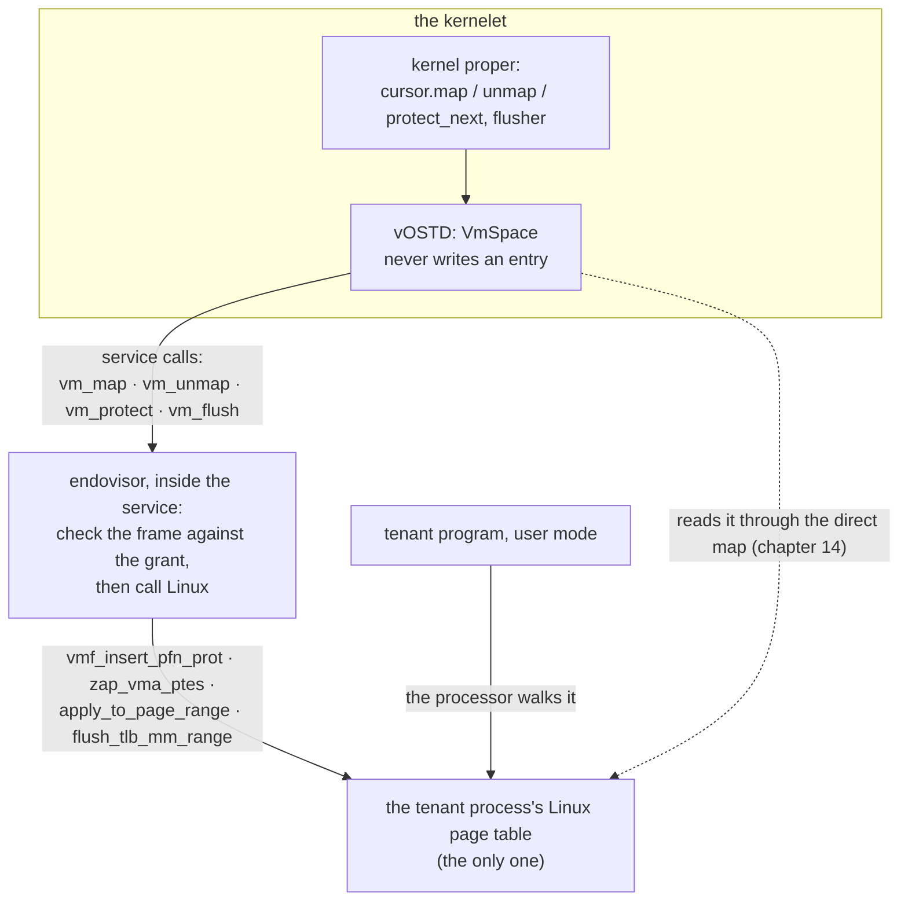
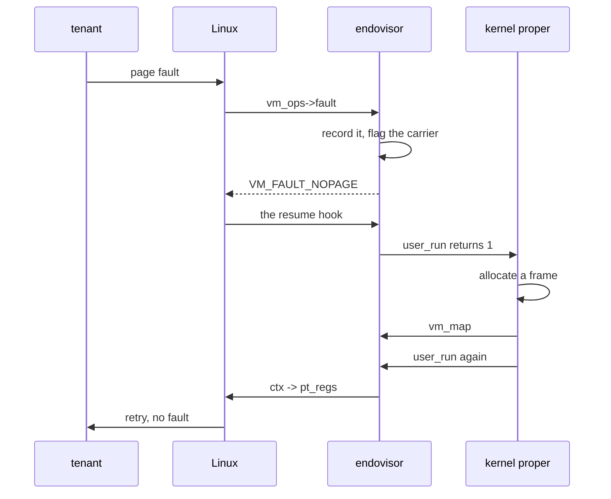

# Tenant memory on Linux's page tables

This chapter and the next are what the book has been building toward. The hundred-line kernel's `VmSpace::new()`, `cursor.map(frame, prop)` and `vm_space.activate()` are the kernel proper's whole view of a tenant's memory, and they are the same calls a kernel makes on a machine. What they *do* inside Linux is the central mechanism of the design.

## The problem

On a machine, a `VmSpace` is a page table. The kernel proper writes its entries, through OSTD's cursor, and the processor walks it when the tenant's program runs. OSTD's job is to write the entries in hardware format and load the table's root into the page-table register at `activate`.

Inside Linux, none of that is available. A carrier runs on the page table of its *Linux* address space; the processor walks that table and no other; and only Linux writes it, under its own locks, with its own bookkeeping of what every entry means. vOSTD cannot write a Linux page-table entry, and it cannot make the processor walk a table of its own.

So the design turns the relationship around. **A `VmSpace` is a Linux address space.** Its page table is the tenant process's Linux page table, the one the processor walks; there is no other. vOSTD never writes an entry of it. Every change the kernel proper's cursor makes becomes a **memory service**, in which the endovisor checks what it is asked for against the kernelet's grant and then makes the change with Linux's own functions, under Linux's own locks. vOSTD *reads* the table, through the direct map, as a processor would; that is the next chapter.



That is a stronger position than the one a kernel has on a machine, where a bug in the framework could map any frame into a tenant. Here, no translation reaches the hardware without trusted host code having checked the frame.

<div class="linux">

**Linux: address spaces, areas, and page faults.** A process's user memory is described by an address space, [`struct mm_struct`](https://elixir.bootlin.com/linux/v6.12/source/include/linux/mm_types.h#L790), which holds the page table's root (`mm->pgd`) and a set of **virtual memory areas** (VMAs): contiguous ranges with uniform permissions, each optionally backed by a file. Linux fills page tables lazily: touching an address with no entry raises a page fault, Linux finds the VMA, and asks *it* for the page, by calling the `fault` function of the VMA's operations table ([`struct vm_operations_struct`](https://elixir.bootlin.com/linux/v6.12/source/include/linux/mm.h#L598)). A driver that implements `mmap` on its device file supplies those operations, and so decides what appears at each address of its area.

A VMA can be marked as holding **raw frame numbers** (`VM_PFNMAP`). Linux then maps exactly the frames it is told to, with [`vmf_insert_pfn_prot()`](https://elixir.bootlin.com/linux/v6.12/source/mm/memory.c#L2403), and takes no further interest in them: no reference counting, no swapping, no migration. The driver removes entries again with [`zap_vma_ptes()`](https://elixir.bootlin.com/linux/v6.12/source/mm/memory.c#L1952). This is how device drivers give a process a window onto their memory, and it is the right contract here, because the frames' lifetime belongs to the kernelet.

Every change to an address space is made under its lock, `mmap_lock`, and the address space is freed, page tables included, in `exit_mmap()` when its last user lets go; a *user reference*, taken with `mmget()` and dropped with `mmput()`, is what keeps that from happening.

</div>

## Creating a space

`VmSpace::new()` is the service `vm_create`. The endovisor makes three things: an empty Linux address space, a file to own the area, and the area itself, one VMA over the whole user range.

*Simplified from `prototype/linux/endovisor/space.c`: `klet_do_vm_create`, `klet_space_make_area`, `klet_space_mmap`.*

```c
s64 klet_do_vm_create(struct klet_carrier *c)
{
	sp = a free slot in inst->spaces[];                       /* at most 64 spaces per kernelet */
	sp->mm = kernelet_mm_alloc(inst->owner);                  /* an empty address space; owner: the root carrier */
	sp->file = anon_inode_create_getfile("[kernelet-space]", &klet_space_fops, sp, O_RDWR, NULL);
	klet_space_make_area(sp);
	WRITE_ONCE(sp->rec->root_paddr, __pa(sp->mm->pgd));       /* so that vOSTD can read the table */
	sp->live = true;
	return sp->id;                                             /* 1-based; 0 means "no space" */
}

static int klet_space_make_area(struct klet_space *sp)
{
	/* vm_mmap() maps into the *calling* task's address space, so adopt the new one for a moment */
	mmget(sp->mm);
	prev = kernelet_switch_mm(sp->mm);
	ret = vm_mmap(sp->file, KLET_AREA_START, KLET_AREA_END - KLET_AREA_START,    /* [0x10000, 2^47 - 4 KiB) */
		      PROT_READ | PROT_WRITE | PROT_EXEC, MAP_SHARED | MAP_FIXED, KLET_AREA_START);
	back = kernelet_switch_mm(prev);                           /* and switch back */
	mmput(back);
	sp->start = KLET_AREA_START;
	sp->end = KLET_AREA_END;
	return 0;
}

static int klet_space_mmap(struct file *file, struct vm_area_struct *vma)   /* the file's mmap: sets up the area */
{
	vm_flags_set(vma, VM_PFNMAP | VM_IO | VM_DONTEXPAND | VM_DONTDUMP | VM_DONTCOPY);
	vma->vm_ops = &klet_space_vm_ops;                          /* fault and pfn_mkwrite, below */
	return 0;
}
```

Three choices in this code each close a hole.

**The owner.** Linux records in each address space an *owner* task, through which the memory controller finds the control group to charge faults and reclaim to. The function Linux uses to make an address space would store the *creating* task there, without a reference, and that task is a carrier that may die while the space lives on; every later fault would then read a freed task. So the patch's `kernelet_mm_alloc()` takes the owner as an argument, and the endovisor passes the root carrier, which lives as long as the sandbox and which the endovisor pins with a task reference from start to destroy.

**The file's inode.** The plain anonymous-inode helper hands every caller one shared inode. Linux keeps, per inode, the list of areas that map it, so every space's area would sit in one list, and an operation on one space's file could reach the others'. Each space gets an inode of its own.

**The area's flags.** `VM_SHARED`, which the `MAP_SHARED` in the `vm_mmap` call sets, is required for the host's sake: inserting a raw frame number into a private, copy-on-write area is a `BUG_ON` in Linux, an assertion whose failure (an *oops*) kills the calling task with the address-space lock held, and halts the machine if the host is configured to panic on an oops, rather than returning an error. `VM_DONTCOPY` keeps a `fork` of a carrier while it is in a tenant's space, which never happens but could, from copying entries that belong to the kernelet. The area covers exactly the range the kernel proper can map, so that a `vm_map` outside it can be refused, and `zap_vma_ptes()`, which silently does nothing for a range not wholly inside its area, is always inside.

## The address-space switch

Two of the lines above call `kernelet_switch_mm()`, the first of the patch's two helpers, and both hooks call it, through `klet_space_adopt` below, before they apply the registers on a trip to user mode in which the virtual CPU has activated a different process than the carrier is in (chapter 9). A carrier is born with an empty address space of its own; to run a tenant thread it must run in *that process's* space.

<div class="linux">

**Linux: changing a task's address space.** Linux has the operation twice: for a kernel thread that borrows a user address space ([`kthread_use_mm()`](https://elixir.bootlin.com/linux/v6.12/source/kernel/kthread.c#L1439)), and for `execve` ([`exec_mmap()`](https://elixir.bootlin.com/linux/v6.12/source/fs/exec.c#L958)), which replaces a process's address space with a fresh one. Neither will do for a user task that wants to swap between address spaces it holds references to: the first warns if its caller is not a kernel thread and takes the references a kernel thread needs, which a user task must not, and the second is private to `exec` and drops the task's reference to the old space. And a module cannot write its own, because everything the switch touches is private to the core kernel.

</div>

The helper does what the two have in common: under the task's lock and with interrupts off, set the task's `mm` and `active_mm` to the new space, load the new page table with the architecture's `switch_mm_irqs_off()`, and keep Linux's per-space bookkeeping in step. It consumes the caller's reference on the new space and hands back the old one, for the caller to drop in a context that may sleep.

*Simplified from `prototype/linux/patches/0001-carrier-hooks.patch`: `kernelet_switch_mm`, `kernelet_mm_alloc`.*

```c
struct mm_struct *kernelet_switch_mm(struct mm_struct *mm)
{
	struct task_struct *tsk = current;
	struct mm_struct *old_mm;

	if (tsk->mm == mm)
		return mm;
	sched_mm_cid_before_execve(tsk);      /* release the old space's concurrency id ... */
	task_lock(tsk);
	local_irq_disable();
	old_mm = tsk->active_mm;
	tsk->active_mm = mm;
	tsk->mm = mm;
	membarrier_update_current_mm(mm);
	switch_mm_irqs_off(old_mm, mm, tsk);  /* load the page table */
	local_irq_enable();
	task_unlock(tsk);
	lru_gen_use_mm(mm);
	sched_mm_cid_after_execve(tsk);       /* ... and take one in the new */
	return old_mm;
}

struct mm_struct *kernelet_mm_alloc(struct task_struct *owner)
{
	struct mm_struct *mm = mm_alloc();
	WRITE_ONCE(mm->owner, owner);
	lru_gen_add_mm(mm);                   /* once, here; never per switch */
	return mm;
}
```

The two `lru_gen_*` calls are for Linux's multi-generational page reclaim, which keeps a list of the address spaces it may scan: a new space is put on it once, and a switch marks the space as in use. The two `sched_mm_cid_*` brackets are not optional. Linux gives each address space a small pool of *concurrency ids*, one per processor currently running one of its tasks, which programs may use to index per-processor data; a task that changes address space must return its id to the old space and take one from the new. Without the brackets a carrier would leak one concurrency id per switch, invisibly, until the pool ran dry and the task hung. That is the kind of bookkeeping that makes the helper belong in Linux rather than in a module.

*Simplified from `prototype/linux/endovisor/space.c`: `klet_space_adopt`.*

```c
int klet_space_adopt(struct klet_carrier *c, u64 id)       /* called by both hooks before user mode */
{
	sp = klet_space_get(c->inst, id);                      /* the space must be this kernelet's */
	if (current->mm != sp->mm) {
		mmget(sp->mm);                                    /* a reference for the helper to consume */
		old = kernelet_switch_mm(sp->mm);
		mmput(old);                                       /* the one it handed back */
		if (c->blank_mm) { mmput(c->blank_mm); c->blank_mm = NULL; }   /* the empty one is never needed again */
	}
	klet_space_put(sp);
	return 0;
}
```

Every carrier holds one reference on the space it is in, which the endovisor drops when the carrier leaves it and Linux when the carrier exits; the endovisor holds one more on every live space, from `vm_create` to `vm_destroy`. That second reference is what pins the page tables for the next chapter's lockless reads.

## The four edits

Everything the kernel proper's cursor does to a space is one of four services. Each takes the address space's lock, finds the area afresh (the discipline Linux's own code follows, rather than trusting a stored pointer), checks its arguments, and calls one Linux function.

**`vm_map(space, va, paddr, prot)`.** The protection crosses as three bits, readable, writable, executable; the endovisor builds Linux's page protection from its own constants and never from bits the kernelet supplies, because one such bit, *global*, would make a translation visible to every process on the machine.

*Simplified from `prototype/linux/endovisor/space.c`: `klet_prot_to_pgprot`, `klet_space_insert`, `klet_do_vm_map`.*

```c
static int klet_prot_to_pgprot(u32 prot, pgprot_t *out)
{
	unsigned long vm_flags = VM_SHARED | VM_READ;
	if (!(prot & KLET_PROT_READ)) return -KLET_INVALID;     /* a page without read permission has no entry: chapter 14 */
	if (prot & KLET_PROT_WRITE) vm_flags |= VM_WRITE;
	if (prot & KLET_PROT_EXEC)  vm_flags |= VM_EXEC;
	*out = vm_get_page_prot(vm_flags);                         /* Linux's own idea of a user page with these rights */
	return 0;
}

static s64 klet_space_insert(struct klet_space *sp, struct vm_area_struct *vma, u64 va, u64 paddr, pgprot_t pgprot)
{
	if (!klet_in_grant(sp->inst, paddr, PAGE_SIZE))            /* THE check: the frame must be the kernelet's */
		return -KLET_NOT_OWNED;
	if (va < sp->start || va >= sp->end)
		return -KLET_INVALID;
	ret = vmf_insert_pfn_prot(vma, va, paddr >> PAGE_SHIFT, pgprot);
	if (ret & VM_FAULT_OOM) return -KLET_LIMIT;                /* Linux could not allocate a page-table page */
	/* insert_pfn() leaves an existing entry alone and still reports success, so look: */
	if (!slot_holds(sp->mm, va, paddr)) return -KLET_INVALID;  /* a vOSTD bug: two maps of one page */
	return 0;
}

s64 klet_do_vm_map(struct klet_carrier *c, u64 id, u64 va, u64 paddr, u32 prot)
{
	klet_prot_to_pgprot(prot, &pgprot);
	sp = klet_space_get(c->inst, id);
	vma = klet_space_lock_area(sp);                            /* mmap_read_lock, then vma_lookup */
	err = klet_space_insert(sp, vma, va, paddr, pgprot);
	mmap_read_unlock(sp->mm);
	klet_space_put(sp);
	return err;
}
```

`vmf_insert_pfn_prot()` may sleep, when a page-table page must be allocated; chapter 14 says why that is allowed although the kernel proper calls `map` under a preemption guard.

**`vm_unmap(space, va, len)`** clips the range to the area and calls `zap_vma_ptes()`, which clears every present entry and **flushes the TLB** before it returns, through Linux's own gather-and-finish. It reports no count; the number of pages that were mapped is vOSTD's own, from a walk it makes before the call.

**`vm_protect(space, va, prot)`** rewrites one present entry in place. Linux's helpers for taking a page-table lock are not exported to modules, so the endovisor uses [`apply_to_page_range()`](https://elixir.bootlin.com/linux/v6.12/source/mm/memory.c#L2983), which is exported and takes that lock itself, here over the one entry, and in its callback replaces the entry with one atomic compare-and-exchange:

*Simplified from `prototype/linux/endovisor/space.c`: `klet_pte_protect`.*

```c
static int klet_pte_protect(pte_t *pte, unsigned long addr, void *data)
{
	pte_t old = ptep_get(pte), new;
	if (!pte_present(old))
		return -EINVAL;
	do {
		new = pte_modify(old, ctx->prot);      /* keeps the frame number, the special bit, and the accessed and dirty bits */
	} while (!try_cmpxchg64((u64 *)&pte->pte, (u64 *)&old.pte, pte_val(new)));
	return 0;
}
```

`pte_modify()` matters: an entry rebuilt from the frame number would lose the *special* bit that marks a raw-frame-number entry, and the next zap would then treat a grant frame as a Linux page and drop a reference it never took. The rewrite is one store, so a lockless reader on another virtual CPU never sees the entry absent. It does not flush; the kernel proper issues its flushes separately, as on a machine.

**`vm_flush(space, va, len)`** is [`flush_tlb_mm_range()`](https://elixir.bootlin.com/linux/v6.12/source/arch/x86/mm/tlb.c#L995) over the range, or over the whole space, on every processor where the address space is loaded, which `switch_mm_irqs_off()` keeps track of. It is not exported in a stock kernel, which is why the patch exports it. It never sleeps, and so may be called while the kernel proper still holds a cursor.

Two more services complete the set: `vm_activate(space)` only records the space in the virtual CPU's record, where the hooks of chapter 8 find it, and never sleeps, because a full kernel proper, such as Asterinas's, calls `activate` from the handler it runs right after a task switch, with interrupts off, and vOSTD must allow for that; and `vm_destroy(space)` clears the whole area, waits for calls in flight, and drops the endovisor's reference on the address space.

## Faults

The tenant touches an address with no entry, or writes a page whose entry is read-only. Linux calls the area's `fault` for the first and `pfn_mkwrite` for the second, on the carrier, in kernel mode, with the address-space lock held. The handler is endovisor code, and it has nothing to look up: Linux's table is the only table, and a fault on this area means the kernel proper has not mapped the page. The handler's whole job is to report it.

*Simplified from `prototype/linux/endovisor/space.c`: `klet_space_report`.*

```c
static vm_fault_t klet_space_report(struct vm_fault *vmf, bool mkwrite)
{
	struct klet_carrier *c = klet_current_carrier();
	bool user = !!(vmf->flags & FAULT_FLAG_USER);

	if (!user)                                        /* Linux's own access to a tenant address (a get_user) */
		return VM_FAULT_SIGBUS;                       /*   fails cleanly, as an -EFAULT in that code */

	c->exc_trap = X86_TRAP_PF;                        /* for the kernel proper: a page fault ... */
	c->exc_addr = vmf->address;                       /*   at this address ... */
	c->exc_error = (mkwrite ? 1 : 0) | (write ? 2 : 0) | 4 | (exec ? 16 : 0);   /*   with the processor's error-code bits: 1 present, 2 write, 4 user, 16 fetch */
	c->exc_pending = true;
	set_thread_flag(TIF_NOTIFY_RESUME);               /* run the resume hook on the way back */
	return VM_FAULT_NOPAGE;                           /* "handled": Linux returns to user mode without installing anything */
}
```

The handler cannot run the kernel proper where it stands, inside Linux's fault path with Linux's lock held. So it records the fault, flags the carrier, and tells Linux the fault is handled. Linux heads back to user mode to retry the instruction, passes through the exit loop, and the resume hook of chapter 8 enters the kernelet with `user_run` returning an exception. The kernel proper's own fault handler runs as a normal task, free to sleep, maps the page with its ordinary cursor, which is a `vm_map`, and calls `execute` again. The retried instruction finds the entry where the processor looks and does not fault a second time.



One case never reaches the handler. An instruction fetch from a *present* entry marked no-execute raises `SIGSEGV` inside Linux directly (short of protection keys, which the design never sets, a present x86-64 entry cannot forbid a read), and the resume hook turns that signal into an exception as it does for any other (chapter 8). A write to a present read-only entry reaches the handler only because the area supplies `pfn_mkwrite`; without it, Linux would make the entry writable on its own authority.

The rule that a kernel-mode access is answered with an error and never reported deserves a sentence. Linux itself sometimes reads a task's user memory from kernel mode, for instance on a 32-bit system-call entry. A handler that reported such a fault and waited for the return to user mode would wait forever, since the access is not in user mode; failing it cleanly lets Linux's own error handling turn it into `-EFAULT`, which that code is written to expect.

## What the kernel proper's calls become

| the kernel proper calls | vOSTD does | the endovisor does, in Linux |
|---|---|---|
| `VmSpace::new()` | `vm_create` | an address space, a file, the area; publishes the table's root |
| `cursor.map(frame, prop)` | `vm_map`; the frame's reference passes to the entry | grant check, `vmf_insert_pfn_prot()` |
| `cursor.unmap(len)` | reads the entries first (chapter 14); `vm_unmap` | `zap_vma_ptes()`, which flushes |
| `cursor.protect_next(len, op)` | `vm_protect` for the one page, if the bits changed | `apply_to_page_range()` with `pte_modify()`; no flush |
| `flusher.dispatch_tlb_flush()` | `vm_flush` per range | `flush_tlb_mm_range()` |
| `vm_space.activate()` | `vm_activate` | records it; the carrier adopts the space at the next `user_run` |
| a tenant page fault | nothing until `user_run` returns | `fault` or `pfn_mkwrite` records and returns |
| the space is dropped | `vm_destroy`, later (chapter 14) | zap everything, drop the reference |

`make probe` shows the fault path: the probe kernel maps only its program's text, the program stores to an unmapped address, and the log shows one Linux fault, the kernel proper's handler mapping a fresh frame, and the program reading its data back. `make mem-func`, `mem-r2`, `mem-conc` and `mem-pressure` run the tests of the next chapter over the four edits.

<div class="recap">

**Recap.** A `VmSpace` is a Linux address space: an `mm` the endovisor creates with the patch's `kernelet_mm_alloc()`, owned by the root carrier, holding one raw-frame-number area over the whole user range, backed by a file with an inode of its own. The kernel proper's cursor edits become `vm_map`, `vm_unmap`, `vm_protect` and `vm_flush`, in which the endovisor checks every frame against the grant and calls Linux's own page-table functions under Linux's own lock. A carrier adopts a process's address space with the patch's `kernelet_switch_mm()` on its way to user mode. A tenant's fault is recorded by the area's handler and delivered to the kernel proper through the resume hook, whose `vm_map` puts the entry where the retried instruction will find it.

</div>
