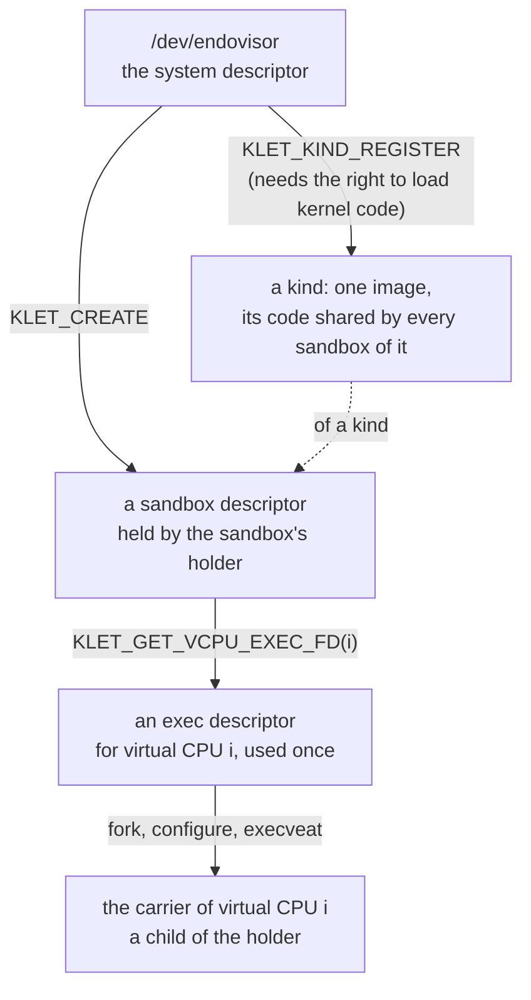

# The endovisor UAPI

The endovisor's user-space interface, its UAPI, is one header, `prototype/linux/endovisor/uapi/endovisor.h`: one device node, three kinds of file descriptor, and one rule about who creates the tasks. Linux calls the set of system calls, device nodes and file formats that user space may use its **UAPI**, the user-space application programming interface, and keeps the headers that define it in a directory of that name. Everything the rest of the book builds is behind this interface, and nothing a tenant does ever touches it.

This chapter first shows the interface in use, by the prototype's own holder program, then says why it has the shape it has, and then specifies every operation.

## A prototype kernelet runtime

The program that drives a kernelet sandbox is its **holder**: the one process of the kernelet runtime that creates the sandbox, keeps its descriptor open for as long as the sandbox lives, and destroys it. A container runtime has such a process per container; the prototype's is `holder.c`, a static C program of two commands, `register` and `run`, around the client functions of `sandbox.c`, which the prototype's test drivers share. The prototype's tests run through the interface: the holder registers each kernel's image and runs the sandbox, and a self-test run before the hello kernel boots exercises every operation.

<div class="background">

**Linux: device nodes, `ioctl` and anonymous files.** A *device node* is a file under `/dev` that stands for a driver rather than for data; opening it gives a descriptor on which the driver answers `read`, `write` and, for everything that is neither, [`ioctl`](https://elixir.bootlin.com/linux/v6.12/source/fs/ioctl.c#L893): one system call that takes a descriptor, a command number and an argument, and hands both to whatever code is behind the descriptor. A driver's interface is therefore a list of command numbers, and a module may define its own.

A descriptor need not come from a file system at all: a module can make an *anonymous* file, with operations of its choosing, and hand out a descriptor on it. The sandbox descriptor below is one of those; the exec descriptor is a third sort, a descriptor on a file that exists only in memory.

</div>

**The operator's step.** Once per boot, someone with the right to load kernel code registers each **kernelet image** the machine will run, one file holding a compiled kernelet (its format is given with `KLET_KIND_REGISTER` below), and names it:

*Simplified from `prototype/host/runtime/sandbox.c`: `open_system`, `register_kind`.*

```c
int open_system(void)
{
	int sys_fd = open("/dev/endovisor", O_RDWR | O_CLOEXEC);

	if (ioctl(sys_fd, KLET_GET_API_VERSION) != KLET_API_VERSION)
		exit(127);                                  /* an interface this program does not know */
	return sys_fd;
}

int register_kind(int sys_fd, const char *name, const char *image_path)
{
	struct klet_kind_register reg = { .image_fd = open(image_path, O_RDONLY | O_CLOEXEC) };

	snprintf(reg.name, sizeof(reg.name), "%s", name);  /* the name KLET_KIND_LIST reports; unique */
	return ioctl(sys_fd, KLET_KIND_REGISTER, &reg);    /* the kind's identifier */
}
```

A registered image is a **kind**, and a kind is what sandboxes are made of. Registering it is the privileged act, and it happens once; creating sandboxes of it is not privileged and happens as often as the runtime likes.

<div class="background">

**Linux: control groups.** A control group is a set of tasks that Linux accounts and limits together: their share of the processors, their memory, and more. Groups form one tree, the unified hierarchy of cgroup v2, which this book means throughout. A process joins a group when its identifier is written into the group's `cgroup.procs` file, and a child starts in its parent's group. Containers are built on them, and so is a sandbox: because every task of the sandbox is in the sandbox's group, the processor time the kernelet burns and the memory Linux allocates for it are charged to the tenant by machinery Linux already has.

</div>

**The holder's step.** To run a sandbox, the holder creates it, gives it its console and log, and then makes one carrier per virtual CPU:

*Simplified from `prototype/host/runtime/sandbox.c`: `run_sandbox`, `wait_sandbox`.*

```c
int run_sandbox(int sys_fd, const char *name, unsigned int nr_vcpus, const char *cmdline,
		const struct sandbox_opts *opt)
{
	struct klet_create create = {
		.kind = find_kind(sys_fd, name),               /* KLET_KIND_LIST, matched by name */
		.nr_vcpus = nr_vcpus,
		.memory_initial = opt->memory_initial,        /* 4 MiB unless asked otherwise */
		.memory_max = opt->memory_max,
		.max_tasks = opt->max_tasks,
		.cmdline = (__u64)(unsigned long)cmdline,
		.cmdline_len = strlen(cmdline),
	};
	struct sandbox sb = { .sys_fd = sys_fd, .nr_vcpus = nr_vcpus };
	int out = 1, err = 2;

	if (opt->cgroup)
		join_cgroup(opt->cgroup);                   /* before the create: this group becomes the sandbox's */
	sb.fd = ioctl(sys_fd, KLET_CREATE, &create);        /* the sandbox descriptor */
	ioctl(sb.fd, KLET_SET_CONSOLE, &out);               /* the sandbox's console: our standard output, or a file */
	ioctl(sb.fd, KLET_SET_LOG, &err);                   /* its kernel log: our standard error, or a file */
	/* a disk would be attached here: KLET_ATTACH_DEVICE with its open file */

	for (i = 0; i < nr_vcpus; i++) {
		int exec_fd = ioctl(sb.fd, KLET_GET_VCPU_EXEC_FD, &i);

		sb.pids[i] = fork();
		if (sb.pids[i] == 0)
			start_carrier(exec_fd, i, opt);         /* the child; does not return */
		close(exec_fd);
	}

	wait_sandbox(sb.fd, sb.pids, nr_vcpus, &sb.ex);     /* KLET_WAIT, watching the children too: a child that
	                                                   dies before its exec never became a carrier, so the
	                                                   holder kills the sandbox itself if one does */
	for (i = 0; i < nr_vcpus; i++)
		waitpid(sb.pids[i], NULL, 0);               /* the carriers died by SIGKILL */
	ioctl(sb.fd, KLET_DESTROY);
	close(sb.fd);

	switch (sb.ex.how) {
	case KLET_END_EXITED:   return sb.ex.code;      /* the kernel proper's exit code */
	case KLET_END_PANICKED: return 128;
	default:                return 129;             /* killed */
	}
}
```

The loop in the middle is the heart of the interface. A **carrier**, chapter 1's term for a Linux task that carries one of the sandbox's virtual CPUs and may run the tenant's programs, is not made by the kernel. The holder forks a child for it, the child arranges itself with ordinary system calls, and then the child *executes* a descriptor the sandbox handed out:

*Simplified from `prototype/host/runtime/sandbox.c`: `start_carrier`, `join_cgroup`.*

```c
void start_carrier(int exec_fd, unsigned int vcpu, const struct sandbox_opts *opt)
{
	char *argv[] = { "carrier", NULL }, *envp[] = { NULL };

	if (opt->pin) {                                 /* virtual CPU i on processor i */
		cpu_set_t set;
		CPU_ZERO(&set);
		CPU_SET(vcpu, &set);
		sched_setaffinity(0, sizeof(set), &set);
	}
	prctl(PR_SET_NO_NEW_PRIVS, 1, 0, 0, 0);         /* the endovisor insists on it */
	if (opt->seccomp_kill_nr >= 0)                  /* a filter bounds what the tenant may ask of its kernelet */
		install_seccomp_kill(opt->seccomp_kill_nr);
	execveat(exec_fd, "", argv, envp, AT_EMPTY_PATH);   /* the endovisor takes it from here */
	die_child("execveat");                           /* reached only if the exec failed */
}

void join_cgroup(const char *dir)                    /* write our process identifier into cgroup.procs */
{
	mkdir(dir, 0755);                                /* made if it does not exist: a runtime's job, done here */
	snprintf(path, sizeof(path), "%s/cgroup.procs", dir);
	fd = open(path, O_WRONLY | O_CLOEXEC);
	n = snprintf(pid, sizeof(pid), "%d\n", getpid());
	write(fd, pid, n);
	close(fd);
}
```

Between the `fork` and the `execveat` the child is an ordinary process of the holder's user, and anything Linux lets a process set on itself can go there: the processor it is pinned to, as here; its priority or scheduling class; the user it runs as; the namespaces it is in; its resource limits; a seccomp filter, which bounds what the tenant may ask of its kernelet. All of it survives the `exec`, because these are properties of the task and not of the program it runs, and all of it is per carrier, so two virtual CPUs can be pinned to two processors and given two priorities.

In summary, the whole life of a sandbox is, in order:

1. When the machine is set up, the operator registers each kind with `KLET_KIND_REGISTER`.
2. The runtime makes a control group for the sandbox with the limits the operator chose, and starts the holder in it, or the holder moves itself in before it creates anything, as the prototype's does when given a group (`join_cgroup`).
3. The holder creates the sandbox with `KLET_CREATE`, opens the disk image and whatever else the sandbox is to have and passes each with `KLET_ATTACH_DEVICE`, and passes its console and log with `KLET_SET_CONSOLE` and `KLET_SET_LOG`.
4. For each virtual CPU, the holder asks for the exec descriptor with `KLET_GET_VCPU_EXEC_FD` and forks a child, which arranges itself and executes the descriptor. The first of those `exec`s loads the kind's image as this sandbox's instance. From now on, the carrier no longer executes the holder's code, but the kernelet's.
5. The sandbox runs. Linux schedules each carrier with the processors and the class its creator gave it; the kernelet schedules its own tasks on them.
6. The kernel proper powers off, or the holder calls `KLET_KILL`, or a carrier is killed. The endovisor records why, marks the kernelet dying and stops every carrier; when the last of them is gone, the sandbox has exited. The holder's `KLET_WAIT` returns, it reaps the carriers, calls `KLET_DESTROY`, and exits; the runtime removes the group.

## Why it is shaped so

The endovisor UAPI is designed with four requirements in mind:

1. **Every carrier task is created and configured by user space just like an ordinary Linux task.** A carrier is a special task, since its system calls go to the kernelet and not to Linux, but it is still a task, and the host's tools for tasks, `sched_setaffinity`, `setpriority`, `sched_setattr`, control groups, namespaces, resource limits, `/proc`, must apply to it as to any other. And only user space can apply them *before* the task carries a virtual CPU.
2. **Resources reach a sandbox as descriptors.** A disk image, a network interface, a console and a log file are things the runtime opens itself, under its own user's permissions, and passes down. Nothing is named by path inside the kernel, and a sandbox can reach exactly what its runtime could open. This is good for both security and flexibility.
3. **A sandbox dies whole, and dies with its runtime.** Nothing a crashed runtime held keeps a sandbox alive.
4. **An image contains privileged kernel code and one copy of it should serve every sandbox of it.** Loading an image is a privilege of the admin who ought to make sure that the image is obtained from a trusted origin. The process of image loading involves format validation and thus should be done once.

### Learning from the KVM UAPI

Linux already has one interface that meets the first three requirements, that of KVM, Linux's hypervisor, and it is the one to draw on. The KVM module runs virtual machines whose virtual processors are ordinary user threads: a program such as QEMU opens `/dev/kvm`, asks it for a descriptor that stands for a virtual machine, asks that for a descriptor per virtual processor, and runs each virtual processor from a thread of its own by calling an operation on its descriptor ([`KVM_CREATE_VM`](https://elixir.bootlin.com/linux/v6.12/source/Documentation/virt/kvm/api.rst#L138), [`KVM_CREATE_VCPU`](https://elixir.bootlin.com/linux/v6.12/source/Documentation/virt/kvm/api.rst#L294), [`KVM_RUN`](https://elixir.bootlin.com/linux/v6.12/source/Documentation/virt/kvm/api.rst#L379)). The threads are QEMU's: it created them, it can pin them and renice them, `ps` shows them, and the machine dies when QEMU does, because closing the last descriptor destroys it.

A kernelet's interface has the same three levels: a system descriptor, a sandbox descriptor, and a descriptor per virtual CPU, each made from the one above it using ioctl, as shown by the diagram below:



### Differing from the KVM UAPI

The UAPI of the endovisor differs from that of KVM in two major aspects.

First, the endovisor has a dedicated API for image registration, whereas KVM leaves loading the guest's kernel to user space or to the guest's own boot loader. KVM is given guest memory and virtual CPU state; the kernel image is just bytes in that memory, and hardware virtualization confines the guest even if those bytes are hostile. A kernelet's image, by contrast, becomes executable code inside the host kernel. Its isolation rests on safe Rust and vOSTD, so the operator must trust how the image was built; checking its format cannot establish that trust. `KLET_KIND_REGISTER` therefore requires the right to load kernel code, while `KLET_CREATE` lets an unprivileged runtime create a sandbox from an already registered kind. Separating the two also lets the endovisor validate and relocate the image once and retain one copy of its code for all sandboxes of that kind, instead of repeating the work and storing another copy for each sandbox. The prototype reuses that copy across successive sandboxes; sharing it among concurrent sandboxes of the same kind remains to be implemented.

Second, the endovisor uses the `execveat` syscall to run a vCPU, whereas KVM does the `KVM_RUN` ioctl. The reason is that a carrier must start with an address space that holds nothing of the host's, and only an exec gives it one. A carrier is to the kernelet what a processor is to an ordinary kernel: the kernelet runs its tenant's processes on it, one at a time. Those processes run in Linux's own user mode, on Linux's own page tables, so at every switch the kernelet switches the carrier's address space to the current process's, and the carrier's address space is always one of the tenant's. It must therefore start holding nothing of the host's: not the holder's program, not its heap, not a stack with the holder's secrets on it. The one operation in Linux that gives a process a fresh address space is `execve`. So the exec descriptor is not called; it is executed.

<div class="background">

**Linux: what `exec` keeps.** A new program gets a new address space, and [`begin_new_exec()`](https://elixir.bootlin.com/linux/v6.12/source/fs/exec.c#L1222) resets what belongs to the old one: signal handlers, timers, the descriptors marked close-on-exec, and a few registrations by which Linux would later write into user memory. It does *not* touch the task's control group, its user and group identities, its namespaces (bar a time namespace chosen for its children, which it enters), its processor mask, priority, resource limits, the no-new-privileges bit or the seccomp filter; those are properties of the task, not of the program, and the two last are kept by design so that a program cannot shed them by executing another. Three things it does recompute: the task's *capabilities*, of which a process that is not root keeps only those it marked ambient; whatever domain the host's security module assigns the new program; and whether the process is dumpable, below. That is what makes the holder's child work: everything it set on itself is still set when the endovisor sees it, and nothing it could not have had is added.

</div>

## The image format and its requirements

The image passed to `KLET_KIND_REGISTER` contains the kernel proper and vOSTD in one file. Its format tells the endovisor how to load it; its code and data layout determine whether it can serve independent sandboxes. Those are separate concerns: a file being *relocatable* does not make its code *position-independent*, and neither property alone gives each sandbox private state.

### The prototype's image format

The prototype accepts a little-endian, 64-bit x86 ELF relocatable object, `ET_REL`. The build in `prototype/Makefile` compiles with `-C relocation-model=static -C code-model=kernel`, then combines the kernel proper and vOSTD with `ld -r`. This is a partial link: the file still contains sections, symbols and relocation records for the endovisor to finish placing in memory. The kernel code model constrains placement to the uppermost 2 GiB of the address space, where Linux keeps modules.

The loader in `prototype/linux/endovisor/image.c` requires:

- **An image with no undefined symbols.** Every symbolic reference must resolve within the image. The only global or weak symbol is `kernelet_entry_table`, an object containing the entry table described in [the kernelet ABI](the-kernelet-abi.md#the-three-tables). Its ABI version must match the endovisor's, and its entry points must lie within the loaded code.
- **Sections and symbols the loader knows how to place.** It loads initialized code and data, zero-initialized storage, notes and unwind information. The prototype does not implement ELF thread-local storage or allocation for common symbols, which leave storage assignment to the linker. It also rejects standard constructor and destructor array sections; initialization currently runs explicitly during sandbox boot. These are implementation restrictions, not requirements of kernelet isolation. Registration runs no image code.
- **Supported relocation records.** Relocations against loaded sections must use `RELA` records, which carry explicit addends, and one of the types listed below. The loader rejects unsupported types, writes outside the target section and values that do not fit their relocation fields.

At registration, the loader allocates memory for the code and read-only data, and a separate region for writable data. It places the sections, resolves their symbols and applies their relocations, then makes the code read-only and executable. It keeps a pristine copy of the relocated writable data, including the zeroed uninitialized storage, for starting a sandbox. This is a module-style loading scheme: `ET_REL` is the current loader's input format, not a general requirement for all possible kernelet implementations.

The format checks establish compatibility with that loader. They do not establish that arbitrary machine code obeys the safe-Rust and vOSTD boundary. That still depends on the trusted build, which is why registering an image requires the right to load kernel code.

<div class="background">

**ELF: relocations.** ELF, the Executable and Linkable Format, records how code and data refer to symbols whose final addresses may not yet be known. A relocation is an instruction to the linker or loader to patch a location using a symbol's final address. A call between two sections, a reference to a global variable, or a function pointer stored in a table may need such a patch. Let `S` be the symbol's address, `A` the addend in the relocation record, and `P` the address of the field being patched. The prototype's `klet_relocate` supports the following subset of x86-64 ELF relocations:

| Relocation | Value written by this loader |
|---|---|
| `R_X86_64_NONE` | No patch |
| `R_X86_64_64` | `S + A`, as a 64-bit absolute value |
| `R_X86_64_32` | `S + A`, checked to fit unsigned 32 bits |
| `R_X86_64_32S` | `S + A`, checked to fit signed 32 bits |
| `R_X86_64_PC32` | `S + A - P`, checked to fit signed 32 bits |
| `R_X86_64_PLT32` | `S + A - P`, checked to fit signed 32 bits; resolved directly to the image's own symbol |
| `R_X86_64_PC64` | `S + A - P`, as a 64-bit relative value |

The absolute forms embed addresses. The relative forms embed distances: when the target and the patch location move by the same amount, their distance stays unchanged.

</div>

### Requirements for sharing code across sandboxes

Our goal is to share physical code pages while keeping each sandbox's mutable state private. One way to do that is to map the same code pages at a different kernel virtual address for each sandbox, with private data at a consistent offset from each code mapping. This requires instruction bytes that work at every mapping, without patches that differ between sandboxes: position-independent code, or **PIC**.

<div class="background">

**ELF: PIC.** Position-independent code can execute at different load addresses without changing its instruction bytes to suit each address. On x86-64, one technique is to address code or data relative to the instruction pointer, `RIP`. When the instruction and its target move by the same amount, the encoded displacement remains valid. The same instructions can therefore reach a different instance's private data when that data has the same position relative to its code mapping. Position independence does not itself allocate or separate those instances' data.

A **global offset table**, or **GOT**, provides indirection for addresses that cannot be reached using a fixed displacement alone. Instead of embedding the target's absolute address in an instruction, the code reads it from a table entry. On x86-64, the code can reach that entry relative to `RIP`; the loader fills the entry with the target's address. The instruction bytes can stay shared while the table entries differ between instances, provided each code mapping reaches its own table. Entries that depend on an instance must be private, even if the table becomes read-only after loading. A GOT is one technique used by PIC, not a requirement for every reference: references within an image can often use relative addressing directly.

PIC can still need relocations during linking and when initializing private data. It is a property of the generated code, separate from the ELF file type: an `ET_REL` object can contain PIC. A position-independent executable, **PIE**, is a linked executable that can run at different load addresses. It is another possible way to package the code, rather than an additional requirement for sharing.

</div>

The precise sharing rule is that **every relocation applied to a physically shared page must produce identical bytes for every mapping**. An absolute relocation whose value depends on the sandbox's load address violates that rule. Absolute relocations can still appear in private data, such as a table of pointers to that sandbox's code mapping, or in shared pages when the resulting value is identical for all instances. Relative relocations remain identical only when the referenced target stays at the same distance from the field being patched. Merely banning the absolute relocation types from the whole image would therefore be both too restrictive for private data and insufficient to guarantee sharing.

For the proposed layout, the loader must give each sandbox private data and any private pointer tables at the offsets its code expects. Choosing PIC or PIE requires a compatible compiler configuration and loader; simply changing the file type does not provide this layout. Another design could use one code mapping and pass a sandbox context explicitly; different code virtual addresses are a design choice, not a requirement of sharing itself.

**The prototype does not implement concurrent sharing within a kind.** Its code is compiled with the static relocation model and patched to reach one data allocation at the addresses chosen during registration. The loader supports no GOT relocations, and the build checks that none remain in the image. Each successive sandbox restores the same data allocation from the pristine copy. A second sandbox of the kind is refused with `EBUSY` until the first is destroyed. Supporting concurrent instances requires the code-generation, mapping and data-access changes described above; it is not a property the current `ET_REL` requirement already provides.

## The operations

The header `prototype/linux/endovisor/uapi/endovisor.h` is the interface's definition, and its comments are written to be the reference: for each operation they say what it does, what its arguments are, what it returns and how it fails. This section quotes the header unchanged, one operation at a time, and adds only what a header cannot carry: a figure, a Linux mechanism, and the reasons. The header opens with the three descriptors and the conventions every operation follows:

*Simplified from `prototype/linux/endovisor/uapi/endovisor.h`: the opening comment.*

```c
// The endovisor UAPI defines what host user space may ask of a Linux that runs kernelets.
// It has one device node, `/dev/endovisor`, and three kinds of descriptor:
//
// - The system descriptor, from `open("/dev/endovisor")`, registers kinds and creates sandboxes.
// - A sandbox descriptor, returned by `KLET_CREATE`, controls one sandbox.
//   Closing its last copy kills the sandbox and destroys it once it has exited.
// - An exec descriptor, returned by `KLET_GET_VCPU_EXEC_FD`, starts one virtual CPU.
//   Executing it with `execveat` and `AT_EMPTY_PATH` makes the caller that virtual CPU's carrier.
//
// The operations defined below are ioctls.
// They return -1 with `errno` set on failure,
// and otherwise return what their comments specify, or zero when nothing is specified.
```

### On the system descriptor

The system descriptor is `open("/dev/endovisor")`. The node is owned by root; an operator who runs sandboxes as an unprivileged user gives that user access to it, as is done for `/dev/kvm`.

#### `KLET_GET_API_VERSION`

*Unchanged from `prototype/linux/endovisor/uapi/endovisor.h`: `KLET_API_VERSION`, `KLET_GET_API_VERSION`.*

```c
// Returned by `KLET_GET_API_VERSION`; a runtime refuses any other value.
#define KLET_API_VERSION	1

// The ioctl type byte is chosen for the prototype.
// `0xEB` is unassigned in `Documentation/userspace-api/ioctl/ioctl-number.rst` at v6.12.
#define KLET_IOC		0xEB

#define KLET_NAME_LEN	32
#define KLET_MESSAGE_LEN	128
#define KLET_CMDLINE_MAX	4096

// ------------------------------------------------------------------
// The system descriptor
// ------------------------------------------------------------------

// The ioctl for querying the endovisor UAPI version.
//
// The ioctl takes no argument and returns `KLET_API_VERSION`.
// This operation cannot fail.
#define KLET_GET_API_VERSION	_IO(KLET_IOC, 0x00)
```

#### `KLET_KIND_REGISTER`

*Unchanged from `prototype/linux/endovisor/uapi/endovisor.h`: `klet_kind_register`, `KLET_KIND_REGISTER`.*

```c
// The ioctl for registering a new kernelet kind by providing a new image.
//
// `image_fd` is an open descriptor on the image file:
// an ELF relocatable object (`ET_REL`, x86-64) holding the kernel proper and vOSTD,
// built so that it has no undefined symbol,
// only relocations of the kinds the endovisor's loader applies,
// and one exported symbol, `kernelet_entry_table`.
// The endovisor repeats those checks on the file and refuses it (`EINVAL`, `ENOEXEC`) if any fails;
// it also refuses an image whose ABI version is not its own (`EPROTO`).
// It copies the image's code into pages it keeps for the kind's life,
// shared by every sandbox of the kind.
//
// The name of the new kind is given in `name`, which `KLET_KIND_LIST` reports.
// This name must be unique among all registered kinds (`EEXIST` otherwise).
// Currently, `flags` must be zero (`EINVAL` otherwise).
//
// The ioctl returns the kind's identifier, a small non-negative integer.
//
// # Security
//
// An image is kernel code,
// so registering asks what loading a module asks (`EPERM` otherwise):
// `CAP_SYS_MODULE` in the initial user namespace
// and module loading not disabled (`kernel.modules_disabled`).
// Because images carry no signature,
// neither signature enforcement (`module.sig_enforce`) nor lockdown may be in force.
// The file is read as a module file is read,
// so that the host's security modules see it.
struct klet_kind_register {
	__s32	image_fd;
	__u32	flags;				// must be 0 (`EINVAL`)
	char	name[KLET_NAME_LEN];	// NUL-terminated
};
#define KLET_KIND_REGISTER		_IOW(KLET_IOC, 0x01, struct klet_kind_register)
```

The [image format and its requirements](#the-image-format-and-its-requirements) above explain the accepted relocations and distinguish the prototype's loading scheme from the requirements for sharing code across concurrent sandboxes.

<div class="background">

**Linux: capabilities and lockdown.** Root's powers are divided into named *capabilities*, and a privileged operation asks for the one it needs with [`capable()`](https://elixir.bootlin.com/linux/v6.12/source/kernel/capability.c#L434). Loading a module asks for `CAP_SYS_MODULE` and that module loading has not been switched off ([`init_module`](https://elixir.bootlin.com/linux/v6.12/source/kernel/module/main.c#L2646) checks both), reads the file in a way the host's security modules can veto, and, for a module without a valid signature, asks that signatures are not being enforced and that the kernel is not *locked down*, a mode in which nothing unsigned may be added to the running kernel ([`security_locked_down()`](https://elixir.bootlin.com/linux/v6.12/source/security/security.c#L5766)). The switch that turns module loading off is not visible to a module; the prototype's patch exports it.

</div>

#### `KLET_KIND_LIST`

*Unchanged from `prototype/linux/endovisor/uapi/endovisor.h`: `klet_kind_info`, `klet_kind_list`, `KLET_KIND_LIST`.*

```c
// The ioctl for listing registered kinds.
//
// The caller supplies an array of `capacity` entries at `kinds`.
// The endovisor fills in up to that many entries
// and sets `count` to the number of registered kinds.
// If `count` exceeds `capacity`, call again with a larger array.
//
// The ioctl returns zero on success.
struct klet_kind_info {
	__u32	id;
	__u32	nr_sandboxes;			// sandboxes of this kind that exist now
	__u64	text_bytes;			// the shared code's size
	char	name[KLET_NAME_LEN];
};
struct klet_kind_list {
	__u64	kinds;				// `struct klet_kind_info *`, user memory
	__u32	capacity;			// entries available at `kinds`
	__u32	count;				// out: kinds registered
};
#define KLET_KIND_LIST		_IOWR(KLET_IOC, 0x02, struct klet_kind_list)
```

#### `KLET_KIND_UNREGISTER`

*Unchanged from `prototype/linux/endovisor/uapi/endovisor.h`: `KLET_KIND_UNREGISTER`.*

```c
// The ioctl for unregistering a kind and returning its pages to Linux.
//
// The argument points to the kind's identifier.
// An unknown kind is refused with `ENOENT`;
// a kind with any sandbox still in existence is refused with `EBUSY`.
//
// The ioctl returns zero on success.
//
// # Security
//
// Unregistering requires the same rights as `KLET_KIND_REGISTER`.
#define KLET_KIND_UNREGISTER	_IOW(KLET_IOC, 0x03, __u32)
```

*Unchanged from `prototype/linux/endovisor/uapi/endovisor.h`: `klet_create`, `KLET_CREATE`.*

#### `KLET_CREATE`

```c
// The ioctl for creating a sandbox of a registered kind.
//
// `kind` identifies the registered image (`ENOENT` for an unknown kind).
// `nr_vcpus` must be between one and `KLET_MAX_VCPUS`.
// `memory_initial` is what the kernelet is given before it boots;
// `memory_max` is the ceiling for memory granted in response to the kernelet's own requests.
// Both are in bytes, rounded up to whole 2 MiB units.
// `max_tasks` bounds the kernelet's own tasks,
// each of which costs the host a kernelet stack.
// The command line at `cmdline`, of length `cmdline_len`,
// is passed to the kernel proper as a machine's boot loader would pass it.
// Currently, `flags` must be zero.
//
// The ioctl fails with `EINVAL` if `nr_vcpus` is out of range,
// `memory_initial` exceeds `memory_max`, `cmdline_len` exceeds `KLET_CMDLINE_MAX`,
// or `flags` is nonzero.
// It fails with `ENOSPC` if the endovisor's table of sandboxes is full.
//
// The ioctl returns the sandbox descriptor, marked close-on-exec.
// Nothing is allocated for the kernelet itself until its first carrier arrives.
//
// # Security
//
// The calling task's control group, on the unified (v2) hierarchy, becomes the sandbox's.
// Every later exec of one of its exec descriptors, and every `KLET_ATTACH_DEVICE`,
// must come from a task in that group.
// The root group is refused (`EPERM`).
// The calling thread's group leader is held, by a task reference,
// as the owner of every address space the kernelet will create,
// so that the memory controller charges their pages to this group.
//
// Creating needs no privilege beyond access to the device node:
// a sandbox can reach nothing its creator could not,
// since its memory is charged to the creator's group
// and the files it is given are files its creator opened.
//
// # Prototype limitations
//
// A kind has at most one sandbox at a time,
// because its one loaded copy is position-dependent (`EBUSY` while one exists).
// `memory_initial` must round to 2 or 4 MiB,
// the grant being one physically contiguous run (`EINVAL` otherwise).
struct klet_create {
	__u32	kind;
	__u32	nr_vcpus;			// 1 to `KLET_MAX_VCPUS`
	__u64	memory_initial;
	__u64	memory_max;
	__u64	max_tasks;
	__u64	cmdline;			// `const char *`, user memory; need not be NUL-terminated
	__u32	cmdline_len;
	__u32	flags;				// must be 0
};
#define KLET_MAX_VCPUS	64
#define KLET_CREATE			_IOW(KLET_IOC, 0x04, struct klet_create)
```

### On the sandbox descriptor

#### `KLET_GET_VCPU_EXEC_FD`

*Unchanged from `prototype/linux/endovisor/uapi/endovisor.h`: `KLET_GET_VCPU_EXEC_FD`.*

```c
// The ioctl for obtaining a virtual CPU's exec descriptor.
//
// The argument points to the virtual CPU's index, `i`.
// The ioctl returns its exec descriptor, marked close-on-exec.
// It fails with `EINVAL` for an `i` beyond `nr_vcpus`,
// `EBUSY` for a virtual CPU already started,
// or `ESRCH` once the sandbox has been killed.
//
// The descriptor refers to a file that lives only in memory, one per virtual CPU.
// The endovisor identifies the sandbox and virtual CPU by the file's identity,
// not by its contents.
// Execute it with `execveat(fd, "", argv, envp, AT_EMPTY_PATH)`;
// the arguments and the environment are discarded.
// The process becomes the carrier of virtual CPU `i`, named `kernelet/<slot>/<i>`,
// where `slot` is the sandbox's index in the endovisor's table,
// given at `KLET_CREATE` and reported by `KLET_GET_STATS`.
//
// The sandbox starts at the first such exec,
// which loads the kind's image as this sandbox's instance
// and grants `memory_initial`, charged to the sandbox's control group.
// The kernelet boots when every virtual CPU's carrier has arrived,
// because a kernel that starts its other processors expects each of them to answer.
// Until then, `KLET_GET_STATS` reports the sandbox as `KLET_STATE_STARTING`.
// A holder that never starts one of its virtual CPUs has a sandbox that never boots;
// `KLET_KILL` ends it.
// A carrier that dies while the others are still arriving ends the sandbox,
// as any carrier's death does.
//
// # Security
//
// The file is owned by root and execute-only.
// The descriptor is an `O_PATH` descriptor, which `execveat` accepts;
// it cannot be used to read or write the file.
// A process that executes it is made non-dumpable.
//
// The exec is refused with `EPERM` unless the executing process
// is in the sandbox's control group and has no-new-privileges set,
// which guarantees that it gains nothing by the exec.
// It fails with `EBUSY` if this virtual CPU has already been started,
// by this descriptor or by another copy of it,
// and with `ESRCH` if the sandbox has been killed.
#define KLET_GET_VCPU_EXEC_FD	_IOW(KLET_IOC, 0x10, __u32)
```

#### `KLET_ATTACH_DEVICE`

*Unchanged from `prototype/linux/endovisor/uapi/endovisor.h`: `klet_device`, `KLET_ATTACH_DEVICE`.*

```c
// The ioctl for attaching a virtio device backed by an open file.
//
// `type` selects the device type, and `fd` is a file the caller opened.
// The endovisor takes its own reference to the file;
// the caller may close `fd` afterwards.
// Attaching is legal until the sandbox starts (`EBUSY` after).
//
// The ioctl returns the device's index,
// which the kernelet sees as the order of devices on its command line.
//
// # Security
//
// The calling task must be in the sandbox's control group (`EPERM` otherwise).
// The device is backed by a file the caller opened under its own permissions.
//
// # Prototype limitations
//
// The prototype has no devices, so this ioctl fails with `EOPNOTSUPP`.
enum klet_device_type {
	KLET_DEVICE_BLOCK	= 1,		// `fd`: a regular file or a block device
	KLET_DEVICE_NET	= 2,		// `fd`: a TAP interface
};
#define KLET_DEVICE_READONLY	0x1
struct klet_device {
	__u32	type;				// `enum klet_device_type`
	__s32	fd;
	__u32	flags;				// `KLET_DEVICE_*`
	__u32	pad;				// must be 0
};
#define KLET_ATTACH_DEVICE		_IOW(KLET_IOC, 0x11, struct klet_device)
```

#### `KLET_SET_CONSOLE` and `KLET_SET_LOG`

*Unchanged from `prototype/linux/endovisor/uapi/endovisor.h`: `KLET_SET_CONSOLE`, `KLET_SET_LOG`.*

```c
// The ioctls for setting the sandbox's console and kernel log files.
//
// The argument points to a file descriptor.
// The endovisor takes its own reference to the file.
// `KLET_SET_CONSOLE` sets the file serving the sandbox's console;
// `KLET_SET_LOG` sets the file receiving its kernel log.
// Both operations are legal until the sandbox starts (`EBUSY` after)
// and return zero on success.
//
// The console carries both directions, what the tenant writes and what it reads,
// so its file must be one that does: a terminal or a socket.
// A pipe carries output only.
// Without a log file, the log is kept only in a bounded ring;
// `KLET_GET_STATS` counts drops from that ring.
//
// # Prototype limitations
//
// The console carries output only.
// A console or log not given goes to the host's kernel log, prefixed `kernelet:`.
#define KLET_SET_CONSOLE		_IOW(KLET_IOC, 0x12, __s32)
#define KLET_SET_LOG		_IOW(KLET_IOC, 0x13, __s32)
```

*Unchanged from `prototype/linux/endovisor/uapi/endovisor.h`: `KLET_KILL`.*

```c
// The ioctl for marking a kernelet dying and recording the reason.
//
// The argument points to the caller's reason, which the exit status carries.
// It must be below `0x80000000`;
// values with the high bit set are reserved for the endovisor and refused with `EINVAL`.
//
// The ioctl returns zero without waiting for the carriers to stop.
// Stopping is asynchronous; `KLET_WAIT` says when it is done.
// A sandbox that has no carrier exits at once.
// The operation is idempotent: a second kill changes nothing.
#define KLET_KILL			_IOW(KLET_IOC, 0x15, __u32)
```

*Unchanged from `prototype/linux/endovisor/uapi/endovisor.h`: `klet_exit`, `klet_end`, `KLET_WAIT`.*

```c
// The ioctl for waiting until a sandbox has exited and reporting how it ended.
//
// A sandbox has exited when, after it was marked dying, every carrier it had is gone,
// or at once if it never had one.
// The sandbox descriptor is also pollable: it reports `POLLIN` once the sandbox has exited.
//
// The ioctl fills in the exit record and returns zero on success.
// `how` identifies which of three things ended the sandbox:
//
// - `KLET_END_EXITED`: `code` is the kernel proper's exit code.
// - `KLET_END_PANICKED`: `message` is the panic message.
// - `KLET_END_KILLED`: `reason` is the caller's reason from `KLET_KILL`,
//   `KLET_KILLED_REQUESTED` if the last copy of the sandbox descriptor closed,
//   or another `KLET_KILLED_*` reason if the endovisor killed it.
//
// `message` is empty when there is no panic message.
//
// # Prototype limitations
//
// The prototype reports a panic as `KLET_END_EXITED`, as a power-off, with no message.
// Of the endovisor's own reasons, it detects only `KLET_KILLED_CARRIER_LOST`.
enum klet_end {
	KLET_END_EXITED	= 1,		// the kernel proper powered off
	KLET_END_PANICKED	= 2,		// a panic nothing in it caught
	KLET_END_KILLED	= 3,		// the host decided
};
#define KLET_KILLED_REQUESTED	0x80000000u	// the last copy of the descriptor closed
#define KLET_KILLED_CARRIER_LOST	0x80000001u	// a carrier died: `SIGKILL`, the OOM killer
#define KLET_KILLED_FAULT		0x80000002u	// a fault in kernelet code
#define KLET_KILLED_STACK		0x80000003u	// a kernelet stack nearly exhausted
#define KLET_KILLED_HOST_COUNT	0x80000004u	// Linux's preemption count found wrong
struct klet_exit {
	__u32	how;				// `enum klet_end`
	__s32	code;
	__u32	reason;
	__u32	pad;
	char	message[KLET_MESSAGE_LEN];
};
#define KLET_WAIT			_IOR(KLET_IOC, 0x16, struct klet_exit)
```

*Unchanged from `prototype/linux/endovisor/uapi/endovisor.h`: `klet_stats`, `klet_vcpu_stat`, `KLET_GET_STATS`.*

```c
// The ioctl for reading a sandbox's state, counters, and virtual CPU statistics.
//
// The caller supplies an array of `capacity` rows at `vcpus`.
// The endovisor sets `nr_vcpus` to the sandbox's number of virtual CPUs
// and fills in `min(capacity, nr_vcpus)` rows.
// It also reports the sandbox's `slot`, `state`, and counters.
// The rows let a tool find the sandbox's carriers without walking its control group;
// `pid` is the process identifier that `taskset` and `chrt` take.
//
// The ioctl returns zero on success.
enum klet_state {
	KLET_STATE_CREATED	= 1,		// no carrier yet
	KLET_STATE_STARTING	= 2,		// some carriers have arrived
	KLET_STATE_RUNNING	= 3,
	KLET_STATE_DYING	= 4,		// marked; carriers being stopped
	KLET_STATE_EXITED	= 5,		// no carrier of the sandbox is left
};
enum klet_vcpu_state {
	KLET_VCPU_UNSTARTED	= 0,		// its exec descriptor has not been executed
	KLET_VCPU_WAITING	= 1,		// arrived; waiting for the others, or for `vcpu_boot`
	KLET_VCPU_RUNNING	= 2,
	KLET_VCPU_GONE	= 3,
};
struct klet_vcpu_stat {
	__s32	pid;				// the carrier's process identifier, 0 if unstarted
	__u32	state;				// `enum klet_vcpu_state`
	__u64	run_ns;				// time the carrier has run
	__u64	stolen_ns;			// time it was runnable but not running
};
struct klet_stats {
	__u32	state;				// `enum klet_state`
	__u32	nr_vcpus;			// out
	__u64	memory_granted;			// bytes
	__u64	service_calls;
	__u64	virqs_raised;
	__u64	log_dropped;
	__u64	vcpus;				// `struct klet_vcpu_stat *`, user memory
	__u32	capacity;			// rows available at `vcpus`
	__u32	slot;				// out: the sandbox's index in the endovisor's table; names its carriers
};
#define KLET_GET_STATS		_IOWR(KLET_IOC, 0x17, struct klet_stats)
```

*Unchanged from `prototype/linux/endovisor/uapi/endovisor.h`: `KLET_DESTROY`.*

```c
// The ioctl for destroying an exited sandbox and releasing its resources.
//
// The operation returns the memory, instance, and records to Linux.
// It is legal once the sandbox has exited (`EBUSY` before)
// and returns zero on success.
// The exit status stays readable through the sandbox descriptor until it is closed.
//
// Closing the last copy of the sandbox descriptor performs `KLET_KILL`;
// the endovisor then destroys the sandbox once it has exited.
// Release never waits.
//
// # Security
//
// Automatic cleanup ensures that nothing a crashed holder held keeps a sandbox alive.
#define KLET_DESTROY		_IO(KLET_IOC, 0x18)
```

### On the exec descriptor

The exec descriptor is returned by `KLET_GET_VCPU_EXEC_FD` on the sandbox descriptor and identifies one virtual CPU of that sandbox. Its operation is `execveat(fd, "", argv, envp, AT_EMPTY_PATH)`: the calling process becomes that virtual CPU's carrier. The holder passes the descriptor to a child it has forked and configured, and the child executes it. A successful exec never returns to the holder's code; the arguments and environment are discarded.

The descriptor grants the right to start that virtual CPU once, subject to the checks below. It refers to a file that exists only in memory, owned by root and execute-only. The endovisor recognizes the file by its identity, not its contents: copying its bytes into another file grants no right to start a virtual CPU. The descriptor is a path-only one (`O_PATH`), which `execveat` accepts but `read`, `write` and `fchmod` refuse. Duplicating it does not grant another start: once the virtual CPU has started, executing any copy fails with `EBUSY`.

**Executing the descriptor.** The caller must be in the sandbox's control group and have *no new privileges* set, or the exec fails with `EPERM`. A killed sandbox refuses the exec with `ESRCH`. The endovisor implements these checks in a handler registered with Linux as an executable format. On success, the handler gives the process a fresh address space and empties it, including the pages holding the arguments, so that it holds only what the kernelet puts there. It marks the task as a carrier and gives it a **lifeline**, an open file whose closing tells the endovisor that the carrier has died. The first carrier starts the sandbox's instance; the kernelet boots once every virtual CPU has a carrier. On the way back from the exec to user mode, the endovisor takes control and starts running kernelet code on the task.

**Controlling the resulting carrier.** Once the exec has succeeded, the runtime controls the virtual CPU through its Linux task. The task is named `kernelet/<slot>/<i>`, identifying the sandbox's slot and the virtual CPU's index; `KLET_GET_STATS` on the sandbox descriptor reports its process identifier. `ps` and `top` list the carriers, and `taskset` and `chrt` change their processor affinity and scheduling class while the sandbox runs. The host sees the holder and one child per virtual CPU in the sandbox's control group. The tenant's own processes are known only to the kernelet.

The exec changes two aspects of how those task interfaces work. First, the carrier is not *dumpable*: sharing its user identity does not permit attaching a debugger or reading its memory through `/proc`, which could expose the tenant's memory. Linux normally makes a process non-dumpable when it executes a file it cannot read ([`begin_new_exec()`](https://elixir.bootlin.com/linux/v6.12/source/fs/exec.c#L1342)), but root can read an execute-only file, and the rule also depends on `fs.suid_dumpable`. The handler therefore clears the dumpable bits itself, for the carrier and for every address space later made for the tenant. Root can still inspect and profile the carrier.

Second, signals control the carrier's execution but do not deliver events to the tenant. `SIGSTOP` stops the virtual CPU until `SIGCONT`; `SIGKILL` to any carrier ends the whole sandbox. Other signals are discarded. The runtime can therefore stop the sandbox through `kill -KILL` on a carrier or `cgroup.kill` on its group, as well as through `KLET_KILL` on the sandbox descriptor.

**What this book's prototype leaves out.** The interface is written for a full endovisor, and the header's comments say where this book's falls short of it. It has no devices, so `KLET_ATTACH_DEVICE` fails with `EOPNOTSUPP`. Its console carries output only, so the input half of `KLET_SET_CONSOLE` does not exist, and a sandbox given no console or log file has both printed to the host's kernel log. Its memory is one fixed grant of 2 or 4 MiB, selected by `memory_initial` at creation; `memory_max` is recorded, but there is no mechanism to grow the grant. A kind runs one sandbox at a time, because its one loaded copy is linked for fixed addresses, so a second `KLET_CREATE` of a kind fails with `EBUSY` until the first sandbox is destroyed. A panic ends the kernelet as a power-off does, with no message for `KLET_WAIT` to report, and of the endovisor's own kill reasons it detects only a lost carrier. Each of those is named where the book reaches the place it would go.

<div class="recap">

**Recap.** The endovisor's user-space interface is one device node and three kinds of descriptor. The system descriptor, from `/dev/endovisor`, is where an operator with the right to load kernel code registers an image file, one that can name nothing outside itself, as a kind whose code every sandbox of it shares, and where anyone with the node creates a sandbox of a kind. The sandbox descriptor is what the holder keeps: through it the holder attaches files, asks for one exec descriptor per virtual CPU, waits for the end and destroys, and when its last copy closes the sandbox dies. An exec descriptor is executed, not called, by a child the holder forked and configured with Linux's ordinary system calls, because a carrier needs an address space that holds nothing of the host's; the endovisor checks the child's control group and its no-new-privileges bit, starts each virtual CPU once, and turns the child into its carrier. The holder's control group is the sandbox's, its main thread owns the tenant's address spaces, and every task of a sandbox is one that user space made and can govern.

</div>
