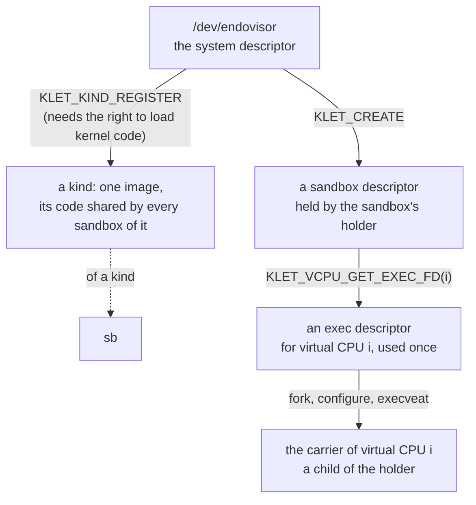
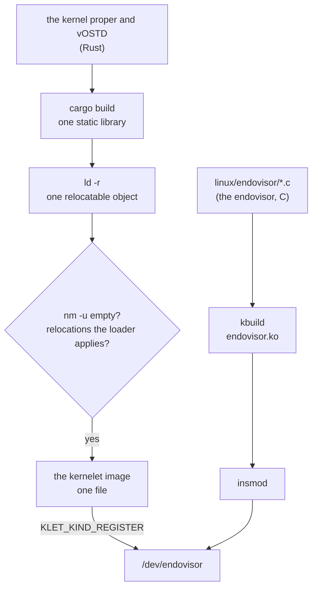

# The endovisor UAPI

Before any mechanism, the view from the host's user space. Linux calls the set of system calls, device nodes and file formats that user space may use its **UAPI**, the user-space application programming interface, and keeps the headers that define it in a directory of that name. A kernelet's is one header, `prototype/linux/endovisor/uapi/endovisor.h`: one device node, three kinds of file descriptor, and one rule about who creates the tasks.

This chapter first shows the interface in use, by the prototype's own holder program, then says why it has the shape it has, and then specifies every operation. Everything the rest of the book builds is behind this interface, and nothing a tenant does ever touches it. The prototype's tests run through it: its holder registers each kernel's image as a kind and runs the sandbox, and a self-test in the first boot exercises every operation.

## A prototype kernelet runtime

The program that drives a kernelet sandbox is its **holder**: the one process of the kernelet runtime that creates the sandbox, keeps its descriptor open for as long as the sandbox lives, and destroys it. A container runtime has such a process per container; the prototype's is `holder.c`, a static C program of two commands, `register` and `run`, around the client functions of `sandbox.c`, which the prototype's test drivers share.

<div class="linux">

**Linux: device nodes and `ioctl`.** A *device node* is a file under `/dev` that stands for a driver rather than for data; opening it gives a descriptor on which the driver answers `read`, `write` and, for everything that is neither, [`ioctl`](https://elixir.bootlin.com/linux/v6.12/source/fs/ioctl.c#L893): one system call that takes a descriptor, a command number and an argument, and hands both to whatever code is behind the descriptor. A driver's interface is therefore a list of command numbers, and a module may define its own. A descriptor need not come from a file system at all: a module can make an *anonymous* file, with operations of its choosing, and hand out a descriptor on it; every descriptor in this chapter but the first is one of those.

</div>

**The operator's step.** Once per boot, someone with the right to load kernel code registers each **kernelet image** the machine will run, one file holding a compiled kernelet (its format is given with `KLET_KIND_REGISTER` below), and names it:

*Simplified from `prototype/host/runtime/sandbox.c`: `open_system`, `register_kind`.*

```c
int open_system(void)
{
	int sys_fd = open("/dev/endovisor", O_RDWR | O_CLOEXEC);

	if (ioctl(sys_fd, KLET_GET_API_VERSION) != KLET_API_VERSION)
		exit(127);                                  /* an interface this program does not know */
	return sys_fd;
}

int register_kind(int sys_fd, const char *name, const char *image_path)
{
	struct klet_kind_register reg = { .image_fd = open(image_path, O_RDONLY | O_CLOEXEC) };

	snprintf(reg.name, sizeof(reg.name), "%s", name);  /* the name KLET_KIND_LIST reports; unique */
	return ioctl(sys_fd, KLET_KIND_REGISTER, &reg);    /* the kind's identifier */
}
```

A registered image is a **kind**, and a kind is what sandboxes are made of. Registering it is the privileged act, and it happens once; creating sandboxes of it is not privileged and happens as often as the runtime likes.

<div class="linux">

**Linux: control groups.** A control group is a set of tasks that Linux accounts and limits together: their share of the processors, their memory, and more. Groups form one tree, the unified hierarchy of cgroup v2, which this book means throughout. A process joins a group when its identifier is written into the group's `cgroup.procs` file, and a child starts in its parent's group. Containers are built on them, and so is a sandbox: because every task of the sandbox is in the sandbox's group, the processor time the kernelet burns and the memory Linux allocates for it are charged to the tenant by machinery Linux already has.

</div>

**The holder's step.** To run a sandbox, the holder creates it, gives it its console and log, and then makes one carrier per virtual CPU:

*Simplified from `prototype/host/runtime/sandbox.c`: `run_sandbox`, `wait_sandbox`.*

```c
int run_sandbox(int sys_fd, const char *name, unsigned int nr_vcpus, const char *cmdline,
		const struct sandbox_opts *opt)
{
	struct klet_create create = {
		.kind = find_kind(sys_fd, name),               /* KLET_KIND_LIST, matched by name */
		.nr_vcpus = nr_vcpus,
		.memory_initial = opt->memory_initial,        /* 4 MiB unless asked otherwise */
		.memory_max = opt->memory_max,
		.max_tasks = opt->max_tasks,
		.cmdline = (__u64)(unsigned long)cmdline,
		.cmdline_len = strlen(cmdline),
	};
	struct sandbox sb = { .sys_fd = sys_fd, .nr_vcpus = nr_vcpus };
	int out = 1, err = 2;

	if (opt->cgroup)
		join_cgroup(opt->cgroup);                   /* before the create: this group becomes the sandbox's */
	sb.fd = ioctl(sys_fd, KLET_CREATE, &create);        /* the sandbox descriptor */
	ioctl(sb.fd, KLET_SET_CONSOLE, &out);               /* the sandbox's console: our standard output, or a file */
	ioctl(sb.fd, KLET_SET_LOG, &err);                   /* its kernel log: our standard error, or a file */
	/* a disk would be attached here: KLET_ATTACH_DEVICE with its open file */

	for (i = 0; i < nr_vcpus; i++) {
		int exec_fd = ioctl(sb.fd, KLET_VCPU_GET_EXEC_FD, &i);

		sb.pids[i] = fork();
		if (sb.pids[i] == 0)
			start_carrier(exec_fd, i, opt);         /* the child; does not return */
		close(exec_fd);
	}

	wait_sandbox(sb.fd, sb.pids, nr_vcpus, &sb.ex);     /* KLET_WAIT, watching the children too: a child that
	                                                   dies before its exec never became a carrier, so the
	                                                   holder kills the sandbox itself if one does */
	for (i = 0; i < nr_vcpus; i++)
		waitpid(sb.pids[i], NULL, 0);               /* the carriers died by SIGKILL */
	ioctl(sb.fd, KLET_DESTROY);
	close(sb.fd);

	switch (sb.ex.how) {
	case KLET_END_EXITED:   return sb.ex.code;      /* the kernel proper's exit code */
	case KLET_END_PANICKED: return 128;
	default:                return 129;             /* killed */
	}
}
```

The loop in the middle is the heart of the interface. A **carrier**, chapter 1's term for a Linux task that carries one of the sandbox's virtual CPUs and may run the tenant's programs, is not made by the kernel. The holder forks a child for it, the child arranges itself with ordinary system calls, and then the child *executes* a descriptor the sandbox handed out:

*Simplified from `prototype/host/runtime/sandbox.c`: `start_carrier`, `join_cgroup`.*

```c
void start_carrier(int exec_fd, unsigned int vcpu, const struct sandbox_opts *opt)
{
	char *argv[] = { "carrier", NULL }, *envp[] = { NULL };

	if (opt->pin) {                                 /* virtual CPU i on processor i */
		cpu_set_t set;
		CPU_ZERO(&set);
		CPU_SET(vcpu, &set);
		sched_setaffinity(0, sizeof(set), &set);
	}
	prctl(PR_SET_NO_NEW_PRIVS, 1, 0, 0, 0);         /* the endovisor insists on it */
	if (opt->seccomp_kill_nr >= 0)                  /* a filter bounds what the tenant may ask of its kernelet */
		install_seccomp_kill(opt->seccomp_kill_nr);
	execveat(exec_fd, "", argv, envp, AT_EMPTY_PATH);   /* the endovisor takes it from here */
	die_child("execveat");                           /* reached only if the exec failed */
}

void join_cgroup(const char *dir)                    /* write our process identifier into cgroup.procs */
{
	mkdir(dir, 0755);                                /* made if it does not exist: a runtime's job, done here */
	snprintf(path, sizeof(path), "%s/cgroup.procs", dir);
	fd = open(path, O_WRONLY | O_CLOEXEC);
	n = snprintf(pid, sizeof(pid), "%d\n", getpid());
	write(fd, pid, n);
	close(fd);
}
```

Between the `fork` and the `execveat` the child is an ordinary process of the holder's user, and anything Linux lets a process set on itself can go there: the processor it is pinned to, as here; its priority or scheduling class; the user it runs as; the namespaces it is in; its resource limits; a seccomp filter, which bounds what the tenant may ask of its kernelet. All of it survives the `exec`, because these are properties of the task and not of the program it runs, and all of it is per carrier, so two virtual CPUs can be pinned to two processors and given two priorities.

In summary, the whole life of a sandbox is, in order:

1. When the machine is set up, the operator registers each kind with `KLET_KIND_REGISTER`.
2. The runtime makes a control group for the sandbox with the limits the operator chose, and starts the holder in it, or the holder moves itself in before it creates anything, as `-c` does.
3. The holder creates the sandbox with `KLET_CREATE`, opens the disk image and whatever else the sandbox is to have and passes each with `KLET_ATTACH_DEVICE`, and passes its console and log with `KLET_SET_CONSOLE` and `KLET_SET_LOG`.
4. For each virtual CPU, the holder asks for the exec descriptor with `KLET_VCPU_GET_EXEC_FD` and forks a child, which arranges itself and executes the descriptor. The first of those `exec`s loads the kind's image as this sandbox's instance. From now on, the carrier no longer executes the holder's code, but the kernelet's.
5. The sandbox runs. Linux schedules each carrier with the processors and the class its creator gave it; the kernelet schedules its own tasks on them.
6. The kernel proper powers off, or the holder calls `KLET_KILL`, or a carrier is killed. The endovisor marks the kernelet dying, stops every carrier, and when the last of them is gone records why. The holder's `KLET_WAIT` returns, it reaps the carriers, calls `KLET_DESTROY`, and exits; the runtime removes the group.

## Why it is shaped so

The endovisor UAPI is designed with four requirements in mind:

1. **Every Linux task of a sandbox is created by user space, and user space can find it and govern it with Linux's own system calls.** A carrier is a special task, since its system calls go to the kernelet and not to Linux, but it is still a task, and the host's tools for tasks, `sched_setaffinity`, `setpriority`, `sched_setattr`, control groups, namespaces, resource limits, `perf`, `/proc`, must apply to it as to any other. Linux applies them to any task; only user space can apply them *before* the task carries a virtual CPU, and only a task user space made is one whose identifier it knows without searching.
2. **Resources reach a sandbox as descriptors.** A disk image, a network interface, a console and a log file are things the runtime opens itself, under its own user's permissions, and passes down. Nothing is named by path inside the kernel, and a sandbox can reach exactly what its runtime could open.
3. **A sandbox dies whole, and dies with its runtime.** Nothing a crashed runtime held keeps a sandbox alive.
4. **An image is kernel code.** Loading one is allowed to whoever may load a module; creating a sandbox of a loaded image is allowed to whoever may open the device. And one copy of an image's code serves every sandbox of it.

### Learning from the KVM UAPI

Linux has one pre-existing interface that meets the first three considerations already—KVM, Linux's hypervisor—and thus its interface is the one that we should draw inspirations from. The KVM module runs virtual machines whose virtual processors are ordinary user threads: a program such as QEMU opens `/dev/kvm`, asks it for a descriptor that stands for a virtual machine, asks that for a descriptor per virtual processor, and runs each virtual processor from a thread of its own by calling an operation on its descriptor ([`KVM_CREATE_VM`](https://elixir.bootlin.com/linux/v6.12/source/Documentation/virt/kvm/api.rst#L138), [`KVM_CREATE_VCPU`](https://elixir.bootlin.com/linux/v6.12/source/Documentation/virt/kvm/api.rst#L294), [`KVM_RUN`](https://elixir.bootlin.com/linux/v6.12/source/Documentation/virt/kvm/api.rst#L379)). The threads are QEMU's: it created them, it can pin them and renice them, `ps` shows them, and the machine dies when QEMU does, because closing the last descriptor destroys it. A kernelet's interface has the same three levels: a system descriptor, a sandbox descriptor, and a descriptor per virtual CPU, each made from the one above it using ioctl, as shown by the diagram below:



### Differing from the KVM UAPI

KVM runs a virtual processor by a *call*: a thread invokes `KVM_RUN` and returns from it. A kernelet starts a virtual CPU by an *exec*: a process executes the descriptor and never returns. This is the one place the two interfaces differ, and the reason is what each thread's address space is for.

A KVM thread keeps its own address space throughout. The guest's memory is elsewhere, in a mapping the thread set up; the thread only drives the guest.

A carrier is to the kernelet what a processor is to an ordinary kernel: the kernelet runs its tenant's processes on it, one at a time. Those processes run in Linux's own user mode, on Linux's own page tables, so at every switch the kernelet switches the carrier's address space to the current process's, and the carrier's address space is always one of the tenant's. It must therefore start holding nothing of the host's: not the holder's program, not its heap, not a stack with the holder's secrets on it. The one operation in Linux that gives a process a fresh address space is `execve`. So the per-virtual-CPU descriptor is not called; it is executed.

<div class="linux">

**Linux: what `exec` keeps.** A new program gets a new address space, and [`begin_new_exec()`](https://elixir.bootlin.com/linux/v6.12/source/fs/exec.c#L1222) resets what belongs to the old one: signal handlers, timers, the descriptors marked close-on-exec, and a few registrations by which Linux would later write into user memory. It does *not* touch the task's control group, its user and group identities, its namespaces (bar a time namespace chosen for its children, which it enters), its processor mask, priority, resource limits, the no-new-privileges bit or the seccomp filter; those are properties of the task, not of the program, and the two last are kept by design so that a program cannot shed them by executing another. Two things it does recompute: the task's *capabilities*, of which a process that is not root keeps only those it marked ambient, and whatever domain the host's security module assigns the new program. That is what makes the holder's child work: everything it set on itself is still set when the endovisor sees it, and nothing it could not have had is added.

</div>

**The holder is the sandbox's anchor.** Requirements 1 and 4 make the holder the sandbox's anchor in four ways.

- **The sandbox's control group is the holder's.** `KLET_CREATE` records the calling task's control group and refuses the root group. Every later `exec` of an exec descriptor, and every device attached, is checked against it and refused from any other group. The runtime therefore puts the holder in the sandbox's group *before* the holder creates the sandbox, and the holder's own processor time and memory count against the tenant, as a container's shim process does. The check is made where a task joins the sandbox; moving a carrier or the holder out afterwards needs write access to both groups' `cgroup.procs`, which the sandbox's user does not have and the runtime is trusted not to use, as `runc` is trusted with the groups it makes.
- **The holder's main thread owns the tenant's address spaces.** Linux records in each address space an *owner* task, through which its memory controller finds the group to charge page tables and faults to, and the task that creates an address space for a tenant is a carrier, which may die before the address space does. So the endovisor holds a reference to the holder's main thread from `KLET_CREATE` on and names it as the owner of every address space the kernelet creates. Linux keeps a task's group membership until the task structure is freed, which the reference prevents, so even a holder that crashed charges to the right group until the sandbox is destroyed.
- **The sandbox dies with the holder.** When the holder exits, however it exits, Linux closes its sandbox descriptor; when the last copy of that descriptor closes, the sandbox is killed and destroyed.
- **The end of a sandbox is the endovisor's bookkeeping, not a task's.** However a sandbox ends, the kernelet is first marked dying and every carrier is stopped. When the last of them is gone the sandbox has exited, and a sandbox that never had a carrier exits the moment it is killed; the endovisor records why, and whoever is in `KLET_WAIT` wakes.

The holder, a process of the runtime that happens to live in the sandbox's control group, is not part of the sandbox. Every task of the sandbox is a carrier, and the word *carrier* means one thing: a Linux task that carries a virtual CPU and may run the tenant's program.

## The operations

The header `prototype/linux/endovisor/uapi/endovisor.h` is the interface's definition, and its comments are written to be the reference: for each operation they say what it does, what its arguments are, what it returns and how it fails. This section quotes the header unchanged, one operation at a time, and adds only what a header cannot carry: a figure, a Linux mechanism, and the reasons. The header opens with the three descriptors and the conventions every operation follows:

*Unchanged from `prototype/linux/endovisor/uapi/endovisor.h`: the opening comment.*

```c
/*
 * The endovisor UAPI: what a program in the host's user space may ask of a
 * Linux that runs kernelets. One device node, /dev/endovisor, and three kinds
 * of descriptor made from it:
 *
 *   the system descriptor   open("/dev/endovisor"): register kinds, create
 *                           sandboxes
 *   a sandbox descriptor    returned by KLET_CREATE: everything about one
 *                           sandbox; when its last copy closes, the sandbox is
 *                           killed, and destroyed once it has exited
 *   an exec descriptor      returned by KLET_VCPU_GET_EXEC_FD: execute it
 *                           (execveat with AT_EMPTY_PATH) and the executing
 *                           process becomes that virtual CPU's carrier
 *
 * Every operation is an ioctl. It returns -1 with errno set on failure, and
 * otherwise what its comment says, 0 when nothing is said. An argument shown
 * as a __u32 or __s32 is passed by pointer, as the _IOW encoding says. Names
 * follow one rule: an operation on the sandbox is named for what it does
 * (KLET_KILL, KLET_SET_CONSOLE); an operation on a kind or a virtual
 * CPU names that object first (KLET_KIND_REGISTER,
 * KLET_VCPU_GET_EXEC_FD). KLET_GET_API_VERSION, on the device itself,
 * is the one exception.
 *
 * This header is shared by the endovisor and by host programs such as
 * host/runtime/holder.c, which includes it with -I linux/endovisor/uapi.
 */
```

### On the system descriptor

The system descriptor is `open("/dev/endovisor")`. The node is owned by root; an operator who runs sandboxes as an unprivileged user gives that user access to it, as is done for `/dev/kvm`.

*Unchanged from `prototype/linux/endovisor/uapi/endovisor.h`: `KLET_API_VERSION`, `KLET_GET_API_VERSION`.*

```c
/* Returned by KLET_GET_API_VERSION; a runtime refuses any other value. */
#define KLET_API_VERSION	1

/* The ioctl type byte, chosen for the prototype; 0xEB is unassigned in
 * Documentation/userspace-api/ioctl/ioctl-number.rst at v6.12. */
#define KLET_IOC		0xEB

#define KLET_NAME_LEN	32
#define KLET_MESSAGE_LEN	128
#define KLET_CMDLINE_MAX	4096

/* ------------------------------------------------------------------ */
/* The system descriptor                                              */
/* ------------------------------------------------------------------ */

/* Returns KLET_API_VERSION. The one operation that cannot fail. */
#define KLET_GET_API_VERSION	_IO(KLET_IOC, 0x00)
```

*Unchanged from `prototype/linux/endovisor/uapi/endovisor.h`: `klet_kind_register`, `KLET_KIND_REGISTER`.*

```c
/*
 * KLET_KIND_REGISTER: hand over a kernelet image, and get a kind.
 *
 * image_fd is an open descriptor on the image file: an ELF relocatable object
 * (ET_REL, x86-64) holding the kernel proper and vOSTD, built so that it has
 * no undefined symbol, only relocations of the kinds the endovisor's loader
 * applies, and one exported symbol, kernelet_entry_table. The endovisor
 * repeats those checks on the file and refuses it (EINVAL, ENOEXEC) if any
 * fails; it also refuses an image whose ABI version is not its own
 * (EPROTO). It copies the image's code into pages it keeps for the kind's
 * life, shared by every sandbox of the kind.
 *
 * An image is kernel code, so registering asks what loading a module asks
 * (EPERM otherwise): CAP_SYS_MODULE in the initial user namespace, module
 * loading not disabled (kernel.modules_disabled), and, because images carry
 * no signature, neither signature enforcement (module.sig_enforce) nor
 * lockdown in force. The file is read as a module file is read, so that the
 * host's security modules see it.
 *
 * name is for people and for KLET_KIND_LIST, and must be unique among
 * the registered kinds (EEXIST otherwise).
 *
 * Returns the kind's identifier, a small non-negative integer.
 */
struct klet_kind_register {
	__s32	image_fd;
	__u32	flags;				/* must be 0 (EINVAL) */
	char	name[KLET_NAME_LEN];	/* NUL-terminated */
};
#define KLET_KIND_REGISTER		_IOW(KLET_IOC, 0x01, struct klet_kind_register)
```

The build makes an image as the comment says and checks it:



"No undefined symbols" is the whole security story of the build, so it deserves a sentence. A symbol is undefined in an object when the code calls a function the object does not contain; the linker fills it in later. An image with none cannot call anything outside itself. It *calls* Linux in exactly one way: through a table of function pointers the endovisor hands it when it starts. That is the service table, and the kernelet cannot call what is not in it, because it cannot name anything else. (It also reads two words of Linux's and writes one, at offsets the endovisor publishes, all for the sake of scheduling; those are the whole of its contact with Linux's own variables. It shares small records with the endovisor, one per virtual CPU and one per address space, and it reads the tenant's page tables through Linux's direct map; every one of those is memory the endovisor chose to show it.)

The one shared copy of the code is why registration and creation are two operations and not one: an `execve` of the image file itself, with the sandbox's parameters as arguments, would have nowhere to keep it.

<div class="linux">

**Linux: capabilities and lockdown.** Root's powers are divided into named *capabilities*, and a privileged operation asks for the one it needs with [`capable()`](https://elixir.bootlin.com/linux/v6.12/source/kernel/capability.c#L434). Loading a module asks for `CAP_SYS_MODULE` and that module loading has not been switched off ([`init_module`](https://elixir.bootlin.com/linux/v6.12/source/kernel/module/main.c#L2646) checks both), reads the file in a way the host's security modules can veto, and, for a module without a valid signature, asks that signatures are not being enforced and that the kernel is not *locked down*, a mode in which nothing unsigned may be added to the running kernel ([`security_locked_down()`](https://elixir.bootlin.com/linux/v6.12/source/security/security.c#L5766)).

</div>

The checks made on the file establish that an image *cannot name* anything in Linux; they do not establish that its machine code is harmless, and no check made on a file could. What makes an image trustworthy is who built it, which is exactly Linux's position on modules, and why registering asks what `init_module` asks of an unsigned module. (The switch that turns module loading off is not visible to a module; reading it is one line more in the patch.) A host that enforces module signatures, or is locked down, cannot run kernelets. The operator registers when the machine is set up; the runtime, which runs as an ordinary user, only creates sandboxes.

*Unchanged from `prototype/linux/endovisor/uapi/endovisor.h`: `klet_kind_info`, `klet_kind_list`, `KLET_KIND_LIST`.*

```c
/*
 * KLET_KIND_LIST: the registered kinds. The caller supplies an array of
 * capacity entries at kinds; the endovisor fills in up to that many, sets
 * count to the number registered (which may exceed capacity: call again with
 * a larger array), and returns 0.
 */
struct klet_kind_info {
	__u32	id;
	__u32	nr_sandboxes;			/* sandboxes of this kind that exist now */
	__u64	text_bytes;			/* the shared code's size */
	char	name[KLET_NAME_LEN];
};
struct klet_kind_list {
	__u64	kinds;				/* struct klet_kind_info *, user memory */
	__u32	capacity;			/* entries available at kinds */
	__u32	count;				/* out: kinds registered */
};
#define KLET_KIND_LIST		_IOWR(KLET_IOC, 0x02, struct klet_kind_list)
```

*Unchanged from `prototype/linux/endovisor/uapi/endovisor.h`: `KLET_KIND_UNREGISTER`.*

```c
/*
 * KLET_KIND_UNREGISTER: drop a kind and return its pages to Linux.
 * Needs the same rights as registering. ENOENT for an unknown kind, EBUSY
 * while any sandbox of the kind exists.
 */
#define KLET_KIND_UNREGISTER	_IOW(KLET_IOC, 0x03, __u32)
```

*Unchanged from `prototype/linux/endovisor/uapi/endovisor.h`: `klet_create`, `KLET_CREATE`.*

```c
/*
 * KLET_CREATE: create a sandbox of a kind, and get its descriptor.
 *
 * The calling task's control group, on the unified (v2) hierarchy, becomes
 * the sandbox's: every later exec of one of its exec descriptors, and every
 * KLET_ATTACH_DEVICE, must come from a task in that group. The root group
 * is refused (EPERM). The calling thread's group leader is held, by a task
 * reference, as the owner of every address space the kernelet will create,
 * so that the memory controller charges their pages to this group.
 *
 * memory_initial is what the kernelet is given before it boots and
 * memory_max what KLET_GRANT and the kernelet's own requests may raise
 * it to, both in bytes, rounded up to whole 2 MiB units; max_tasks bounds the
 * kernelet's own tasks, each of which costs the host a kernelet stack. The
 * command line is passed to the kernel proper as a machine's boot loader
 * would pass it.
 *
 * Errors: ENOENT for an unknown kind; EINVAL for nr_vcpus outside 1 to
 * KLET_MAX_VCPUS, memory_initial above memory_max, cmdline_len above
 * KLET_CMDLINE_MAX, or nonzero flags; ENOSPC when the endovisor's table
 * of sandboxes is full.
 * In this prototype a kind has at most one sandbox at a time, because its
 * one loaded copy is position-dependent (EBUSY while one exists).
 * In this prototype memory_initial must come to 2 or 4 MiB, the grant being
 * one physically contiguous run (EINVAL otherwise).
 *
 * Creating needs no privilege beyond access to the device node: a sandbox
 * can reach nothing its creator could not, since its memory is charged to
 * the creator's group and the files it is given are files its creator
 * opened.
 *
 * Returns the sandbox descriptor, close-on-exec. Nothing is allocated for the
 * kernelet itself until its first carrier arrives.
 */
struct klet_create {
	__u32	kind;
	__u32	nr_vcpus;			/* 1 to KLET_MAX_VCPUS */
	__u64	memory_initial;
	__u64	memory_max;
	__u64	max_tasks;
	__u64	cmdline;			/* const char *, user memory; need not be NUL-terminated */
	__u32	cmdline_len;
	__u32	flags;				/* must be 0 */
};
#define KLET_MAX_VCPUS	64
#define KLET_CREATE			_IOW(KLET_IOC, 0x04, struct klet_create)
```

### On the sandbox descriptor

*Unchanged from `prototype/linux/endovisor/uapi/endovisor.h`: `KLET_VCPU_GET_EXEC_FD`.*

```c
/*
 * KLET_VCPU_GET_EXEC_FD: the exec descriptor of virtual CPU i.
 *
 * The descriptor is on a file that lives only in memory, one per virtual
 * CPU, owned by root and execute-only: it can be executed, not read or
 * written, and a process that has executed it is not dumpable afterwards.
 * (The descriptor is an O_PATH one on that file, which execveat accepts.)
 * The endovisor knows which sandbox and which virtual CPU each such file is
 * for by the file's identity, not by its contents. Execute it with
 * execveat(fd, "", argv, envp, AT_EMPTY_PATH); the arguments and the
 * environment are discarded.
 *
 * The exec is refused (EPERM) unless the executing process is in the
 * sandbox's control group and has no-new-privileges set, which is what
 * guarantees that it gains nothing by the exec; it fails with EBUSY if this
 * virtual CPU has been started already, by this descriptor or by another
 * copy of it, and with ESRCH if the sandbox has been killed. Otherwise the
 * process becomes the carrier of virtual CPU i, named kernelet/<slot>/<i>,
 * where slot is the sandbox's slot: its index in the endovisor's table of
 * sandboxes, a small number given at KLET_CREATE and reported by
 * KLET_GET_STATS.
 *
 * The sandbox starts at the first such exec, which loads the kind's image as
 * this sandbox's instance and grants memory_initial, charged to the group.
 * The kernelet boots when every virtual CPU's carrier has arrived, because a
 * kernel that starts its other processors expects each of them to answer.
 * Until then KLET_GET_STATS reports the sandbox as STARTING; a holder
 * that never starts one of its virtual CPUs has a sandbox that never boots,
 * which KLET_KILL ends. A carrier that dies while the others are still
 * arriving ends the sandbox, as any carrier's death does.
 *
 * Returns the exec descriptor, close-on-exec. EINVAL for an i beyond
 * nr_vcpus, EBUSY for a virtual CPU already started, ESRCH once the sandbox
 * has been killed.
 */
#define KLET_VCPU_GET_EXEC_FD	_IOW(KLET_IOC, 0x10, __u32)
```

*Unchanged from `prototype/linux/endovisor/uapi/endovisor.h`: `klet_device`, `KLET_ATTACH_DEVICE`.*

```c
/*
 * KLET_ATTACH_DEVICE: give the sandbox a virtio device, backed by a file
 * the caller opened. Legal until the sandbox starts (EBUSY after), from a
 * task in the sandbox's control group (EPERM otherwise). The endovisor takes
 * its own reference to the open file; the caller may close fd afterwards.
 * Returns the device's index, which the kernelet sees as the order of
 * devices on its command line.
 * This prototype has no devices: EOPNOTSUPP.
 */
enum klet_device_type {
	KLET_DEVICE_BLOCK	= 1,		/* fd: a regular file or a block device */
	KLET_DEVICE_NET	= 2,		/* fd: a TAP interface */
};
#define KLET_DEVICE_READONLY	0x1
struct klet_device {
	__u32	type;				/* enum klet_device_type */
	__s32	fd;
	__u32	flags;				/* KLET_DEVICE_* */
	__u32	pad;				/* must be 0 */
};
#define KLET_ATTACH_DEVICE		_IOW(KLET_IOC, 0x11, struct klet_device)
```

*Unchanged from `prototype/linux/endovisor/uapi/endovisor.h`: `KLET_SET_CONSOLE`, `KLET_SET_LOG`.*

```c
/*
 * KLET_SET_CONSOLE, KLET_SET_LOG: the file the sandbox's console is
 * served through, and the file the kernelet's kernel log is written to. The
 * argument is the descriptor; the endovisor takes its own reference. The
 * console carries both directions, what the tenant writes to it and what it
 * reads from it, so its file must be one that does: a terminal or a socket; a
 * pipe carries output only. Legal until the sandbox starts (EBUSY after).
 * Without a log file, the log is kept only in a bounded ring that
 * KLET_GET_STATS counts drops from.
 * In this prototype the console carries output only, and a console or log
 * not given goes to the host's kernel log, prefixed "kernelet:".
 */
#define KLET_SET_CONSOLE		_IOW(KLET_IOC, 0x12, __s32)
#define KLET_SET_LOG		_IOW(KLET_IOC, 0x13, __s32)
```

*Unchanged from `prototype/linux/endovisor/uapi/endovisor.h`: `klet_grant`, `KLET_GRANT`.*

```c
/*
 * KLET_GRANT: give the sandbox add more bytes of memory now, and/or raise
 * its ceiling to max; a zero leaves that field alone. Both rounded up to
 * 2 MiB. ENOMEM if add cannot be found, EINVAL if max is below what is
 * granted, ESRCH once the sandbox has been killed.
 * This prototype's grant is fixed: EOPNOTSUPP.
 */
struct klet_grant {
	__u64	add;
	__u64	max;
};
#define KLET_GRANT			_IOW(KLET_IOC, 0x14, struct klet_grant)
```

*Unchanged from `prototype/linux/endovisor/uapi/endovisor.h`: `KLET_KILL`.*

```c
/*
 * KLET_KILL: mark the kernelet dying, with a reason the exit status
 * carries, and return at once; stopping the carriers is asynchronous and
 * KLET_WAIT says when it is done. The reason is the caller's, below
 * 0x80000000; values with the high bit set are the endovisor's own and are
 * refused (EINVAL). A sandbox that has no carrier yet exits at once.
 * Idempotent: a second kill changes nothing.
 */
#define KLET_KILL			_IOW(KLET_IOC, 0x15, __u32)
```

*Unchanged from `prototype/linux/endovisor/uapi/endovisor.h`: `klet_exit`, `klet_end`, `KLET_WAIT`.*

```c
/*
 * KLET_WAIT: sleep until the sandbox has exited, then report how. The
 * descriptor is also pollable: POLLIN once the sandbox has exited.
 *
 * A sandbox has exited when, after it was marked dying, every carrier it had
 * is gone, or at once if it never had one. how says which of three things
 * ended it; code is the kernel proper's exit code (EXITED); reason is the
 * caller's own code from KLET_KILL, or KLET_KILLED_REQUESTED when the
 * last copy of the descriptor closed, or one of the other KLET_KILLED_*
 * when the endovisor killed it (KILLED); message is the panic message
 * (PANICKED) or empty.
 * This prototype reports a panic as EXITED, as a power-off, with no message.
 * Of the endovisor's reasons, this prototype detects only
 * KLET_KILLED_CARRIER_LOST.
 */
enum klet_end {
	KLET_END_EXITED	= 1,		/* the kernel proper powered off */
	KLET_END_PANICKED	= 2,		/* a panic nothing in it caught */
	KLET_END_KILLED	= 3,		/* the host decided */
};
#define KLET_KILLED_REQUESTED	0x80000000u	/* the last copy of the descriptor closed */
#define KLET_KILLED_CARRIER_LOST	0x80000001u	/* a carrier died: SIGKILL, the OOM killer */
#define KLET_KILLED_FAULT		0x80000002u	/* a fault in kernelet code */
#define KLET_KILLED_STACK		0x80000003u	/* a kernelet stack nearly exhausted */
#define KLET_KILLED_HOST_COUNT	0x80000004u	/* Linux's preemption count found wrong */
struct klet_exit {
	__u32	how;				/* enum klet_end */
	__s32	code;
	__u32	reason;
	__u32	pad;
	char	message[KLET_MESSAGE_LEN];
};
#define KLET_WAIT			_IOR(KLET_IOC, 0x16, struct klet_exit)
```

*Unchanged from `prototype/linux/endovisor/uapi/endovisor.h`: `klet_stats`, `klet_vcpu_stat`, `KLET_GET_STATS`.*

```c
/*
 * KLET_GET_STATS: the sandbox's slot and state, counters, and one row
 * per virtual CPU. The caller supplies an array of capacity rows at vcpus;
 * nr_vcpus is set to the sandbox's number, and min(capacity, nr_vcpus) rows
 * are filled. The rows are how a tool finds a sandbox's carriers without
 * walking its control group; pid is what taskset and chrt take.
 */
enum klet_state {
	KLET_STATE_CREATED	= 1,		/* no carrier yet */
	KLET_STATE_STARTING	= 2,		/* some carriers have arrived */
	KLET_STATE_RUNNING	= 3,
	KLET_STATE_DYING	= 4,		/* marked; carriers being stopped */
	KLET_STATE_EXITED	= 5,		/* no carrier of the sandbox is left */
};
enum klet_vcpu_state {
	KLET_VCPU_UNSTARTED	= 0,		/* its exec descriptor has not been executed */
	KLET_VCPU_WAITING	= 1,		/* arrived; waiting for the others, or for vcpu_boot */
	KLET_VCPU_RUNNING	= 2,
	KLET_VCPU_GONE	= 3,
};
struct klet_vcpu_stat {
	__s32	pid;				/* the carrier's process identifier, 0 if unstarted */
	__u32	state;				/* enum klet_vcpu_state */
	__u64	run_ns;				/* time the carrier has run */
	__u64	stolen_ns;			/* time it was runnable but not running */
};
struct klet_stats {
	__u32	state;				/* enum klet_state */
	__u32	nr_vcpus;			/* out */
	__u64	memory_granted;			/* bytes */
	__u64	service_calls;
	__u64	virqs_raised;
	__u64	log_dropped;
	__u64	vcpus;				/* struct klet_vcpu_stat *, user memory */
	__u32	capacity;			/* rows available at vcpus */
	__u32	slot;				/* out: the sandbox's index in the endovisor's table; names its carriers */
};
#define KLET_GET_STATS		_IOWR(KLET_IOC, 0x17, struct klet_stats)
```

*Unchanged from `prototype/linux/endovisor/uapi/endovisor.h`: `KLET_DESTROY`.*

```c
/*
 * KLET_DESTROY: give everything back: the memory, the instance, the
 * records. Legal once the sandbox has exited (EBUSY before). The exit status
 * stays readable through the descriptor until it is closed. Closing the last
 * copy of the descriptor does KLET_KILL; the endovisor then destroys the
 * sandbox itself once it has exited, so that nothing a crashed holder held
 * keeps a sandbox alive. Release never waits.
 */
#define KLET_DESTROY		_IO(KLET_IOC, 0x18)
```

### Turning a Linux task into a carrier

Executing an exec descriptor is the one operation of the interface that is not an `ioctl`. Linux lets a module teach it a new executable format, and the endovisor registers one for exec descriptors. Offered the file, the handler first checks that the `exec` is legitimate: the sandbox has been created and not killed, this virtual CPU has not been started already, the executing process is in the sandbox's control group, and it has *no new privileges* set, which is what guarantees that it gains none by this `exec`. Then it does what every program loader does, with one difference: it gives the process a fresh address space and maps *nothing* into it, not even the program's arguments, because the address space must hold only what the kernelet puts there.

Possession of the vCPU descriptor is the right to start that virtual CPU, once. The descriptor refers to a file that exists only in memory and holds nothing of interest: no program, no data. What matters is the file's identity. The endovisor remembers which sandbox and which virtual CPU it created each such file for, and when a process executes a file, the endovisor checks whether it is one of those. A file with the same bytes elsewhere is not one; a second `exec` of the same file is refused, because its virtual CPU has already been started. The file is owned by root and can be executed but neither read nor written, and the descriptor the holder gets is a path-only one (`O_PATH`), which `execveat` accepts and `read`, `write` and `fchmod` refuse, so the holder can hand the descriptor to a child but cannot read the file or change it.

The handler also turns the task into a carrier, in four strokes. It marks the task as one, by the one pointer the patch adds to Linux's task structure. It gives the task a **lifeline**, an open file by whose closing the endovisor will learn that the carrier has died. It makes the task non-dumpable, below. And it names the task `kernelet/<slot>/<i>` after the sandbox's slot, a small number the endovisor gives each live sandbox, so that `ps` shows which sandbox and which virtual CPU it is; the name fits the sixteen bytes Linux keeps for one.

The carrier never reaches the user mode the `exec` was heading for: on the way there the endovisor takes it, and from then on the task is the kernelet's, to run kernelet code on and to enter user mode from on the kernelet's behalf.

### Inspecting and controlling a carrier

A carrier is not *dumpable*: nobody of the same user may attach a debugger to it or read its memory through `/proc`. A tenant's memory is reachable from a carrier's `/proc` entries, so this is what keeps one sandbox's user from reading it. Linux has a rule that nearly does it for free: a process which has executed a file it cannot read is made non-dumpable ([`begin_new_exec()`](https://elixir.bootlin.com/linux/v6.12/source/fs/exec.c#L1342)), and the exec descriptor's file is execute-only. But root can read an execute-only file, so for a root holder the rule leaves the carrier dumpable, and for anyone it depends on the host's `fs.suid_dumpable` setting; the handler therefore clears the dumpable bits itself, for the carrier and for every address space the endovisor later makes for the tenant's processes. Root can still attach, as root can read any container's memory. And since the carrier arrived by a system call, its first trip to user mode needs nothing special: the resume hook that takes it overwrites the registers Linux saved, as it will on every later trip.

Linux's own tools apply to a carrier as to any task, with the one exception that signals are not a way to talk to it. One thing the holder cannot do is signal a carrier politely: every signal but `SIGKILL` and `SIGSTOP` is discarded before it reaches a carrier; `SIGSTOP` stops that virtual CPU until `SIGCONT`; and `SIGKILL` to any carrier ends the whole sandbox.

What the operator sees on the host is a control group containing the holder and one process per virtual CPU, named `kernelet/<slot>/<i>`, all children of the holder. `ps` and `top` list them; `taskset` and `chrt` move a virtual CPU to other processors or change its class while the sandbox runs; root's `perf` profiles one, since a carrier is not dumpable and so not open to its own user's tools; `kill -KILL` on any of them ends the sandbox, as does `cgroup.kill` on the group. Nothing in the group corresponds to the tenant's own processes, which only the kernelet knows about.

**What this book's prototype leaves out.** The interface is written for a full endovisor, and the header's comments say where this book's falls short of it. It has no devices, so `KLET_ATTACH_DEVICE` fails with `EOPNOTSUPP`. Its console carries output only, so the input half of `KLET_SET_CONSOLE` does not exist, and a sandbox given no console or log file has both printed to the host's kernel log. Its memory is one fixed grant of 2 or 4 MiB, so `KLET_GRANT` fails likewise and `memory_max` is recorded, not enforced. A kind runs one sandbox at a time, because its one loaded copy is linked for fixed addresses, so a second `KLET_CREATE` of a kind fails with `EBUSY` until the first sandbox is destroyed. A panic ends the kernelet as a power-off does, with no message for `KLET_WAIT` to report, and of the endovisor's own kill reasons it detects only a lost carrier. Each of those is named where the book reaches the place it would go.

<div class="recap">

**Recap.** The endovisor's user-space interface is one device node and three kinds of descriptor. The system descriptor, from `/dev/endovisor`, is where an operator with the right to load kernel code registers an image file, one that can name nothing outside itself, as a kind whose code every sandbox of it shares, and where anyone with the node creates a sandbox of a kind. The sandbox descriptor is what the holder keeps: through it the holder attaches files, asks for one exec descriptor per virtual CPU, waits for the end and destroys, and when its last copy closes the sandbox dies. An exec descriptor is executed, not called, by a child the holder forked and configured with Linux's ordinary system calls, because a carrier needs an address space that holds nothing of the host's; the endovisor checks the child's control group and its no-new-privileges bit, starts each virtual CPU once, and turns the child into its carrier. The holder's control group is the sandbox's, its main thread owns the tenant's address spaces, and every task of a sandbox is one that user space made and can govern.

</div>
