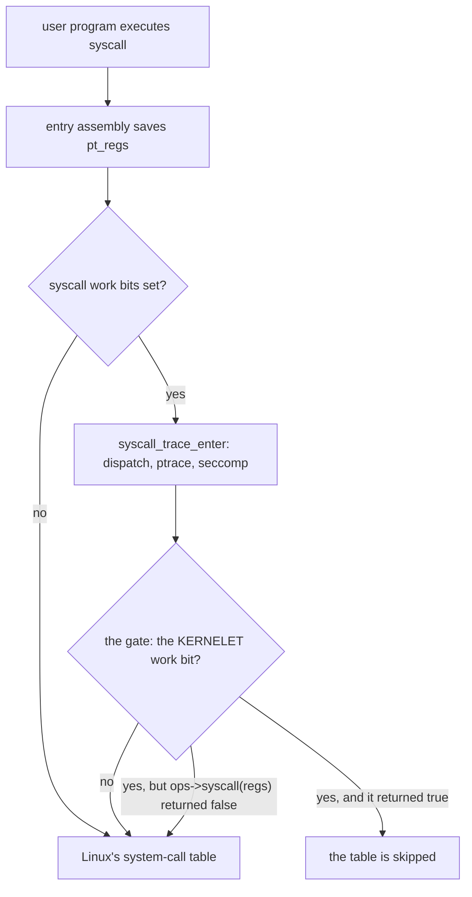
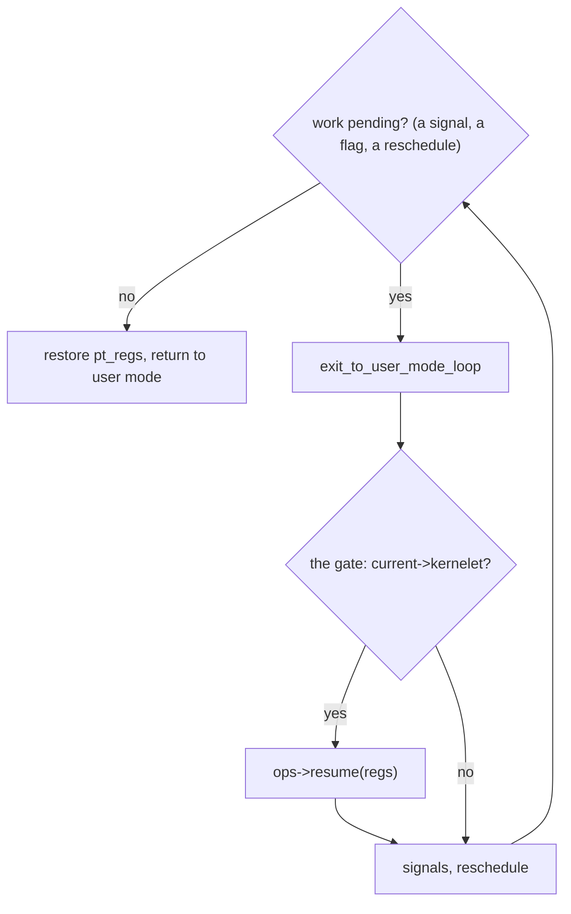

# The gate

A kernelet's user program runs in user mode on a real processor. When it executes `syscall`, the processor jumps into whatever the hardware's system-call entry register points at, and on a Linux machine that is Linux's entry code. Linux would then look the call number up in its own table and run `write`. Nothing in the hundred-line kernel would ever hear of it.

So the first thing the design needs from Linux is a way to **hand a system call to a kernelet before Linux handles it**. Linux has no such interface, and this chapter adds one. It is the only change the design makes to Linux's own code, and it is small: a pointer in the task structure, one bit, two calls in the entry path, two helper functions and two exports. The patch is `prototype/patches/0001-kernelet-gate.patch`, applied to Linux 6.12.

## The entry path

<div class="linux">

**Linux: tasks and the entry path.** Linux's unit of execution is the **task** ([`struct task_struct`](https://elixir.bootlin.com/linux/v6.12/source/include/linux/sched.h#L778)); a thread is a task, a single-threaded process is a task. When a task enters the kernel from user mode, the entry code saves the user registers at the top of the task's kernel stack in a structure called [`pt_regs`](https://elixir.bootlin.com/linux/v6.12/source/arch/x86/include/asm/ptrace.h#L103), and restores them from there on the way back. To change what a task does when it returns to user mode, change its `pt_regs`.

On x86-64 every system-call instruction, after a few lines of assembly and one architecture-specific C function, reaches architecture-independent C in [`kernel/entry/common.c`](https://elixir.bootlin.com/linux/v6.12/source/kernel/entry/common.c), the **generic entry layer**. On the way in, if the task has any bit set in a per-task mask called its *syscall work*, the layer calls [`syscall_trace_enter()`](https://elixir.bootlin.com/linux/v6.12/source/kernel/entry/common.c#L28), which runs Linux's interception mechanisms in order: *Syscall User Dispatch*, `ptrace`, and `seccomp`, the filter by which a process restricts which system calls it and its descendants may make. Any of them may declare the call answered, in which case Linux skips its own handler. On the way out, if the task has pending work such as a signal, the layer runs [`exit_to_user_mode_loop()`](https://elixir.bootlin.com/linux/v6.12/source/kernel/entry/common.c#L90) until none is left, then restores `pt_regs`.

</div>

The three interceptors are all controlled from user space, and none lets kernel code *answer* a call. The gate is a fourth stage that does.

**On the way in:**



**On the way out:**



## The patch, hunk by hunk

**A hook structure and a pointer per task.** A new header defines two function pointers, and `struct task_struct` gains a pointer to a structure holding them. A task whose pointer is null is unaffected by anything else in the patch.

*From `prototype/patches/0001-kernelet-gate.patch`: `kernelet_gate_ops`, `kernelet_gate`.*

```c
/* include/linux/kernelet.h (new) */
struct kernelet_gate_ops {
	/* A system call was issued by an attached task's user mode. Returns true
	 * if the kernelet serviced it; Linux's own dispatch is then skipped. */
	bool (*syscall)(struct pt_regs *regs);
	/* Called on the way out to user mode while any exit work is pending. */
	void (*resume)(struct pt_regs *regs);
};

struct kernelet_gate {
	const struct kernelet_gate_ops *ops;
};

/* include/linux/sched.h, inside struct task_struct */
	struct kernelet_gate		*kernelet;	/* NULL for every ordinary task */
```

**One bit of syscall work.** Linux calls `syscall_trace_enter()` only for tasks with a bit set in their syscall-work mask, so the patch adds a bit, `SYSCALL_WORK_KERNELET`, and includes it in the set that triggers the call on entry. A task that is not a kernelet's pays nothing: the fast path does not even test the pointer.

**The syscall hook.** Inside `syscall_trace_enter()`, directly after seccomp:

```c
/* kernel/entry/common.c, syscall_trace_enter() */
	if (work & SYSCALL_WORK_KERNELET) {
		if (current->kernelet->ops->syscall(regs))
			return -1L;
	}
```

Returning `-1` from this function is Linux's existing convention for "an earlier stage has answered this call; do not dispatch it", and [`do_syscall_64()`](https://elixir.bootlin.com/linux/v6.12/source/arch/x86/entry/common.c#L76) then skips the table. The hook is placed *after* seccomp, which means the filter a sandbox was started with runs on every one of the tenant's system calls *before* the kernelet sees them. That is a tool for the kernelet runtime, the host program that creates sandboxes (chapter 5), with a sharp edge: a filter that allows a call lets the kernelet serve it; one that returns an error answers the call in Linux, and the kernelet never hears of it; one that kills ends a carrier, and with it, as chapter 11 shows, the whole sandbox. A filter for a sandbox therefore bounds what the tenant may ask of its *kernelet*, and must be written for that, not copied from a host process. The prototype's runtime installs none.

**The resume hook.** At the top of `exit_to_user_mode_loop()`, after interrupts are enabled and before Linux delivers signals:

```c
/* kernel/entry/common.c, exit_to_user_mode_loop() */
		if (unlikely(current->kernelet)) {
			if (ti_work & _TIF_NOTIFY_RESUME) {          /* Linux's own notify-resume work first, since it clears the flag: */
				resume_user_mode_work(regs);             /* a flag set while the hook runs then survives to the loop's */
				ti_work &= ~_TIF_NOTIFY_RESUME;          /* next look at the flags, and the hook runs again */
			}
			current->kernelet->ops->resume(regs);
		}
```

This runs whenever a task with pending work is about to return to user mode. Linux's own notify-resume work goes first because its first act is to clear the flag that requested it; run after the hook, it would clear a request the endovisor made from another processor while the hook was looking elsewhere, and the carrier would enter user mode with that request pending (chapter 9). It is what lets the kernelet run code at moments that are *not* a system call: when the task was just created, when an exception has been turned into a signal, when a timer wants the kernelet's attention. Placing it before signal delivery is what lets the kernelet take a tenant's exceptions away from Linux, as chapter 7 shows.

**The gate is inherited.** Nothing in the patch copies the pointer into child tasks, and nothing needs to: Linux creates a task by copying the parent's whole `task_struct` ([`dup_task_struct()`](https://elixir.bootlin.com/linux/v6.12/source/kernel/fork.c#L1101)), the new field included, and the syscall-work bits are inherited the same way. A child of a kernelet's task is therefore attached to the gate before it executes its first instruction, and there is no moment at which it could make a system call that Linux would answer. This is the difference between a field Linux does not know about, which it copies, and a setting Linux knows about, such as Syscall User Dispatch, which it deliberately resets at `fork` and `exec`.

**Two helper functions.** `kernel/fork.c` gains two functions that the endovisor cannot write itself because everything they touch is private to the core kernel: `kernelet_mm_alloc()`, which creates an empty address space with a chosen owner, and `kernelet_switch_mm()`, which makes the calling task run in a different address space. Both belong to chapter 12, where tenant memory is built; they are mentioned here only so that the patch's contents are complete.

**Two exports.** `kernel_clone` (chapter 5 creates tasks with it) and `flush_tlb_mm_range` (chapter 12 flushes with it): the two functions the endovisor needs that Linux does not already export to modules.

**A configuration option.** `CONFIG_KERNELET` guards all of it. The prototype's kernel configuration turns it on; a kernel built without it behaves exactly as a stock kernel, since every line the patch adds to a function is inside `#ifdef CONFIG_KERNELET`; only the include lines, the bit's name and a macro that expands to zero remain.

## What the patch does not do

It adds no new system call, no boot parameter, and no change to Linux's scheduler or memory manager. For a task whose `kernelet` pointer is null, which is every task on a machine without a loaded endovisor, the two hooks are never reached. Its whole effect is to let *some* kernel code, named by a pointer in the task, see a task's system calls before Linux does and run once more before the task returns to user mode. Who installs that pointer, and on which tasks, is the next chapter.

<div class="recap">

**Recap.** The gate is two hooks in Linux's generic entry layer, selected by a pointer in `task_struct` and a syscall-work bit: `syscall` runs after seccomp and can answer the call so that Linux's table is skipped; `resume` runs on the way back to user mode, before signals are delivered. A child inherits the attachment because Linux copies the task structure. The rest of the patch is two helpers and two exports for later chapters.

</div>
