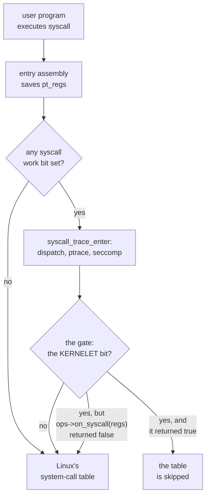
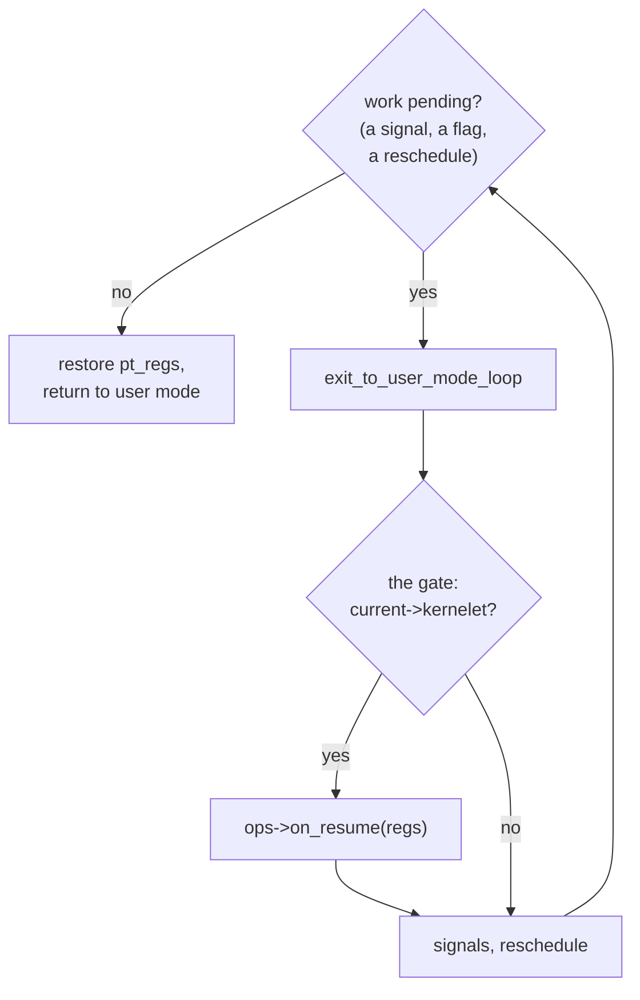

# The gate

A kernelet's user program runs in user mode on a real processor. When it executes `syscall`, the processor jumps into whatever the hardware's system-call entry register points at, and on a Linux machine that is Linux's entry code. Linux would then look the call number up in its own table and run `write`. Nothing in the hundred-line kernel would ever hear of it.

So the design needs a way to **hand a system call to a kernelet before Linux handles it**. It also needs, for reasons this chapter builds up to, a way to **run kernelet code just before one of its tasks enters user mode**, whatever brought the task into the kernel. Linux has no such interface. This chapter adds one that does both, the **gate**: two hooks in Linux's entry path.

The gate is the only change the design makes to Linux's own code, and it is small: a pointer in the task structure, one bit, two calls in the entry path, two helper functions and two exports. The patch is `prototype/linux/patches/0001-kernelet-gate.patch`, applied to Linux 6.12.

## Where Linux can be hooked

<div class="linux">

**Linux: tasks and the entry path.** Linux's unit of execution is the **task** ([`struct task_struct`](https://elixir.bootlin.com/linux/v6.12/source/include/linux/sched.h#L778)); a thread is a task, a single-threaded process is a task. When a task enters the kernel from user mode, the entry code saves the user registers at the top of the task's kernel stack in a structure called [`pt_regs`](https://elixir.bootlin.com/linux/v6.12/source/arch/x86/include/asm/ptrace.h#L103), and restores them from there on the way back. To change what a task does when it returns to user mode, change its `pt_regs`.

On x86-64 every system-call instruction, after a few lines of assembly and one architecture-specific C function, reaches architecture-independent C in [`kernel/entry/common.c`](https://elixir.bootlin.com/linux/v6.12/source/kernel/entry/common.c), the **generic entry layer**. On the way in, if the task has any bit set in a per-task mask called its *syscall work*, the layer calls [`syscall_trace_enter()`](https://elixir.bootlin.com/linux/v6.12/source/kernel/entry/common.c#L28), which runs Linux's interception mechanisms in order: *Syscall User Dispatch*, `ptrace`, and `seccomp`, the filter by which a process restricts which system calls it and its descendants may make. Any of them may declare the call answered, in which case Linux skips its own handler. On the way out, if the task has pending work such as a signal, the layer runs [`exit_to_user_mode_loop()`](https://elixir.bootlin.com/linux/v6.12/source/kernel/entry/common.c#L90) until none is left, then restores `pt_regs`.

</div>

Linux thus already has three stages at which something other than the handler sees a system call. All three are controlled from user space, and none lets kernel code *answer* a call. The gate is a fourth stage that does, and it has a second half on the way out.

## Two hooks, one for each direction

**On the way in.** The hook answers the question the chapter opened with: the tenant made a system call, so give it to the kernelet. It runs last among the interceptors, and if the kernelet answers the call, Linux's table is skipped.



**On the way out.** This hook is the one that is not obvious. A system call is the only reason a tenant *asks* for its kernel, but it is not the only reason the kernel must run before the tenant does. Three more appear in later chapters:

- *A carrier has just been created* (chapter 5). It is a fresh Linux task heading for user mode, and nothing of the kernelet has run on it yet. The kernelet must boot, build the tenant's address space and choose the registers the task will enter user mode with, all before that first entry, and there has been no system call to hook.
- *The tenant has faulted* (chapters 7 and 12). It executed an instruction it may not, or touched a page that is not mapped. Linux handles the exception and, as for every process, turns it into a signal to deliver on the way back to user mode. The kernelet must take that exception for itself before Linux delivers the signal.
- *Someone else wants the kernelet* (chapter 9). A timer fired, or another virtual CPU has a task for this one, while the carrier is in user mode. It must be brought into the kernel and then into kernelet code before it continues.

In every case the task is inside the kernel, on its way back to user mode, and someone has set a flag saying there is work to do before it gets there. Linux already has exactly that moment: the exit loop, which runs whenever a task with pending work is about to return to user mode. The way-out hook is placed at its top. The job it gives the kernelet is the same every time: *the tenant is about to run; find out why you were called, and run kernelet code first if there is any to run.*



## The patch, hunk by hunk

**A hook structure and a pointer per task.** A new header defines the two hooks as function pointers, and `struct task_struct` gains a pointer to a structure holding them. A task whose pointer is null is unaffected by anything else in the patch.

*Simplified from `prototype/linux/patches/0001-kernelet-gate.patch`: `kernelet_gate_ops`, `kernelet_gate`.*

```c
/* include/linux/kernelet.h (new) */
struct kernelet_gate_ops {
	/* A system call was issued by a tenant's user mode. Returns true
	 * if the kernelet serviced it; Linux's own dispatch is then skipped. */
	bool (*on_syscall)(struct pt_regs *regs);
	/* Called just before Linux resumes a tenant's user mode.
	 * The kernelet can take this opportunity to do useful work. */
	void (*on_resume)(struct pt_regs *regs);
};

struct kernelet_gate {
	const struct kernelet_gate_ops *ops;
};

/* include/linux/sched.h, inside struct task_struct */
	struct kernelet_gate		*kernelet;	/* NULL for every ordinary task */
```

**One bit of syscall work.** Linux calls `syscall_trace_enter()` only for tasks with a bit set in their syscall-work mask. The patch adds a bit, `SYSCALL_WORK_KERNELET`, and includes it in the set that triggers the call on entry. A task that is not a kernelet's pays nothing: the fast path does not even test the pointer.

**The syscall hook.** Inside `syscall_trace_enter()`, directly after seccomp:

*Simplified from `prototype/linux/patches/0001-kernelet-gate.patch`: `SYSCALL_WORK_KERNELET`.*

```c
/* kernel/entry/common.c, syscall_trace_enter() */
	if (work & SYSCALL_WORK_KERNELET) {
		if (current->kernelet->ops->on_syscall(regs))
			return -1L;
	}
```

Returning `-1` from this function is Linux's existing convention for "an earlier stage has answered this call; do not dispatch it", and [`do_syscall_64()`](https://elixir.bootlin.com/linux/v6.12/source/arch/x86/entry/common.c#L76) then skips the table.

**Seccomp comes first.** Because the hook is placed *after* seccomp, the filter a sandbox was started with runs on every one of the tenant's system calls *before* the kernelet sees them. That is a tool for the kernelet runtime, the host program that creates sandboxes (chapter 5), with a sharp edge. A filter that allows a call lets the kernelet serve it. One that returns an error answers the call in Linux, and the kernelet never hears of it. One that kills ends a carrier, and with it, as chapter 11 shows, the whole sandbox. A filter for a sandbox therefore bounds what the tenant may ask of its *kernelet*, and must be written for that, not copied from a host process. The prototype's runtime installs one only in a boot of `make probe`, which checks that a killing filter ends the sandbox.

**The resume hook.** The patch's second call is on the way out. A task reaches `exit_to_user_mode_loop()` only when it has exit work pending, and the hook sits at the top of that loop, after interrupts are enabled and before Linux delivers signals. The loop, and the flag that most often sends a task into it, are Linux's own:

<div class="linux">

**Linux: the exit work flags and `TIF_NOTIFY_RESUME`.** A task carries a word of *thread flags*, and a few of them mean "do something before this task next returns to user mode": `TIF_SIGPENDING` (a signal to deliver), `TIF_NEED_RESCHED` (the scheduler wants the processor back), and [`TIF_NOTIFY_RESUME`](https://elixir.bootlin.com/linux/v6.12/source/arch/x86/include/asm/thread_info.h#L87), the general-purpose one, which stands for any other deferred work. The entry layer tests the whole set at once ([`EXIT_TO_USER_MODE_WORK`](https://elixir.bootlin.com/linux/v6.12/source/include/linux/entry-common.h#L65)) and enters `exit_to_user_mode_loop()` only if one of them is set. `TIF_NOTIFY_RESUME` is set by [`set_notify_resume()`](https://elixir.bootlin.com/linux/v6.12/source/include/linux/resume_user_mode.h#L21), and by [`task_work_add()`](https://elixir.bootlin.com/linux/v6.12/source/kernel/task_work.c#L54), which queues a function for a task to run on its own way out to user mode. The flag's work is [`resume_user_mode_work()`](https://elixir.bootlin.com/linux/v6.12/source/include/linux/resume_user_mode.h#L41): it clears the flag, runs the queued task work, reclaims memory for a control group over its high limit, throttles block I/O if the task owes some, and tells a restartable sequence that it was interrupted. That it clears the flag *first* is what the excerpt below depends on.

The commonest piece of task work is closing a file. When the last reference to an open file is dropped, [`fput()`](https://elixir.bootlin.com/linux/v6.12/source/fs/file_table.c#L480) does not release the file there and then but queues the release on the current task, so that it runs just before the task returns to user mode. It defers because the release can sleep (a file system's `release` may write data back and take locks) while `fput()` may be called from almost anywhere, under a spin lock or from an interrupt; on the way out to user mode the task holds no lock and may sleep. Chapter 11 leans on that, because a carrier's death notice is such a file.

</div>

The hook, with Linux's own work for that flag placed before it:

*Simplified from `prototype/linux/patches/0001-kernelet-gate.patch`: `resume_user_mode_work`.*

```c
/* kernel/entry/common.c, exit_to_user_mode_loop() */
		if (unlikely(current->kernelet)) {
			if (ti_work & _TIF_NOTIFY_RESUME) {          /* Linux's own notify-resume work first, since it clears the flag: */
				resume_user_mode_work(regs);             /* a flag set while the hook runs then survives to the loop's */
				ti_work &= ~_TIF_NOTIFY_RESUME;          /* next look at the flags, and the hook runs again */
			}
			current->kernelet->ops->on_resume(regs);
		}
```

Linux's own notify-resume work goes first because its first act is to clear the flag that requested it. Run after the hook, it would clear a request the endovisor made from another processor while the hook was looking elsewhere, and the carrier would enter user mode with that request pending (chapter 9). Placing the hook before signal delivery is what lets the kernelet take a tenant's exceptions away from Linux, as chapter 7 shows.

**The gate is inherited.** Nothing in the patch copies the pointer into child tasks, and nothing needs to: Linux creates a task by copying the parent's whole `task_struct` ([`dup_task_struct()`](https://elixir.bootlin.com/linux/v6.12/source/kernel/fork.c#L1101)), the new field included, and the syscall-work bits are inherited the same way. A child of a kernelet's task is therefore attached to the gate before it executes its first instruction, and there is no moment at which it could make a system call that Linux would answer. This is the difference between a field Linux does not know about, which it copies, and a setting Linux knows about, such as Syscall User Dispatch, which it deliberately resets at `fork` and `exec`.

**Two helper functions.** `kernel/fork.c` gains two functions that the endovisor cannot write itself because everything they touch is private to the core kernel: `kernelet_mm_alloc()`, which creates an empty address space with a chosen owner, and `kernelet_switch_mm()`, which makes the calling task run in a different address space. Both belong to chapter 12, where tenant memory is built; they are mentioned here only so that the patch's contents are complete.

**Two exports.** `kernel_clone` (chapter 5 creates tasks with it) and `flush_tlb_mm_range` (chapter 12 flushes with it): the two functions the endovisor needs that Linux does not already export to modules.

**A configuration option.** `CONFIG_KERNELET` guards all of it. The prototype's kernel configuration turns it on. A kernel built without it behaves exactly as a stock kernel, since every line the patch adds to a function is inside `#ifdef CONFIG_KERNELET`; what remains outside are the include lines, a forward declaration, the new header's two prototypes, the bit's name and a macro that expands to zero.

**A precondition.** The kernel must be built without the legacy *vsyscall* page (`CONFIG_X86_VSYSCALL_EMULATION` unset). A program that jumps to that page's fixed address gets three system calls answered by Linux's own page-fault handler, without ever reaching the entry path, so the gate would never see them. The module refuses to load on a kernel built with it.

## What the patch does not do

It adds no new system call, no boot parameter, and no change to Linux's scheduler or memory manager. For a task whose `kernelet` pointer is null, which is every task on a machine without a loaded endovisor, the two hooks are never reached. Its whole effect is to let *some* kernel code, named by a pointer in the task, see a task's system calls before Linux does and run once more before the task returns to user mode. Who installs that pointer, and on which tasks, is the next chapter.

<div class="recap">

**Recap.** The gate is two hooks in Linux's generic entry layer, selected by a pointer in `task_struct` and a syscall-work bit: `on_syscall` runs after seccomp and can answer the call so that Linux's table is skipped; `on_resume` runs on the way back to user mode, before signals are delivered, and gives the kernelet the last word before the tenant runs, for everything that is not a system call: a carrier's first entry, a tenant's fault, a timer or another virtual CPU wanting it. A child inherits the attachment because Linux copies the task structure. The rest of the patch is two helpers and two exports for later chapters.

</div>
