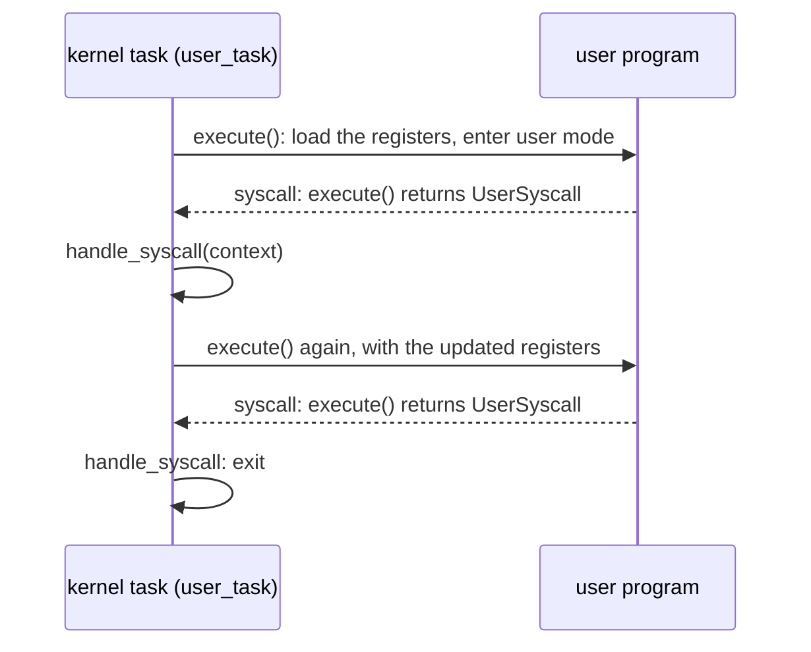

# The kernel we will run

This chapter reads the kernel the book is built around: Asterinas's teaching example, a kernel in about a hundred lines of safe Rust.

The kernel is never edited. It is in the companion repository as `prototype/kernels/hello/src/lib.rs`. Before every build of the image, the build compares it byte for byte with a copy of the original, taken from the Asterinas tree at commit `ab9a4cfdc`. That it needs no edit to run inside Linux is the claim the rest of the book makes good.

First comes the user program the kernel runs, then the kernel itself in four pieces. After each piece, the chapter says what it asks of the machine, because that list is what the host has to provide.

## The program it runs

The kernel runs one user program, a few lines of assembly, given here in full apart from its license line:

*Unchanged: `prototype/kernels/hello/hello.S`.*

```asm
.global _start                      # entry point
.section .text                      # code section
_start:
    mov     $1, %rax                # syscall number of write
    mov     $1, %rdi                # stdout
    mov     $message, %rsi          # address of message
    mov     $message_end, %rdx
    sub     %rsi, %rdx              # calculate message len
    syscall
    mov     $60, %rax               # syscall number of exit, move it to rax
    mov     $0, %rdi                # exit code, move it to rdi
    syscall

.section .rodata                    # read only data section
message:
    .ascii  "Hello, world\n"
message_end:
```

It makes two system calls with the `syscall` instruction, using Linux's numbers: `write` is 1 and `exit` is 60.

The kernel places the program in memory rather than loading it. The program is linked as a static executable at address `0x400000`, with its first instruction at `0x401000`, where statically linked Linux programs conventionally start, and the kernel hard-codes both addresses. `include_bytes!("../hello")` embeds the assembled executable, headers and all, and the kernel copies the file's bytes verbatim to `0x400000`. That works because the linker placed each segment at its file offset from that address, so the code lands at `0x401000` and the message at `0x402000`.

## Piece 1: main

*Unchanged: `prototype/kernels/hello/src/lib.rs`.*

```rust
#[ostd::main]
pub fn main() {
    let program_binary = include_bytes!("../hello");
    let vm_space = Arc::new(create_vm_space(program_binary));
    vm_space.activate();
    let user_task = create_user_task(vm_space);
    user_task.run();
}
```

`main` builds an address space holding the program, makes it current on this processor with `activate`, creates a task to run the program, and puts the task on the scheduler's queue with `run()`. `#[ostd::main]` marks the function the framework calls once it has booted. `main` runs before any task exists; the task first runs when `main` returns, on the same processor, so the space is still active when `execute` and `reader` need it.

**What it asks of the machine:** a notion of *current address space*, and a way to start a task.

## Piece 2: building the address space

*Simplified from `prototype/kernels/hello/src/lib.rs`: `create_vm_space`.*

```rust
fn create_vm_space(program: &[u8]) -> VmSpace {
    let nbytes = program.len().align_up(PAGE_SIZE);
    let user_pages = {
        let segment = FrameAllocOptions::new()
            .alloc_segment(nbytes / PAGE_SIZE)
            .unwrap();
        segment.write_bytes(0, program).unwrap();
        segment
    };

    let vm_space = VmSpace::new();
    const MAP_ADDR: Vaddr = 0x0040_0000;
    let preempt_guard = disable_preempt();
    let mut cursor = vm_space
        .cursor_mut(&preempt_guard, &(MAP_ADDR..MAP_ADDR + nbytes))
        .unwrap();
    let map_prop = PageProperty::new_user(PageFlags::RWX, CachePolicy::Writeback);
    for frame in user_pages {
        cursor.map(frame.into(), map_prop);
    }
    drop(cursor);
    vm_space
}
```

Three framework ideas appear here.

**Frames.** The kernel holds physical memory only through handles; a physical address gives it no way to touch the frames. `FrameAllocOptions::new().alloc_segment(n)` allocates `n` physically contiguous pages of RAM and returns a `Segment`, a handle to them, and `write_bytes` copies the program into them. Iterating a `Segment` yields its frames one by one, and `.into()` turns each into the untyped frame that `map` accepts.

**The address space.** An address space, `VmSpace`, is edited only through a **cursor** over a range of virtual addresses. `VmSpace::new()` creates an empty one; on a machine that is a fresh page table. `cursor_mut` opens a cursor, and each `map` call puts one frame at the cursor's address, with the given permissions, and advances the cursor one page. `PageProperty::new_user` with `PageFlags::RWX` makes the pages readable, writable and executable from user mode, and `CachePolicy::Writeback` is ordinary cached memory.

The cursor holds the range locked while it exists, so two parts of a kernel cannot map the same page at once; dropping it releases the range.

**The preemption guard.** `disable_preempt()` returns a guard; while it lives, the framework's scheduler will not switch this processor to another task. The cursor requires a guard that proves the caller cannot be switched away, and a preemption guard is one: under it the page-table pages the cursor walks cannot be freed, and the cursor can hold the page-table locks without being switched out.

**What it asks of the machine:** physical frames to allocate; a page table per address space, which the kernel edits one page at a time through a cursor; and a way to switch off task preemption.

## Piece 3: the task and the loop

*Simplified from `prototype/kernels/hello/src/lib.rs`: `create_user_task`, `create_user_context`.*

```rust
fn create_user_task(vm_space: Arc<VmSpace>) -> Arc<Task> {
    fn user_task() {
        let current = Task::current().unwrap();
        let mut user_mode = {
            let user_ctx = create_user_context();
            UserMode::new(user_ctx)
        };

        loop {
            let return_reason = user_mode.execute(&DummyUserHooks);
            let user_context = user_mode.context_mut();
            if ReturnReason::UserSyscall == return_reason {
                let vm_space = current.data().downcast_ref::<Arc<VmSpace>>().unwrap();
                handle_syscall(user_context, &vm_space);
            }
        }
    }

    Arc::new(TaskOptions::new(user_task).data(vm_space).build().unwrap())
}

fn create_user_context() -> UserContext {
    let mut user_ctx = UserContext::default();
    const ENTRY_POINT: Vaddr = 0x0040_1000;
    user_ctx.set_rip(ENTRY_POINT);
    user_ctx
}
```

A **task** is the framework's unit of execution, like a thread: a function, a stack, and saved registers. `TaskOptions::new(user_task)` describes one that will run the function `user_task`; `.data(vm_space)` attaches the address space to it so the function can find it later; `build()` creates it, and `main`, in piece 1, queues it with `run()`. Inside the function, `Task::current()` is the running task, and `data()` returns what was attached, recovered as the `Arc<VmSpace>` by `downcast_ref`.

A `UserContext` is a user program's register file. Its register part is the sixteen general registers, the instruction pointer and the flags, eighteen words; it also records which trap ended the last run. The task sets the instruction pointer and leaves the rest zero. `execute` itself turns on the interrupt flag, and the stack pointer stays zero, which is harmless because the program never uses a stack.

The loop calls `user_mode.execute(...)`, which **enters user mode** and returns each time the processor comes back into the kernel with something for the kernel to handle: a system call, or a fault or trap. Interrupts it handles itself and goes straight back to user mode. `DummyUserHooks` is the empty set of hooks, which asks to be told of no other event, so nothing else returns; these hooks are not the Linux hooks of later chapters. The return value says what happened. The context now holds the program's registers as they were at that moment. The kernel reads and changes them through `context_mut()` before calling `execute` again.

So a user program, to this kernel, is a function call that returns now and then. The kernel's handler for the program lives *inside* a loop, on a kernel stack, and its local variables survive every trip the program makes to user mode and back. Keep that picture: Linux does not share it. In Linux a task's kernel stack is empty whenever the task is in user mode, because a system call builds frames on it and returning to user mode discards them, and reconciling the two is the work of two later chapters.



**What it asks of the machine:** tasks with their own stacks; a way to enter user mode that returns on a system call or an exception, with the program's registers in hand.

## Piece 4: the system calls

*Simplified from `prototype/kernels/hello/src/lib.rs`: `handle_syscall`.*

```rust
fn handle_syscall(user_context: &mut UserContext, vm_space: &VmSpace) {
    const SYS_WRITE: usize = 1;
    const SYS_EXIT: usize = 60;

    match user_context.rax() {
        SYS_WRITE => {
            let (_, buf_addr, buf_len) =
                (user_context.rdi(), user_context.rsi(), user_context.rdx());
            let buf = {
                let mut buf = vec![0u8; buf_len];
                let mut reader = vm_space.reader(buf_addr, buf_len).unwrap();
                reader
                    .read_fallible(&mut VmWriter::from(&mut buf as &mut [u8]))
                    .unwrap();
                buf
            };
            println!("{}", str::from_utf8(&buf).unwrap());
            user_context.set_rax(buf_len);
        }
        SYS_EXIT => poweroff(ExitCode::Success),
        _ => unimplemented!(),
    }
}
```

The handler dispatches on the system call number, which is in `rax` by Linux's convention; the arguments are in `rdi`, `rsi`, `rdx`. `write` prints the program's buffer and returns the byte count in `rax`. `exit` powers the machine off, which in a kernelet stops the sandbox, not the host.

The kernel never dereferences a user address. For `write` it must read `buf_len` bytes of the *program's* memory at `buf_addr`, so it asks the address space for a **reader** over that range and copies through it into a kernel buffer with `read_fallible`, which returns an error, rather than faulting the kernel, if the address is bad. This kernel unwraps that error, so a bad buffer ends in a panic, never in a stray access.

**What it asks of the machine:** a safe way to copy from a user address, which may be bad; a console; and power-off.

## The list

Here is everything the hundred-line kernel needs, with what OSTD does on a machine and what the host will have to do instead. Each row names the chapters that build it.

| the kernel uses | on a machine, OSTD | inside Linux, vOSTD must |
|---|---|---|
| `#[ostd::main]` | boots, then calls `main` and yields to the first task | call the same generated entry from the endovisor's entry (chapter 4) |
| `Arc`, `vec!` (the heap) | a heap in the machine's RAM | ask Linux for memory (chapter 4) |
| `FrameAllocOptions`, `Segment` | allocates from the machine's RAM | allocate from a grant of memory Linux hands it (chapter 4) |
| `VmSpace::new`, `cursor_mut`, `map` | writes a hardware page table the processor walks | ask Linux to put the page in a Linux page table (chapter 13) |
| `VmSpace::activate` | loads the page-table register | remember which address space this virtual CPU is in, and switch the carrier to its Linux address space (chapter 13) |
| `TaskOptions`, `Task::run`, `Task::current`, `disable_preempt` | its own tasks, stacks and scheduler | OSTD's code, ported with small changes, on kernelet stacks the endovisor allocates (chapters 7 and 9) |
| `UserMode::execute` | the processor's instruction for entering user mode, and its trap handlers | a carrier, a Linux task that enters user mode on the kernelet's behalf, with a patch to Linux that routes the system call back (chapters 5 to 8) |
| `VmSpace::reader`, `read_fallible` | reads the user address, with a fault handler as the safety net | walk the page table itself and copy through Linux's direct map (chapter 14) |
| `println!`, `poweroff` | the serial port; QEMU's exit port, or a halt | two calls into the host (chapter 4) |

<div class="recap">

**Recap.** The hundred-line kernel allocates frames, builds an address space with a cursor, creates a task, and in that task loops over `execute`, which enters user mode and returns on each system call. It copies the program's buffer through a fallible reader rather than touching the address. The table above is the contract that vOSTD and the endovisor must fulfill. The rest of the book fulfills it one row at a time.

</div>
