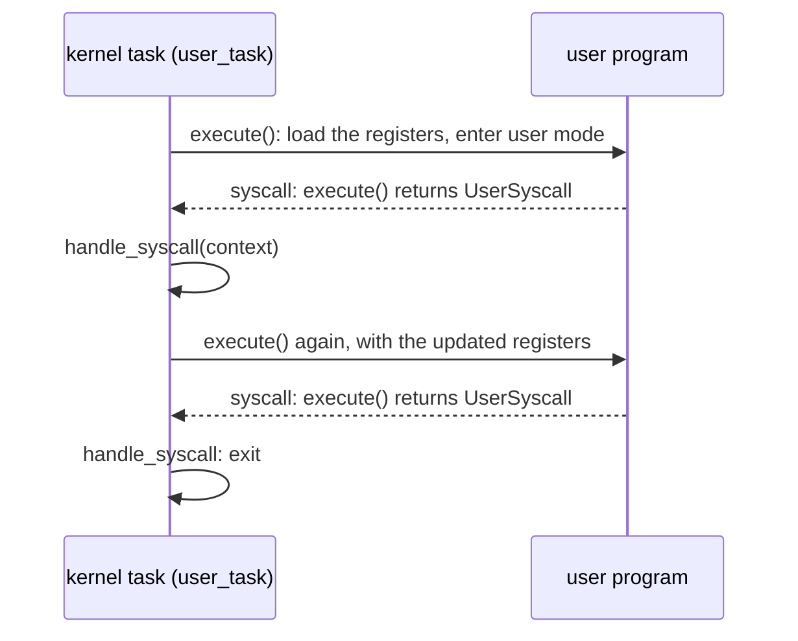

# The kernel we will run

Before building the machinery, it helps to know exactly what has to run on it. This chapter reads the kernel that the whole book is about: Asterinas's teaching example, a kernel in about a hundred lines of safe Rust. It is in the companion repository as `prototype/hello/src/lib.rs`, and the build compares it byte for byte with the original from the Asterinas tree before every run. It is never edited. That it needs no edit to run inside Linux is the claim the rest of the book makes good.

Read the kernel in four pieces. After each, the chapter says what the piece asks of the machine, because that list is what the host has to provide.

## The program it runs

The kernel runs one user program, eighteen lines of assembly:

*Unchanged: `prototype/hello/hello.S`.*

```asm
_start:
    mov     $1, %rax                # system call number of write
    mov     $1, %rdi                # file descriptor 1
    mov     $message, %rsi          # address of the message
    mov     $message_end, %rdx
    sub     %rsi, %rdx              # its length
    syscall
    mov     $60, %rax               # system call number of exit
    mov     $0, %rdi                # exit code
    syscall

message:
    .ascii  "Hello, world\n"
message_end:
```

It makes two system calls with the `syscall` instruction, using Linux's numbers: `write` is 1 and `exit` is 60. It is linked as a static executable at address `0x400000`, with its first instruction at `0x401000`, which is where statically linked Linux programs conventionally start. Those two addresses are hard-coded in the kernel.

## Piece 1: main

<div class="rust">

**Rust: three things in this excerpt.** `Arc<T>` is a reference-counted pointer to a `T` that several owners may share; it is freed when the last owner drops it. `let x = f();` declares a variable, and types are inferred, so they are rarely written. `#[ostd::main]` is an *attribute*, a marker the framework reads: it names the function that runs once the framework has set itself up, like `main` in C.

</div>

*Unchanged: `prototype/hello/src/lib.rs`.*

```rust
#[ostd::main]
pub fn main() {
    let program_binary = include_bytes!("../hello");
    let vm_space = Arc::new(create_vm_space(program_binary));
    vm_space.activate();
    let user_task = create_user_task(vm_space);
    user_task.run();
}
```

The program's bytes are compiled into the kernel with `include_bytes!`. `main` builds an address space holding the program, makes it the current one with `activate`, creates a task that will run the program, and starts the task. Then `main` returns, and the framework switches to the task.

**What it asks of the machine:** a notion of *current address space*, and a way to start a task.

## Piece 2: building the address space

```rust
fn create_vm_space(program: &[u8]) -> VmSpace {
    let nbytes = program.len().align_up(PAGE_SIZE);
    let user_pages = {
        let segment = FrameAllocOptions::new()
            .alloc_segment(nbytes / PAGE_SIZE)
            .unwrap();
        segment.write_bytes(0, program).unwrap();
        segment
    };

    let vm_space = VmSpace::new();
    const MAP_ADDR: Vaddr = 0x0040_0000;
    let preempt_guard = disable_preempt();
    let mut cursor = vm_space
        .cursor_mut(&preempt_guard, &(MAP_ADDR..MAP_ADDR + nbytes))
        .unwrap();
    let map_prop = PageProperty::new_user(PageFlags::RWX, CachePolicy::Writeback);
    for frame in user_pages {
        cursor.map(frame.into(), map_prop);
    }
    drop(cursor);
    vm_space
}
```

<div class="rust">

**Rust: `Result` and `unwrap`.** A function that can fail returns a `Result`, which is either `Ok(value)` or `Err(error)`. Calling `.unwrap()` on it takes the value and panics (stops the kernel with a message) if it was an error. The teaching kernel unwraps everything; a real kernel would handle the errors. `drop(x)` ends the life of `x` now rather than at the end of the block.

</div>

Three framework types appear here.

**Frames.** `FrameAllocOptions::new().alloc_segment(n)` allocates `n` physically contiguous pages of RAM and returns a `Segment`, a handle to them. `write_bytes` copies the program into them. The kernel never sees a raw address of the frames; it holds handles, and the handles are the only way to touch the memory. On a machine, OSTD takes these frames from the physical memory the bootloader reported.

**The address space.** `VmSpace::new()` creates an empty address space for user programs. On a machine that is a fresh page table. To change it, the kernel opens a **cursor** over a range of virtual addresses, `cursor_mut`, and calls `map` once per page: *put this frame at the cursor's address, with these permissions*, after which the cursor moves one page on. `PageFlags::RWX` makes the pages readable, writable and executable. The cursor holds the range locked while it exists, so two parts of a kernel cannot map the same page at once; dropping it releases the range.

**The preemption guard.** `disable_preempt()` returns a guard; while it lives, the framework's scheduler will not switch this processor to another task. The cursor requires one, because the framework's page-table code is written on the assumption that it will not be interrupted by a task switch half way through an edit.

**What it asks of the machine:** physical frames to allocate; a page table per address space, which the kernel edits one page at a time through a cursor; and a way to switch off task preemption.

## Piece 3: the task and the loop

```rust
fn create_user_task(vm_space: Arc<VmSpace>) -> Arc<Task> {
    fn user_task() {
        let current = Task::current().unwrap();
        let mut user_mode = {
            let user_ctx = create_user_context();
            UserMode::new(user_ctx)
        };

        loop {
            let return_reason = user_mode.execute(&DummyUserHooks);
            let user_context = user_mode.context_mut();
            if ReturnReason::UserSyscall == return_reason {
                let vm_space = current.data().downcast_ref::<Arc<VmSpace>>().unwrap();
                handle_syscall(user_context, &vm_space);
            }
        }
    }

    Arc::new(TaskOptions::new(user_task).data(vm_space).build().unwrap())
}

fn create_user_context() -> UserContext {
    let mut user_ctx = UserContext::default();
    const ENTRY_POINT: Vaddr = 0x0040_1000;
    user_ctx.set_rip(ENTRY_POINT);
    user_ctx
}
```

This is the most important piece, so read it slowly.

A **task** is the framework's unit of execution, like a thread: a function, a stack, and saved registers. `TaskOptions::new(user_task)` describes one that will run the function `user_task`; `.data(vm_space)` attaches the address space to it so the function can find it later; `build()` creates it. `main`, in piece 1, then calls `run()` on it.

A `UserContext` is a user program's register file: sixteen general registers, the instruction pointer and the flags. The task fills in one register, the instruction pointer, and leaves the rest zero.

Then the loop. `user_mode.execute(...)` **enters user mode**: it loads the context into the processor's registers and starts the program. The call *returns* when something brings the processor back into the kernel: a system call, an exception, or an event the kernel asked to be told about. The return value says which. The context now holds the program's registers as they were at that moment, and the kernel reads and changes them through `context_mut()` before calling `execute` again.

So a user program, to this kernel, is a function call that returns now and then. The kernel's handler for the program lives *inside* a loop, on a kernel stack, and its local variables survive every trip the program makes to user mode and back. Keep that picture; it is the one Linux does not share, and reconciling the two is the work of chapters 6 and 7.



**What it asks of the machine:** tasks with their own stacks; a way to enter user mode that returns on a system call or an exception, with the program's registers in hand.

## Piece 4: the system calls

```rust
fn handle_syscall(user_context: &mut UserContext, vm_space: &VmSpace) {
    const SYS_WRITE: usize = 1;
    const SYS_EXIT: usize = 60;

    match user_context.rax() {
        SYS_WRITE => {
            let (_, buf_addr, buf_len) =
                (user_context.rdi(), user_context.rsi(), user_context.rdx());
            let buf = {
                let mut buf = vec![0u8; buf_len];
                let mut reader = vm_space.reader(buf_addr, buf_len).unwrap();
                reader
                    .read_fallible(&mut VmWriter::from(&mut buf as &mut [u8]))
                    .unwrap();
                buf
            };
            println!("{}", str::from_utf8(&buf).unwrap());
            user_context.set_rax(buf_len);
        }
        SYS_EXIT => poweroff(ExitCode::Success),
        _ => unimplemented!(),
    }
}
```

The system call number is in `rax`, as Linux's convention has it, and the arguments in `rdi`, `rsi`, `rdx`. For `write`, the kernel must read `buf_len` bytes of the *program's* memory at `buf_addr`. It does not dereference that address. It asks the address space for a **reader** over the range and copies through it into a kernel buffer with `read_fallible`, which fails, instead of crashing, if the program passed an address that is not mapped. Then it prints the buffer and puts the byte count in `rax` as the return value. For `exit`, it powers the machine off.

**What it asks of the machine:** a safe way to copy from a user address, which may be bad; a console; and power-off.

## The list

Here is everything the hundred-line kernel needs, with what OSTD does on a machine and what the host will have to do instead. Each row is a chapter or part of one.

| the kernel uses | on a machine, OSTD | inside Linux, vOSTD must |
|---|---|---|
| `FrameAllocOptions`, `Segment` | allocates from the machine's RAM | allocate from a grant of memory Linux hands it (chapter 3) |
| `VmSpace::new`, `cursor_mut`, `map` | writes a hardware page table the processor walks | ask Linux to put the page in a Linux page table (chapter 12) |
| `VmSpace::activate` | loads the page-table register | remember which address space the virtual CPU is in (chapter 12) |
| `TaskOptions`, `Task::run`, `disable_preempt` | its own tasks, stacks and scheduler | the same code, on stacks Linux lends it (chapters 6 and 8) |
| `UserMode::execute` | the processor's instruction for entering user mode, and its trap handlers | a Linux task that enters user mode on the kernelet's behalf, with a patch to Linux that routes the system call back (chapters 4 to 7) |
| `VmSpace::reader`, `read_fallible` | reads the user address, with a fault handler as the safety net | walk the page table itself and copy through the kernel's own map of memory (chapter 13) |
| `println!`, `poweroff` | the serial port; the power controller | two calls into the host (chapter 3) |

<div class="recap">

**Recap.** The hundred-line kernel allocates frames, builds an address space with a cursor, creates a task, and in that task loops over `execute`, which enters user mode and returns on each system call. It copies the program's buffer through a fallible reader rather than touching the address. The table above is the contract that vOSTD and the endovisor must fulfil, and the rest of the book fulfils it one row at a time.

</div>
