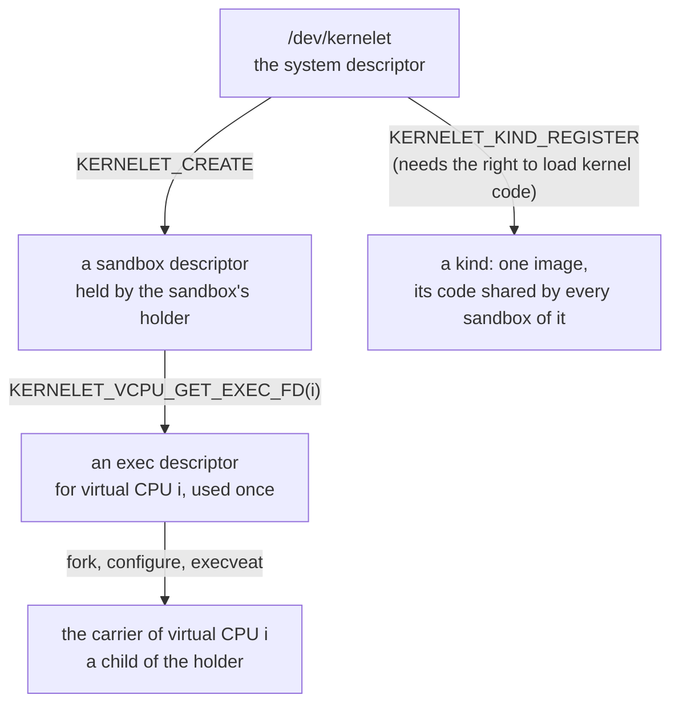
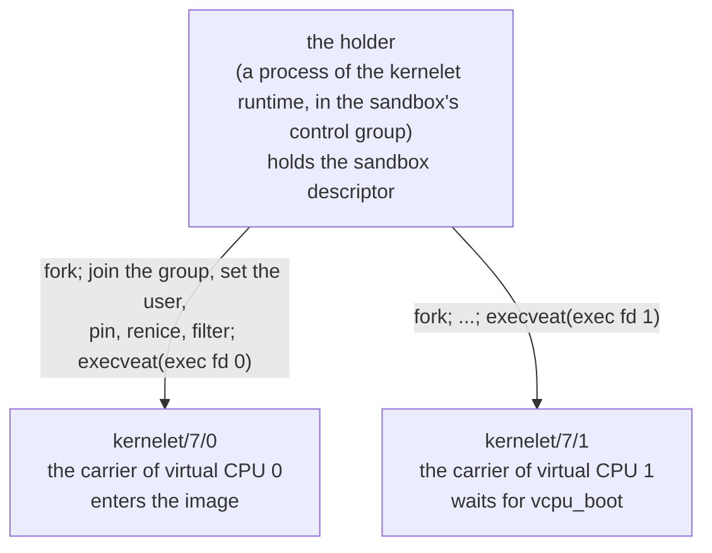

# The kernelet UAPI

Chapter 5 showed how this prototype starts a sandbox: the runtime forks a child, the child executes a sandbox file, and the root carrier that the handler makes of it clones one carrier per virtual CPU inside the kernel. It is the simplest thing that works, and it is the wrong interface. This chapter is about the right one: what a program on the host should be able to ask of a kernel that can run kernelets, and how the carriers come to exist when it asks.

Linux calls the set of system calls, device nodes and file formats that user space may use its **UAPI**, the user-space application programming interface, and keeps the headers that define it in a directory of that name. A kernelet's is small: one device node, three kinds of file descriptor, and one rule about who creates the tasks.

The prototype still starts a sandbox the way chapter 5 describes, so `make hello` runs that path. The interface here is what it moves to next, and the chapters that depend on the root carrier are revised with it.

## What was wrong with one `execve`

Three things, each a thing that user space could not do.

- **It could not see the carriers.** They were made by `kernel_clone` inside the resume hook, and user space learned nothing about them: not their process identifiers, not when they existed. An operator who wanted to know which process was a sandbox's virtual CPU had to walk the control group.
- **It could not configure a carrier.** Linux has a system call for everything one might want to set on a task: `sched_setaffinity` to pin it to processors, `setpriority` and `sched_setattr` for its priority and scheduling class, resource limits, namespaces, a seccomp filter. All of them act on a task user space names or is. A carrier that the kernel cloned took whatever the root carrier had, which was whatever the runtime set on *one* child before *one* `execve`, the same for every virtual CPU.
- **It could not hand the sandbox a file.** A real sandbox has a disk image and a network interface behind it, and the natural way to give a kernel such a thing on Linux is to open it in user space, under user space's own credentials and permission checks, and pass the descriptor. A sandbox file read by a handler has nowhere to put a descriptor.

A fourth thing was right and must stay right: loading a kernelet image is loading kernel code, and chapter 3 said the image is linked into the module for that reason. A full endovisor loads images at run time, so the interface must say who may, and it must let many sandboxes share one copy of an image's code.

## The shape: three descriptors

Linux has one interface of this shape already, and it is the one to copy. KVM, Linux's hypervisor, is a module that runs virtual machines whose virtual processors are ordinary user threads: a program such as QEMU opens `/dev/kvm`, asks it for a descriptor that stands for a virtual machine, asks that for a descriptor per virtual processor, and runs each virtual processor from a thread of its own by calling an operation on its descriptor ([`KVM_CREATE_VM`](https://elixir.bootlin.com/linux/v6.12/source/Documentation/virt/kvm/api.rst#L138), [`KVM_CREATE_VCPU`](https://elixir.bootlin.com/linux/v6.12/source/Documentation/virt/kvm/api.rst#L294), [`KVM_RUN`](https://elixir.bootlin.com/linux/v6.12/source/Documentation/virt/kvm/api.rst#L379)). The threads are QEMU's: it created them, it can pin them and renice them, and `ps` shows them.

**Linux: device nodes and `ioctl`.** A *device node* is a file under `/dev` that stands for a driver rather than for data; opening it gives a descriptor on which the driver answers `read`, `write` and, for everything that is neither, [`ioctl`](https://elixir.bootlin.com/linux/v6.12/source/fs/ioctl.c#L893): one system call that takes a descriptor, a command number and an argument, and hands both to whatever code is behind the descriptor. A driver's interface is therefore a list of command numbers, and a module may define its own. A descriptor need not come from a file system at all: chapter 5's lifeline was an *anonymous* file the endovisor made, and the descriptors below are made the same way, with operations of the endovisor's choosing.

A kernelet's interface has the same three levels, with one difference at the bottom.

| descriptor | obtained by | stands for | when the last copy closes |
|---|---|---|---|
| **system** | `open("/dev/kernelet")` | the kernel's ability to run kernelets | nothing happens |
| **sandbox** | `KERNELET_CREATE` on the system descriptor | one sandbox | the sandbox is killed and destroyed |
| **exec** | `KERNELET_VCPU_GET_EXEC_FD(i)` on the sandbox descriptor | one virtual CPU of one sandbox, not yet started | nothing happens; the sandbox descriptor can hand out another |

The difference is at the bottom. A KVM virtual processor is run by a thread that *calls* an operation and returns from it, keeping its own address space throughout. A carrier runs the tenant's program in Linux's own user mode, so it needs an address space of its own that holds nothing of the host's, and chapter 5 said the one operation that gives a process a fresh address space is `execve`. So the exec descriptor is not called; it is executed. It is chapter 5's sandbox file, one per virtual CPU instead of one per sandbox: a small file that lives only in memory, created by the endovisor with [`shmem_file_setup()`](https://elixir.bootlin.com/linux/v6.12/source/mm/shmem.c#L5265), that the endovisor's binary-format handler recognizes *by the file object*, not by anything written in it. Possession of the descriptor is the right to start that virtual CPU, once.

## The system descriptor

Opening `/dev/kernelet` gives the system descriptor. The node is owned by root; an operator who runs sandboxes as an unprivileged user gives that user access to it, as is done for `/dev/kvm`.

The operations' names follow one rule throughout. An operation whose target is the sandbox is `KERNELET_` and a verb: `KERNELET_KILL`. One whose target is some other object is `KERNELET_`, the object, and a verb: `KERNELET_KIND_REGISTER`.

| operation | what it does | who may |
|---|---|---|
| `KERNELET_GET_API_VERSION` | reports the interface's version, so that a runtime can refuse a kernel it does not understand | anyone with the node |
| `KERNELET_KIND_REGISTER` | takes the descriptor of an image file and a name; the endovisor repeats the checks chapter 3's build made, keeps one copy of the image's code, and returns a **kind** identifier | the right to load kernel code |
| `KERNELET_KIND_LIST` | lists the registered kinds: identifier, name, how many sandboxes run each | anyone with the node |
| `KERNELET_KIND_UNREGISTER` | drops a kind that no sandbox is using and returns its pages to Linux | the right to load kernel code |
| `KERNELET_CREATE` | creates a sandbox of a kind, with the number of virtual CPUs, the memory it may have, and the kernel's command line; returns the sandbox descriptor | anyone with the node, from a task in a control group other than the root group |

A **kind** is a registered image. It is registered once per boot and shared: every sandbox of a kind executes the same pages of code, placed at its own address, with data of its own after it, as chapter 3 described for one instance. That sharing is why registration and creation are two operations and not one: an `execve` of the image file itself, with the sandbox's parameters as arguments, would have nowhere to keep the one shared copy.

**Linux: capabilities and lockdown.** Root's powers are divided into named *capabilities*, and a privileged operation asks for the one it needs with [`capable()`](https://elixir.bootlin.com/linux/v6.12/source/kernel/capability.c#L434). Loading a module asks for `CAP_SYS_MODULE` ([`init_module`](https://elixir.bootlin.com/linux/v6.12/source/kernel/module/main.c#L2646)). A kernel can also be *locked down*, a mode in which nothing may add code to the running kernel unless it is signed, and every loader asks [`security_locked_down()`](https://elixir.bootlin.com/linux/v6.12/source/security/security.c#L5766) before it proceeds.

Registering is privileged because an image is kernel code. The checks the build makes, and the endovisor repeats, establish that an image *cannot name* anything in Linux, which is what chapter 3 called the whole security story of the build; they do not establish that its machine code is harmless, and no check made on a file could. What makes an image trustworthy is who built it, which is exactly Linux's position on modules. So `KERNELET_KIND_REGISTER` asks what `init_module` asks: the capability to load kernel code, and a kernel that is not locked down. An operator registers the kinds a machine will run when the machine is set up; the runtime, which runs as an ordinary user, only creates sandboxes of them.

Creating is not privileged, beyond access to the node, because a sandbox can reach nothing its creator could not. Its memory is charged to the creator's control group, and the files it is given are files its creator opened. The root control group is refused because a sandbox has to be bounded by something, and the group is what bounds it.

## The sandbox descriptor

| operation | what it does |
|---|---|
| `KERNELET_VCPU_GET_EXEC_FD` | returns the exec descriptor of virtual CPU *i*; each virtual CPU has one, and each may be executed once |
| `KERNELET_ATTACH_DEVICE` | gives the sandbox a virtual device, passing the descriptor of the file or interface behind it; allowed until the sandbox starts |
| `KERNELET_SET_CONSOLE` | passes the descriptor the sandbox's console is served through: a terminal, a pipe, a socket |
| `KERNELET_SET_LOG` | passes the descriptor the kernelet's kernel log is written to |
| `KERNELET_GRANT` | gives the sandbox more memory, or raises the limit it may ask up to |
| `KERNELET_KILL` | marks the kernelet dying, with a reason; chapter 12 is what follows |
| `KERNELET_WAIT`, and `poll` | waits until the sandbox has ended, and says why |
| `KERNELET_GET_STATS` | counters, and for each virtual CPU the carrier's process identifier and state |
| `KERNELET_DESTROY` | gives everything back; allowed once the sandbox has ended |

Three of these are the answer to the third fault above. A disk image, a network interface, a console and a log file are all things the runtime opens itself, under its own user's permissions, and passes down. Nothing is named by path inside the kernel, and the sandbox can reach exactly what its runtime could open.

## A carrier is made by `exec`

The program that drives a sandbox is its **holder**: the one process of the kernelet runtime that keeps the sandbox descriptor open for as long as the sandbox lives. The runtime of chapter 5, `run-hello`, is the simplest possible holder.

The holder makes a carrier the way a shell makes a command run: it forks, the child arranges itself, and the child calls `exec`. Between the fork and the `exec` the child has the whole of Linux at its disposal, because it is still an ordinary process of the holder's user:

1. it joins the sandbox's control group, by writing its process identifier into the group's `cgroup.procs`;
2. it changes to the user identity the sandbox runs as, one dedicated to this sandbox, so that no other process of the host may signal or inspect its carriers;
3. it enters whatever namespaces the operator wants it in, with [`setns`](https://elixir.bootlin.com/linux/v6.12/source/kernel/nsproxy.c#L546);
4. it pins itself to processors and sets its priority or scheduling class, with [`sched_setaffinity`](https://elixir.bootlin.com/linux/v6.12/source/kernel/sched/syscalls.c#L1320), [`setpriority`](https://elixir.bootlin.com/linux/v6.12/source/kernel/sys.c#L227) or `sched_setattr`, differently for each virtual CPU if the operator asked;
5. it sets *no new privileges* and installs the seccomp filter of chapter 4;
6. it executes the exec descriptor with [`execveat`](https://elixir.bootlin.com/linux/v6.12/source/fs/exec.c#L2105), the form of `execve` that takes a descriptor instead of a path.

**Linux: what `exec` keeps.** A new program gets a new address space, and [`begin_new_exec()`](https://elixir.bootlin.com/linux/v6.12/source/fs/exec.c#L1222) resets what belongs to the old one: signal handlers, timers, the descriptors marked close-on-exec, and a few registrations by which Linux would later write into user memory. It does *not* touch the task's control group, credentials, namespaces, processor mask, priority, resource limits, the no-new-privileges bit or the seccomp filter; those are properties of the task, not of the program, and the two last are kept by design so that a program cannot shed them by executing another. That is what makes the list above work: everything the child set on itself is still set when the handler sees it.

**What the handler does.** It is chapter 5's handler with the root carrier taken out. Offered the file, it recognizes it as an exec descriptor of its own and checks four things: that the sandbox has been created and not killed; that virtual CPU *i* has not been started already; that the executing process is in the sandbox's control group; and that it has *no new privileges* set and gains none by this `exec`. Then it does what chapter 5 showed: `begin_new_exec`, which also closes the close-on-exec descriptors; the rest of the descriptors it closes itself; it unmaps the argument stack so that the address space is empty, maps nothing, sets the registers up as a 64-bit user task, opens the carrier's lifeline, attaches the hooks and flags the task. It names the task too, `kernelet/<sandbox>/<i>`, so that `ps` shows which sandbox and which virtual CPU a process is; Linux would otherwise name it after the file, and a file executed by descriptor has no name worth showing.

On the way to user mode the carrier runs the resume hook, and that hook is now its start function, where chapter 5's clones had `klet_carrier_main`. The carrier of virtual CPU 0 enters the image when every virtual CPU's carrier has arrived; any other waits, in a killable sleep, for the kernelet to call `vcpu_boot(i)` as chapter 9 describes, and then enters at `vcpu_entry`. The first trip to user mode is simpler than before: the carrier arrived by a system call, not by a clone, so there is no fork-return path to zero a register, and the hook that leaves for user mode overwrites all of them, as it does on every later trip.

**The sandbox starts at the first `exec`.** Whichever carrier executes first does what chapter 5's root carrier did at its `execve`: it loads the kernelet's instance, sets up the shared pages and makes the initial grant, in its own context, so that the memory is charged to the sandbox's control group. From then on no device may be attached. The kernelet boots only when all of its carriers have arrived, because a kernel that starts its other processors expects each of them to answer, and the simplest way to keep that true is not to enter the image until every virtual CPU has a task. A holder that never starts one of them has a sandbox that never boots, which `KERNELET_GET_STATS` shows, and `KERNELET_KILL` ends. A carrier that dies while the others are still arriving ends the sandbox, as any carrier's death does.

**Why the file is execute-only.** The exec descriptor can be executed but not read, and is owned by root. Linux's rule is that a process which has executed a file it cannot read is not *dumpable*: nobody of the same user may attach a debugger to it or read its memory through `/proc` ([`begin_new_exec()`](https://elixir.bootlin.com/linux/v6.12/source/fs/exec.c#L1342) applies the rule). A tenant's memory is reachable from a carrier's `/proc` entries, so this is what keeps one sandbox's user from reading it, and it costs nothing to arrange. Root can still attach to a carrier, as root can read any container's memory.

**What the holder can do afterwards.** It forked the carriers, so it knows their process identifiers, and it can keep a descriptor on each with [`pidfd_open`](https://elixir.bootlin.com/linux/v6.12/source/kernel/pid.c#L629), which stays valid even after the identifier is reused. Through them the holder, or the operator with `taskset` and `chrt`, can move a virtual CPU to other processors or change its scheduling class while the sandbox runs, and `perf`, `top` and `/proc` work on a carrier as on any process. Two things are not offered, for reasons chapters 8 and 12 give: signals other than `SIGKILL` are discarded at the resume hook, so a single carrier cannot be stopped or terminated politely, and a `SIGKILL` to any one of them ends the whole sandbox.

## There is no root carrier

The root carrier of chapter 5 had four jobs besides cloning: it was the parent of the carriers, it was the owner of every tenant address space, the task through which the memory controller finds the group to charge (chapter 13), its death was the sandbox's death, and the runtime's `waitpid` waited for it. Every one of those is a job the holder can do, and a holder is a process user space can see. So the root carrier goes, and the word *carrier* means one thing from here on: a Linux task that carries a virtual CPU and may run the tenant's program.

- **The sandbox's control group is the holder's.** `KERNELET_CREATE` records the calling task's control group and refuses the root group. Every later `exec` of an exec descriptor is checked against it, and refused from a task in another group. The runtime therefore moves the holder into the sandbox's group *before* the holder creates the sandbox, and the holder's own processor time and memory count against the tenant, as a container's shim process does. Chapter 5 got the same guarantee from inheritance; this gets it from a check at the one place a task joins a sandbox.
- **The holder's main thread owns the tenant address spaces.** Chapter 13's `kernelet_mm_alloc()` takes the owner as an argument so that it is not the creating carrier, which may die first. Now the endovisor pins the holder's main thread with a task reference at `KERNELET_CREATE`, as it pinned the root carrier, and names it as the owner of every address space the kernelet creates. A pinned task still names its control group after it has exited, so even a holder that crashed charges to the right group until the sandbox is destroyed.
- **The sandbox dies with the holder.** When the holder exits, however it exits, Linux closes its sandbox descriptor; when the last copy of that descriptor closes, the sandbox is killed and destroyed. A crashed runtime cannot leave a sandbox behind.
- **The end of a sandbox needs no task of its own.** The root carrier used to sleep until the sandbox ended and then die, so that its lifeline would close last. Now the endovisor's bookkeeping does it: when the last carrier's lifeline closes, the sandbox has exited in chapter 12's sense, the endovisor records why, and whoever is in `KERNELET_WAIT` wakes. The holder then reaps its children with `waitpid`, calls `KERNELET_DESTROY`, and exits.

Lifelines are unchanged. Each carrier still holds one, its `release` is still the death notice, and any carrier's death still ends the sandbox.

## The life of a sandbox, in order

1. When the machine is set up, the operator registers each kind with `KERNELET_KIND_REGISTER`, which needs the right to load kernel code.
2. The runtime makes a control group for the sandbox with the limits the operator chose, forks the holder, and moves it into the group.
3. The holder opens `/dev/kernelet`, calls `KERNELET_CREATE`, opens the disk image and whatever else the sandbox is to have and passes each with `KERNELET_ATTACH_DEVICE`, and passes its console and log with `KERNELET_SET_CONSOLE` and `KERNELET_SET_LOG`.
4. For each virtual CPU, the holder asks for the exec descriptor and forks a child, which joins the group, takes the sandbox's user identity, pins and prioritizes itself as asked, sets no new privileges, installs the seccomp filter, and executes the descriptor.
5. The first of those `exec`s loads the instance and makes the grant. When the last carrier has arrived, the carrier of virtual CPU 0 enters the image and the kernel proper boots; the others wait for `vcpu_boot`.
6. The sandbox runs. Linux schedules each carrier with the processors and the class its creator gave it; the kernelet schedules its own tasks on them (chapter 9).
7. The kernel proper powers off, or the holder calls `KERNELET_KILL`, or a carrier is killed. The endovisor marks the kernelet, stops every carrier (chapter 12), and reports the end. The holder's `KERNELET_WAIT` returns, it reaps the carriers, calls `KERNELET_DESTROY`, and exits; the runtime removes the group.

## What the operator sees

A control group containing the holder and one process per virtual CPU, named `kernelet/<sandbox>/<i>`, all children of the holder. `ps` and `top` list them; `taskset` and `chrt` move a virtual CPU or change its class; `perf` profiles one; `kill -KILL` on any of them ends the sandbox, as does `cgroup.kill` on the group. Nothing in the group corresponds to the tenant's own processes, which only the kernelet knows about. The carriers cannot be traced by their own user, because they are not dumpable.

**Recap.** A kernelet's user-space interface has three descriptors: the system descriptor from `/dev/kernelet`, on which an operator with the right to load kernel code registers kinds and anyone with the node creates sandboxes; the sandbox descriptor, through which the holder attaches files, kills, waits and destroys, and which kills the sandbox when its last copy closes; and one exec descriptor per virtual CPU, which the holder's child executes after configuring itself with Linux's ordinary system calls, and which the binary-format handler turns into that virtual CPU's carrier. There is no root carrier: the holder's control group is the sandbox's, its main thread owns the tenant address spaces, and the sandbox dies with it. The prototype does not implement this interface yet; chapter 5 is what it does today.

