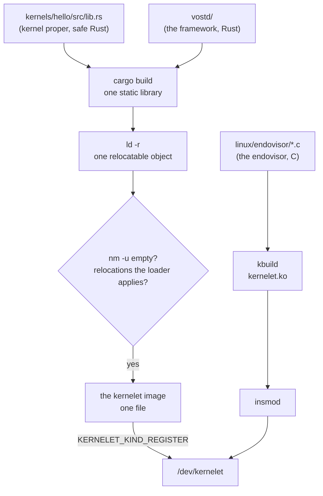
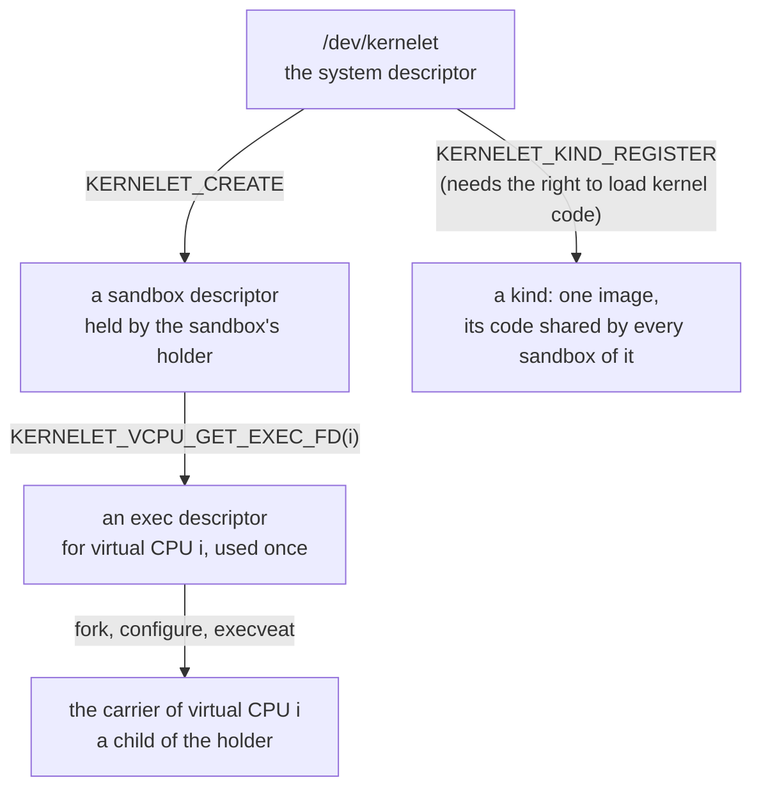
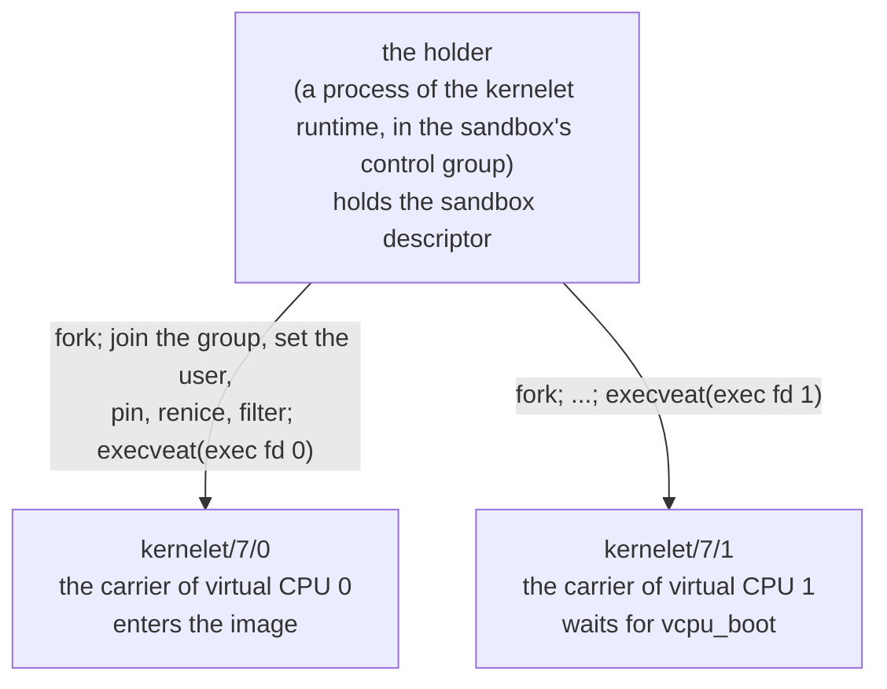

# The kernelet UAPI

Before any mechanism, the view from the host's user space: what a program running on Linux may ask of a kernel that can run kernelets, and what it gets back. Linux calls the set of system calls, device nodes and file formats that user space may use its **UAPI**, the user-space application programming interface, and keeps the headers that define it in a directory of that name. A kernelet's is small: one kind of file, one device node, three kinds of file descriptor, and one rule about who creates the tasks. Everything the rest of the book builds is behind this interface, and nothing a tenant does ever touches it.

## The image is a file

A kernelet is three layers of code compiled into one file, the **kernelet image**.

1. **The kernel proper**: the kernel that is to run, written in safe Rust against the Asterinas framework. In this book it is the hundred-line kernel of the next chapter, never edited.
2. **vOSTD**, a Rust crate whose library name is `ostd`, so that the kernel proper's `use ostd::...` lines resolve to it. It offers every type and function the kernel proper uses, with the same names and signatures as the real OSTD. It is in `prototype/vostd/`.
3. **The image ABI** (an *application binary interface* is the exact layout of what two separately compiled pieces of code pass each other): a few C-layout structures that both vOSTD and the endovisor know, saying what the host tells the kernelet at start, which functions the kernelet may call, and which functions the host may call. Chapter 4 reads them.

The build compiles the kernel proper and vOSTD together into one static library, links it with `ld -r` into a single relocatable object, and checks two things about that object: that it has **no undefined symbols**, and that its *relocations*, the places in the code that a loader must patch with final addresses, are of the kinds the endovisor's loader knows how to apply. The result is the image, one file. It is not part of the endovisor's own kernel module, `kernelet.ko`, which is built from the endovisor's C files alone and loaded once; images are loaded later, through the interface below, as many as the machine will run.

"No undefined symbols" is the whole security story of the build, so it deserves a sentence. A symbol is undefined in an object when the code calls a function the object does not contain; the linker fills it in later. An image with none cannot call anything outside itself. It *calls* Linux in exactly one way: through a table of function pointers the endovisor hands it when it starts. That is the service table, and the kernelet cannot call what is not in it, because it cannot name anything else. (It also reads two words of Linux's and writes one, at offsets the endovisor publishes, for reasons chapters 10 and 12 give; those are the whole of its contact with Linux's own variables. It shares small records with the endovisor, one per virtual CPU and one per address space (chapters 9 and 14), and it reads the tenant's page tables through Linux's direct map (chapter 14); every one of those is memory the endovisor chose to show it.)

**Linux: modules and exported symbols.** A kernel module is code loaded into the running kernel with `insmod`. It may call only kernel functions that the kernel marks as **exported** (`EXPORT_SYMBOL` in the source); the rest are private to the kernel even though they are in the same address space. The endovisor is a module. A few functions it needs are not exported in a stock kernel, which is one of the two reasons for the patch of chapter 5.

## The shape: three descriptors

Linux has one interface of this shape already, and it is the one to copy. KVM, Linux's hypervisor, is a module that runs virtual machines whose virtual processors are ordinary user threads: a program such as QEMU opens `/dev/kvm`, asks it for a descriptor that stands for a virtual machine, asks that for a descriptor per virtual processor, and runs each virtual processor from a thread of its own by calling an operation on its descriptor ([`KVM_CREATE_VM`](https://elixir.bootlin.com/linux/v6.12/source/Documentation/virt/kvm/api.rst#L138), [`KVM_CREATE_VCPU`](https://elixir.bootlin.com/linux/v6.12/source/Documentation/virt/kvm/api.rst#L294), [`KVM_RUN`](https://elixir.bootlin.com/linux/v6.12/source/Documentation/virt/kvm/api.rst#L379)). The threads are QEMU's: it created them, it can pin them and renice them, and `ps` shows them.

**Linux: device nodes and `ioctl`.** A *device node* is a file under `/dev` that stands for a driver rather than for data; opening it gives a descriptor on which the driver answers `read`, `write` and, for everything that is neither, [`ioctl`](https://elixir.bootlin.com/linux/v6.12/source/fs/ioctl.c#L893): one system call that takes a descriptor, a command number and an argument, and hands both to whatever code is behind the descriptor. A driver's interface is therefore a list of command numbers, and a module may define its own. A descriptor need not come from a file system at all: a module can make an *anonymous* file, with operations of its choosing, and hand out a descriptor on it; every descriptor below but the first is one of those.

A kernelet's interface has the same three levels, with one difference at the bottom.

| descriptor | obtained by | stands for | when the last copy closes |
|---|---|---|---|
| **system** | `open("/dev/kernelet")` | the kernel's ability to run kernelets | nothing happens |
| **sandbox** | `KERNELET_CREATE` on the system descriptor | one sandbox | the sandbox is killed and destroyed |
| **exec** | `KERNELET_VCPU_GET_EXEC_FD(i)` on the sandbox descriptor | one virtual CPU of one sandbox, not yet started | nothing happens; the sandbox descriptor can hand out another |

The difference is at the bottom. A KVM virtual processor is run by a thread that *calls* an operation and returns from it, keeping its own address space throughout. A carrier runs the tenant's program in Linux's own user mode, so it needs an address space of its own that holds nothing of the host's, and the one operation that gives a process a fresh address space is `execve`. So the exec descriptor is not called; it is executed. It is a small file that lives only in memory, created by the endovisor with [`shmem_file_setup()`](https://elixir.bootlin.com/linux/v6.12/source/mm/shmem.c#L5265), that the endovisor recognizes when it is executed *by the file object*, not by anything written in it. Possession of the descriptor is the right to start that virtual CPU, once.

## The system descriptor

Opening `/dev/kernelet` gives the system descriptor. The node is owned by root; an operator who runs sandboxes as an unprivileged user gives that user access to it, as is done for `/dev/kvm`.

The operations' names follow one rule throughout. An operation whose target is the sandbox is `KERNELET_` and a verb: `KERNELET_KILL`. One whose target is some other object is `KERNELET_`, the object, and a verb: `KERNELET_KIND_REGISTER`.

| operation | what it does | who may |
|---|---|---|
| `KERNELET_GET_API_VERSION` | reports the interface's version, so that a runtime can refuse a kernel it does not understand | anyone with the node |
| `KERNELET_KIND_REGISTER` | takes the descriptor of an image file and a name; the endovisor repeats the checks the build made, keeps one copy of the image's code, and returns a **kind** identifier | the right to load kernel code |
| `KERNELET_KIND_LIST` | lists the registered kinds: identifier, name, how many sandboxes run each | anyone with the node |
| `KERNELET_KIND_UNREGISTER` | drops a kind that no sandbox is using and returns its pages to Linux | the right to load kernel code |
| `KERNELET_CREATE` | creates a sandbox of a kind, with the number of virtual CPUs, the memory it may have, and the kernel's command line; returns the sandbox descriptor | anyone with the node, from a task in a control group other than the root group |

A **kind** is a registered image. It is registered once per boot and shared: every sandbox of a kind executes the same pages of code, placed at an address of its own with data of its own after it. That sharing is why registration and creation are two operations and not one: an `execve` of the image file itself, with the sandbox's parameters as arguments, would have nowhere to keep the one shared copy.

**Linux: capabilities and lockdown.** Root's powers are divided into named *capabilities*, and a privileged operation asks for the one it needs with [`capable()`](https://elixir.bootlin.com/linux/v6.12/source/kernel/capability.c#L434). Loading a module asks for `CAP_SYS_MODULE` ([`init_module`](https://elixir.bootlin.com/linux/v6.12/source/kernel/module/main.c#L2646)). A kernel can also be *locked down*, a mode in which nothing may add code to the running kernel unless it is signed, and every loader asks [`security_locked_down()`](https://elixir.bootlin.com/linux/v6.12/source/security/security.c#L5766) before it proceeds.

Registering is privileged because an image is kernel code. The checks the build makes, and the endovisor repeats, establish that an image *cannot name* anything in Linux; they do not establish that its machine code is harmless, and no check made on a file could. What makes an image trustworthy is who built it, which is exactly Linux's position on modules. So `KERNELET_KIND_REGISTER` asks what `init_module` asks: the capability to load kernel code, and a kernel that is not locked down. An operator registers the kinds a machine will run when the machine is set up; the runtime, which runs as an ordinary user, only creates sandboxes of them.

Creating is not privileged, beyond access to the node, because a sandbox can reach nothing its creator could not. Its memory is charged to the creator's control group, and the files it is given are files its creator opened. The root control group is refused because a sandbox has to be bounded by something, and the group is what bounds it.

**Linux: control groups.** A control group is a set of tasks that Linux accounts and limits together: their share of the processors, their memory, and more. A task joins a group when its process identifier is written into the group's `cgroup.procs` file, and a child starts in its parent's group. Containers are built on them, and so is a sandbox: because every task of the sandbox is in the sandbox's group, the processor time the kernelet burns and the memory Linux allocates for it are charged to the tenant by machinery Linux already has.

## The sandbox descriptor

| operation | what it does |
|---|---|
| `KERNELET_VCPU_GET_EXEC_FD` | returns the exec descriptor of virtual CPU *i*; each virtual CPU has one, and each may be executed once |
| `KERNELET_ATTACH_DEVICE` | gives the sandbox a virtual device, passing the descriptor of the file or interface behind it; allowed until the sandbox starts |
| `KERNELET_SET_CONSOLE` | passes the descriptor the sandbox's console is served through: a terminal, a pipe, a socket |
| `KERNELET_SET_LOG` | passes the descriptor the kernelet's kernel log is written to |
| `KERNELET_GRANT` | gives the sandbox more memory, or raises the limit it may ask up to |
| `KERNELET_KILL` | marks the kernelet dying, with a reason; chapter 12 is what follows |
| `KERNELET_WAIT`, and `poll` | waits until the sandbox has ended, and says why |
| `KERNELET_GET_STATS` | counters, and for each virtual CPU the carrier's process identifier and state |
| `KERNELET_DESTROY` | gives everything back; allowed once the sandbox has ended |

A disk image, a network interface, a console and a log file are all things the runtime opens itself, under its own user's permissions, and passes down as descriptors. Nothing is named by path inside the kernel, and a sandbox can reach exactly what its runtime could open.

## A carrier is made by `exec`

The program that drives a sandbox is its **holder**: the one process of the kernelet runtime that keeps the sandbox descriptor open for as long as the sandbox lives.

The holder makes a carrier the way a shell makes a command run: it forks, the child arranges itself, and the child calls `exec`. Between the fork and the `exec` the child has the whole of Linux at its disposal, because it is still an ordinary process of the holder's user:

1. it joins the sandbox's control group, by writing its process identifier into the group's `cgroup.procs`;
2. it changes to the user identity the sandbox runs as, one dedicated to this sandbox, so that no other process of the host may signal or inspect its carriers;
3. it enters whatever namespaces the operator wants it in, with [`setns`](https://elixir.bootlin.com/linux/v6.12/source/kernel/nsproxy.c#L546);
4. it pins itself to processors and sets its priority or scheduling class, with [`sched_setaffinity`](https://elixir.bootlin.com/linux/v6.12/source/kernel/sched/syscalls.c#L1320), [`setpriority`](https://elixir.bootlin.com/linux/v6.12/source/kernel/sys.c#L227) or `sched_setattr`, differently for each virtual CPU if the operator asked;
5. it sets *no new privileges* and installs the seccomp filter that chapter 5 describes;
6. it executes the exec descriptor with [`execveat`](https://elixir.bootlin.com/linux/v6.12/source/fs/exec.c#L2105), the form of `execve` that takes a descriptor instead of a path.

**Linux: what `exec` keeps.** A new program gets a new address space, and [`begin_new_exec()`](https://elixir.bootlin.com/linux/v6.12/source/fs/exec.c#L1222) resets what belongs to the old one: signal handlers, timers, the descriptors marked close-on-exec, and a few registrations by which Linux would later write into user memory. It does *not* touch the task's control group, credentials, namespaces, processor mask, priority, resource limits, the no-new-privileges bit or the seccomp filter; those are properties of the task, not of the program, and the two last are kept by design so that a program cannot shed them by executing another. That is what makes the list above work: everything the child set on itself is still set when the endovisor sees it.

**What the endovisor does with the `exec`.** Linux lets a module teach it a new executable format, and the endovisor registers one for exec descriptors; chapter 6 reads the handler line by line. Offered the file, it checks four things: that the sandbox has been created and not killed; that virtual CPU *i* has not been started already; that the executing process is in the sandbox's control group; and that it has *no new privileges* set and gains none by this `exec`. Then it does what every program loader does, with one difference: it gives the process a fresh address space and maps *nothing* into it, not even the program's arguments, so that nothing of the host's is there for a tenant to find; and it marks the task as a carrier, by the one pointer chapter 5 adds to Linux's task structure, and gives it a **lifeline**, an open file by whose closing the endovisor will learn that the carrier has died (chapter 6). It names the task too, `kernelet/<sandbox>/<i>`, so that `ps` shows which sandbox and which virtual CPU a process is; Linux would otherwise name it after the file, and a file executed by descriptor has no name worth showing.

The carrier never reaches the user mode the `exec` was heading for. On the way there the endovisor takes it, and from then on the task is the kernelet's: the carrier of virtual CPU 0 enters the image when every virtual CPU's carrier has arrived, and any other waits, in a killable sleep, until the kernel proper starts that processor (`vcpu_boot`, chapter 9). What a carrier does with its days, running kernelet code and entering user mode on the kernelet's behalf, is chapters 6 to 8.

**The sandbox starts at the first `exec`.** Whichever carrier executes first loads the kind's image into memory as this sandbox's instance, sets up what the kernelet and the endovisor share, and gives the kernelet its initial memory, in its own context, so that all of it is charged to the sandbox's control group. From then on no device may be attached. The kernelet boots only when all of its carriers have arrived, because a kernel that starts its other processors expects each of them to answer, and the simplest way to keep that true is not to enter the image until every virtual CPU has a task. A holder that never starts one of them has a sandbox that never boots, which `KERNELET_GET_STATS` shows, and `KERNELET_KILL` ends. A carrier that dies while the others are still arriving ends the sandbox, as any carrier's death does.

**Why the file is execute-only.** The exec descriptor can be executed but not read, and is owned by root. Linux's rule is that a process which has executed a file it cannot read is not *dumpable*: nobody of the same user may attach a debugger to it or read its memory through `/proc` ([`begin_new_exec()`](https://elixir.bootlin.com/linux/v6.12/source/fs/exec.c#L1342) applies the rule). A tenant's memory is reachable from a carrier's `/proc` entries, so this is what keeps one sandbox's user from reading it, and it costs nothing to arrange. Root can still attach to a carrier, as root can read any container's memory.

**What the holder can do afterwards.** It forked the carriers, so it knows their process identifiers, and it can keep a descriptor on each with [`pidfd_open`](https://elixir.bootlin.com/linux/v6.12/source/kernel/pid.c#L629), which stays valid even after the identifier is reused. Through them the holder, or the operator with `taskset` and `chrt`, can move a virtual CPU to other processors or change its scheduling class while the sandbox runs, and `perf`, `top` and `/proc` work on a carrier as on any process. Two things are not offered, for reasons chapters 8 and 12 give: signals other than `SIGKILL` are discarded before they could reach a carrier, so a single carrier cannot be stopped or terminated politely, and a `SIGKILL` to any one of them ends the whole sandbox.

## The holder is the sandbox's anchor

A sandbox has one process that is not a carrier, and it is the holder. Four things hang on it.

- **The sandbox's control group is the holder's.** `KERNELET_CREATE` records the calling task's control group and refuses the root group. Every later `exec` of an exec descriptor is checked against it, and refused from a task in another group. The runtime therefore moves the holder into the sandbox's group *before* the holder creates the sandbox, and the holder's own processor time and memory count against the tenant, as a container's shim process does. The guarantee that everything a sandbox costs is charged to its group comes from a check at the one place a task joins the sandbox.
- **The holder's main thread owns the tenant's address spaces.** Linux records in each address space an *owner* task, through which its memory controller finds the group to charge page tables and faults to, and the task that creates an address space for a tenant is a carrier, which may die before the address space does. So the endovisor pins the holder's main thread with a task reference at `KERNELET_CREATE` and names it as the owner of every address space the kernelet creates (chapter 13). A pinned task still names its control group after it has exited, so even a holder that crashed charges to the right group until the sandbox is destroyed.
- **The sandbox dies with the holder.** When the holder exits, however it exits, Linux closes its sandbox descriptor; when the last copy of that descriptor closes, the sandbox is killed and destroyed. A crashed runtime cannot leave a sandbox behind.
- **The end of a sandbox is the endovisor's bookkeeping, not a task's.** When the last carrier's lifeline closes, the sandbox has exited in chapter 12's sense; the endovisor records why, and whoever is in `KERNELET_WAIT` wakes. The holder then reaps its children with `waitpid`, calls `KERNELET_DESTROY`, and exits.

So the word *carrier* means one thing throughout the book: a Linux task that carries a virtual CPU and may run the tenant's program. Every other task on the host, the holder included, is an ordinary process that never runs a line of the kernelet.

## The life of a sandbox, in order

1. When the machine is set up, the operator registers each kind with `KERNELET_KIND_REGISTER`, which needs the right to load kernel code.
2. The runtime makes a control group for the sandbox with the limits the operator chose, forks the holder, and moves it into the group.
3. The holder opens `/dev/kernelet`, calls `KERNELET_CREATE`, opens the disk image and whatever else the sandbox is to have and passes each with `KERNELET_ATTACH_DEVICE`, and passes its console and log with `KERNELET_SET_CONSOLE` and `KERNELET_SET_LOG`.
4. For each virtual CPU, the holder asks for the exec descriptor and forks a child, which joins the group, takes the sandbox's user identity, pins and prioritizes itself as asked, sets no new privileges, installs the seccomp filter, and executes the descriptor.
5. The first of those `exec`s loads the instance and grants the memory. When the last carrier has arrived, the carrier of virtual CPU 0 enters the image and the kernel proper boots; the others wait for `vcpu_boot`.
6. The sandbox runs. Linux schedules each carrier with the processors and the class its creator gave it; the kernelet schedules its own tasks on them (chapter 9).
7. The kernel proper powers off, or the holder calls `KERNELET_KILL`, or a carrier is killed. The endovisor marks the kernelet, stops every carrier (chapter 12), and reports the end. The holder's `KERNELET_WAIT` returns, it reaps the carriers, calls `KERNELET_DESTROY`, and exits; the runtime removes the group.

## What the operator sees

A control group containing the holder and one process per virtual CPU, named `kernelet/<sandbox>/<i>`, all children of the holder. `ps` and `top` list them; `taskset` and `chrt` move a virtual CPU or change its class; `perf` profiles one; `kill -KILL` on any of them ends the sandbox, as does `cgroup.kill` on the group. Nothing in the group corresponds to the tenant's own processes, which only the kernelet knows about. The carriers cannot be traced by their own user, because they are not dumpable.

**Recap.** A kernelet image is one file, built so that it can name nothing outside itself, and registered as a kind by an operator with the right to load kernel code. The user-space interface has three descriptors: the system descriptor from `/dev/kernelet`, on which kinds are registered and anyone with the node creates sandboxes; the sandbox descriptor, through which the holder attaches files, kills, waits and destroys, and which kills the sandbox when its last copy closes; and one exec descriptor per virtual CPU, which the holder's child executes after configuring itself with Linux's ordinary system calls, and which the endovisor turns into that virtual CPU's carrier. The holder's control group is the sandbox's, its main thread owns the tenant's address spaces, and the sandbox dies with it.

