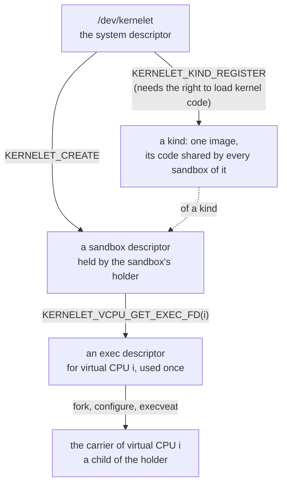
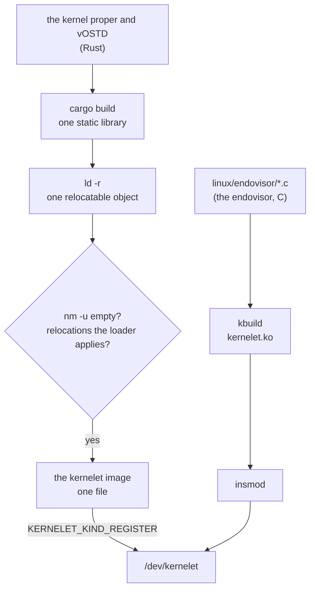

# The kernelet UAPI

Before any mechanism, the view from the host's user space. Linux calls the set of system calls, device nodes and file formats that user space may use its **UAPI**, the user-space application programming interface, and keeps the headers that define it in a directory of that name. A kernelet's is one header, `prototype/linux/endovisor/uapi/kernelet.h`: one device node, three kinds of file descriptor, and one rule about who creates the tasks.

This chapter first shows the interface in use, by the prototype's own holder program, then says why it has the shape it has, and then specifies every operation. Everything the rest of the book builds is behind this interface, and nothing a tenant does ever touches it. The endovisor of this prototype does not offer the device yet: the holder program is built but not run, and the tests start a sandbox an older way, with one program file and one `execve`.

## A prototype kernelet runtime

The program that drives a kernelet sandbox is its **holder**: the one process of the kernelet runtime that creates the sandbox, keeps its descriptor open for as long as the sandbox lives, and destroys it. A container runtime has such a process per container; the prototype's is `holder.c`, a static C program of two commands, `register` and `run`.

<div class="linux">

**Linux: device nodes and `ioctl`.** A *device node* is a file under `/dev` that stands for a driver rather than for data; opening it gives a descriptor on which the driver answers `read`, `write` and, for everything that is neither, [`ioctl`](https://elixir.bootlin.com/linux/v6.12/source/fs/ioctl.c#L893): one system call that takes a descriptor, a command number and an argument, and hands both to whatever code is behind the descriptor. A driver's interface is therefore a list of command numbers, and a module may define its own. A descriptor need not come from a file system at all: a module can make an *anonymous* file, with operations of its choosing, and hand out a descriptor on it; every descriptor in this chapter but the first is one of those.

</div>

**The operator's step.** Once per boot, someone with the right to load kernel code registers each **kernelet image** the machine will run, one file holding a compiled kernelet (its format is given with `KERNELET_KIND_REGISTER` below), and names it:

*Simplified from `prototype/host/runtime/holder.c`: `open_system`, `register_kind`.*

```c
static int open_system(void)
{
	int sys = open("/dev/kernelet", O_RDWR | O_CLOEXEC);

	if (ioctl(sys, KERNELET_GET_API_VERSION) != KERNELET_API_VERSION)
		exit(127);                                  /* an interface this program does not know */
	return sys;
}

static int register_kind(int sys, const char *name, const char *image_path)
{
	struct kernelet_kind_register reg = { .image_fd = open(image_path, O_RDONLY | O_CLOEXEC) };

	snprintf(reg.name, sizeof(reg.name), "%s", name);  /* the name KERNELET_KIND_LIST reports; unique */
	return ioctl(sys, KERNELET_KIND_REGISTER, &reg);    /* the kind's identifier */
}
```

A registered image is a **kind**, and a kind is what sandboxes are made of. Registering it is the privileged act, and it happens once; creating sandboxes of it is not privileged and happens as often as the runtime likes.

<div class="linux">

**Linux: control groups.** A control group is a set of tasks that Linux accounts and limits together: their share of the processors, their memory, and more. Groups form one tree, the unified hierarchy of cgroup v2, which this book means throughout. A process joins a group when its identifier is written into the group's `cgroup.procs` file, and a child starts in its parent's group. Containers are built on them, and so is a sandbox: because every task of the sandbox is in the sandbox's group, the processor time the kernelet burns and the memory Linux allocates for it are charged to the tenant by machinery Linux already has.

</div>

**The holder's step.** To run a sandbox, the holder creates it, gives it its console and log, and then makes one carrier per virtual CPU:

*Simplified from `prototype/host/runtime/holder.c`: `run_sandbox`, `wait_sandbox`.*

```c
static int run_sandbox(int sys, const char *name, unsigned int nr_vcpus, const char *cmdline,
		       const char *cgroup, int pin)
{
	struct kernelet_create create = {
		.kind = find_kind(sys, name),               /* KERNELET_KIND_LIST, matched by name */
		.nr_vcpus = nr_vcpus,
		.memory_initial = 4 << 20,
		.memory_max = 64 << 20,
		.max_tasks = 256,
		.cmdline = (__u64)(unsigned long)cmdline,
		.cmdline_len = strlen(cmdline),
	};
	struct kernelet_exit ex;
	int sb, out = 1, err = 2;

	if (cgroup)
		join_cgroup(cgroup);                        /* before the create: this group becomes the sandbox's */
	sb = ioctl(sys, KERNELET_CREATE, &create);      /* the sandbox descriptor */
	ioctl(sb, KERNELET_SET_CONSOLE, &out);          /* the sandbox's console: our standard output */
	ioctl(sb, KERNELET_SET_LOG, &err);              /* its kernel log: our standard error */
	/* a disk would be attached here: KERNELET_ATTACH_DEVICE with its open file */

	for (i = 0; i < nr_vcpus; i++) {
		int exec_fd = ioctl(sb, KERNELET_VCPU_GET_EXEC_FD, &i);

		pids[i] = fork();
		if (pids[i] == 0)
			start_carrier(exec_fd, i, pin);         /* the child; does not return */
		close(exec_fd);
	}

	wait_sandbox(sb, pids, nr_vcpus, &ex);          /* KERNELET_WAIT, watching the children too: a child that
	                                                   dies before its exec never became a carrier, so the
	                                                   holder kills the sandbox itself if one does */
	for (i = 0; i < nr_vcpus; i++)
		waitpid(pids[i], NULL, 0);                  /* the carriers died by SIGKILL */
	ioctl(sb, KERNELET_DESTROY);
	close(sb);

	switch (ex.how) {
	case KERNELET_END_EXITED:   return ex.code;     /* the kernel proper's exit code */
	case KERNELET_END_PANICKED: return 128;
	default:                    return 129;         /* killed */
	}
}
```

The loop in the middle is the heart of the interface. A **carrier**, chapter 1's term for a Linux task that carries one of the sandbox's virtual CPUs and may run the tenant's programs, is not made by the kernel. The holder forks a child for it, the child arranges itself with ordinary system calls, and then the child *executes* a descriptor the sandbox handed out:

*Simplified from `prototype/host/runtime/holder.c`: `start_carrier`, `join_cgroup`.*

```c
static void start_carrier(int exec_fd, unsigned int vcpu, int pin)
{
	char *argv[] = { "carrier", NULL }, *envp[] = { NULL };

	if (pin) {                                      /* virtual CPU i on processor i */
		cpu_set_t set;
		CPU_ZERO(&set);
		CPU_SET(vcpu, &set);
		sched_setaffinity(0, sizeof(set), &set);
	}
	prctl(PR_SET_NO_NEW_PRIVS, 1, 0, 0, 0);         /* the endovisor insists on it */
	execveat(exec_fd, "", argv, envp, AT_EMPTY_PATH);   /* the endovisor takes it from here */
	die_child("execveat");                           /* reached only if the exec failed */
}

static void join_cgroup(const char *dir)             /* write our process identifier into cgroup.procs */
{
	snprintf(path, sizeof(path), "%s/cgroup.procs", dir);
	fd = open(path, O_WRONLY | O_CLOEXEC);
	n = snprintf(pid, sizeof(pid), "%d\n", getpid());
	write(fd, pid, n);
	close(fd);
}
```

Between the `fork` and the `execveat` the child is an ordinary process of the holder's user, and anything Linux lets a process set on itself can go there: the processor it is pinned to, as here; its priority or scheduling class; the user it runs as; the namespaces it is in; its resource limits; a seccomp filter, which bounds what the tenant may ask of its kernelet. All of it survives the `exec`, because these are properties of the task and not of the program it runs, and all of it is per carrier, so two virtual CPUs can be pinned to two processors and given two priorities.

In summary, the whole life of a sandbox is, in order:

1. When the machine is set up, the operator registers each kind with `KERNELET_KIND_REGISTER`.
2. The runtime makes a control group for the sandbox with the limits the operator chose, and starts the holder in it, or the holder moves itself in before it creates anything, as `-c` does.
3. The holder creates the sandbox with `KERNELET_CREATE`, opens the disk image and whatever else the sandbox is to have and passes each with `KERNELET_ATTACH_DEVICE`, and passes its console and log with `KERNELET_SET_CONSOLE` and `KERNELET_SET_LOG`.
4. For each virtual CPU, the holder asks for the exec descriptor with `KERNELET_VCPU_GET_EXEC_FD` and forks a child, which arranges itself and executes the descriptor. The first of those `exec`s loads the kind's image as this sandbox's instance. From now on, the carrier no longer executes the holder's code, but the kernelet's.
5. The sandbox runs. Linux schedules each carrier with the processors and the class its creator gave it; the kernelet schedules its own tasks on them.
6. The kernel proper powers off, or the holder calls `KERNELET_KILL`, or a carrier is killed. The endovisor marks the kernelet dying, stops every carrier, and when the last of them is gone records why. The holder's `KERNELET_WAIT` returns, it reaps the carriers, calls `KERNELET_DESTROY`, and exits; the runtime removes the group.

## Why it is shaped so

The kernelet UAPI is designed with four requirements in mind:

1. **Every Linux task of a sandbox is created by user space, and user space can find it and govern it with Linux's own system calls.** A carrier is a special task, since its system calls go to the kernelet and not to Linux, but it is still a task, and the host's tools for tasks, `sched_setaffinity`, `setpriority`, `sched_setattr`, control groups, namespaces, resource limits, `perf`, `/proc`, must apply to it as to any other. Linux applies them to any task; only user space can apply them *before* the task carries a virtual CPU, and only a task user space made is one whose identifier it knows without searching.
2. **Resources reach a sandbox as descriptors.** A disk image, a network interface, a console and a log file are things the runtime opens itself, under its own user's permissions, and passes down. Nothing is named by path inside the kernel, and a sandbox can reach exactly what its runtime could open.
3. **A sandbox dies whole, and dies with its runtime.** Nothing a crashed runtime held keeps a sandbox alive.
4. **An image is kernel code.** Loading one is allowed to whoever may load a module; creating a sandbox of a loaded image is allowed to whoever may open the device. And one copy of an image's code serves every sandbox of it.

### Learning from the KVM UAPI

Linux has one pre-existing interface that meets the first three considerations already—KVM, Linux's hypervisor—and thus its interface is the one that we should draw inspirations from. The KVM module runs virtual machines whose virtual processors are ordinary user threads: a program such as QEMU opens `/dev/kvm`, asks it for a descriptor that stands for a virtual machine, asks that for a descriptor per virtual processor, and runs each virtual processor from a thread of its own by calling an operation on its descriptor ([`KVM_CREATE_VM`](https://elixir.bootlin.com/linux/v6.12/source/Documentation/virt/kvm/api.rst#L138), [`KVM_CREATE_VCPU`](https://elixir.bootlin.com/linux/v6.12/source/Documentation/virt/kvm/api.rst#L294), [`KVM_RUN`](https://elixir.bootlin.com/linux/v6.12/source/Documentation/virt/kvm/api.rst#L379)). The threads are QEMU's: it created them, it can pin them and renice them, `ps` shows them, and the machine dies when QEMU does, because closing the last descriptor destroys it. A kernelet's interface has the same three levels: a system descriptor, a sandbox descriptor, and a descriptor per virtual CPU, each made from the one above it using ioctl, as shown by the diagram below:



### Differing from the KVM UAPI

KVM runs a virtual processor by a *call*: a thread invokes `KVM_RUN` and returns from it. A kernelet starts a virtual CPU by an *exec*: a process executes the descriptor and never returns. This is the one place the two interfaces differ, and the reason is what each thread's address space is for.

A KVM thread keeps its own address space throughout. The guest's memory is elsewhere, in a mapping the thread set up; the thread only drives the guest.

A carrier is to the kernelet what a processor is to an ordinary kernel: the kernelet runs its tenant's processes on it, one at a time. Those processes run in Linux's own user mode, on Linux's own page tables, so at every switch the kernelet switches the carrier's address space to the current process's, and the carrier's address space is always one of the tenant's. It must therefore start holding nothing of the host's: not the holder's program, not its heap, not a stack with the holder's secrets on it. The one operation in Linux that gives a process a fresh address space is `execve`. So the per-virtual-CPU descriptor is not called; it is executed.

Possession of the descriptor is the right to start that virtual CPU, once. The descriptor refers to a file that exists only in memory and holds nothing of interest: no program, no data. What matters is the file's identity. The endovisor remembers which sandbox and which virtual CPU it created each such file for, and when a process executes a file, the endovisor checks whether it is one of those. A file with the same bytes elsewhere is not one; a second `exec` of the same file is refused, because its virtual CPU has already been started. The file is owned by root and can be executed but neither read nor written, so the holder can hand the descriptor to a child but cannot read it or change it.

<div class="linux">

**Linux: what `exec` keeps.** A new program gets a new address space, and [`begin_new_exec()`](https://elixir.bootlin.com/linux/v6.12/source/fs/exec.c#L1222) resets what belongs to the old one: signal handlers, timers, the descriptors marked close-on-exec, and a few registrations by which Linux would later write into user memory. It does *not* touch the task's control group, its user and group identities, its namespaces (bar a time namespace chosen for its children, which it enters), its processor mask, priority, resource limits, the no-new-privileges bit or the seccomp filter; those are properties of the task, not of the program, and the two last are kept by design so that a program cannot shed them by executing another. Two things it does recompute: the task's *capabilities*, of which a process that is not root keeps only those it marked ambient, and whatever domain the host's security module assigns the new program. That is what makes the holder's child work: everything it set on itself is still set when the endovisor sees it, and nothing it could not have had is added.

</div>

Linux lets a module teach it a new executable format, and the endovisor registers one for exec descriptors; the prototype's older handler differs from it only in its checks. Offered the file, it checks that the sandbox has been created and not killed, that this virtual CPU has not been started already, that the executing process is in the sandbox's control group, and that it has *no new privileges* set, which is what guarantees that it gains none by this `exec`. Then it does what every program loader does, with one difference: it gives the process a fresh address space and maps *nothing* into it, not even the program's arguments, because the address space must hold only what the kernelet puts there. It marks the task as a carrier, by the one pointer the patch adds to Linux's task structure, gives it a **lifeline**, an open file by whose closing the endovisor will learn that the carrier has died, and names it `kernelet/<slot>/<i>` after the sandbox's slot, a name that fits the sixteen bytes Linux keeps for one, so that `ps` shows which sandbox and which virtual CPU it is. The carrier never reaches the user mode the `exec` was heading for: on the way there the endovisor takes it, and from then on the task is the kernelet's, to run kernelet code on and to enter user mode from on the kernelet's behalf.

Two consequences of `exec` are worth having. The exec descriptor's file can be executed but not read, and Linux's rule is that a process which has executed a file it cannot read is not *dumpable*: nobody of the same user may attach a debugger to it or read its memory through `/proc` ([`begin_new_exec()`](https://elixir.bootlin.com/linux/v6.12/source/fs/exec.c#L1342) applies the rule, provided the host's `fs.suid_dumpable` setting is at its default of 0, which the runtime checks). A tenant's memory is reachable from a carrier's `/proc` entries, so this is what keeps one sandbox's user from reading it, and it costs nothing to arrange; the address spaces the endovisor later makes for the tenant's processes are marked the same way and kept in the host's initial user namespace, so the rule covers them too. Root can still attach, as root can read any container's memory. And since the carrier arrived by a system call, its first trip to user mode needs nothing special: the resume hook that takes it overwrites the registers Linux saved, as it will on every later trip.

**The holder is the sandbox's anchor.** Requirements 1 and 4 make the holder the sandbox's anchor in four ways.

- **The sandbox's control group is the holder's.** `KERNELET_CREATE` records the calling task's control group and refuses the root group. Every later `exec` of an exec descriptor, and every device attached, is checked against it and refused from any other group. The runtime therefore puts the holder in the sandbox's group *before* the holder creates the sandbox, and the holder's own processor time and memory count against the tenant, as a container's shim process does. The check is made where a task joins the sandbox; moving a carrier or the holder out afterwards needs write access to both groups' `cgroup.procs`, which the sandbox's user does not have and the runtime is trusted not to use, as `runc` is trusted with the groups it makes.
- **The holder's main thread owns the tenant's address spaces.** Linux records in each address space an *owner* task, through which its memory controller finds the group to charge page tables and faults to, and the task that creates an address space for a tenant is a carrier, which may die before the address space does. So the endovisor holds a reference to the holder's main thread from `KERNELET_CREATE` on and names it as the owner of every address space the kernelet creates. Linux keeps a task's group membership until the task structure is freed, which the reference prevents, so even a holder that crashed charges to the right group until the sandbox is destroyed.
- **The sandbox dies with the holder.** When the holder exits, however it exits, Linux closes its sandbox descriptor; when the last copy of that descriptor closes, the sandbox is killed and destroyed.
- **The end of a sandbox is the endovisor's bookkeeping, not a task's.** However a sandbox ends, the kernelet is first marked dying and every carrier is stopped. When the last of them is gone the sandbox has exited, and a sandbox that never had a carrier exits the moment it is killed; the endovisor records why, and whoever is in `KERNELET_WAIT` wakes.

The holder, a process of the runtime that happens to live in the sandbox's control group, is not part of the sandbox. Every task of the sandbox is a carrier, and the word *carrier* means one thing: a Linux task that carries a virtual CPU and may run the tenant's program. One thing the holder cannot do is signal a carrier politely: every signal but `SIGKILL` and `SIGSTOP` is discarded before it reaches a carrier; `SIGSTOP` stops that virtual CPU until `SIGCONT`; and `SIGKILL` to any carrier ends the whole sandbox.

## The operations

Every operation is an `ioctl`. It returns `-1` with `errno` set on failure and otherwise what its entry says, `0` where nothing is said. An argument that is a single 32-bit value is passed by pointer, as its encoding in the header says. Names follow one rule: an operation on the sandbox is named for what it does (`KERNELET_KILL`, `KERNELET_SET_CONSOLE`); an operation on a kind or a virtual CPU names that object first (`KERNELET_KIND_REGISTER`, `KERNELET_VCPU_GET_EXEC_FD`); `KERNELET_GET_API_VERSION`, on the device itself, is the one exception. The header is `prototype/linux/endovisor/uapi/kernelet.h`; each structure below is excerpted from it.

### On the system descriptor

The system descriptor is `open("/dev/kernelet")`. The node is owned by root; an operator who runs sandboxes as an unprivileged user gives that user access to it, as is done for `/dev/kvm`.

**`KERNELET_GET_API_VERSION`.** No argument. Returns `KERNELET_API_VERSION`, so that a runtime can refuse a kernel it does not understand; the one operation that cannot fail.

**`KERNELET_KIND_REGISTER`.** Takes an image, as an open descriptor, and a name, which must be unique among the registered kinds (`EEXIST` otherwise); returns the **kind** identifier, a small non-negative integer.

*Simplified from `prototype/linux/endovisor/uapi/kernelet.h`: `kernelet_kind_register`.*

```c
struct kernelet_kind_register {
	__s32	image_fd;                   /* an open descriptor on the image file */
	__u32	flags;                      /* must be 0 */
	char	name[KERNELET_NAME_LEN];    /* for people and for KERNELET_KIND_LIST */
};
```

The image file is an ELF relocatable object for x86-64 holding chapter 1's kernel proper and vOSTD, built so that it has **no undefined symbols**, only relocations of the kinds the endovisor's loader applies, and one exported symbol, `kernelet_entry_table`. The build makes it like this and checks it:



"No undefined symbols" is the whole security story of the build, so it deserves a sentence. A symbol is undefined in an object when the code calls a function the object does not contain; the linker fills it in later. An image with none cannot call anything outside itself. It *calls* Linux in exactly one way: through a table of function pointers the endovisor hands it when it starts. That is the service table, and the kernelet cannot call what is not in it, because it cannot name anything else. (It also reads two words of Linux's and writes one, at offsets the endovisor publishes, all for the sake of scheduling; those are the whole of its contact with Linux's own variables. It shares small records with the endovisor, one per virtual CPU and one per address space, and it reads the tenant's page tables through Linux's direct map; every one of those is memory the endovisor chose to show it.)

The endovisor repeats the checks on the file and refuses it (`EINVAL`, `ENOEXEC`) if any fails, or if the image's ABI version is not its own (`EPROTO`); then it copies the image's code into pages it keeps for the kind's life, which every sandbox of the kind executes, each placed at an address of its own with data of its own after it. That sharing is why registration and creation are two operations and not one: an `execve` of the image file itself, with the sandbox's parameters as arguments, would have nowhere to keep the one shared copy.

<div class="linux">

**Linux: capabilities and lockdown.** Root's powers are divided into named *capabilities*, and a privileged operation asks for the one it needs with [`capable()`](https://elixir.bootlin.com/linux/v6.12/source/kernel/capability.c#L434). Loading a module asks for `CAP_SYS_MODULE` and that module loading has not been switched off ([`init_module`](https://elixir.bootlin.com/linux/v6.12/source/kernel/module/main.c#L2646) checks both), reads the file in a way the host's security modules can veto, and, for a module without a valid signature, asks that signatures are not being enforced and that the kernel is not *locked down*, a mode in which nothing unsigned may be added to the running kernel ([`security_locked_down()`](https://elixir.bootlin.com/linux/v6.12/source/security/security.c#L5766)).

</div>

Registering needs `CAP_SYS_MODULE` and a kernel that is not locked down (`EPERM` otherwise), because an image is kernel code. The checks establish that an image *cannot name* anything in Linux; they do not establish that its machine code is harmless, and no check made on a file could. What makes an image trustworthy is who built it, which is exactly Linux's position on modules, so registering asks what `init_module` asks of an unsigned module, since images carry no signature: the capability, module loading not switched off, no signature enforcement, no lockdown, and a read of the file that the host's security modules see. (The switch that turns module loading off is not visible to a module; reading it is one line more in the patch.) A host that enforces module signatures, or is locked down, cannot run kernelets. The operator registers when the machine is set up; the runtime, which runs as an ordinary user, only creates sandboxes.

**`KERNELET_KIND_LIST`.** Lists the registered kinds. The caller supplies an array of `capacity` entries; the endovisor fills in up to that many, sets `count` to the number registered, which may exceed `capacity`, and returns `0`.

*Simplified from `prototype/linux/endovisor/uapi/kernelet.h`: `kernelet_kind_info`, `kernelet_kind_list`.*

```c
struct kernelet_kind_info {
	__u32	id;
	__u32	nr_sandboxes;               /* sandboxes of this kind that exist now */
	__u64	text_bytes;                 /* the shared code's size */
	char	name[KERNELET_NAME_LEN];
};
struct kernelet_kind_list {
	__u64	kinds;                      /* struct kernelet_kind_info *, user memory */
	__u32	capacity;
	__u32	count;                      /* out */
};
```

**`KERNELET_KIND_UNREGISTER`.** The argument is a kind identifier. Drops the kind and returns its pages to Linux. Needs `CAP_SYS_MODULE`; `EBUSY` while any sandbox of the kind exists.

**`KERNELET_CREATE`.** Creates a sandbox of a kind and returns its **sandbox descriptor**, close-on-exec.

*Simplified from `prototype/linux/endovisor/uapi/kernelet.h`: `kernelet_create`.*

```c
struct kernelet_create {
	__u32	kind;
	__u32	nr_vcpus;                   /* 1 to KERNELET_MAX_VCPUS */
	__u64	memory_initial;             /* bytes, given before it boots */
	__u64	memory_max;                 /* what KERNELET_GRANT and its own requests may raise it to */
	__u64	max_tasks;                  /* the kernelet's own tasks: each costs a kernelet stack */
	__u64	cmdline;                    /* const char *, user memory */
	__u32	cmdline_len;
	__u32	flags;                      /* must be 0 */
};
```

The calling task's control group becomes the sandbox's; the root group is refused (`EPERM`). The calling thread's main thread, its thread-group leader, is held as the owner of every address space the kernelet will create. Memory amounts are rounded up to whole 2 MiB units. The command line is passed to the kernel proper as a boot loader would pass it. Errors: `ENOENT` for an unknown kind; `EINVAL` for a virtual CPU count outside 1 to `KERNELET_MAX_VCPUS`, an initial memory above the maximum, a command line longer than `KERNELET_CMDLINE_MAX`, or nonzero flags. Nothing is allocated for the kernelet itself until its first carrier arrives, so that everything is charged to the group. Creating needs no privilege beyond access to the node, because a sandbox can reach nothing its creator could not: its memory is charged to the creator's group, and the files it is given are files its creator opened.

### On the sandbox descriptor

**`KERNELET_VCPU_GET_EXEC_FD`.** The argument is a virtual CPU's index, `0` to `nr_vcpus - 1`. Returns that virtual CPU's **exec descriptor**, close-on-exec; `EINVAL` beyond the count, `EBUSY` for a virtual CPU already started, `ESRCH` once the sandbox has been killed. The descriptor is on an in-memory file that the endovisor made owned by root and execute-only, and that it recognizes by its inode. It is used by executing it, `execveat(fd, "", argv, envp, AT_EMPTY_PATH)`; the arguments and the environment are discarded. The `exec` is refused (`EPERM`) unless the executing process is in the sandbox's control group and has no-new-privileges set; it fails with `EBUSY` if this virtual CPU has been started already, by this descriptor or another copy of it, and with `ESRCH` once the sandbox has been killed. Otherwise the process becomes the carrier of that virtual CPU, named `kernelet/<slot>/<i>`. The sandbox starts at the first such `exec`, which loads the kind's image as this sandbox's instance and grants `memory_initial`, and after which no device may be attached. The kernelet boots when every virtual CPU's carrier has arrived: a kernel that starts its other processors expects each of them to answer, and the simplest way to keep that true is not to enter the image until every virtual CPU has a task. A holder that never starts one of them has a sandbox that never boots, which `KERNELET_GET_STATS` shows as *starting*, and `KERNELET_KILL` ends. A carrier that dies while the others are still arriving ends the sandbox, as any carrier's death does.

**`KERNELET_ATTACH_DEVICE`.** Gives the sandbox a virtio device backed by a file the caller opened. Returns the device's index, which the kernelet sees as the order of devices on its command line. Legal until the sandbox starts (`EBUSY` after), from a task in the sandbox's control group (`EPERM` otherwise). The endovisor takes its own reference to the open file, so the caller may close its descriptor.

*Simplified from `prototype/linux/endovisor/uapi/kernelet.h`: `kernelet_device`.*

```c
struct kernelet_device {
	__u32	type;                       /* KERNELET_DEVICE_BLOCK: a file or block device; KERNELET_DEVICE_NET: a TAP interface */
	__s32	fd;
	__u32	flags;                      /* KERNELET_DEVICE_READONLY */
	__u32	pad;                        /* must be 0 */
};
```

**`KERNELET_SET_CONSOLE`, `KERNELET_SET_LOG`.** The argument is a descriptor. The first names the file the sandbox's console is served through: what the tenant writes to its console is written there, and what is written there arrives as its console input, so the file must carry both directions, a terminal or a socket; a pipe carries output only. The second names the file the kernelet's kernel log is written to. The endovisor takes its own reference; legal until the sandbox starts. Without a log file the log is kept only in a bounded ring, and `KERNELET_GET_STATS` counts what was dropped from it.

**`KERNELET_GRANT`.** Gives the sandbox memory now, raises its ceiling, or both, each rounded up to 2 MiB; a zero field leaves that side alone. `ENOMEM` if `add` cannot be found, `EINVAL` if `max` is below what is granted.

*Simplified from `prototype/linux/endovisor/uapi/kernelet.h`: `kernelet_grant`.*

```c
struct kernelet_grant {
	__u64	add;                        /* bytes to give now */
	__u64	max;                        /* the new ceiling */
};
```

**`KERNELET_KILL`.** The argument is a reason, a 32-bit value of the caller's choosing below `0x80000000` that the exit status will carry; values with the high bit set are the endovisor's own and are refused (`EINVAL`). Marks the kernelet dying and returns at once; stopping the carriers is asynchronous, and `KERNELET_WAIT` says when it is done. A sandbox that has no carrier yet exits at once. A second kill changes nothing.

**`KERNELET_WAIT`, and `poll`.** Sleeps until the sandbox has exited and reports how; the descriptor is also pollable, readable once the sandbox has exited.

*Simplified from `prototype/linux/endovisor/uapi/kernelet.h`: `kernelet_exit`, `kernelet_end`.*

```c
enum kernelet_end {
	KERNELET_END_EXITED	= 1,            /* the kernel proper powered off */
	KERNELET_END_PANICKED	= 2,        /* a panic nothing in it caught */
	KERNELET_END_KILLED	= 3,            /* the host decided */
};
struct kernelet_exit {
	__u32	how;                        /* enum kernelet_end */
	__s32	code;                       /* EXITED: the kernel proper's exit code */
	__u32	reason;                     /* KILLED: KERNELET_KILL's argument, or KERNELET_KILLED_* */
	__u32	pad;
	char	message[KERNELET_MESSAGE_LEN];  /* PANICKED: the message */
};
```

The reasons the endovisor itself kills with are a carrier lost (`SIGKILL` from outside, or the out-of-memory killer), and three this book's prototype does not detect: a fault in kernelet code, a kernelet stack nearly exhausted, and Linux's preemption count found wrong on leaving kernelet code. `KERNELET_KILLED_REQUESTED` is what the closing of the last descriptor reports; a `KERNELET_KILL` reports its own argument.

**`KERNELET_GET_STATS`.** The sandbox's slot and state, counters, and one row per virtual CPU. The caller supplies an array of `capacity` rows; `nr_vcpus` is set to the sandbox's number and that many rows, or `capacity` if fewer, are filled.

*Simplified from `prototype/linux/endovisor/uapi/kernelet.h`: `kernelet_vcpu_stat`, `kernelet_stats`.*

```c
struct kernelet_vcpu_stat {
	__s32	pid;                        /* the carrier's process identifier, 0 if unstarted */
	__u32	state;                      /* UNSTARTED, WAITING, RUNNING, GONE */
	__u64	run_ns;                     /* time the carrier has run */
	__u64	stolen_ns;                  /* time it was runnable but not running */
};
struct kernelet_stats {
	__u32	state;                      /* CREATED, STARTING, RUNNING, DYING, EXITED */
	__u32	nr_vcpus;                   /* out */
	__u64	memory_granted;
	__u64	service_calls;
	__u64	virqs_raised;
	__u64	log_dropped;
	__u64	vcpus;                      /* struct kernelet_vcpu_stat *, user memory */
	__u32	capacity;
	__u32	slot;                       /* out: the sandbox's slot, which names its carriers */
};
```

The rows are how an operator's tool finds a sandbox's carriers without walking the control group; the per-carrier identifiers are what `taskset` and `chrt` take.

**`KERNELET_DESTROY`.** No argument. Gives everything back: the memory, the instance, the records. Legal once the sandbox has exited (`EBUSY` before); the exit status stays readable through the descriptor until it is closed. Closing the last copy of the sandbox descriptor does `KERNELET_KILL`, and once the sandbox has exited the endovisor destroys it itself, so that a crashed holder leaves nothing behind; the close never waits.

**What this book's prototype leaves out.** The interface is written for a full endovisor. This book's does not have devices, so `KERNELET_ATTACH_DEVICE` has nothing behind it; its console carries output only, so the input half of `KERNELET_SET_CONSOLE` does not exist; its memory is one fixed grant, so `KERNELET_GRANT` and the growth that `memory_max` allows have no mechanism; a panic ends the kernelet as a power-off does, with no message for `KERNELET_WAIT` to report; and of the endovisor's kill reasons it detects only a lost carrier. Each of those is named where the book reaches the place it would go.

<div class="recap">

**Recap.** A kernelet's user-space interface is one device node and three kinds of descriptor. The system descriptor, from `/dev/kernelet`, is where an operator with the right to load kernel code registers an image file, one that can name nothing outside itself, as a kind whose code every sandbox of it shares, and where anyone with the node creates a sandbox of a kind. The sandbox descriptor is what the holder keeps: through it the holder attaches files, asks for one exec descriptor per virtual CPU, waits for the end and destroys, and when its last copy closes the sandbox dies. An exec descriptor is executed, not called, by a child the holder forked and configured with Linux's ordinary system calls, because a carrier needs an address space that holds nothing of the host's; the endovisor checks the child's control group and its no-new-privileges bit, starts each virtual CPU once, and turns the child into its carrier. The holder's control group is the sandbox's, its main thread owns the tenant's address spaces, and every task of a sandbox is one that user space made and can govern. The prototype's endovisor does not offer the interface yet.

</div>
