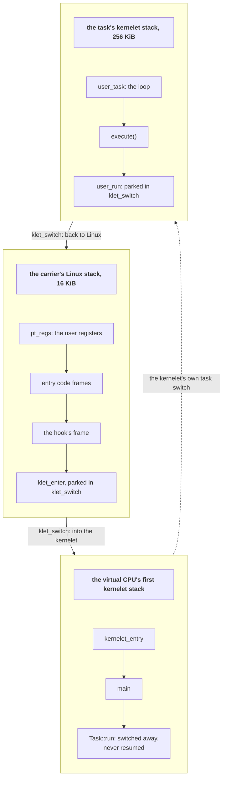

# Two stacks

Chapter 3 drew a picture: the kernel proper's handler for a user program is a loop inside a function, and its local variables live on a kernel stack across every trip to user mode. This chapter is about why Linux cannot give a carrier such a stack, and how the endovisor gives it one anyway.

## Two kernels, two opinions about the stack

<div class="linux">

**Linux: a task's kernel stack.** A Linux task's kernel stack, 16 KiB on x86-64, is empty whenever the task is in user mode. The stack is used whenever the task runs in kernel mode, and it is *empty* while the task is in user mode: a system call builds a few frames on it, and returning to user mode discards them. Linux's exit path relies on this; nothing in Linux can be "in the middle of a function" while its task runs user code. The saved user registers, `pt_regs`, sit at the very top of the stack and are the one thing that survives.

</div>

The kernel proper is built the other way around. Its `execute` call must *return* when the program makes a system call, into a function whose frame was there before the program ran. If kernelet code used the carrier's Linux stack, that frame would be discarded the moment the carrier returned to user mode.

The resolution is to give kernelet code stacks of its own. A **kernelet stack** is a block of kernel memory that the endovisor allocates and that the kernelet's tasks run on. The carrier *switches* onto a kernelet stack to run kernelet code and back onto its Linux stack to let Linux return to user mode. Linux's stack is empty exactly when Linux expects it to be, and the kernelet's stack holds the suspended loop exactly as the kernel proper expects.



Linux tolerates one task with two stacks better than one might fear:

- Linux's scheduler saves and restores only the stack pointer when it switches tasks, so a carrier can be preempted while on a kernelet stack and resumed there.
- Linux finds the current task through a per-processor pointer, not through the stack.
- An interrupt that arrives while the carrier is on a kernelet stack pushes its frame there and then moves to Linux's per-processor interrupt stack, as it would from any kernel stack.
- `pt_regs` are found from the top of the Linux stack, which does not move.

What Linux does *not* tolerate is kernelet code calling into Linux while on a kernelet stack, for any length of time. Linux's code assumes its own stack: its unwinder and backtraces, its checks that a buffer lies on the task's stack, and its idea of how much room is left. So the rule is: **kernelet code runs on a kernelet stack, and nothing the kernelet or the endovisor calls of Linux runs there**; only Linux's own interrupt and exception entry, and preemption on their way out, use it, and the endovisor's own code runs there only in the few lines that switch.

## The switch

The switch is a few lines of assembly, the oldest trick in the book of coroutines: save the registers the calling convention makes the callee responsible for, swap the stack pointer, restore the other side's registers, and return. Because `ret` pops from the *new* stack, the function returns into whatever code was suspended there.

*Simplified from `prototype/linux/endovisor/switch.S`: `klet_switch`.*

```asm
/* void klet_switch(void **save_sp, void *new_sp) */
klet_switch:
	pushq	%rbp
	pushq	%rbx
	pushq	%r12
	pushq	%r13
	pushq	%r14
	pushq	%r15
	movq	%rsp, (%rdi)      /* remember where this stack stopped */
	movq	%rsi, %rsp        /* and continue on the other one */
	popq	%r15
	popq	%r14
	popq	%r13
	popq	%r12
	popq	%rbx
	popq	%rbp
	RET
```

The six pushed registers are the ones the x86-64 calling convention says a called function must preserve; the others may be clobbered by any call, so the compiler never expects them to survive one. To the compiler, `klet_switch` is an ordinary function that happens to return much later, on another stack.

A fresh kernelet stack has to look as if `klet_switch` had already been called on it once, so that the first switch "returns" into the right place. The endovisor plants that frame by hand:

*Simplified from `prototype/linux/endovisor/carrier.c`: `klet_coro_prepare`.*

```c
static void klet_coro_prepare(struct klet_carrier *c)
{
	u64 *sp = (u64 *)((char *)c->stack + KLET_STACK_SIZE);   /* the top of the stack */

	*--sp = 0;                              /* a fake return address */
	*--sp = (u64)klet_coro_trampoline;      /* what klet_switch's `ret` will jump to */
	*--sp = 0;                              /* rbp */
	*--sp = 0;                              /* rbx */
	*--sp = (u64)c;                         /* r12: the carrier, for the trampoline */
	*--sp = 0;                              /* r13 */
	*--sp = 0;                              /* r14 */
	*--sp = 0;                              /* r15 */
	c->coro_sp = sp;
}
```

The first `klet_switch` onto a new stack lands in the kernelet's entry point, through a trampoline. The trampoline moves the carrier pointer from `r12` into the first-argument register and calls `klet_coro_main`, which for virtual CPU 0 is the call to `kernelet_entry` from chapter 4, on a stack the kernelet owns.

The endovisor wraps the switch in two functions, one for each direction:

*Simplified from `prototype/linux/endovisor/carrier.c`: `klet_enter`, `klet_leave`.*

```c
/* On the Linux stack: give control to the kernelet. */
static void klet_enter(struct klet_carrier *c, u64 run_ret)
{
	c->run_ret = run_ret;                   /* what user_run will return, if that is where it stopped */
	c->state = KLET_RUNNING;
	c->depth = 0;
	klet_mirror_in(c);                      /* note Linux's preemption count, for the mirror built later */
	klet_watch_arm(c);                      /* the watch timer on this processor, built later */
	klet_switch(&c->linux_sp, c->coro_sp);  /* returns when the kernelet leaves */
}

/* On a kernelet stack: give control back to Linux. */
static void klet_leave(struct klet_carrier *c, enum klet_cstate state)
{
	klet_mirror_out(c, state == KLET_DEAD); /* what the kernelet lent Linux's preemption count, taken back */
	c->state = state;
	klet_switch(&c->coro_sp, c->linux_sp);  /* returns when the kernelet is next entered */
}
```

`klet_enter` is called from exactly two places, the two hooks: the resume hook, which also makes a new carrier's first entry on its way out of the exec (chapter 6), and the syscall hook. Each of those is a frame on the Linux stack, and `klet_switch` parks that frame until the kernelet leaves.

## Where the stacks come from

<div class="linux">

**Linux: `vmalloc`.** Linux has two kinds of kernel memory: the direct map, physically contiguous, from `kmalloc` and the page allocator; and the **vmalloc area**, where the kernel builds virtually contiguous ranges out of scattered pages with [`vmalloc()`](https://elixir.bootlin.com/linux/v6.12/source/include/linux/vmalloc.h#L144). Each range is followed by an unmapped *guard page*, so running off the end of one faults instead of silently overwriting its neighbor.

</div>

A kernelet stack is 256 KiB from `vmalloc`, with an unmapped page before and after it, since every `vmalloc` range is followed by one.

What the guard page buys is less than it seems. A stack that runs off its end faults with a stack pointer that is already bad; delivering a fault pushes a frame onto the very stack that has run out, so the processor cannot deliver it, and Linux halts the machine on the double fault that results. A check at every function entry of the image would catch it before the end; this prototype has no such check, so a kernel proper with unbounded recursion would halt the host, and the test kernels are written not to recurse.

The endovisor keeps a **pool** of stacks per sandbox: a freed stack goes back to the pool, not to Linux, and the pool is returned whole when the sandbox's last carrier is gone. The reason is a Linux detail a tenant could otherwise turn against the machine: freeing `vmalloc` memory is batched, and the batch ends in a TLB flush on *every* processor, so a kernel that created and ended tasks in a loop would tax processors it is not allowed to run on.

*Simplified from `prototype/linux/endovisor/carrier.c`: `klet_kstack_alloc`, `klet_kstack_put`.*

```c
u64 klet_kstack_alloc(struct klet_inst *inst)
{
	list_for_each_entry(k, &inst->kstack_all, link)     /* a free one in the pool? */
		if (!k->busy) { k->busy = true; return (u64)k->base; }

	if (inst->kstack_made >= inst->kstack_max)          /* the pool is bounded: max_tasks + nr_vcpus stacks, from KLET_CREATE */
		return 0;                                       /* vOSTD turns 0 into an out-of-memory error */
	inst->kstack_made++;
	base = __vmalloc(KLET_STACK_SIZE, GFP_KERNEL_ACCOUNT);   /* else grow the pool; charged to the sandbox (chapter 6) */
	k = kzalloc(sizeof(*k), GFP_KERNEL);
	k->base = base; k->busy = true;
	list_add_tail(&k->link, &inst->kstack_all);
	return (u64)base;
}

void klet_kstack_put(struct klet_inst *inst, u64 base)
{
	list_for_each_entry(k, &inst->kstack_all, link)
		if ((u64)k->base == base) { k->busy = false; return; }
}
```

The real function holds the instance's lock around the search and the reservation, so that two virtual CPUs cannot both take the last stack.

Every kernelet stack comes from this pool: the carrier's first one and each task's. The kernelet reaches the pool through two services, `kstack_alloc` and `kstack_free`. The carrier's own first stack, the one `klet_coro_prepare` sets up, comes from the pool; so does the stack of every task the kernel proper creates.

## Services run on the Linux stack

A **crossing**, in this book, is one service call: from kernelet code into the endovisor and back, switching stacks twice. A service call is kernelet code calling the endovisor, and by the rule above it must switch stacks. It cannot use `klet_enter` and `klet_leave`, which hand control over; it needs to call a function and come back. The endovisor has a second, smaller switch for that:

*Simplified from `prototype/linux/endovisor/switch.S`: `klet_run_on_linux_stack`.*

```asm
/* void klet_run_on_linux_stack(void *linux_sp, struct klet_svc_args *args) */
klet_run_on_linux_stack:
	pushq	%rbp
	movq	%rsp, %rbp            /* remember the kernelet stack */
	movq	%rdi, %rsp            /* jump onto the Linux stack, below the parked frame */
	andq	$-16, %rsp
	movq	%rsi, %rdi
	call	klet_svc_body         /* the service, on Linux's stack */
	movq	%rbp, %rsp            /* and back */
	popq	%rbp
	RET
```

A service runs on the Linux stack just below the frame `klet_enter` parked. `linux_sp` is where `klet_enter`'s `klet_switch` parked the Linux stack, that is, the lowest byte of it in use; everything below is free, and the service runs there.

Every service in the table except one, `user_run`, goes through a stub: a stub packs the arguments into a small structure, calls `klet_run_on_linux_stack`, and unpacks the result.

*Simplified from `prototype/linux/endovisor/carrier.c`: `klet_svc_enter`, `klet_svc_log_write`, `klet_svc_body`.*

```c
static u64 klet_svc_enter(u64 op, u64 a0, u64 a1, u64 a2)
{
	struct klet_carrier *c = klet_current_carrier();
	struct klet_svc_args args = { .op = op, .a0 = a0, .a1 = a1, .a2 = a2 };

	klet_run_on_linux_stack(c->linux_sp, &args);
	return args.ret;
}

static void klet_svc_log_write(const char *ptr, u64 len)     /* what the service table points at */
{
	klet_svc_enter(KLET_SVC_LOG_WRITE, (u64)ptr, len, 0);
}

void klet_svc_body(struct klet_svc_args *args)                /* runs on the Linux stack */
{
	struct klet_carrier *c = klet_current_carrier();

	c->depth++;                      /* "inside the host": the timer and the sweep read this */
	switch (args->op) {
	case KLET_SVC_LOG_WRITE:
		klet_do_out_write(c->inst, &c->inst->log, (const char *)args->a0, args->a1);   /* to the holder's log file, through a ring */
		break;
	case KLET_SVC_MEM_ALLOC:
		args->ret = (u64)klet_do_mem_alloc(c->inst, args->a0, args->a1);
		break;
	/* ... every other service ... */
	}
	c->depth--;
}
```

The endovisor finds the calling carrier from Linux's `current` task and the hooks pointer in it: `klet_current_carrier()` is `container_of(current->carrier_hooks, struct klet_carrier, hooks)` (given a pointer to a field, `container_of` subtracts the field's offset to get the enclosing structure). No service takes a "which kernelet" argument, so a kernelet cannot claim to be another.

The **depth** counter is 1 while a service body runs on the kernelet's behalf, when the carrier may hold Linux's locks. The endovisor's per-processor timer and the sweep that takes a processor back from a stopped sandbox, both built later, read it, with the carrier's state, before touching a carrier's instruction pointer.

Two services do not simply return: `user_run`, which leaves the kernelet stack and does not come back until the next hook brings the carrier in, as the next chapter shows; and `stop`, which uses the stub like any service and then leaves forever.

<div class="recap">

**Recap.** Linux empties a task's kernel stack on every return to user mode; the kernel proper keeps a loop's frame alive across them. So kernelet code runs on kernelet stacks, 256 KiB each, from a per-sandbox pool over `vmalloc`, and the carrier switches between them and its Linux stack with `klet_switch`, a six-register coroutine switch. `klet_enter` hands control to the kernelet and `klet_leave` hands it back; every service call hops onto the Linux stack with `klet_run_on_linux_stack`, runs `klet_svc_body` there with the depth counter raised, and hops back.

</div>
