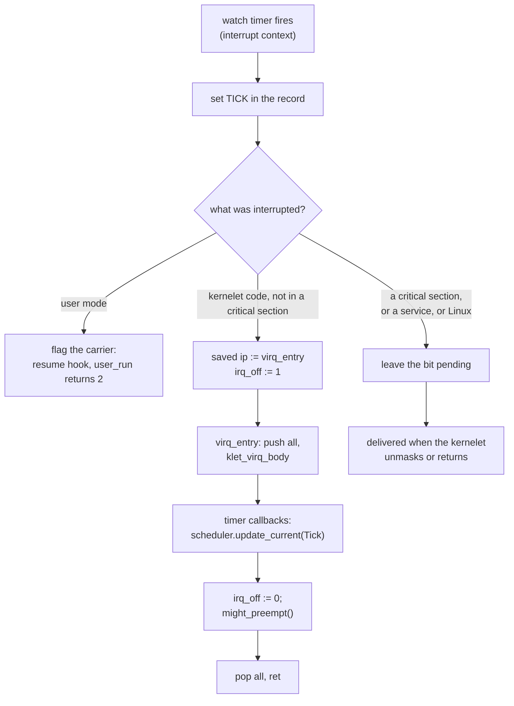

# Virtual interrupts

A scheduler needs to be interrupted. A time slice ends because a timer interrupt fires; a wake-up on another processor is noticed because an interrupt arrives there. The kernelet has no interrupts of its own: Linux owns the interrupt controller, the vector table and every physical line, and nothing in vOSTD can register a handler for any of them. This chapter gives the kernelet virtual ones.

## Bits in a record

A virtual interrupt is a bit in the `pending` word of a virtual CPU's record (chapter 8). The endovisor sets it, from any context; the kernelet's handler for it runs on that virtual CPU's carrier, in ordinary task context, soon after. Two bits exist in this prototype:

| bit | meaning | set by |
|---|---|---|
| TICK | a millisecond of execution has passed on this virtual CPU | the watch timer, below |
| KICK | another virtual CPU wants this one to look at its run queue | the `vcpu_kick` service |

The kernel proper's timer callbacks and its scheduler's tick accounting run from TICK exactly as they would from a hardware timer interrupt. KICK does what a reschedule interrupt does on a machine: it makes the virtual CPU ask its scheduler whether something more urgent has become runnable.

The question is *when* the handler runs, and the answer depends on what the virtual CPU is doing at the moment the bit is set. One term is needed for it. A virtual CPU is in a **critical section** when the kernelet task on it holds at least one preemption guard or spin lock, or has its virtual interrupts masked; the two conditions are kept as two fields of the record, below.

## The watch timer

<div class="linux">

**Linux: high-resolution timers and preemption notifiers.** An [`hrtimer`](https://elixir.bootlin.com/linux/v6.12/source/kernel/time/hrtimer.c) is a timer whose callback runs in interrupt context, normally on the processor that armed it; a *pinned* timer is guaranteed to stay there, and a *hard* one runs in the interrupt itself even on a real-time kernel. The timer interrupt publishes the registers of whatever it interrupted, and a callback reads them with `get_irq_regs()`, which is how Linux's profiler samples programs; if the callback changes the saved instruction pointer, the interrupt returns somewhere else. Not every interrupt publishes its registers that way: the timer does, and the plain cross-processor call that the kick uses, at the end of this chapter, does not. A **preemption notifier** ([`preempt_notifier_register()`](https://elixir.bootlin.com/linux/v6.12/source/kernel/sched/core.c#L4866)) is a pair of callbacks Linux runs for one task every time it switches that task out of a processor and in to one; KVM uses it to know where its virtual CPUs are.

</div>

The **watch timer** is one `hrtimer` per processor, pinned and hard, with a period of one millisecond. The rule for when it runs is one sentence: **a processor's watch timer is armed exactly while the task running there is a carrier.** Each carrier registers a preemption notifier when it starts, and the notifier's switch-in callback arms the timer of whatever processor the carrier has just landed on; the timer's own callback re-arms itself if it interrupted a carrier and stops otherwise. So a carrier that Linux migrates is watched wherever it lands, and no timer runs on a processor that has no carrier.

*Simplified from `prototype/endovisor/watch.c` and `prototype/endovisor/sched.c`: `klet_watch_arm`, `klet_sched_in`.*

```c
static void klet_sched_in(struct preempt_notifier *pn, int cpu)   /* Linux just put this carrier on a processor */
{
	struct klet_carrier *c = container_of(pn, struct klet_carrier, pnotifier);
	klet_watch_arm(c);
}

void klet_watch_arm(struct klet_carrier *c)
{
	struct hrtimer *timer = this_cpu_ptr(&klet_watch_timer);
	if (!hrtimer_active(timer))
		hrtimer_start(timer, ns_to_ktime(KLET_WATCH_INTERVAL_NS), HRTIMER_MODE_REL_PINNED_HARD);
}
```

Every time a period expires, the callback raises TICK and then decides how to deliver whatever is pending:

*Simplified from `prototype/endovisor/watch.c`: `klet_watch_fn`.*

```c
static enum hrtimer_restart klet_watch_fn(struct hrtimer *timer)
{
	struct pt_regs *regs = get_irq_regs();      /* what the interrupt interrupted; NULL if nothing was */
	struct klet_carrier *c;
	bool tick = true;

	if (this_cpu_read(klet_watch_requested)) {  /* a kick asked for this firing (below): it is a tick */
		this_cpu_write(klet_watch_requested, false);              /* only if the period it cut short has run out meanwhile */
		tick = !ktime_before(hrtimer_cb_get_time(timer), this_cpu_read(klet_watch_period_end));
	}

	if (!current->kernelet)                     /* not a carrier any more: stop */
		return HRTIMER_NORESTART;
	c = klet_current_carrier();

	if (tick)
		klet_virq_raise(c, KLET_VIRQ_TICK);     /* 1. the tick */

	if (!regs || user_mode(regs) || !klet_in_image_text(regs->ip) || !klet_in_kernelet(c)) {
		/* no registers, user mode (klet_virq_raise flagged the carrier), a service, or Linux: leave it pending */
	} else if (!klet_critical(c)) {
		klet_virq_redirect(c, regs);            /* 2. in kernelet code, not in a critical section: deliver now */
	} else {
		/* in a critical section: the kernelet delivers it itself when the section ends */
	}
	/* 3. the bound on critical sections: chapter 10 */

	hrtimer_forward_now(timer, ns_to_ktime(KLET_WATCH_INTERVAL_NS));   /* a requested firing goes back to its period's own expiry instead */
	return HRTIMER_RESTART;
}
```

`klet_virq_raise` sets the bit and does the two cheap things that get it noticed: wakes the carrier if it is asleep in `vcpu_idle`, and flags it (chapter 5) if it is in user mode, so that it comes back through the resume hook, `user_run` returns 2, and `execute`'s loop runs the handler before it re-enters user mode. A flag set while the hook is already running is not lost either: the patch runs Linux's own notify-resume work, which clears the flag, *before* the hook (chapter 4), so the exit loop finds the new request on its next look and runs the hook again.

The interesting case is the middle one: the carrier is executing kernelet code, at an arbitrary instruction, and is not in a critical section. A machine would push the interrupted instruction pointer and jump to the handler. The endovisor does the same, by changing one saved register:

*Simplified from `prototype/endovisor/watch.c`: `klet_virq_redirect`.*

```c
bool klet_virq_redirect(struct klet_carrier *c, struct pt_regs *regs)
{
	if (user_mode(regs) || !klet_in_image_text(regs->ip) || !klet_in_kernelet(c))
		return false;
	if (klet_irq_off(c))                         /* interrupts masked: wait */
		return false;
	limit = READ_ONCE(c->vrec.stack_limit);
	if (!limit || regs->sp < limit || regs->sp - limit < KLET_UPCALL_HEADROOM)
		return false;                            /* no limit published, or not enough stack for the handler */

	WRITE_ONCE(c->vrec.virq_ip, regs->ip);       /* where we interrupted the kernelet */
	WRITE_ONCE(c->vrec.irq_off, 1);              /* mask, as hardware clears IF when it takes an interrupt */
	regs->ip = (unsigned long)kernelet_entry_table.virq_entry;   /* return there instead */
	return true;
}
```

When the timer interrupt returns, it returns into the kernelet's upcall stub rather than into the interrupted instruction. `klet_in_kernelet(c)` is the endovisor's own bookkeeping, state `RUNNING` and depth 0, from chapter 6: a carrier inside a service call is never redirected, because it may hold Linux's locks.

## The upcall

The stub is in vOSTD, in assembly, because it is entered between two arbitrary instructions and must put every register and the flags back exactly. It saves everything on the *current task's* kernelet stack, calls a Rust function, and returns to the interrupted instruction. It is written in Intel syntax, destination first, as Rust's `global_asm!` has it; chapter 6's switch was in the assembler's own syntax, source first.

*Simplified from `prototype/vostd/src/vcpu.rs`: `klet_virq_entry`, `klet_virq_body`.*

```asm
klet_virq_entry:
    lea rsp, [rsp - 8]       ; a slot for the interrupted instruction pointer (lea, not sub: sub would change the flags)
    pushfq                   ; the flags, exactly as the interrupted code left them
    push rax ... push r15    ; every general register
    mov rbp, rsp
    and rsp, -16             ; align for the call
    call klet_virq_body      ; returns the instruction pointer to resume at
    mov rsp, rbp
    mov [rsp + 128], rax     ; into the slot
    pop r15 ... pop rax
    popfq
    ret                      ; to the interrupted instruction
```

```rust
extern "C" fn klet_virq_body() -> u64 {
    let rec = vrec();
    let ip = unsafe { read_volatile(rec.virq_ip.get()) } as usize;
    assert!(IMAGE_TEXT_LO <= ip && ip < IMAGE_TEXT_HI);   // never resume at an address the host made up

    let owns_mirror = get_guard_count() == 0;            // this upcall begins a critical section of its own
    if owns_mirror { host_preempt_inc(); }               // chapter 10: tell Linux so

    run_handlers(rec);                                   // TICK: the timer callbacks; KICK: a look at the run queue

    let host_wants_cpu = if owns_mirror { host_preempt_dec_and_test() } else { false };
    unsafe { write_volatile(rec.irq_off.get(), 0) };     // unmask: what a machine's interrupt return would do
    if host_wants_cpu { host_yield(); }                  // chapter 10: Linux was waiting for this processor
    if get_guard_count() == 0 {                          // kernel-mode preemption: switch if the scheduler wants to
        crate::task::scheduler::might_preempt();
    }
    ip as u64
}

fn run_handlers(rec: &VcpuRec) {
    loop {
        let pending = rec.pending.swap(0, Ordering::AcqRel);
        if pending == 0 { break; }
        if pending & VIRQ_TICK != 0 { crate::timer::call_timer_callback_functions(); }
        if pending & VIRQ_KICK != 0 { cpu_local::set_need_preempt(); }
    }
}
```

The last few lines are something OSTD on a machine does not do today, and the design needs: **kernel-mode preemption**. Because the interrupted instruction pointer is on the task's own stack, the handler may switch to another task before returning, and the interrupted task resumes later, from the same frame, on whichever virtual CPU next picks it. That is how a tick ends a time slice in the middle of a kernel task's computation, as it does on a machine with a preemptible kernel.



## Interrupts off, and guards

Two separate fields in the record stand for the two ways a kernel holds things off, and they are kept separate because OSTD keeps them separate.

- `irq_off` is the virtual interrupt flag, inverted. vOSTD sets it where OSTD's interrupts-off guard would clear the processor's flag, and clears it when the guard drops; the endovisor sets it when it redirects into the upcall, and the upcall clears it at the end. While it is set, nothing is delivered.
- The **guard count**, the low bits of `preempt_info`, is how many preemption guards and spin locks are held. What a guard *means* is that no task switch happens on this virtual CPU while it is held; how that is *enforced* is that the watch timer never redirects a task that holds one, so the upcall, the one place a switch could happen underneath kernelet code, is never entered under a guard. A bit raised while a guard is held waits for the last guard to drop, which is the unmask path below. Handlers may still run under a guard: when the carrier comes back from user mode with a bit pending, `execute` runs them whatever the count. And `klet_virq_body` tests the count once more before `might_preempt`, because a handler may have taken a guard of its own and not yet dropped it.

Both are updated by the virtual CPU that owns the record, with single instructions where it matters, because the endovisor reads them from an interrupt on the same processor and the upcall writes them. If a guard's increment compiled to a load, an add and a store, and an upcall ran between the load and the store and changed the word itself, the store would overwrite the upcall's change; a single `inc` cannot be split by an interrupt.

Kernel-mode preemption has one more consequence, which OSTD on a machine never meets, because its interrupts never switch tasks underneath kernel code. `reschedule` (chapter 8) makes its decision and then switches; between the two, the run queue has already made the chosen task its current one and put the still-running task back in the queue. An upcall that lands in that window and calls `might_preempt` would decide again, and could pick the task that is still running; a switch to a task waits until that task has finished switching away, which a running task never does. So vOSTD marks the window with a flag in the virtual CPU's local storage, set before the decision is made and cleared once the switch has completed, or at once when the decision is to do nothing, and `might_preempt` inside the window only leaves a note. The switch, once complete, or the decision to do nothing, acts on the note at once, so a preemption is deferred by the window and never by more. The window has a price, which chapter 14 shows on the wake-up across virtual CPUs: a kick usually arrives after the woken virtual CPU has already picked the task, lands inside the window, and the note costs one reschedule that finds nothing to do.

A bit that was left pending while interrupts were masked must still be delivered. The guard that unmasks does it:

*Simplified from `prototype/vostd/src/task/preempt/cpu_local.rs` and `prototype/vostd/src/vcpu.rs`: `irq_unmask`, `deliver_if_pending`, `handle_virq`.*

```rust
pub(crate) fn irq_unmask() {
    let leaving = get_guard_count() == 0;       // the end of a critical section?
    /* ... chapter 10's mirror ... */
    set_irq_off(false);
    if leaving {
        vcpu::deliver_if_pending();             // one load and a branch
    }
}

pub(crate) fn deliver_if_pending() {
    if has_pending() { handle_virq(); }
}

pub(crate) fn handle_virq() {                   // the same handlers, called as a function
    {
        let _guard = crate::irq::disable_local();
        run_handlers(vrec());
    }
    crate::task::scheduler::might_preempt();
}
```

The same check runs whenever the last guard drops, which follows every service that ran under a guard, in case a bit arrived while the carrier was in Linux. So a virtual interrupt is delivered by whichever of three paths comes first: the upcall, if the kernelet was not in a critical section when it arrived; the end of the critical section, if it was; or the return from user mode.

## The kick's interrupt

When one virtual CPU kicks another that is running kernelet code on a different processor, waiting for that processor's next watch tick could cost a millisecond. The endovisor sends an inter-processor interrupt instead, with the one Linux function for running a function on another processor. The function it runs cannot redirect anything itself, because that kind of interrupt does not publish the interrupted registers; what it can do is make the processor's watch timer fire at once, and the watch timer's callback, which does see the registers, delivers the kick:

*Simplified from `prototype/endovisor/sched.c`: `klet_kick_remote`, `klet_kick_ipi`.*

```c
void klet_kick_remote(struct klet_carrier *c)
{
	if (c->state != KLET_RUNNING || c->depth != 0 || !klet_task_on_cpu(c->task))
		return;                                 /* not in kernelet code on a processor: the bit will be found */
	smp_call_function_single(task_cpu(c->task), klet_kick_ipi, c, 0);
}

static void klet_kick_ipi(void *arg)            /* runs in interrupt context on that processor */
{
	struct klet_carrier *c = arg;
	if (current->kernelet == &c->gate)          /* still the same carrier there? */
		klet_watch_fire_now();                  /* then make the watch timer fire, and it will redirect */
}
```

A requested firing is not a tick, unless the period it cut short has already run out: the callback raises no TICK for it, takes no strike (chapter 10), and puts the timer back on the expiry of the period it cut short, so a kick neither advances the kernelet's clock nor delays its next tick. A kick whose bit is already set does nothing at all, so a thousand kicks cost one delivery.

<div class="recap">

**Recap.** Virtual interrupts are bits in the virtual CPU's record: TICK from the watch timer, KICK from `vcpu_kick`. The watch timer is a pinned, hard, one-millisecond `hrtimer` per processor, armed by each carrier's preemption notifier whenever Linux puts the carrier on that processor. When it finds the carrier in kernelet code with virtual interrupts on, it points the interrupted frame at the image's upcall stub, which saves everything on the task's stack, runs the handlers, and may switch tasks before returning: kernel-mode preemption. A carrier in user mode is flagged; one with interrupts masked delivers the bit itself when it unmasks.

</div>
