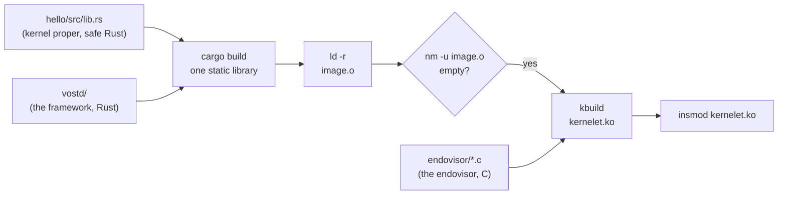

# What a kernelet is made of

The previous chapter was the view from above the framework: a kernel that allocates frames, maps pages and enters user mode. This chapter is the view from below. It says what a kernelet is as a thing in memory, how it is built, and how it talks to the host. Nothing in it runs yet; it is the shape that the next chapters fill in.

## Three layers and one file

A kernelet is three layers of code compiled into one file.

1. **The kernel proper**, the hundred-line kernel of the last chapter: safe Rust, never edited.
2. **vOSTD**, a Rust crate whose library name is `ostd`, so that the kernel proper's `use ostd::...` lines resolve to it. It offers every type and function the kernel proper uses, with the same names and signatures as the real OSTD. It is in `prototype/vostd/`.
3. **The image ABI** (an *application binary interface* is the exact layout of what two separately compiled pieces of code pass each other), a few C-layout structures that both vOSTD and the endovisor know: what the host tells the kernelet at start, which functions the kernelet may call, and which functions the host may call. It is in `prototype/vostd/src/abi.rs` on the Rust side and `prototype/endovisor/kernelet.h` on the C side, and the two must agree byte for byte.

The build compiles the kernel proper and vOSTD together into one static library, links it with `ld -r` into a single relocatable object, `image.o`, and checks two things about that object: that it has **no undefined symbols**, and that its *relocations*, the places in the code that the loader must patch with final addresses, are of kinds Linux's module loader accepts. Then it links `image.o` into the endovisor's kernel module, `kernelet.ko`, together with the endovisor's own C files.



"No undefined symbols" is the whole security story of the build, so it deserves a sentence. A symbol is undefined in an object when the code calls a function the object does not contain; the linker fills it in later. An image with none cannot call anything outside itself. It *calls* Linux in exactly one way: through a table of function pointers the endovisor hands it when it starts. That is the service table, and the kernelet cannot call what is not in it, because it cannot name anything else. (It also reads two words of Linux's and writes one, at offsets the endovisor publishes, for reasons chapters 8 and 10 give; those are the whole of its other contact with the host.)

In this prototype the image is linked statically into the module, so there is one kernelet per module load. A full endovisor would load images at run time, sharing one copy of the code among many kernelets; the prototype's shortcut changes nothing below this chapter.

<div class="linux">

**Linux: modules and exported symbols.** A kernel module is code loaded into the running kernel with `insmod`. It may call only kernel functions that the kernel marks as **exported** (`EXPORT_SYMBOL` in the source); the rest are private to the kernel even though they are in the same address space. The endovisor is a module. A few functions it needs are not exported in a stock kernel, which is one of the two reasons for the patch in the next chapter.

</div>

## The three tables

The image ABI has three structures. Here they are, trimmed to what this chapter can explain; the fields left out belong to later chapters.

*Simplified from `prototype/vostd/src/abi.rs`: `BootArgs`, `Services`, `EntryTable`.*

```rust
/// What the endovisor tells the kernelet about the world it was given.
#[repr(C)]
pub struct BootArgs {
    pub abi_version: u64,
    pub grant_paddr: u64,        // the physical address of its memory
    pub grant_len: u64,          // and how much: 4 MiB here
    pub linear_map_base: u64,    // where Linux maps all of physical memory
    pub nr_vcpus: u64,           // how many virtual CPUs the sandbox has
    pub tsc_khz: u64,            // the cycle counter's frequency
    // ... how to find the virtual CPU record, the command line, and more
}

/// The host functions the kernelet may call. Its only way out.
#[repr(C)]
pub struct Services {
    pub abi_version: u64,
    pub log_write: unsafe extern "C" fn(ptr: *const u8, len: u64),
    pub mem_alloc: unsafe extern "C" fn(size: u64, align: u64) -> *mut u8,
    pub mem_free: unsafe extern "C" fn(ptr: *mut u8, size: u64, align: u64),
    pub user_run: unsafe extern "C" fn(ctx: *mut RawUserContext) -> u64,
    pub vm_create: unsafe extern "C" fn() -> i64,
    pub vm_map: unsafe extern "C" fn(space: u64, va: u64, paddr: u64, prot: u32) -> i64,
    // ... vm_unmap, vm_protect, vm_flush, vm_wait, vm_wake, vm_activate, vm_destroy
    pub kstack_alloc: unsafe extern "C" fn() -> u64,
    pub kstack_free: unsafe extern "C" fn(base: u64),
    pub vcpu_boot: unsafe extern "C" fn(id: u64),
    pub vcpu_kick: unsafe extern "C" fn(id: u64),
    pub vcpu_idle: unsafe extern "C" fn(deadline_ns: u64),
    pub vcpu_yield: unsafe extern "C" fn(),
    // ... vcpu_on_spin, fpu_save, fpu_load
    pub stop: unsafe extern "C" fn(code: u64) -> !,
}

/// The kernelet functions the host may call.
#[repr(C)]
pub struct EntryTable {
    pub abi_version: u64,
    pub kernelet_entry: unsafe extern "C" fn(boot: *const BootArgs, svc: *const Services),
    pub vcpu_entry: unsafe extern "C" fn(id: u64),
    pub virq_entry: unsafe extern "C" fn(),
}
```

<div class="rust">

**Rust: C-shaped structs and function pointers.** `#[repr(C)]` lays a struct out in memory exactly as C would, so a C program can read it. `unsafe extern "C" fn(...)` is a pointer to a function with the C calling convention; calling one is `unsafe`, because the compiler cannot check what is on the other side. vOSTD is the only crate in the image allowed to write `unsafe`, so only vOSTD can call a service.

</div>

Two rules shape every service. Arguments are integers or pointers into the kernelet's own memory: a space number, a virtual address, a physical address, a buffer to log. The one exception is the heap, whose blocks are the host's, below. And the host keeps no pointer into the kernelet after a call returns. Both keep a buggy vOSTD from steering the endovisor into writing wherever the kernelet says.

The image's one exported symbol is the entry table:

*Simplified from `prototype/vostd/src/abi.rs`: `kernelet_entry_table`.*

```rust
#[no_mangle]
pub static kernelet_entry_table: EntryTable = EntryTable {
    abi_version: KLET_ABI_VERSION,
    kernelet_entry: crate::kernelet_entry,
    vcpu_entry: crate::vcpu_entry,
    virq_entry: crate::vcpu::klet_virq_entry,
};
```

The endovisor checks `abi_version` against its own when the module loads, and refuses to load if the two halves were built from different ABIs.

## The grant and the direct map

A kernel needs memory to manage. The endovisor gives a kernelet a **grant**: one physically contiguous block of RAM, 4 MiB in this prototype, taken from Linux's page allocator when the module loads and described in the boot arguments by its physical address and length.

*Simplified from `prototype/endovisor/main.c`: `klet_grant_alloc`.*

```c
static int klet_grant_alloc(struct klet_inst *inst)
{
	inst->grant_pages = alloc_pages(GFP_KERNEL | __GFP_ZERO, KLET_GRANT_ORDER);  /* 2^10 pages */
	if (!inst->grant_pages)
		return -ENOMEM;
	inst->boot.grant_paddr = page_to_phys(inst->grant_pages);
	inst->boot.grant_len = KLET_GRANT_LEN;
	inst->boot.linear_map_base = (u64)(unsigned long)__va(0);
	return 0;
}
```

<div class="linux">

**Linux: the direct map.** Linux maps *all* of physical memory, in order, into one region of the kernel's address space, called the direct map or linear map. Turning a physical address into a pointer the kernel can dereference is therefore one addition: `__va(paddr)` is `paddr + base`. `kmalloc` and the page allocator hand out direct-map memory, so for them a kernel pointer and a physical address are two names for the same bytes; `vmalloc`, which chapter 6 uses, is the exception, because it maps scattered pages into a separate region. The line `__va(0)` above is simply the base.

</div>

vOSTD's frame allocator runs over the grant exactly as OSTD's runs over a machine's RAM: a bitmap with one bit per 4 KiB frame, a first-fit search for `n` contiguous free frames, and a reference count per frame (the count matters in chapter 13). When the kernel proper's `FrameAllocOptions` asks for a segment, this is what answers.

*Simplified from `prototype/vostd/src/mm/frame.rs`: `alloc`, `FrameAllocOptions`.*

```rust
pub(crate) fn alloc(nframes: usize) -> Option<Paddr> {
    let guard = Guard::lock();                 // a spin lock over the bitmap
    let bits = guard.bits();
    let mut start = 0;
    'outer: while start + nframes <= total {
        for i in start..start + nframes {
            if test(bits, i) { start = i + 1; continue 'outer; }   // in use: look further
        }
        for i in start..start + nframes {
            bits[i / 64] |= 1u64 << (i % 64);
            REFS[i].store(1, Ordering::Relaxed);                     // one reference: the handle
        }
        return Some(BASE + start * PAGE_SIZE);
    }
    None
}
```

And the translation from a frame's physical address to something the kernelet can read and write is the same one addition Linux uses, with the base the boot arguments supplied:

*Unchanged from `prototype/vostd/src/mm/mod.rs`: `paddr_to_vaddr`.*

```rust
pub(crate) fn paddr_to_vaddr(paddr: Paddr) -> usize {
    crate::abi::linear_map_base() + paddr
}
```

This is how the hundred-line kernel's `segment.write_bytes(0, program)` lands in RAM: vOSTD adds the base to the segment's physical address and copies there. No page table is touched, because Linux mapped that memory before the kernelet existed.

## Three small services

Three of the services need no more than a sentence each, and the hundred-line kernel uses all three.

<div class="rust">

**Rust: traits.** A trait is an interface: a list of functions a type must provide. `impl GlobalAlloc for HostHeap` says that the type `HostHeap` provides the two functions the `GlobalAlloc` trait names, and the attribute `#[global_allocator]` tells Rust to use it for every heap allocation. A function written `fn f<T: SomeTrait>(x: &T)` accepts any type that provides the trait's functions. Implementing a trait is `unsafe` when the trait's contract is one the compiler cannot check, as an allocator's is.

</div>

**The heap.** Rust's `Vec`, `Box` and `Arc` need a heap. vOSTD's is the host's: a global allocator that forwards each allocation to the services `mem_alloc` and `mem_free`, which the endovisor implements with Linux's `kmalloc` and `kfree`.

*Simplified from `prototype/vostd/src/mm/heap.rs`: `HostHeap`.*

```rust
struct HostHeap;

unsafe impl GlobalAlloc for HostHeap {
    unsafe fn alloc(&self, layout: Layout) -> *mut u8 {
        (svc().mem_alloc)(layout.size() as u64, layout.align() as u64)
    }
    unsafe fn dealloc(&self, ptr: *mut u8, layout: Layout) {
        (svc().mem_free)(ptr, layout.size() as u64, layout.align() as u64)
    }
}

#[global_allocator]
static HEAP: HostHeap = HostHeap;
```

**The console.** `println!` collects a line and hands it to `log_write`, which the endovisor prints with `printk`, prefixed `kernelet:`. That is why every line the kernelet prints appears in the serial log beside Linux's own messages.

**Power-off.** `poweroff` is the service `stop`, which never returns. What the endovisor does with it is chapter 11.

## How the kernelet starts

The endovisor enters the image at `kernelet_entry` with the two tables. vOSTD records them, sets up what the chapter has described, and calls the kernel proper's `main`.

*Simplified from `prototype/vostd/src/lib.rs`: `kernelet_entry`.*

```rust
pub(crate) unsafe extern "C" fn kernelet_entry(boot: *const BootArgs, svc: *const Services) {
    abi::init_tables(boot, svc);          // keep the pointers; check the ABI version
    let args = &*boot;
    cpu::init(args.nr_vcpus as usize);
    time::init(args.tsc_khz);
    mm::frame::allocator::init(args.grant_paddr as usize, args.grant_len as usize);
    mm::heap::init();
    boot::init(cmdline);
    __ostd_main()                          // generated by #[ostd::main]: calls main(), then yields
}
```

`__ostd_main` is generated by the `#[ostd::main]` attribute on the kernel proper's `main`. It calls `main`, and then calls `Task::yield_now()`, which switches to the first task that `main` started and never returns. That is how the hundred-line kernel goes from piece 1 to piece 3: `main` built a task and returned, and the framework's scheduler ran it.

What remains unexplained is where `kernelet_entry` is *called from*: on which Linux task, on which stack, and how that task later enters user mode for the kernelet. Those are the next four chapters.

<div class="recap">

**Recap.** A kernelet is one object file holding the kernel proper and vOSTD, with no undefined symbols, linked into the endovisor's module. It talks to the host through three C-layout tables: boot arguments in, a service table of function pointers out, and an entry table the host calls. Its memory is a grant of 4 MiB whose frames it reaches through Linux's direct map, its heap is `kmalloc` behind a service, and its console is `printk`. The endovisor starts it by calling `kernelet_entry`, which ends in the kernel proper's `main`.

</div>
