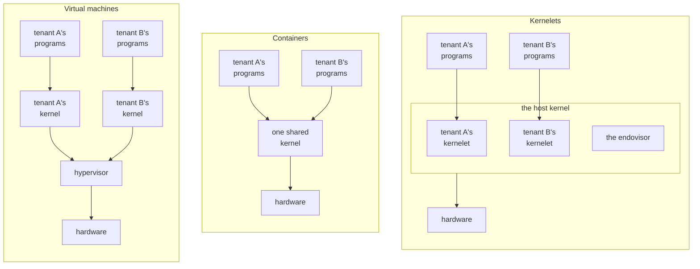

# Why a kernel of your own

A cloud provider, the **operator** of its machines, must keep its customers, called **tenants**, from reading, corrupting or starving each other. The business is profitable only because one physical computer runs programs from many tenants. Tenants do not trust each other, and the operator trusts none of them. There are two established ways to keep them apart, and this chapter introduces a third.

## Two ways to share a machine

A **virtual machine** separates tenants strongly, at the price of a second layer of everything. It gives each tenant a whole simulated computer: the tenant installs a kernel in it and runs programs on that kernel, and a layer underneath, the *hypervisor*, shares the real machine among the simulated ones. The separation is the hardware's own: the processor refuses to let a guest touch anything outside its simulated machine. The second layer is a second kernel per tenant, a second translation of every memory address (once through the guest's page table, once through the hypervisor's), and a trap into the hypervisor whenever a guest touches a device the hypervisor simulates.

A **container** separates tenants only as deeply as the shared kernel is correct. It gives each tenant a slice of one kernel; what separates tenants is bookkeeping inside it, which hides one tenant's processes and files from another's. There is one kernel and one translation of every address, so the cost is almost nothing. But every tenant can call nearly every system call of the shared kernel, which is built from tens of millions of lines of C, and a bug anywhere in that surface is a hole between tenants.

In each panel an arrow points from code to the layer that serves its requests.

## A kernel inside the kernel

The third panel is the **kernelet**: a tenant's own kernel, loaded *into* the kernel that runs the machine, the **host kernel**, and run there in kernel mode beside the host's own code. Each tenant gets a kernel of its own, as with a virtual machine, but with no hypervisor and no simulated hardware: a kernelet is an ordinary piece of loaded code.

The operator, not the tenant, compiles every kernelet. That matters because code in kernel mode can do anything: read any memory, write any page table, halt the machine. Loading a binary a tenant supplied would hand the tenant the whole computer. So the operator builds each kernelet from source, with a compiler the operator trusts, and a tenant chooses among the kernels the operator offers: a kernel of its own in that no other tenant shares it, not one it wrote. The next two sections are about that source.

## A kernel in two layers

A kernelet's source is written the way Asterinas is. Asterinas, a Rust kernel that aims to run the programs Linux runs, is built as a *framekernel*: it is split into two layers with a hard rule between them.

- **OSTD**, the *framework*, is the small part of the kernel that alone, among Asterinas's own crates, may use Rust's `unsafe`. It wraps the machine (page tables, tasks, interrupts, entry to user mode) in an interface that cannot be misused to corrupt memory.
- **The kernel proper** is everything else: system calls, file systems, the network stack, process and memory management. It is written entirely in *safe* Rust against OSTD's interface, and so is every crate of its own that it is built from.

So the kernel proper can reach the machine only through OSTD's interface. It cannot read through a forged address, because safe Rust cannot dereference one. It cannot execute a privileged instruction, because that takes inline assembly, which is `unsafe`. It can change a page table only by asking OSTD, which checks every request before carrying it out.

The rule binds the libraries the kernel proper uses as well as its own crates. Those libraries are Rust's `core` and `alloc`, whose `unsafe` code every Rust program trusts, and third-party crates, which must offer no safe function that does what only `unsafe` code should, such as running a privileged instruction. Asterinas does not yet keep that rule everywhere: its default build includes a confidential-computing crate with a safe function that runs a privileged instruction, which its own source marks as a fault to fix, and a kernelet build leaves that feature out.

That limit rests on a property of OSTD called **soundness**: no safe Rust code written against its interface can break memory safety, whatever that code does. Soundness is the foundation of kernelets, as the next section shows.

OSTD's soundness is argued, not proved. Its authors lay out the argument in the soundness analysis of the Asterinas book and rely on review; research on Asterinas adds fuzzing, model checking and a verified memory-management design.

## The same kernel, a different framework

Give the kernel proper a *different* OSTD: the same interface, without a single change, implemented so that every request it makes of the host concerns only one tenant's resources. Most operations that would touch hardware become requests to the host; the few that are harmless to it, such as reading the cycle counter, the framework still does itself. The book calls that framework **vOSTD**, *virtual OSTD*, as a virtual machine is a virtual computer. In principle vOSTD offers all of OSTD's interface; this book's offers the part its kernels use. The kernel proper is linked with vOSTD into one image. Each running instance of that image is a kernelet.

Whether a kernelet can corrupt the host then comes down to the soundness of what it is built from. That is vOSTD, which is new code that uses `unsafe` as OSTD does; the `unsafe` inside `core`, `alloc` and the library crates; the compiler; and the host's own handling of each request. OSTD's design analysis does not carry over to vOSTD, so the chapters that build vOSTD argue its soundness piece by piece.

A kernelet's boundary is the language, not a hardware mode: where a hypervisor virtualizes the hardware beneath a kernel, vOSTD virtualizes the interface the kernel is written against. What a kernel proper can call or refer to is only what is linked into its image, its own crates, Rust's `core` and `alloc`, and vOSTD; the image calls no symbol of the host's. What vOSTD can ask of the host is a fixed list of functions, the **service table**, that it is handed when it starts. Besides those calls, vOSTD touches the host's memory only where the host publishes a place for it: it reads two words of the host's (which task runs on this processor, and that task's link to its kernelet), raises and lowers a third (the host's preemption count), and reads its tenants' page tables, which the host keeps for it.

The language confines what a kernelet can touch, not how long it holds a processor. Keeping a kernelet from starving its neighbors is the host's job, and a timer interrupt takes a processor back even from kernel-mode code; the chapters on virtual interrupts and on sharing a processor show how.

In this book the host is **Linux**, and hosting kernelets costs it a small patch, two configuration settings and one kernel module, the **endovisor**. The operator rebuilds Linux 6.12 for x86-64 with the patch, with the patch's own option on and vsyscall emulation off, and loads the module. A tenant then gets a kernel of its own, the kernel proper in safe Rust over vOSTD, inside Linux. Any kernel could implement the service table instead; the host could be Asterinas itself.

## The words

These are used in one sense throughout the book.

| word | meaning |
|---|---|
| **tenant** | whoever's programs run in a sandbox; assumed hostile |
| **operator** | whoever runs the machine: builds the kernelets, configures the host, and is trusted |
| **kernelet** | one instance of a kernel proper written in safe Rust against OSTD's interface (Asterinas's, or in this book a hundred-line kernel and four small test kernels), linked with vOSTD and running in kernel mode inside the host kernel |
| **sandbox** | one tenant's environment: a kernelet plus the user-mode programs it serves. What a virtual machine or a container is to its tenant |
| **host kernel**, or **host** | the kernel that owns the machine. In this book, Linux |
| **endovisor** | the component of the host kernel that creates, serves and destroys kernelets. *Endo-* because it sits inside the host kernel, beside the kernelets, where a hypervisor sits beneath its guests. In this book, a Linux kernel module |
| **vOSTD** | the framework inside a kernelet: OSTD's interface with a different implementation underneath |
| **service table** | the fixed list of host functions vOSTD may call; its only way to call the host |
| **grant** | the physical memory a kernelet has been given, from which it maps its tenant's pages |
| **virtual CPU** | one of the fixed number of processors a kernelet is given when it is created; the kernelet schedules its tasks on them as a kernel does on real processors (chapter 9) |
| **carrier** | a Linux task (a thread, in Linux's word) that carries one of a kernelet's virtual CPUs: Linux schedules the task, and the kernelet runs its own code and the tenant's programs on it (chapters 2 and 6) |
| **kernelet runtime** | the host program that creates and configures sandboxes, as a container runtime does (chapter 2) |
| **carrier event hooks** | the two functions Linux calls for a carrier, at a system call and on the way back to user mode; the core of the one small patch to Linux (chapter 5) |

A term with a chapter beside it is defined in full there.

## What the book builds

The book runs five small kernels as kernelets inside Linux. The first is a teaching example from the Asterinas project, run **with its source unchanged**: a kernel of about a hundred lines of safe Rust that loads one user program, runs it, and serves its two system calls, `write` and `exit`. Chapter 3 reads it. The other four, written for the prototype, exercise what the hundred lines do not reach: a scheduler of the kernelet's own, a timer, being stopped, and a tenant address space under load.

The prototype is small, but it exercises the hardest parts of OSTD's interface with the real Linux mechanisms. It runs one sandbox at a time, gives it a fixed 4 MiB of physical memory for its tenant, and has no devices, so the separation of two live tenants is designed rather than demonstrated. None of its kernels is Asterinas's full, Linux-compatible kernel proper, which has not yet run on Linux.

**Recap.** A kernelet is a tenant's own kernel: a kernel proper in safe Rust, compiled by the operator, over a framework, vOSTD, that offers the same interface as the real framework but confines every request to the tenant. It reaches the host only through the service table and the few words the host publishes to it. Linux is the host in this book; the endovisor is the Linux module that serves kernelets.

