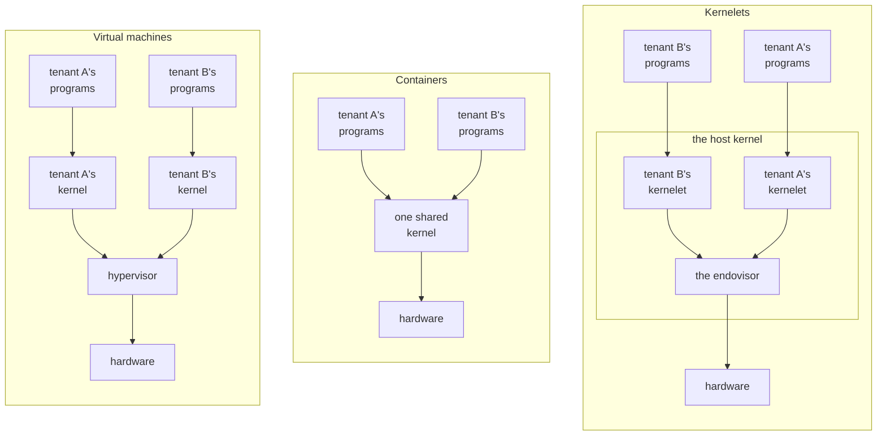

# Why a kernel of your own

A cloud provider, the **operator** of its machines, must keep its customers, called **tenants**, from reading or corrupting each other's data, or starving each other of the machine. The business is profitable only because one physical computer runs programs from many tenants. Tenants do not trust each other, and the operator trusts none of them. There are two established ways to keep them apart, and this chapter introduces a third.

## Two ways to share a machine

A **virtual machine** separates tenants strongly, at the price of a second layer of everything. It gives each tenant a whole simulated computer, in which the tenant installs a kernel and runs programs on that kernel. A layer underneath, the *hypervisor*, shares the real machine among the simulated ones. The separation is the hardware's own: the processor refuses to let a guest touch anything outside its simulated machine. The second layer is a second kernel per tenant, a second translation of every memory address (once through the guest's page table, once through the hypervisor's), and a trap into the hypervisor whenever a guest touches a device the hypervisor simulates.

A **container** costs almost nothing, but separates tenants only as deeply as the shared kernel is correct. It gives each tenant a slice of one kernel; what separates tenants is bookkeeping inside it, which hides one tenant's processes and files from another's. There is one kernel and one translation of every address, so the cost is almost nothing. But every tenant can call nearly every system call of the shared kernel, which is built from tens of millions of lines of C, and a bug anywhere in that surface is a hole between tenants.

In each panel an arrow points from code to the layer that serves its requests; a kernelet's requests go to the endovisor, introduced below.

## A kernel inside the kernel

The third panel is the **kernelet**: a tenant's own kernel, loaded *into* the kernel that runs the machine, the **host kernel**, and run there in kernel mode beside the host's own code. Each tenant gets a kernel of its own, as with a virtual machine, but with no hypervisor and no simulated hardware: a kernelet is an ordinary piece of loaded code. A kernel of its own means one that no other tenant shares, not one the tenant wrote.

The operator, not the tenant, compiles every kernelet. Code in kernel mode can do anything: read any memory, write any page table, halt the machine. Loading a binary a tenant supplied would hand the tenant the whole computer. So the operator builds each kernelet from source, with a compiler the operator trusts, and offers tenants a choice among those kernels.

Compiling the kernelet does not make it correct, and the tenant's programs are hostile. They call the kernelet's system calls, and the kernel proper has bugs. What has to hold is that even a kernel proper whose logic the tenant has subverted cannot touch anything outside its own tenant: a bug in a kernelet should hurt only the tenant it serves. The next two sections show why the source makes that true.

## A kernel in two layers

A kernelet's source is written the way Asterinas is. Asterinas, a Rust kernel that aims to run the programs Linux runs, is built as a *framekernel*: it is split into two layers with a hard rule between them.

- **OSTD**, the *framework*, is the small part of the kernel, and the only one of Asterinas's own crates, that may use Rust's `unsafe`. It wraps the machine (page tables, tasks, interrupts, entry to user mode) in an interface that cannot be misused to corrupt memory.
- **The kernel proper** is everything else: system calls, file systems, the network stack, process and memory management. It is written entirely in *safe* Rust against OSTD's interface, in every one of its crates.

So the kernel proper can reach the machine only through OSTD's interface. It cannot read through a forged address, because safe Rust cannot dereference one. It cannot execute a privileged instruction, because that takes inline assembly, which is `unsafe`. It can change a page table only by asking OSTD, which checks every request before carrying it out.

The libraries the kernel proper uses must not give it a way around OSTD either. Rust's `core`, `alloc` and `compiler_builtins` contain `unsafe` code that every Rust program trusts; every other crate from outside the kernel proper must offer no safe function that does what only `unsafe` code should, such as handing the hardware an address it cannot check.

Asterinas does not yet keep that rule everywhere. Its default build turns on a feature for confidential computing that pulls in a crate whose safe functions hand the hardware a physical address they cannot check, which Asterinas's own source marks as a fault to fix. A kernelet build must turn that feature off.

The kernel proper's confinement to OSTD's interface rests on a property of OSTD called **soundness**: no safe Rust code written against its interface can break memory safety, whatever that code does.

OSTD's soundness is argued, not proved. Its authors lay out the argument in the Asterinas book's soundness analysis and rely on review; research on Asterinas adds fuzzing, model checking and a verified memory-management design. Soundness is the foundation of kernelets, as the next section shows.

## The same kernel, a different framework

Give the kernel proper a *different* OSTD: the same interface, so that the kernel proper needs not a single change, implemented so that every request it makes of the host concerns only one tenant's resources. Most operations that would touch hardware become requests to the host; the few that are harmless to it, such as reading the cycle counter, the framework still does itself. The book calls that framework **vOSTD**, *virtual OSTD*, as a virtual machine is a virtual computer. The kernel proper is linked with vOSTD into one image, which is what runs as a kernelet.

Whether a kernelet can corrupt the host, and through it another tenant, then comes down to four things being right: vOSTD, which is new code that uses `unsafe` as OSTD does; the `unsafe` code inside `core`, `alloc` and the library crates; the compiler; and the host's handling of each request. OSTD's soundness analysis does not carry over to vOSTD, so the chapters that build vOSTD argue its soundness piece by piece.

A kernelet's boundary is the language, not a hardware mode, and it reaches the host in a few fixed ways. What a kernel proper can call or refer to is only what is linked into its image: its own crates; Rust's `core`, `alloc` and `compiler_builtins`; the few small crates it shares with OSTD; and vOSTD. The image calls no symbol of the host's. What vOSTD can ask of the host is a fixed list of functions, the **service table**, that it is handed when it starts. Besides those calls, vOSTD touches the host's memory only at places the host publishes: a few words of the host's own, one shared record per virtual CPU and per address space, the tenant's page tables, which the host keeps, and the host's direct map of memory, through which it reaches the tenant's pages. The chapter on the kernelet ABI lists them. Any kernel that implements the service table and publishes those words and records could host kernelets; the host could be Asterinas itself.

The language confines what a kernelet can touch, not how long it holds a processor. Keeping a kernelet from starving its neighbors is the host's job: the endovisor's per-processor timer takes a processor back even from kernelet code running in kernel mode, and only vOSTD can hold that off, briefly, since masking interrupts or raising the host's preemption count takes `unsafe` code. The chapters on virtual interrupts and on sharing a processor show how.

## What the book builds

In this book the host is **Linux**. Hosting kernelets costs it a small patch, three configuration settings and one kernel module, the **endovisor**, which creates, serves and destroys kernelets. The operator rebuilds Linux 6.12 for x86-64 with the patch's option on and with two features off that a kernelet image cannot live with, the vsyscall page and indirect branch tracking; runs it with four-level paging; and loads the module.

The book runs five small kernels as kernelets inside that Linux, and through them exercises the hardest parts of OSTD's interface with the real Linux mechanisms. The first is a teaching example from the Asterinas project, run **with its source unchanged**: a kernel of about a hundred lines of safe Rust that loads one user program, runs it, and serves its two system calls, `write` and `exit`. Chapter 3 reads it. The other four, written for the prototype, exercise what the hundred lines do not reach: a scheduler of the kernelet's own, a timer, being stopped, and a tenant address space under load.

The prototype's limits are deliberate. It runs one sandbox at a time, gives it a fixed 4 MiB of physical memory for its tenant, its grant, and has no devices, so the separation of two live tenants is designed rather than demonstrated. Its vOSTD offers the part of OSTD's interface that its kernels use, plus a small instrumentation module, outside OSTD's interface, that one test kernel reads. None of its kernels is Asterinas's full, Linux-compatible kernel proper, which has not yet run as a kernelet.

## The words

These are used in one sense throughout the book.

| word | meaning |
|---|---|
| **tenant** | whoever's programs run in a sandbox; assumed hostile |
| **operator** | whoever runs the machine: builds the kernelets, configures the host, and is trusted |
| **kernelet** | one instance of a kernel proper written in safe Rust against OSTD's interface (in principle Asterinas's full kernel proper; in this book, a hundred-line example kernel from the Asterinas project and four small test kernels), linked with vOSTD and running in kernel mode inside the host kernel |
| **sandbox** | one tenant's environment: a kernelet plus the user-mode programs it serves. What a virtual machine or a container is to its tenant |
| **host kernel**, or **host** | the kernel that owns the machine. In this book, Linux |
| **endovisor** | the component of the host kernel that creates, serves and destroys kernelets. *Endo-* because it sits inside the host kernel, beside the kernelets, where a hypervisor sits beneath its guests. In this book, a Linux kernel module |
| **vOSTD** | the framework inside a kernelet: OSTD's interface with a different implementation underneath |
| **service table** | the fixed list of host functions vOSTD may call; its only way to call the host |
| **grant** | the physical memory a kernelet has been given, from which it maps its tenant's pages |
| **virtual CPU** | one of the fixed number of processors a kernelet is given when it is created; the kernelet schedules its tasks on them as a kernel does on real processors (chapter 9) |
| **carrier** | a Linux task (a thread, in Linux's word) that carries one of a kernelet's virtual CPUs: Linux schedules the task, and the kernelet runs its own code and the tenant's programs on it (chapters 2 and 6) |
| **kernelet runtime** | the host program that creates and configures sandboxes, as a container runtime does (chapter 2) |
| **carrier event hooks** | the two functions Linux calls for a carrier, at a system call and on the way back to user mode, which is where a carrier enters and leaves kernelet code; the core of the one small patch to Linux (chapter 5) |

A term with a chapter beside it is defined in full there.

**Recap.** A kernelet is a tenant's own kernel: a kernel proper in safe Rust, compiled by the operator, over a framework, vOSTD, that offers the same interface as the real framework but confines every request to the tenant's own resources. A bug in it should hurt only the tenant it serves. It reaches the host only through the service table and the records and words the host shares with it. Linux is the host in this book; the endovisor is the Linux module that serves kernelets.

