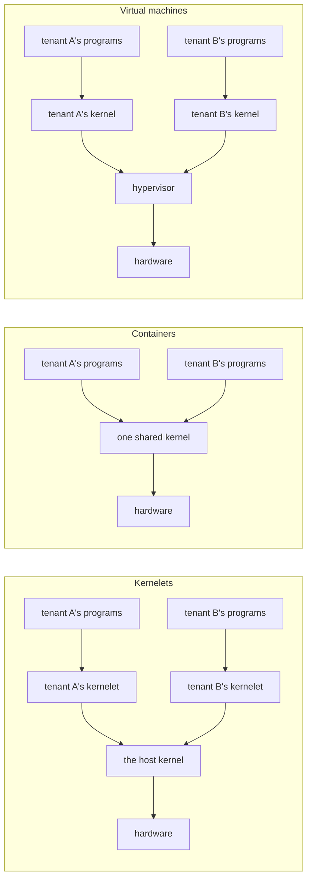

# Why a kernel of your own

A computer runs one kernel. Every program on it asks that kernel for files, memory and time through system calls, and the kernel decides. That is the picture from your operating-systems course, and it is true of the laptop in front of you.

It stops being true, or at least stops being enough, on a machine in a data center. There, one computer runs programs from many customers, called **tenants**, who do not trust each other and whom the operator does not trust either. Each tenant must be kept from reading, corrupting or starving the others. There are two established ways to do that, and this chapter introduces a third.

## Two ways to share a machine

A **virtual machine** gives each tenant a whole computer of its own, simulated. The tenant installs a kernel in it and runs programs on that kernel; a layer underneath, the *hypervisor*, shares the real machine among the simulated ones. The separation is strong, because it is the hardware's own: the processor refuses to let a guest touch anything outside its simulated machine. The price is a second layer of everything: a second kernel per tenant, a second translation of every memory address, and a trap into the hypervisor whenever a guest touches a device.

A **container** gives each tenant a slice of one kernel. The kernel is shared; what separates tenants is bookkeeping inside it, which hides one tenant's processes and files from another's. The price is nearly zero, and so is the separation's depth: every tenant can call every system call of the shared kernel, and the kernel is tens of millions of lines of C. A bug anywhere in that surface is a hole between tenants.

The third column is what this book is about. Each tenant gets a kernel of its own, as with a virtual machine. But that kernel is not a guest on simulated hardware. It is an ordinary piece of software loaded *into* the kernel that runs the machine, the **host kernel**, and it runs there in kernel mode, beside the host's own code. There is no hypervisor and no simulated hardware. Such a loaded kernel is a **kernelet**.

Put that way it sounds reckless. Code in kernel mode can do anything: read any memory, write any page table, halt the machine. Loading a tenant's kernel into the host would seem to hand the tenant the whole computer. What makes it safe is how the kernel is written.

## A kernel in two layers

Asterinas is a kernel written in Rust that runs the same programs Linux runs: it accepts Linux's system calls and executes Linux binaries. What matters here is not its compatibility but its shape. It is built as a *framekernel*, which means it is split into two layers with a hard rule between them.

- **OSTD**, the *framework*, is small. It is the only part of the kernel allowed to use Rust's `unsafe`, the keyword that permits raw memory access and machine instructions. OSTD wraps the machine, meaning page tables, tasks, interrupts, entry to user mode, in an interface that cannot be misused to corrupt memory.
- **The kernel proper** is everything else: system calls, file systems, the network stack, process and memory management. It is written entirely in *safe* Rust against OSTD's interface.

**Rust: what "safe" promises.** Rust programs are checked by the compiler for memory safety: a safe program cannot read freed memory, write past the end of an array, or turn an integer into a pointer and follow it. The escape hatch is the keyword `unsafe`, which marks a block in which the programmer takes that responsibility back. A crate (Rust's word for a library or program) can forbid the keyword outright with the attribute `#![deny(unsafe_code)]`, and then the compiler guarantees that nothing in it can corrupt memory, however wrong its logic is.

So the kernel proper can do only what OSTD's interface lets it do. It cannot forge a pointer to another tenant's memory, because safe Rust has no way to express that. It cannot execute a privileged instruction, because none of OSTD's functions do that for it. It can still have bugs, and a hostile tenant will look for them, but a bug in safe Rust can produce a wrong answer, never a corrupted page table.

Who compiles it matters. The *operator* of the machine builds the kernel proper, and refuses any crate that does not carry `#![deny(unsafe_code)]`; the tenant never hands over code to be loaded into kernel mode. What the tenant controls is its own programs, and through them which paths of the kernel proper run, with which arguments. OSTD itself, the layer that does use `unsafe`, is written and audited by the operator, like the host kernel: it is trusted, as the host is.

That is the opening.

## The same kernel, a different framework

Give the kernel proper a *different* OSTD. Keep the interface exactly the same, so that the kernel proper compiles against it without a single change, but implement it so that every operation touches only one tenant's resources, and leave out the operations a tenant must never perform, such as talking to hardware directly. The book calls that framework **vOSTD**, *virtual OSTD*, named the way a virtual CPU is named. The kernel proper, unchanged, compiled against vOSTD, is a kernelet.

Where a hypervisor virtualizes the hardware beneath a kernel, this virtualizes the programming interface the kernel is written against. The boundary is not a hardware mode but the language: what a kernelet can name is decided by what its crates export, and what it can ask of the host is a fixed list of functions that vOSTD is handed when it starts.

Nothing in that arrangement says who implements the list. The host could be Asterinas itself; in this book the host is **Linux**. An operator keeps the Linux kernel they already run, applies a small patch to it, loads one kernel module, and a tenant gets a kernel of its own, in safe Rust, inside Linux.

## The words

These are used in one sense throughout the book.

| word | meaning |
|---|---|
| **tenant** | whoever's programs run in a sandbox; assumed hostile |
| **kernelet** | one instance of the Asterinas kernel proper compiled against vOSTD, running in kernel mode inside the host kernel |
| **sandbox** | one tenant's environment: a kernelet plus the user-mode programs it serves. What a virtual machine or a container is to its tenant |
| **host kernel**, or **host** | the kernel that owns the machine. In this book, Linux |
| **endovisor** | the component of the host kernel that creates, serves and destroys kernelets. *Endo-* because it sits inside the host kernel, beside the kernelets, where a hypervisor sits beneath its guests. In this book, a Linux kernel module |
| **vOSTD** | the framework a kernelet is built on: OSTD's interface with a different implementation underneath |
| **service table** | the fixed list of host functions a kernelet may call; its only way out |
| **grant** | the physical memory a kernelet has been given |
| **virtual CPU** | one of the fixed number of processors a sandbox is given when it is created; the kernelet runs its tasks on them as a kernel runs on real processors (chapter 8) |
| **carrier** | a Linux task of a sandbox: the root carrier, which holds the sandbox together, and one carrier per virtual CPU, which stands behind it (chapter 5) |
| **kernelet runtime** | the host program that creates and configures sandboxes, as a container runtime does (chapter 5) |
| **gate** | the small change to Linux that hands a tenant's system calls to its kernelet (chapter 4) |

The last three are the Linux-specific parts of the design, and the chapters named define them in full.

## What the book builds

The Asterinas project includes a teaching example: a kernel of about a hundred lines of safe Rust that loads one user program, runs it, and serves its two system calls, `write` and `exit`. The next chapter reads it. The rest of the book makes that kernel run as a kernelet inside Linux, **with its source unchanged**, and then gives it everything a real kernel needs: its own tasks and scheduler, a timer, a way to be stopped, and a tenant address space that lives in a Linux page table.

The prototype is small: one kernelet at a time, a fixed 4 MiB of memory, no devices. It is not the Linux-compatible kernel proper with its file systems and network stack, which has not yet run on Linux. But it exercises the parts of OSTD's interface that are hardest to provide inside another kernel, and every mechanism it uses is the real one.

**Recap.** A kernelet is a tenant's own kernel, loaded into the host kernel as safe Rust code over a framework, vOSTD, that offers the same interface as the real framework but confines every operation to the tenant. The host sees a few function calls from it and a few shared records, and nothing else. Linux is the host in this book; the endovisor is the Linux module that serves kernelets.

