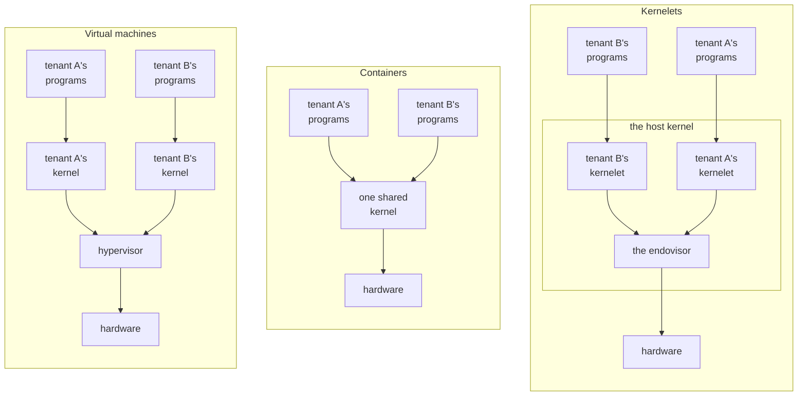

# Why a kernel of your own

A cloud provider, the **operator** of its machines, must keep its customers, called **tenants**, from reading or corrupting each other's data, or starving each other of the machine. The business is profitable only because one physical computer runs programs from many tenants. Tenants do not trust each other, and the operator trusts none of them.

There are two established ways to keep them apart. This chapter introduces a third.

## Two ways to share a machine

A **virtual machine** separates tenants strongly, at the price of a second layer of everything. It gives each tenant a whole simulated computer, in which the tenant installs a kernel and runs programs on that kernel. A layer underneath, the *hypervisor*, shares the real machine among the simulated ones. The separation is the hardware's own: the processor refuses to let a guest touch anything outside its simulated machine. The second layer is a second kernel per tenant, a second translation of every memory address (once through the guest's page table, once through the hypervisor's), and a trap into the hypervisor whenever a guest touches a device the hypervisor simulates.

A **container** costs almost nothing, but separates tenants only as deeply as the shared kernel is correct. It gives each tenant a slice of one kernel; what separates tenants is bookkeeping inside it, which hides one tenant's processes and files from another's. There is one kernel and one translation of every address, which is why it is cheap. But every tenant can call nearly every system call of the shared kernel, in practice Linux, which is built from tens of millions of lines of C, and a bug anywhere in that surface is a hole between tenants.

In each panel an arrow points from code to the layer that serves its requests; a kernelet's requests go to the endovisor, introduced below.

## A kernel inside the kernel

The third panel is the **kernelet**: a tenant's own kernel, loaded *into* the kernel that runs the machine, the **host kernel**, and run there in kernel mode beside the host's own code. Each tenant gets a kernel of its own, as with a virtual machine, but with no hypervisor and no simulated hardware: a kernelet is an ordinary piece of code that the host loads into its own memory.

A component of the host kernel, the **endovisor**, creates, serves and destroys kernelets, as a hypervisor does its guests, but from inside the host rather than beneath it.

A kernel of its own means one that no other tenant shares, not one the tenant wrote. The operator, not the tenant, compiles every kernelet. Code in kernel mode can do anything: read any memory, write any page table, halt the machine. Loading a binary a tenant supplied would hand the tenant the whole computer. So the operator builds each kernelet from source, with a compiler the operator trusts, and offers tenants a choice among those kernels.

A kernelet must keep even its own bugs inside its tenant. Compiling the kernelet does not make it correct, and the tenant's programs are hostile. A kernelet has two layers, described in the next section: a large one, the *kernel proper*, which implements the system calls the tenant's programs make and certainly has bugs, and a small one underneath it. What has to hold is that even a kernel proper that a tenant's program has taken over through such a bug cannot touch anything outside its own tenant: a bug in a kernelet should hurt only the tenant it serves. The next two sections show why the way a kernelet's source is written makes that true.

## A kernel in two layers

A kernelet's source is written the way Asterinas is: as a *framekernel*, split into two layers with a hard rule between them. Asterinas is a Rust kernel that aims to run the programs Linux runs.

- **OSTD**, the *framework*, is the small part of the kernel that may use Rust's `unsafe`. It wraps the machine (page tables, tasks, interrupts, entry to user mode) in an interface that cannot be misused to corrupt memory.
- **The kernel proper** is everything else: system calls, file systems, the network stack, process and memory management. It is written entirely in *safe* Rust against OSTD's interface, in every one of its crates.

So the kernel proper can reach the machine only through OSTD's interface. It cannot read through a forged address, because safe Rust cannot dereference one. It cannot execute a privileged instruction, because that takes inline assembly, which is `unsafe`. It can change a page table only by asking OSTD, which checks every request before carrying it out.

The libraries the kernel proper uses must not give it a way around OSTD either. Every crate from outside the kernel proper must offer no safe function that does what only `unsafe` code should, such as running a privileged instruction or handing the hardware an unchecked physical address. Rust's `core`, `alloc` and `compiler_builtins` are the exception: they contain `unsafe` code that every Rust program trusts.

Asterinas's own kernel proper does not yet keep that rule in every crate it links. Its default build pulls in a confidential-computing crate whose safe functions hand the hardware an unchecked physical address, which Asterinas's own source marks as a fault to fix, and a processor-support crate whose safe functions run privileged instructions. A kernelet build must leave both out.

This book's kernels link nothing beyond `core`, `alloc`, `compiler_builtins`, one small helper crate shared with OSTD, and vOSTD.

The kernel proper's confinement to OSTD's interface rests on a property of OSTD called **soundness**: no safe Rust code written against its interface can break memory safety, whatever that code does. Soundness is the foundation of kernelets, as the next section shows.

OSTD's soundness is argued, not proved. Its authors lay out the argument in a written soundness analysis and rely on review; research on Asterinas adds fuzzing, model checking and a verified memory-management design.

## The same kernel, a different framework

Now give the kernel proper a *different* OSTD, one that confines every request it passes to the host to one tenant's resources. It keeps the same interface, so the kernel proper needs no change at all. Underneath, most operations that would touch hardware become requests to the host, and the few that are harmless to it, such as reading the cycle counter, the framework still does itself. The book calls that framework **vOSTD**, *virtual OSTD*, as a virtual machine is a virtual computer. The kernel proper is linked with vOSTD into one image, which is what runs as a kernelet.

Whether a kernelet can corrupt the host, and through it another tenant, then comes down to four things being right: vOSTD, which is new code that uses `unsafe` as OSTD does; the `unsafe` code inside `core`, `alloc` and the library crates; the compiler; and the host's handling of each request. OSTD's soundness analysis does not carry over to vOSTD, so the chapters that build vOSTD argue its soundness piece by piece.

That covers corruption, and reads the program asks for. Side channels, by which code learns what it may not read through timing or speculative execution, are not stopped by the language; this book treats them as out of scope.

A kernelet reaches the host in only a few fixed ways, because its boundary is the language, not a hardware mode. What the kernel proper can call or refer to is only what is linked into its image: its own crates; Rust's `core`, `alloc` and `compiler_builtins`; the library crates it depends on; and vOSTD. The image calls no symbol of the host's. What vOSTD can ask of the host is a fixed list of functions, the **service table**, that it is handed when it starts. Besides those calls, vOSTD touches the host's memory only where the host hands it a place: the arguments it is started with; the memory its services hand it; a few words of the host's own; one shared record per virtual CPU (one of the fixed number of processors a kernelet is given) and per tenant address space; the tenant's page tables, which the host keeps; and the host's direct map, its mapping of all physical memory, through which vOSTD reaches the tenant's pages and must reach nothing else. The chapter on the kernelet ABI lists them.

The language confines what a kernelet can touch, not how long it holds a processor. Keeping a kernelet from starving its neighbors is the host's job: the endovisor's per-processor timer takes a processor back even from kernelet code running in kernel mode. The kernel proper can hold that off only through vOSTD's guards, which the timer overrides after about two ticks. The chapters on virtual interrupts and on sharing a processor show how.

## What the book builds

Any kernel that implements the service table and hands over those places could host kernelets; in this book the host is **Linux**. Hosting kernelets costs it a small patch, two configuration settings, and the endovisor as one kernel module. The operator rebuilds Linux 6.12 for x86-64 with the patch's option on and with vsyscall emulation off, which would otherwise let a tenant have Linux run a system call the endovisor never sees; runs it with four-level page tables and without indirect branch tracking, since the image carries no branch-target markers; and loads the module.

The book runs five small kernels as kernelets inside that Linux. Through them it exercises the hardest parts of OSTD's interface with the real Linux mechanisms. The first is a teaching example from the Asterinas project, run **with its source unchanged**: a kernel of about a hundred lines of safe Rust that runs one user program and serves its two system calls, `write` and `exit`. The other four, written for the prototype, exercise what the hundred lines do not reach: a scheduler of the kernelet's own, the host taking a processor back from kernel code, exceptions and being stopped, and a tenant address space under load.

The prototype has three limits. It runs one sandbox, one tenant's kernelet and programs, per kernel image at a time; gives each a fixed grant of 2 or 4 MiB of physical memory; and has no devices. So two sandboxes have run side by side, but their separation against each other is designed rather than demonstrated.

Its kernels and vOSTD are smaller than Asterinas's. Its vOSTD offers the part of OSTD's interface that its kernels use, plus a small instrumentation module, outside OSTD's interface, that one test kernel uses to read counters and to slow one service down. None of its kernels is Asterinas's full, Linux-compatible kernel proper, which has not yet run as a kernelet.

## The words

These are used in one sense throughout the book.

| word | meaning |
|---|---|
| **tenant** | whoever's programs run in a sandbox; assumed hostile |
| **operator** | whoever runs the machine: builds the kernelets, configures the host, and is trusted |
| **kernelet** | one instance of a kernel proper written in safe Rust against OSTD's interface (in principle Asterinas's full kernel proper; in this book, a hundred-line example kernel from the Asterinas project and four small test kernels), linked with vOSTD and running in kernel mode inside the host kernel |
| **sandbox** | one tenant's environment: a kernelet plus the user-mode programs it serves. What a virtual machine or a container is to its tenant |
| **host kernel**, or **host** | the kernel that owns the machine. In this book, Linux |
| **endovisor** | the component of the host kernel that creates, serves and destroys kernelets. *Endo-* because it sits inside the host kernel, beside the kernelets, where a hypervisor sits beneath its guests. In this book, a Linux kernel module |
| **vOSTD** | the framework inside a kernelet: OSTD's interface with a different implementation underneath |
| **service table** | the fixed list of host functions vOSTD may call; its only way to call the host |
| **grant** | the physical memory a kernelet has been given, from which it maps its tenant's pages |
| **virtual CPU** | one of the fixed number of processors a kernelet is given when it is created; the kernelet schedules its tasks on them as a kernel does on real processors (chapter 9) |
| **carrier** | a Linux task (Linux's word for a thread) that carries one of a kernelet's virtual CPUs: Linux schedules the task, and the kernelet runs its own code and the tenant's programs on it (chapters 2 and 6) |
| **kernelet runtime** | the host program that creates and configures sandboxes, as a container runtime does (chapter 2) |
| **carrier event hooks** | the two functions Linux calls for a carrier, at a system call and on the way back to user mode, which is where a carrier enters and leaves kernelet code; the core of the one small patch to Linux (chapter 5) |

A term with a chapter beside it is defined in full there.

**Recap.** A kernelet is a tenant's own kernel: a kernel proper in safe Rust, compiled by the operator, over a framework, vOSTD, that offers the same interface as the real framework but confines every request to the tenant's own resources. A bug in it should hurt only the tenant it serves. It reaches the host only through the service table and the memory the host hands it, and the host's timer, not the language, keeps it from holding a processor. Linux is the host in this book; the endovisor is the Linux module that serves kernelets.

