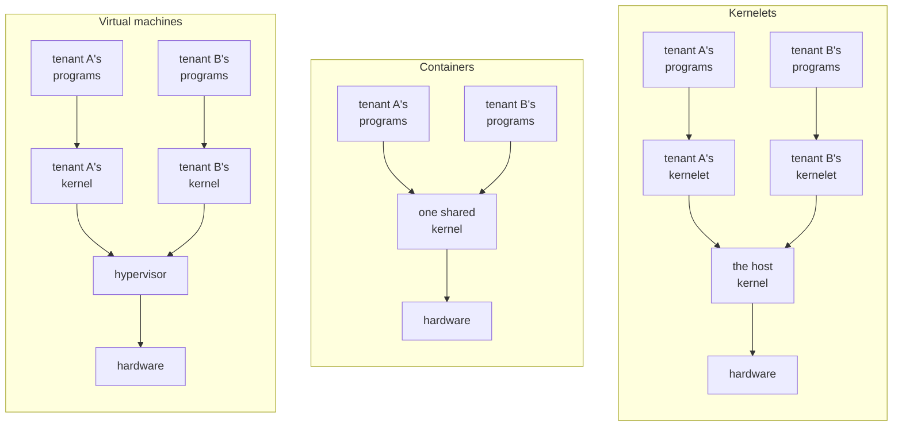

# Why a kernel of your own

A cloud provider must keep the customers who share one physical computer, called **tenants**, from reading, corrupting or starving each other. Providers rent out computers by the hour, and the business is profitable only because one computer runs programs from many tenants, who do not trust each other and whom the operator does not trust either. There are two established ways to keep them apart, and this chapter introduces a third.

## Two ways to share a machine

A **virtual machine** separates tenants strongly, at the price of a second layer of everything. It gives each tenant a whole simulated computer: the tenant installs a kernel in it and runs programs on that kernel, and a layer underneath, the *hypervisor*, shares the real machine among the simulated ones. The separation is the hardware's own: the processor refuses to let a guest touch anything outside its simulated machine. The second layer is a second kernel per tenant, a second translation of every memory address, and a trap into the hypervisor whenever a guest touches an emulated device.

A **container** costs almost nothing and separates tenants only as deeply as the shared kernel is correct. It gives each tenant a slice of one kernel; what separates tenants is bookkeeping inside it, which hides one tenant's processes and files from another's. Every tenant can call nearly every system call of the shared kernel. That kernel is built from tens of millions of lines of C, and a bug anywhere in that surface is a hole between tenants.

## A kernel inside the kernel

The third panel is the **kernelet**: a tenant's own kernel, loaded *into* the kernel that runs the machine, the **host kernel**, and run there in kernel mode beside the host's own code. Each tenant gets a kernel of its own, as with a virtual machine, but that kernel is not a guest on simulated hardware. There is no hypervisor and no simulated hardware, only an ordinary piece of loaded code.

Loading a tenant's kernel into the host sounds reckless, and two things make it safe: how the kernel is written, and who compiles it. Code in kernel mode can do anything: read any memory, write any page table, halt the machine. So the tenant never hands the host a binary. The operator builds each kernelet from safe Rust source, with a compiler the operator trusts, and the tenant chooses among the kernels the operator offers. The rest of this chapter is about the source.

## A kernel in two layers

Asterinas, a Rust kernel that aims to run the programs Linux runs, is built as a *framekernel*: it is split into two layers with a hard rule between them.

- **OSTD**, the *framework*, is the small part of the kernel that alone may use Rust's `unsafe`. It wraps the machine (page tables, tasks, interrupts, entry to user mode) in an interface that cannot be misused to corrupt memory.
- **The kernel proper** is everything else: system calls, file systems, the network stack, process and memory management. It is written entirely in *safe* Rust against OSTD's interface.

So the kernel proper can reach the machine only through OSTD's interface. It cannot read through a forged address, because safe Rust cannot dereference one. It cannot execute a privileged instruction, because that takes inline assembly, which is `unsafe`. It can change a page table only by asking OSTD, which checks every request before carrying it out. The rule reaches every crate the kernel proper is built from, so the build must exclude any library that wraps a privileged instruction in a safe function.

That limit rests on a property of OSTD called **soundness**: no safe Rust code written against its interface can break memory safety, whatever that code does. OSTD's authors argue its soundness in a published design analysis and rely on review; research on Asterinas adds fuzzing, model checking and a verified memory-management design. Soundness is the foundation of kernelets, as the next section shows.

## The same kernel, a different framework

Give the kernel proper a *different* OSTD: the same interface, implemented so that every operation touches only one tenant's resources. The interface stays exactly the same, so that the kernel proper compiles against it without a single change. Operations that would touch hardware become requests to the host. The book calls that framework **vOSTD**, *virtual OSTD*, as a virtual machine is a virtual computer. The kernel proper, unchanged, is linked with vOSTD into one image, and each running instance of that image is a kernelet.

The host is then exactly as safe as vOSTD is sound. vOSTD is new code that uses `unsafe` as OSTD does, and OSTD's design analysis does not carry over to it; the chapters that build vOSTD argue its soundness piece by piece.

Where a hypervisor virtualizes the hardware beneath a kernel, vOSTD virtualizes the programming interface the kernel is written against. The boundary is not a hardware mode but the language. What a kernelet's code can call or refer to is only what vOSTD's crates export. What it can ask of the host is a fixed list of functions, the **service table**, that vOSTD is handed when it starts. Language confines what a kernelet can touch, not how long it holds a processor; keeping a kernelet from starving its neighbors is the host's scheduler's job.

Any kernel can implement that list, and in this book the host is **Linux**. An operator rebuilds the Linux they already run with a small patch and two configuration settings, loads one kernel module, the **endovisor**, and a tenant gets a kernel of its own, the kernel proper in safe Rust over vOSTD, inside Linux.

## The words

These are used in one sense throughout the book.

| word | meaning |
|---|---|
| **tenant** | whoever's programs run in a sandbox; assumed hostile |
| **kernelet** | one instance of a kernel proper written in safe Rust against OSTD's interface (Asterinas's, or in this book a hundred-line kernel), linked with vOSTD and running in kernel mode inside the host kernel |
| **sandbox** | one tenant's environment: a kernelet plus the user-mode programs it serves. What a virtual machine or a container is to its tenant |
| **host kernel**, or **host** | the kernel that owns the machine. In this book, Linux |
| **endovisor** | the component of the host kernel that creates, serves and destroys kernelets. *Endo-* because it sits inside the host kernel, beside the kernelets, where a hypervisor sits beneath its guests. In this book, a Linux kernel module |
| **vOSTD** | the framework inside a kernelet: OSTD's interface with a different implementation underneath |
| **service table** | the fixed list of host functions vOSTD may call; its only way to call the host |
| **grant** | the physical memory a kernelet has been given, from which it maps its tenant's pages |
| **virtual CPU** | one of the fixed number of processors a kernelet is given when it is created; the kernelet schedules its tasks on them as a kernel does on real processors (chapter 9) |
| **carrier** | a Linux task that carries one of a kernelet's virtual CPUs and may run the tenant's programs (chapters 2 and 6) |
| **kernelet runtime** | the host program that creates and configures sandboxes, as a container runtime does (chapter 2) |
| **carrier event hooks** | the two functions Linux calls for a carrier, at a system call and on the way back to user mode; the core of the one small patch to Linux (chapter 5) |

The carrier event hooks are Linux's own; carrier and kernelet runtime are named here as Linux realizes them. A term with a chapter beside it is defined in full there.

## What the book builds

The book runs a teaching example from the Asterinas project as a kernelet inside Linux, **with its source unchanged**: a kernel of about a hundred lines of safe Rust that loads one user program, runs it, and serves its two system calls, `write` and `exit`. Chapter 3 reads it. The later chapters then use four more small kernels, written for the prototype, to exercise what the hundred lines do not reach: a scheduler of the kernelet's own, a timer, being stopped, and a tenant address space under load.

The prototype is small, but it exercises the hardest parts of OSTD's interface with the real Linux mechanisms. It runs one sandbox at a time, gives it a fixed 4 MiB of physical memory for its tenant, and has no devices. The kernel it runs is not Asterinas's full, Linux-compatible kernel proper with its file systems and network stack, which has not yet run on Linux; but the hardest part of hosting one, a tenant address space that the host's own page tables hold, is here in full.

**Recap.** A kernelet is a tenant's own kernel: a kernel proper in safe Rust, compiled by the operator, over a framework, vOSTD, that offers the same interface as the real framework but confines every operation to the tenant. The host sees from it only calls through the service table and a few records the endovisor chooses to share. Linux is the host in this book; the endovisor is the Linux module that serves kernelets.

